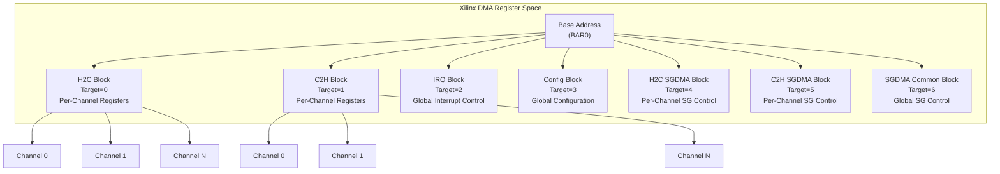
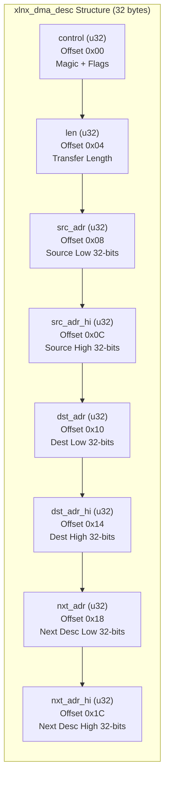
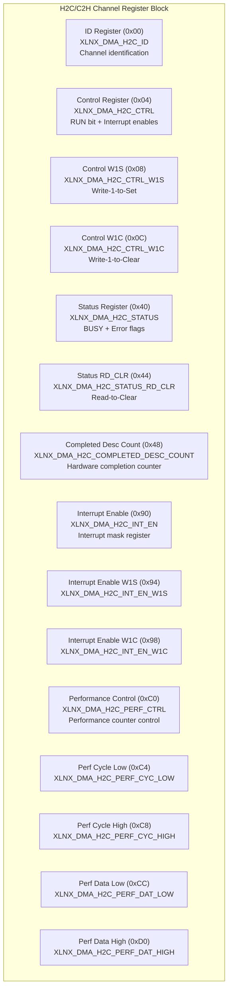
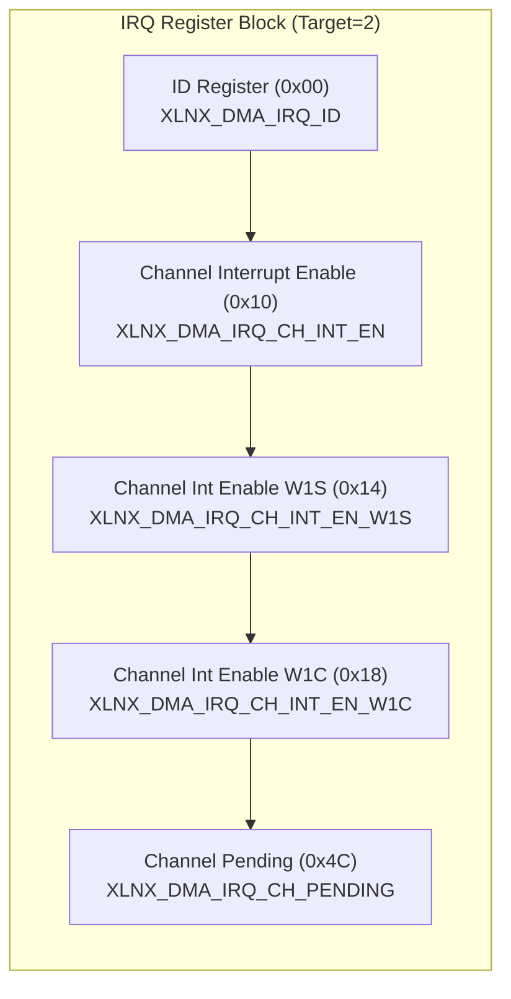
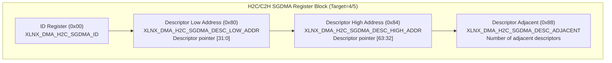
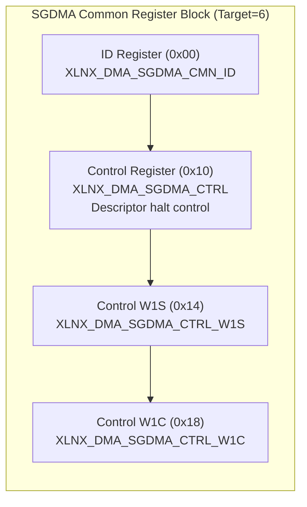
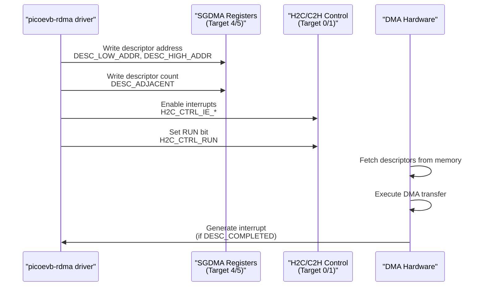
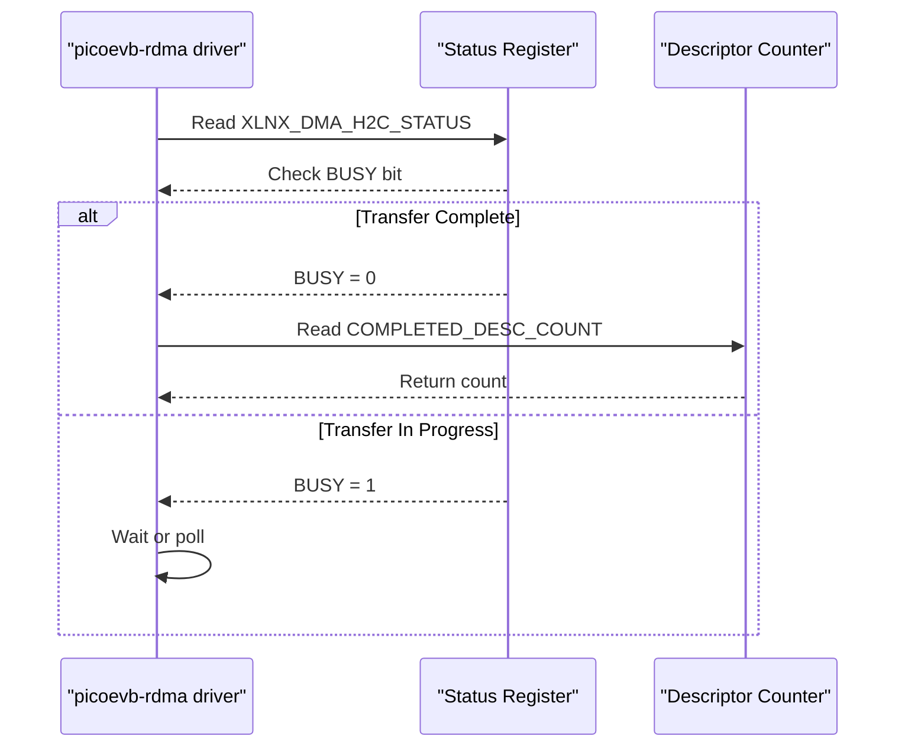
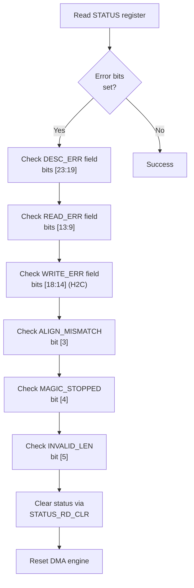

<!-- source: DeepWiki mcp.deepwiki.com · repo NVIDIA/jetson-rdma-picoevb · page 4.5 Hardware Register Interface · fetched 2026-10-26 -->

# Hardware Register Interface

<details>
<summary>Relevant source files</summary>

The following files were used as context for generating this wiki page:

- [kernel-module/picoevb-rdma.h](kernel-module/picoevb-rdma.h)

</details>


This document describes the Xilinx DMA engine hardware register interface used by the picoevb-rdma kernel module to control DMA operations on the FPGA. This is the lowest-level interface in the system, defining the memory-mapped I/O registers and DMA descriptor format.

For higher-level DMA operations and workflow, see [DMA Operations](#4.3). For the user-space API that abstracts these registers, see [IOCTL Interface](#4.2).

**Scope**: This page documents the register definitions in [kernel-module/picoevb-rdma.h](), including register offsets, bit fields, control flags, and the DMA descriptor structure. All registers are accessed via memory-mapped I/O by the kernel module.

---

## Register Address Space Organization

The Xilinx DMA engine exposes multiple register blocks, each serving a specific function. Registers are accessed using a target-based addressing scheme where the target type, channel number, and register offset are encoded into a single address.

### Address Encoding

The `XLNX_REG` macro [kernel-module/picoevb-rdma.h:49-52]() encodes register addresses as:

```
Address = (target << 12) | (channel << 8) | register_offset
```

**Register Target Types** [kernel-module/picoevb-rdma.h:41-47]():

| Target Constant | Value | Purpose |
|-----------------|-------|---------|
| `XLNX_DMA_TARGET_H2C` | 0 | Host-to-Card DMA channel registers |
| `XLNX_DMA_TARGET_C2H` | 1 | Card-to-Host DMA channel registers |
| `XLNX_DMA_TARGET_IRQ` | 2 | Interrupt control registers |
| `XLNX_DMA_TARGET_CONFIG` | 3 | Configuration registers |
| `XLNX_DMA_TARGET_H2C_SGDMA` | 4 | H2C Scatter-Gather DMA registers |
| `XLNX_DMA_TARGET_C2H_SGDMA` | 5 | C2H Scatter-Gather DMA registers |
| `XLNX_DMA_TARGET_SGDMA` | 6 | Common SGDMA registers |

### Register Space Layout



**Sources**: [kernel-module/picoevb-rdma.h:39-52]()

---

## DMA Descriptor Format

DMA transfers are controlled by descriptors stored in host memory. Each descriptor specifies a single DMA operation with source address, destination address, length, and control flags.

### Descriptor Structure

The `xlnx_dma_desc` structure [kernel-module/picoevb-rdma.h:19-28]() defines the hardware descriptor format:



### Control Field Flags

The `control` field [kernel-module/picoevb-rdma.h:29-34]() contains:

| Bit Field | Constant | Purpose |
|-----------|----------|---------|
| `[31:16]` | `XLNX_DMA_DESC_CONTROL_MAGIC` (0xad4b) | Magic number for descriptor validation |
| `[13:8]` | `XLNX_DMA_DESC_CONTROL_NEXT_ADJ` | Offset to next descriptor (in multiples of descriptor size) |
| `[4]` | `XLNX_DMA_DESC_CONTROL_EOP` | End of Packet flag |
| `[1]` | `XLNX_DMA_DESC_CONTROL_COMPLETED` | Descriptor completed (hardware sets) |
| `[0]` | `XLNX_DMA_DESC_CONTROL_STOP` | Stop DMA after this descriptor |

### Length Constraints

[kernel-module/picoevb-rdma.h:35-37]() defines transfer length limits:

| Constraint | Value | Description |
|------------|-------|-------------|
| `XLNX_DMA_DESC_LEN_MAX` | 268,435,455 bytes (256 MB - 1) | Maximum transfer length per descriptor |
| `XLNX_DMA_DESC_LEN_MAX_WORD_ALIGNED` | 268,435,452 bytes | Maximum length with 4-byte alignment |
| `XLNX_DMA_DESC_LEN_MAX_POW2_ALIGNED` | 134,217,728 bytes (128 MB) | Maximum power-of-2 aligned length |

**Sources**: [kernel-module/picoevb-rdma.h:19-37]()

---

## H2C and C2H Register Blocks

The H2C (Host-to-Card) and C2H (Card-to-Host) register blocks have nearly identical layouts. Each channel has its own set of registers for control, status, and performance monitoring.

### Register Map



### ID Register

[kernel-module/picoevb-rdma.h:56-65]() defines the ID register (`XLNX_DMA_H2C_ID` at offset 0x00):

| Bit Field | Constant | Description |
|-----------|----------|-------------|
| `[31:20]` | `XLNX_DMA_H2C_ID_SUBSYS_ID` | Subsystem ID (should be 0x1fc) |
| `[19:16]` | `XLNX_DMA_H2C_ID_TGT` | Target identifier |
| `[15]` | `XLNX_DMA_H2C_ID_AXI_STREAM` | AXI Stream mode indicator |
| `[11:8]` | `XLNX_DMA_H2C_ID_CH_ID` | Channel ID |
| `[3:0]` | `XLNX_DMA_H2C_ID_VER` | Version number |

### Control Register

[kernel-module/picoevb-rdma.h:67-84]() defines the Control register (`XLNX_DMA_H2C_CTRL` at offset 0x04):

**Control Bits**:

| Bit | Constant | Function |
|-----|----------|----------|
| `[27]` | `XLNX_DMA_H2C_CTRL_STREAM_WB_DIS` | Disable streaming writeback |
| `[26]` | `XLNX_DMA_H2C_CTRL_POLLMODE_WB_EN` | Enable poll-mode writeback |
| `[25]` | `XLNX_DMA_H2C_CTRL_NON_INC_MOD` | Non-incrementing address mode |
| `[0]` | `XLNX_DMA_H2C_CTRL_RUN` | Start/run DMA engine |

**Interrupt Enable Bits**:

| Bit Field | Constant | Description |
|-----------|----------|-------------|
| `[23:19]` | `XLNX_DMA_H2C_CTRL_IE_DESC_ERR` | Interrupt enable for descriptor errors |
| `[18:14]` | `XLNX_DMA_H2C_CTRL_IE_WRITE_ERR` | Interrupt enable for write errors (H2C only) |
| `[13:9]` | `XLNX_DMA_H2C_CTRL_IE_READ_ERR` | Interrupt enable for read errors |
| `[6]` | `XLNX_DMA_H2C_CTRL_IE_IDLE_STOPPED` | Interrupt enable for idle/stopped |
| `[5]` | `XLNX_DMA_H2C_CTRL_IE_INVALID_LEN` | Interrupt enable for invalid length |
| `[4]` | `XLNX_DMA_H2C_CTRL_IE_MAGIC_STOPPED` | Interrupt enable for magic number mismatch |
| `[3]` | `XLNX_DMA_H2C_CTRL_IE_ALIGN_MISMATCH` | Interrupt enable for alignment error |
| `[2]` | `XLNX_DMA_H2C_CTRL_IE_DESC_COMPLETED` | Interrupt enable for descriptor completion |
| `[1]` | `XLNX_DMA_H2C_CTRL_IE_DESC_STOPPED` | Interrupt enable for descriptor stopped |

**Control Register Variants**:
- `XLNX_DMA_H2C_CTRL_W1S` (0x08): Write-1-to-Set - writing 1 sets the corresponding bit
- `XLNX_DMA_H2C_CTRL_W1C` (0x0C): Write-1-to-Clear - writing 1 clears the corresponding bit

### Status Register

[kernel-module/picoevb-rdma.h:90-104]() defines the Status register (`XLNX_DMA_H2C_STATUS` at offset 0x40):

| Bit | Constant | Status Indication |
|-----|----------|-------------------|
| `[0]` | `XLNX_DMA_H2C_STATUS_BUSY` | DMA engine is busy |
| `[1]` | `XLNX_DMA_H2C_STATUS_DESC_STOPPED` | Descriptor processing stopped |
| `[2]` | `XLNX_DMA_H2C_STATUS_DESC_COMPLETED` | Descriptor completed |
| `[3]` | `XLNX_DMA_H2C_STATUS_ALIGN_MISMATCH` | Address alignment error |
| `[4]` | `XLNX_DMA_H2C_STATUS_MAGIC_STOPPED` | Invalid magic number in descriptor |
| `[5]` | `XLNX_DMA_H2C_STATUS_INVALID_LEN` | Invalid transfer length |
| `[6]` | `XLNX_DMA_H2C_STATUS_IDLE_STOPPED` | Engine idle/stopped |
| `[13:9]` | `XLNX_DMA_H2C_STATUS_READ_ERR` | Read error flags |
| `[18:14]` | `XLNX_DMA_H2C_STATUS_WRITE_ERR` | Write error flags (H2C only) |
| `[23:19]` | `XLNX_DMA_H2C_STATUS_DESC_ERR` | Descriptor error flags |

The status register can be cleared by reading `XLNX_DMA_H2C_STATUS_RD_CLR` (0x44).

### Completed Descriptor Counter

[kernel-module/picoevb-rdma.h:108]() defines `XLNX_DMA_H2C_COMPLETED_DESC_COUNT` (0x48), which tracks the number of descriptors completed by the hardware. The driver uses this to determine DMA operation completion.

### Interrupt Mask Register

[kernel-module/picoevb-rdma.h:110-123]() defines the interrupt mask register (`XLNX_DMA_H2C_INT_EN` at offset 0x90). This register has the same bit layout as the control register's interrupt enable fields but serves as a separate mask. Variants include:
- `XLNX_DMA_H2C_INT_EN_W1S` (0x94): Write-1-to-Set
- `XLNX_DMA_H2C_INT_EN_W1C` (0x98): Write-1-to-Clear

### Performance Counters

[kernel-module/picoevb-rdma.h:129-139]() defines performance monitoring registers:

| Register | Offset | Description |
|----------|--------|-------------|
| `XLNX_DMA_H2C_PERF_CTRL` | 0xC0 | Performance counter control |
| `XLNX_DMA_H2C_PERF_CYC_LOW` | 0xC4 | Cycle counter low 32-bits |
| `XLNX_DMA_H2C_PERF_CYC_HIGH` | 0xC8 | Cycle counter high 32-bits |
| `XLNX_DMA_H2C_PERF_DAT_LOW` | 0xCC | Data counter low 32-bits |
| `XLNX_DMA_H2C_PERF_DAT_HIGH` | 0xD0 | Data counter high 32-bits |

**Performance Control Flags** [kernel-module/picoevb-rdma.h:130-131]():
- `XLNX_DMA_H2C_PERF_CTRL_RUN` (bit 2): Start performance counters
- `XLNX_DMA_H2C_PERF_CTRL_AUTO_STOP` (bit 0): Auto-stop counters on completion

**Sources**: [kernel-module/picoevb-rdma.h:54-139]()

---

## IRQ Register Block

The IRQ block provides global interrupt control for all H2C and C2H channels.

### IRQ Block Registers



### ID Register

[kernel-module/picoevb-rdma.h:143-149]() defines the IRQ ID register:

| Bit Field | Constant | Description |
|-----------|----------|-------------|
| `[31:20]` | `XLNX_DMA_IRQ_ID_SUBSYS_ID` | Subsystem ID |
| `[19:16]` | `XLNX_DMA_IRQ_ID_TGT` | Target identifier (should be 2) |
| `[3:0]` | `XLNX_DMA_IRQ_ID_VER` | Version number |

### Channel Interrupt Bits

[kernel-module/picoevb-rdma.h:151-154]() defines helper macros for channel-specific interrupt bits:

- `XLNX_DMA_IRQ_CH_H2C_BIT(channel)`: Returns bit position for H2C channel interrupt
- `XLNX_DMA_IRQ_CH_C2H_BIT(channel, num_h2c)`: Returns bit position for C2H channel interrupt

The interrupt enable register (`XLNX_DMA_IRQ_CH_INT_EN` at 0x10) and pending register (`XLNX_DMA_IRQ_CH_PENDING` at 0x4C) use these bit positions to enable/check interrupts for specific channels.

**Sources**: [kernel-module/picoevb-rdma.h:141-162]()

---

## Config Register Block

The Config block contains global configuration registers.

[kernel-module/picoevb-rdma.h:164-172]() defines the Config ID register (`XLNX_DMA_CONFIG_ID` at offset 0x00):

| Bit Field | Constant | Description |
|-----------|----------|-------------|
| `[31:20]` | `XLNX_DMA_CONFIG_ID_SUBSYS_ID` | Subsystem ID (0x1fc) |
| `[19:16]` | `XLNX_DMA_CONFIG_ID_TGT` | Target identifier (should be 3) |
| `[3:0]` | `XLNX_DMA_CONFIG_ID_VER` | Version number |

**Sources**: [kernel-module/picoevb-rdma.h:164-172]()

---

## SGDMA Register Blocks

Scatter-Gather DMA (SGDMA) registers control the descriptor processing engines. There are per-channel SGDMA blocks for H2C and C2H, plus a common SGDMA control block.

### H2C/C2H SGDMA Registers



### SGDMA ID Register

[kernel-module/picoevb-rdma.h:176-185]() defines the SGDMA ID register:

| Bit Field | Constant | Description |
|-----------|----------|-------------|
| `[31:20]` | `XLNX_DMA_H2C_SGDMA_ID_SUBSYS_ID` | Subsystem ID |
| `[19:16]` | `XLNX_DMA_H2C_SGDMA_ID_TGT` | Target identifier (4 for H2C, 5 for C2H) |
| `[15]` | `XLNX_DMA_H2C_SGDMA_ID_AXI_STREAM` | AXI Stream mode |
| `[11:8]` | `XLNX_DMA_H2C_SGDMA_ID_CH_ID` | Channel ID |
| `[3:0]` | `XLNX_DMA_H2C_SGDMA_ID_VER` | Version number |

### Descriptor Address Registers

[kernel-module/picoevb-rdma.h:187-191]() defines:
- `XLNX_DMA_H2C_SGDMA_DESC_LOW_ADDR` (0x80): Low 32-bits of descriptor address
- `XLNX_DMA_H2C_SGDMA_DESC_HIGH_ADDR` (0x84): High 32-bits of descriptor address  
- `XLNX_DMA_H2C_SGDMA_DESC_ADJACENT` (0x88): Number of contiguous descriptors

The driver writes the physical address of the first DMA descriptor to these registers to initiate a transfer.

### SGDMA Common Block



### SGDMA Common ID Register

[kernel-module/picoevb-rdma.h:195-201]() defines:

| Bit Field | Constant | Description |
|-----------|----------|-------------|
| `[31:20]` | `XLNX_DMA_SGDMA_CMN_ID_SUBSYS_ID` | Subsystem ID |
| `[19:16]` | `XLNX_DMA_SGDMA_CMN_ID_TGT` | Target identifier (should be 6) |
| `[3:0]` | `XLNX_DMA_SGDMA_CMN_ID_VER` | Version number |

### SGDMA Control Register

[kernel-module/picoevb-rdma.h:203-207]() defines the SGDMA control register:

| Bit Field | Constant | Description |
|-----------|----------|-------------|
| `[19:16]` | `XLNX_DMA_SGDMA_CTRL_C2H_DSC_HALT` | C2H descriptor halt mask (per channel) |
| `[3:0]` | `XLNX_DMA_SGDMA_CTRL_H2C_DSC_HALT` | H2C descriptor halt mask (per channel) |

Setting a halt bit pauses descriptor processing for the corresponding channel.

**Sources**: [kernel-module/picoevb-rdma.h:174-211]()

---

## Register Access Patterns

The kernel module accesses these registers through the following typical sequences:

### DMA Transfer Initialization



### DMA Transfer Completion Check



### Error Handling



**Sources**: [kernel-module/picoevb-rdma.h:1-213]()

---

## Subsystem Identification

The Xilinx DMA subsystem is identified by the constant `XLNX_DMA_SUBSYS_ID` = 0x1fc [kernel-module/picoevb-rdma.h:39](). The driver verifies this ID when probing hardware to ensure it is communicating with a compatible DMA engine.

All register blocks (H2C, C2H, IRQ, Config, SGDMA) include ID registers that can be read to verify:
1. The subsystem ID matches 0x1fc
2. The target type matches the expected value
3. The version is compatible

**Sources**: [kernel-module/picoevb-rdma.h:39]()

---

## Summary

The hardware register interface provides complete control over the Xilinx DMA engine's operation:

- **DMA Descriptors**: 32-byte structures defining individual DMA operations
- **H2C/C2H Blocks**: Per-channel control, status, and performance registers
- **IRQ Block**: Global interrupt enable/status for all channels
- **SGDMA Blocks**: Scatter-gather descriptor processing control
- **Register Access**: Memory-mapped I/O with target-based addressing

The kernel module [kernel-module/picoevb-rdma.c]() uses these registers to:
1. Program DMA descriptor addresses
2. Start/stop DMA operations
3. Configure interrupts
4. Monitor transfer status
5. Handle errors
6. Measure performance

All register definitions are centralized in [kernel-module/picoevb-rdma.h]() to maintain a single source of truth for the hardware interface.

**Sources**: [kernel-module/picoevb-rdma.h:1-213]()

---

