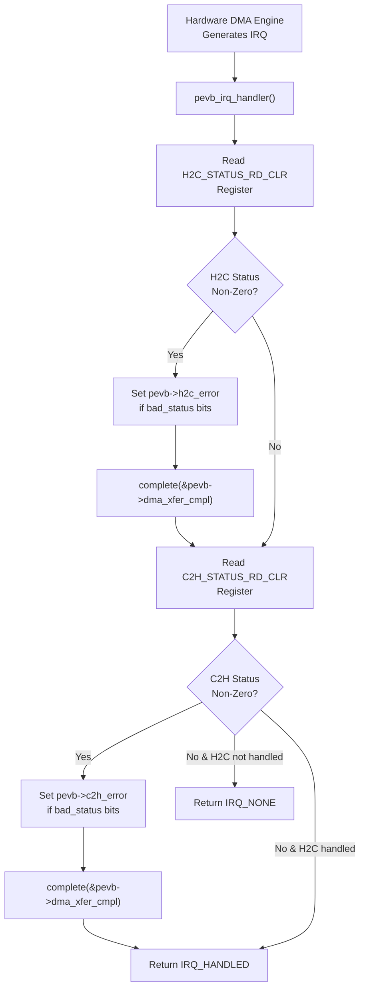
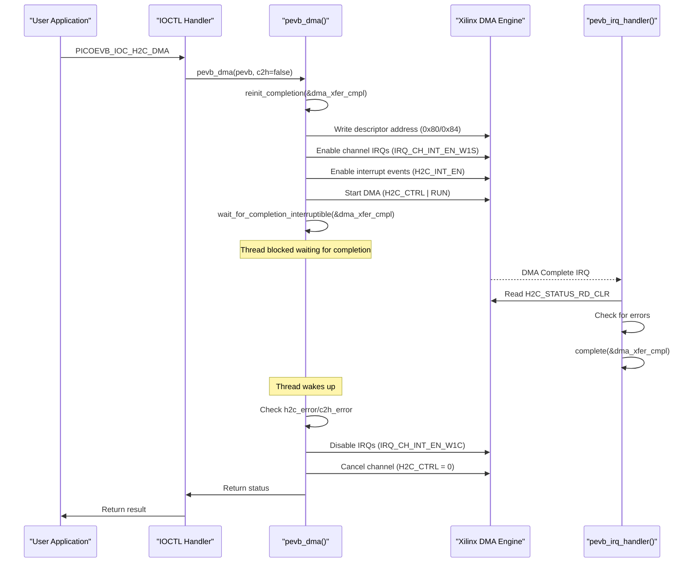
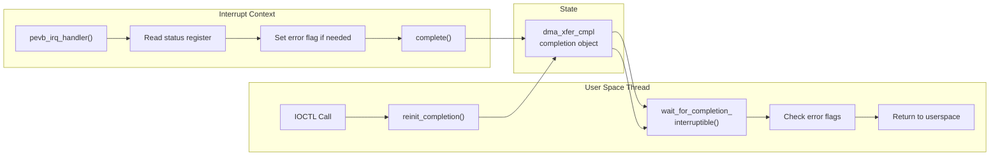

<!-- source: DeepWiki mcp.deepwiki.com · repo NVIDIA/jetson-rdma-picoevb · page 4.6 Interrupt Handling · fetched 2026-10-26 -->

# Interrupt Handling

<details>
<summary>Relevant source files</summary>

The following files were used as context for generating this wiki page:

- [kernel-module/picoevb-rdma.c](kernel-module/picoevb-rdma.c)
- [kernel-module/picoevb-rdma.h](kernel-module/picoevb-rdma.h)

</details>


## Purpose and Scope

This page documents the interrupt-driven DMA completion mechanism in the picoevb-rdma kernel module. The driver uses a shared interrupt handler to receive completion notifications from the Xilinx DMA engine for both Host-to-Card (H2C) and Card-to-Host (C2H) transfers. 

For information about the overall DMA operation flow and descriptor management, see [DMA Operations](#4.3). For details on the hardware registers accessed by the interrupt handler, see [Hardware Register Interface](#4.5).

**Sources:** [kernel-module/picoevb-rdma.c:529-677]()

---

## Interrupt Infrastructure

### Registration and Configuration

The driver registers a shared IRQ handler during PCI device probe using the legacy INTx interrupt mechanism. The handler is registered with `IRQF_SHARED` to allow interrupt line sharing with other devices.

| Component | Implementation |
|-----------|----------------|
| IRQ Handler Function | `pevb_irq_handler()` |
| Registration | `request_irq(pdev->irq, pevb_irq_handler, IRQF_SHARED, ...)` |
| Deregistration | `free_irq(pdev->irq, pevb)` in `pevb_remove()` |
| Synchronization Primitive | `struct completion dma_xfer_cmpl` |

The `struct pevb` maintains per-device interrupt state:

```c
struct pevb {
    ...
    struct completion dma_xfer_cmpl;  // DMA completion synchronization
    bool h2c_error;                    // H2C error flag
    bool c2h_error;                    // C2H error flag
    ...
};
```

**Sources:** [kernel-module/picoevb-rdma.c:51-71](), [kernel-module/picoevb-rdma.c:1138-1242]()

---

## Interrupt Handler Implementation

### IRQ Handler Flow



**Diagram: Interrupt Handler Execution Flow**

The interrupt handler `pevb_irq_handler()` checks both H2C and C2H channel status registers to determine which channel completed. The handler reads the status using the read-clear variant of the status register (`H2C_STATUS_RD_CLR`), which automatically clears the status bits upon read.

**Sources:** [kernel-module/picoevb-rdma.c:529-568]()

---

### Error Detection

The handler checks for error conditions by masking the status register against a `bad_status` bitmask:

```c
const u32 bad_status =
    (XLNX_DMA_H2C_STATUS_DESC_ERR_MASK << XLNX_DMA_H2C_STATUS_DESC_ERR_SHIFT) |
    (XLNX_DMA_H2C_STATUS_WRITE_ERR_MASK << XLNX_DMA_H2C_STATUS_WRITE_ERR_SHIFT) |
    (XLNX_DMA_H2C_STATUS_READ_ERR_MASK << XLNX_DMA_H2C_STATUS_READ_ERR_SHIFT) |
    XLNX_DMA_H2C_STATUS_IDLE_STOPPED |
    XLNX_DMA_H2C_STATUS_INVALID_LEN |
    XLNX_DMA_H2C_STATUS_MAGIC_STOPPED |
    XLNX_DMA_H2C_STATUS_ALIGN_MISMATCH;
```

If any error bits are set, the corresponding `pevb->h2c_error` or `pevb->c2h_error` flag is set before completing the transfer.

| Error Condition | Status Bit | Description |
|----------------|------------|-------------|
| Descriptor Error | `DESC_ERR` | DMA descriptor parse/fetch error |
| Write Error | `WRITE_ERR` | PCIe write error (H2C only) |
| Read Error | `READ_ERR` | PCIe read error |
| Idle Stopped | `IDLE_STOPPED` | Channel stopped while idle |
| Invalid Length | `INVALID_LEN` | Invalid transfer length |
| Magic Stopped | `MAGIC_STOPPED` | Incorrect descriptor magic number |
| Align Mismatch | `ALIGN_MISMATCH` | Address alignment violation |

**Sources:** [kernel-module/picoevb-rdma.c:534-565](), [kernel-module/picoevb-rdma.h:90-104]()

---

## DMA Operation and Interrupt Synchronization

### DMA Transfer Lifecycle with Interrupts



**Diagram: DMA Transfer Lifecycle with Interrupt Synchronization**

**Sources:** [kernel-module/picoevb-rdma.c:570-677]()

---

### Interrupt Enable/Disable Sequence

The `pevb_dma()` function manages interrupt configuration for each transfer:

**Enable Sequence (before DMA start):**

1. **Clear pending status** - Read `H2C_STATUS_RD_CLR` to clear any stale status
2. **Enable channel interrupts** - Write `0xffffffff` to `H2C_INT_EN` to enable all interrupt events
3. **Enable top-level IRQ** - Write channel bit to `IRQ_CH_INT_EN_W1S` to enable channel interrupt at the IRQ controller level
4. **Configure control register** - Set interrupt enable bits in `H2C_CTRL` for all error and completion events

**Disable Sequence (after completion or error):**

1. **Disable top-level IRQ** - Write channel bit to `IRQ_CH_INT_EN_W1C` to disable channel interrupt
2. **Disable channel interrupts** - Write `0` to `H2C_INT_EN` to disable all interrupt events
3. **Cancel descriptor fetches** - Set descriptor halt bits in `SGDMA_CTRL_W1S` then clear in `SGDMA_CTRL_W1C`
4. **Stop channel** - Write `0` to `H2C_CTRL` to stop the channel

**Sources:** [kernel-module/picoevb-rdma.c:589-661]()

---

## Channel-Specific Handling

### H2C and C2H Register Offsets

The driver handles both H2C and C2H channels using register offset calculations:

```c
if (c2h) {
    chan_offset = XLNX_REG(C2H, 0, H2C_CTRL) - XLNX_REG(H2C, 0, H2C_CTRL);
    irq_int_en_bit_offset = 
        XLNX_DMA_IRQ_CH_C2H_BIT(0, pevb->drvdata->num_h2c_chans) -
        XLNX_DMA_IRQ_CH_H2C_BIT(0);
    sgma_ctrl_bit = XLNX_DMA_SGDMA_CTRL_C2H_DSC_HALT_SHIFT;
} else {
    chan_offset = 0;
    irq_int_en_bit_offset = 0;
    sgma_ctrl_bit = XLNX_DMA_SGDMA_CTRL_H2C_DSC_HALT_SHIFT;
}
```

The same register names are used for both channels by adding `chan_offset` to the base H2C register addresses. This works because the Xilinx DMA engine uses identical register layouts for H2C and C2H channels.

| Channel | Base Register Offset | IRQ Bit Position | Halt Control Bit |
|---------|---------------------|------------------|------------------|
| H2C (channel 0) | `0x0000` | Bit 0 | Bit 0 (H2C_DSC_HALT) |
| C2H (channel 0) | `0x1000` | Bit 1 (depends on `num_h2c_chans`) | Bit 16 (C2H_DSC_HALT) |

**Sources:** [kernel-module/picoevb-rdma.c:570-587](), [kernel-module/picoevb-rdma.h:151-154]()

---

## Completion Mechanism

### Wait and Wake Semantics



**Diagram: Completion Object Synchronization Between User Thread and IRQ Handler**

The Linux `completion` API provides the synchronization primitive:

- `reinit_completion()` - Initializes the completion before starting a transfer
- `wait_for_completion_interruptible()` - Blocks the calling thread until the completion is signaled or the thread receives a signal
- `complete()` - Signals the completion from interrupt context, waking up the waiting thread

If the wait is interrupted by a signal (e.g., Ctrl+C), `wait_for_completion_interruptible()` returns `-ERESTARTSYS`, and the driver still performs cleanup operations before returning to userspace.

**Sources:** [kernel-module/picoevb-rdma.c:589-646]()

---

## Hardware Register Mapping

### Interrupt-Related Registers

| Register Name | Offset Macro | Purpose | Access |
|--------------|--------------|---------|--------|
| `H2C_STATUS_RD_CLR` | `XLNX_REG(H2C, 0, H2C_STATUS_RD_CLR)` | Read and clear H2C status | IRQ handler reads |
| `C2H_STATUS_RD_CLR` | `XLNX_REG(C2H, 0, H2C_STATUS_RD_CLR)` | Read and clear C2H status | IRQ handler reads |
| `H2C_INT_EN` | `XLNX_REG(H2C, 0, H2C_INT_EN)` | Enable H2C interrupt events | DMA setup/teardown |
| `IRQ_CH_INT_EN_W1S` | `XLNX_REG(IRQ, 0, IRQ_CH_INT_EN_W1S)` | Enable channel IRQ (write-1-set) | DMA setup |
| `IRQ_CH_INT_EN_W1C` | `XLNX_REG(IRQ, 0, IRQ_CH_INT_EN_W1C)` | Disable channel IRQ (write-1-clear) | DMA teardown |
| `H2C_CTRL` | `XLNX_REG(H2C, 0, H2C_CTRL)` | Control register with IRQ enable bits | DMA start/stop |

The `XLNX_REG()` macro generates register offsets by encoding the target block, channel number, and register within that block:

```c
#define XLNX_REG(_target_, _channel_, _reg_) \
    ((XLNX_DMA_TARGET_##_target_ << 12) | \
    ((_channel_) << 8) | \
    XLNX_DMA_##_reg_)
```

**Sources:** [kernel-module/picoevb-rdma.h:49-52](), [kernel-module/picoevb-rdma.h:90-160]()

---

## Interrupt Event Configuration

### Control Register Interrupt Enable Bits

The `H2C_CTRL` register contains interrupt enable (IE) bits for all events. The driver enables all of them:

```c
val = (XLNX_DMA_H2C_CTRL_IE_DESC_ERR_MASK << XLNX_DMA_H2C_CTRL_IE_DESC_ERR_SHIFT) |
      (XLNX_DMA_H2C_CTRL_IE_WRITE_ERR_MASK << XLNX_DMA_H2C_CTRL_IE_WRITE_ERR_SHIFT) |
      (XLNX_DMA_H2C_CTRL_IE_READ_ERR_MASK << XLNX_DMA_H2C_CTRL_IE_READ_ERR_SHIFT) |
      XLNX_DMA_H2C_CTRL_IE_IDLE_STOPPED |
      XLNX_DMA_H2C_CTRL_IE_INVALID_LEN |
      XLNX_DMA_H2C_CTRL_IE_MAGIC_STOPPED |
      XLNX_DMA_H2C_CTRL_IE_ALIGN_MISMATCH |
      XLNX_DMA_H2C_CTRL_IE_DESC_COMPLETED |
      XLNX_DMA_H2C_CTRL_IE_DESC_STOPPED |
      XLNX_DMA_H2C_CTRL_RUN;
```

These bits configure which hardware events will generate interrupts. The most important are:

- **IE_DESC_COMPLETED** - Normal completion interrupt
- **IE_DESC_STOPPED** - Descriptor processing stopped
- **Error events** - All error conditions generate interrupts for diagnosis

**Sources:** [kernel-module/picoevb-rdma.c:616-628](), [kernel-module/picoevb-rdma.h:67-84]()

---

## Error Recovery

### Error Handling Flow

When an error is detected in the interrupt handler:

1. **Error flag set** - `pevb->h2c_error` or `pevb->c2h_error` is set to `true`
2. **Completion signaled** - `complete()` is called to wake the waiting thread
3. **Thread wakes** - `wait_for_completion_interruptible()` returns 0
4. **Error checked** - The DMA function checks the error flag
5. **Cleanup** - IRQs are disabled and channel is stopped regardless of error status
6. **Error returned** - If error flag is set, `-EIO` is returned to userspace

```c
ret = wait_for_completion_interruptible(&pevb->dma_xfer_cmpl);
if (ret)
    dev_err(&pevb->pdev->dev, "DMA interrupted\n");
else {
    val = c2h ? pevb->c2h_error : pevb->h2c_error;
    if (val) {
        dev_err(&pevb->pdev->dev, "DMA failed\n");
        ret = -EIO;
    }
}
```

The driver always performs full cleanup (disabling IRQs, stopping the channel) even when errors occur, ensuring the hardware is left in a known state for subsequent operations.

**Sources:** [kernel-module/picoevb-rdma.c:636-677]()

---

## Performance Considerations

### Interrupt Latency Impact

The driver uses a single-descriptor-per-transfer model, meaning each DMA operation generates one interrupt upon completion. For large transfers that are chunked into multiple DMA operations (due to FPGA RAM size limits or IOMMU fragmentation), this can introduce interrupt latency overhead between chunks.

The code includes comments acknowledging this limitation:

```c
/*
 * FIXME: We should really generate a list of descriptors, and
 * send them to the HW all at once, to avoid IRQ latency
 * between transfers, when mulitple are needed. This is
 * possible for h2c or c2h transfers, since there's no
 * contention for FPGA RAM locations, unlike h2c2h transfers
 * where each separate transfer re-uses the RAM. However, this
 * makes no difference if the host has an IOMMU and hence
 * always presents a large contiguous mapping of the buffer.
 */
```

On systems with an IOMMU that provides large contiguous mappings, this overhead is minimized since most transfers complete in a single DMA operation.

**Sources:** [kernel-module/picoevb-rdma.c:822-831](), [kernel-module/picoevb-rdma.c:882-891]()

---

## Debug Support

### Performance Counter Access

After each DMA operation completes, the driver reads hardware performance counters for debugging:

```c
/* Dump performance counters */
reg = XLNX_REG(H2C, 0, H2C_PERF_CYC_HIGH) + chan_offset;
val = pevb_readl(pevb, BAR_DMA, reg);
dev_dbg(&pevb->pdev->dev, "CYC_HIGH 0x%08x\n", val);
// ... additional counter reads ...
```

These counters measure cycle count and data transfer metrics, useful for diagnosing performance issues. The counters are only visible in kernel debug logs when `dev_dbg()` is enabled.

**Sources:** [kernel-module/picoevb-rdma.c:662-674](), [kernel-module/picoevb-rdma.h:129-139]()

---

