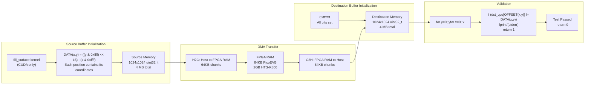
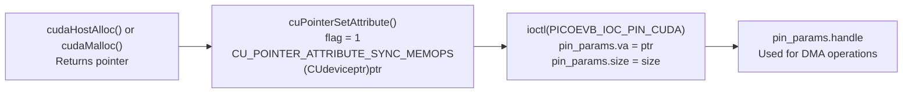
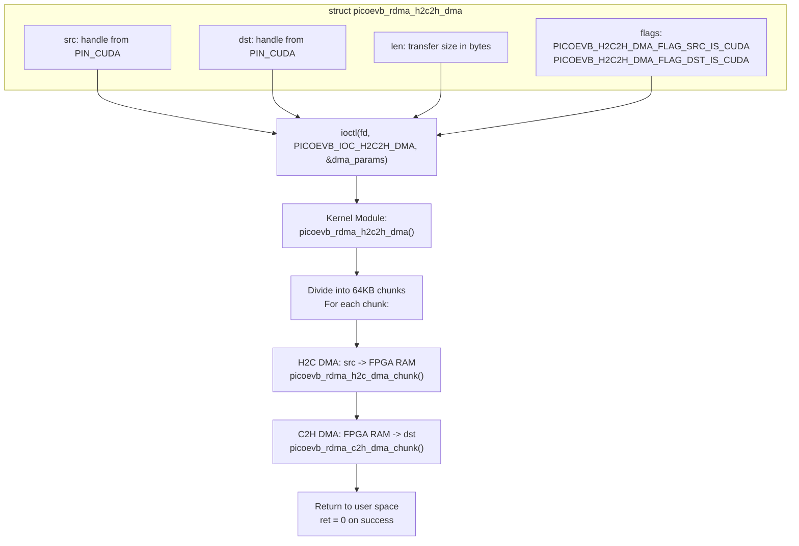

<!-- source: DeepWiki mcp.deepwiki.com · repo NVIDIA/jetson-rdma-picoevb · page 5.2 Functional Tests · fetched 2026-10-26 -->

# Functional Tests

<details>
<summary>Relevant source files</summary>

The following files were used as context for generating this wiki page:

- [README.md](README.md)
- [client-applications/rdma-cuda.cu](client-applications/rdma-cuda.cu)

</details>


The functional tests validate the correctness of DMA transfers between host memory, GPU memory, and the FPGA. These tests perform bidirectional data transfers with pattern-based validation to ensure data integrity. Two functionally identical tests are provided: `rdma-cuda` for CUDA-managed memory and `rdma-malloc` for standard host memory allocated via `malloc()`.

For performance measurement applications, see [Performance Benchmarks](#5.3). For detailed implementation of each test, see [rdma-cuda Test](#5.2.1) and [rdma-malloc Test](#5.2.2).

**Sources:** [README.md:325-360]()

## Test Overview

The functional tests validate the H2C2H (Host-to-Card-to-Host) DMA transfer pattern, which uses the FPGA's onboard RAM as an intermediate buffer. Both tests follow an identical validation approach:

1. Allocate source and destination memory buffers
2. Pin the memory for DMA access
3. Fill source buffer with a known data pattern
4. Fill destination buffer with different values
5. Execute DMA transfer via the FPGA
6. Validate that destination matches the source pattern

The tests differ only in their memory allocation APIs and whether they use NVIDIA's P2P API for memory pinning.

**Sources:** [README.md:332-340](), [client-applications/rdma-cuda.cu:52-241]()

## Test Execution Flow

```mermaid
graph TB
    START["Application Start"]
    
    OPEN["open('/dev/picoevb', O_RDWR)"]
    
    ALLOC_SRC["Allocate Source Buffer<br/>rdma-cuda: cudaHostAlloc/cudaMalloc<br/>rdma-malloc: malloc"]
    
    ALLOC_DST["Allocate Destination Buffer<br/>rdma-cuda: cudaHostAlloc/cudaMalloc<br/>rdma-malloc: malloc"]
    
    SYNC_SRC["cuPointerSetAttribute()<br/>CU_POINTER_ATTRIBUTE_SYNC_MEMOPS<br/>(CUDA only)"]
    
    SYNC_DST["cuPointerSetAttribute()<br/>CU_POINTER_ATTRIBUTE_SYNC_MEMOPS<br/>(CUDA only)"]
    
    PIN_SRC["ioctl(PICOEVB_IOC_PIN_CUDA)<br/>struct picoevb_rdma_pin_cuda<br/>Returns handle"]
    
    PIN_DST["ioctl(PICOEVB_IOC_PIN_CUDA)<br/>struct picoevb_rdma_pin_cuda<br/>Returns handle"]
    
    FILL["Fill Source: fill_surface() kernel<br/>Pattern: DATA(x,y) = (y<<16)|x<br/>Fill Dest: 0xffffffff"]
    
    SYNC["cudaDeviceSynchronize()<br/>(CUDA only)"]
    
    DMA["ioctl(PICOEVB_IOC_H2C2H_DMA)<br/>struct picoevb_rdma_h2c2h_dma<br/>Transfers via FPGA RAM"]
    
    VALIDATE["Validate Destination<br/>Compare each element<br/>to DATA(x,y)"]
    
    RESULT{"All Values<br/>Correct?"}
    
    UNPIN_DST["ioctl(PICOEVB_IOC_UNPIN_CUDA)<br/>struct picoevb_rdma_unpin_cuda"]
    
    UNPIN_SRC["ioctl(PICOEVB_IOC_UNPIN_CUDA)<br/>struct picoevb_rdma_unpin_cuda"]
    
    FREE_DST["Free Destination Buffer"]
    
    FREE_SRC["Free Source Buffer"]
    
    CLOSE["close(fd)"]
    
    SUCCESS["Exit 0<br/>Test Passed"]
    FAILURE["fprintf(stderr)<br/>Exit 1<br/>Test Failed"]
    
    START --> OPEN
    OPEN --> ALLOC_SRC
    ALLOC_SRC --> SYNC_SRC
    SYNC_SRC --> PIN_SRC
    PIN_SRC --> ALLOC_DST
    ALLOC_DST --> SYNC_DST
    SYNC_DST --> PIN_DST
    PIN_DST --> FILL
    FILL --> SYNC
    SYNC --> DMA
    DMA --> VALIDATE
    VALIDATE --> RESULT
    RESULT -->|"Pass"| UNPIN_DST
    RESULT -->|"Fail"| FAILURE
    UNPIN_DST --> FREE_DST
    FREE_DST --> UNPIN_SRC
    UNPIN_SRC --> FREE_SRC
    FREE_SRC --> CLOSE
    CLOSE --> SUCCESS
```



This diagram shows the complete test execution sequence with actual IOCTL commands and data structures used at each step. The H2C2H transfer internally divides the transfer into 64KB chunks, with each chunk first copied from host to FPGA RAM, then from FPGA RAM to destination.

**Sources:** [client-applications/rdma-cuda.cu:52-241](), [README.md:352-359]()

## Data Pattern and Validation

The functional tests use a deterministic two-dimensional data pattern for validation:



The pattern `DATA(x,y) = ((y & 0xffff) << 16) | (x & 0xffff)` encodes each pixel's coordinates into its value, making any data corruption immediately detectable during validation.

**Sources:** [client-applications/rdma-cuda.cu:41-42](), [client-applications/rdma-cuda.cu:175-188]()

## Memory Allocation Strategies

The two functional tests differ in their memory allocation approach:

| Test | Memory Allocation | Platform | API | Pinning Method |
|------|------------------|----------|-----|----------------|
| `rdma-cuda` | iGPU unified memory | Jetson/Drive AGX Xavier | `cudaHostAlloc(cudaHostAllocDefault)` | `PICOEVB_IOC_PIN_CUDA` |
| `rdma-cuda` | dGPU device memory | x86 PC with discrete GPU | `cudaMalloc()` (with `NV_BUILD_DGPU`) | `PICOEVB_IOC_PIN_CUDA` |
| `rdma-malloc` | Standard host memory | All platforms | `malloc()` | Kernel uses `get_user_pages()` |

**Sources:** [client-applications/rdma-cuda.cu:75-80](), [client-applications/rdma-cuda.cu:101-106](), [README.md:327-330]()

## CUDA Memory Synchronization

For CUDA-managed memory, the test must set the `CU_POINTER_ATTRIBUTE_SYNC_MEMOPS` attribute before pinning:



This attribute ensures that memory operations are synchronized for DMA access. Without this step, the CUDA runtime may cache data inconsistently with respect to PCIe DMA operations.

**Sources:** [client-applications/rdma-cuda.cu:86-91](), [client-applications/rdma-cuda.cu:112-117](), [README.md:335-336]()

## Transfer Parameters

The H2C2H DMA operation is configured using the `picoevb_rdma_h2c2h_dma` structure:



The flags indicate whether source and destination buffers are CUDA memory (requiring P2P API) or regular host memory (requiring `get_user_pages()`).

**Sources:** [client-applications/rdma-cuda.cu:144-149](), [kernel-module/picoevb-rdma-ioctl.h]()

## Running the Tests

The functional tests are executed from the command line without arguments:

```bash
sudo ./rdma-malloc
sudo ./rdma-cuda
```

Expected output on success (tests produce no output when passing):
- Exit code 0
- No stderr output

Expected output on failure:
- Exit code 1
- Error message: `dst[0x%x] is 0x%x not 0x%x` for each mismatched value

The tests require root privileges (or appropriate permissions on `/dev/picoevb`) to perform IOCTL operations on the kernel driver.

**Sources:** [README.md:343-347]()

## Test Surface Dimensions

Both tests use a fixed surface size defined by compile-time constants:

| Constant | Value | Purpose |
|----------|-------|---------|
| `SURFACE_W` | 1024 | Surface width in pixels |
| `SURFACE_H` | 1024 | Surface height in pixels |
| `SURFACE_SIZE` | 1,048,576 | Total pixels (W × H) |
| Transfer size | 4 MB | SURFACE_SIZE × sizeof(uint32_t) |

The CUDA kernel uses a 16×16 thread block configuration with a grid size of 64×64 blocks to fill the surface.

**Sources:** [client-applications/rdma-cuda.cu:37-39](), [client-applications/rdma-cuda.cu:127-136]()

## Test Differences Summary

| Aspect | rdma-cuda | rdma-malloc |
|--------|-----------|-------------|
| Source file | `rdma-cuda.cu` | `rdma-malloc.c` |
| Language | CUDA C++ | Standard C |
| Memory API | `cudaHostAlloc()` / `cudaMalloc()` | `malloc()` |
| Pattern fill | GPU kernel `fill_surface()` | CPU loop |
| Synchronization | `cudaDeviceSynchronize()` | Not needed |
| Memory attribute | `CU_POINTER_ATTRIBUTE_SYNC_MEMOPS` | Not applicable |
| Pinning | `PICOEVB_IOC_PIN_CUDA` | Implicit via `get_user_pages()` |
| Platform-specific | Conditional `NV_BUILD_DGPU` | Platform-agnostic |

Both tests validate the same core DMA functionality but exercise different memory subsystems and kernel driver code paths.

**Sources:** [README.md:327-330](), [client-applications/rdma-cuda.cu]()

---

