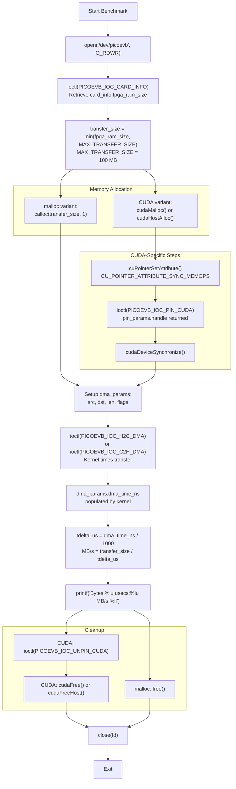
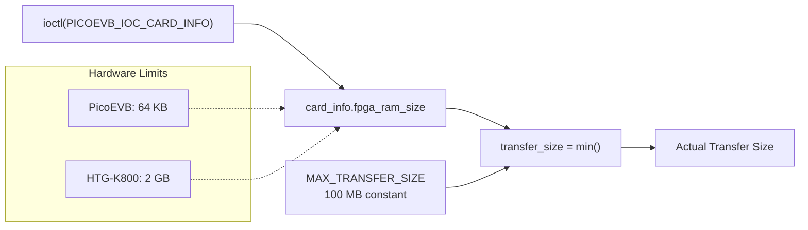
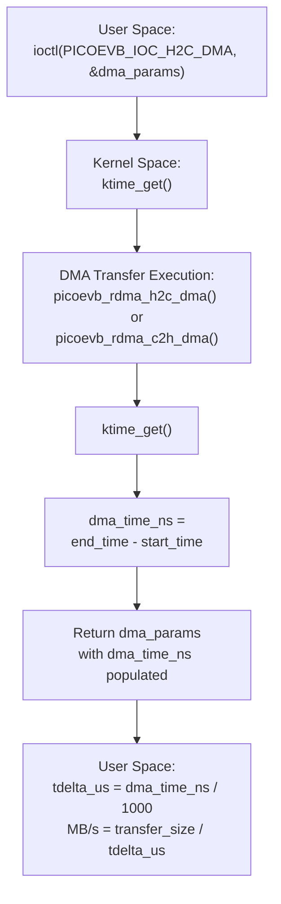
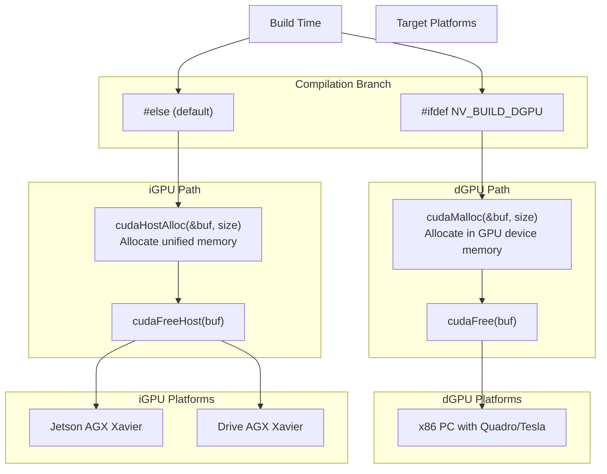
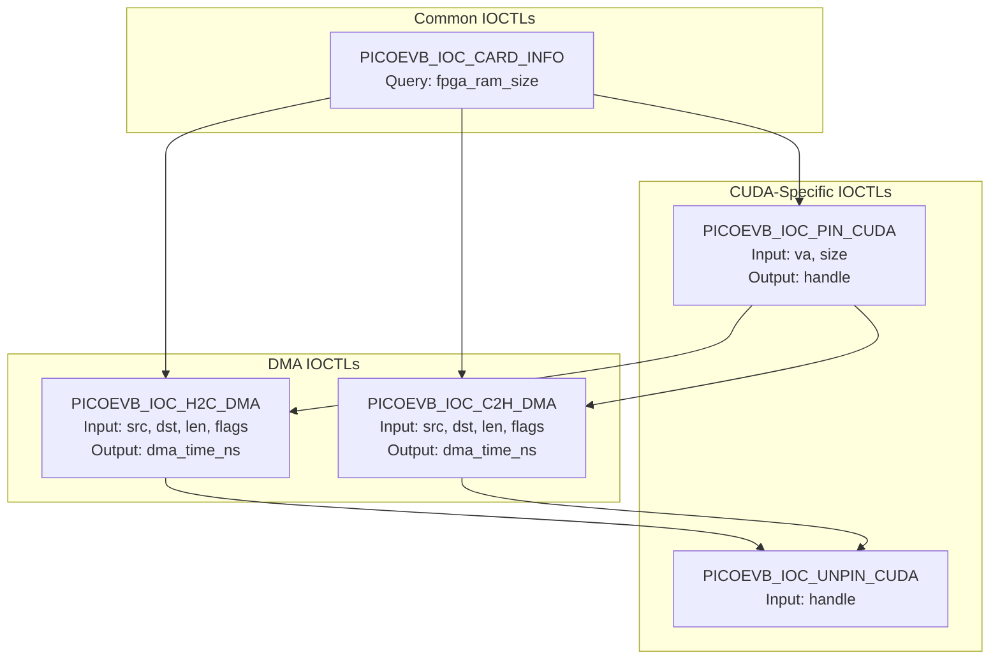

<!-- source: DeepWiki mcp.deepwiki.com · repo NVIDIA/jetson-rdma-picoevb · page 5.3 Performance Benchmarks · fetched 2026-10-26 -->

# Performance Benchmarks

<details>
<summary>Relevant source files</summary>

The following files were used as context for generating this wiki page:

- [client-applications/rdma-cuda-c2h-perf.cu](client-applications/rdma-cuda-c2h-perf.cu)
- [client-applications/rdma-cuda-h2c-perf.cu](client-applications/rdma-cuda-h2c-perf.cu)
- [client-applications/rdma-malloc-c2h-perf.c](client-applications/rdma-malloc-c2h-perf.c)
- [client-applications/rdma-malloc-h2c-perf.c](client-applications/rdma-malloc-h2c-perf.c)

</details>


This page documents the performance measurement applications that quantify DMA transfer bandwidth between host memory, FPGA RAM, and GPU memory. These applications perform single unidirectional transfers and report throughput in MB/s.

For detailed implementation of individual benchmark applications, see [CUDA Performance Tests](#5.3.1) and [Malloc Performance Tests](#5.3.2). For data integrity validation without performance measurement, see [Functional Tests](#5.2).

---

## Overview

The performance benchmark suite consists of four applications that measure unidirectional DMA bandwidth:

| Application | Direction | Memory Type | Source File |
|-------------|-----------|-------------|-------------|
| `rdma-cuda-h2c-perf` | Host-to-Card | CUDA | [client-applications/rdma-cuda-h2c-perf.cu:1-143]() |
| `rdma-cuda-c2h-perf` | Card-to-Host | CUDA | [client-applications/rdma-cuda-c2h-perf.cu:1-144]() |
| `rdma-malloc-h2c-perf` | Host-to-Card | malloc | [client-applications/rdma-malloc-h2c-perf.c:1-96]() |
| `rdma-malloc-c2h-perf` | Card-to-Host | malloc | [client-applications/rdma-malloc-c2h-perf.c:1-96]() |

All four applications use identical measurement methodology but differ in memory allocation strategy and kernel interaction patterns.

**Sources:** [client-applications/rdma-cuda-c2h-perf.cu:1-144](), [client-applications/rdma-cuda-h2c-perf.cu:1-143](), [client-applications/rdma-malloc-c2h-perf.c:1-96](), [client-applications/rdma-malloc-h2c-perf.c:1-96]()

---

## Benchmark Execution Flow



**Diagram: Benchmark Application Execution Flow**

The diagram illustrates the common execution pattern shared by all benchmark applications, highlighting the additional pinning steps required for CUDA memory transfers.

**Sources:** [client-applications/rdma-cuda-c2h-perf.cu:39-143](), [client-applications/rdma-malloc-c2h-perf.c:36-95]()

---

## Transfer Size Determination

All benchmark applications query the FPGA hardware to determine the maximum transfer size, which is limited by the FPGA's onboard RAM capacity:



**Diagram: Transfer Size Determination Logic**

The transfer size is determined by [client-applications/rdma-cuda-c2h-perf.cu:64-72]():

```c
ret = ioctl(fd, PICOEVB_IOC_CARD_INFO, &card_info);
transfer_size = card_info.fpga_ram_size;
if (transfer_size > MAX_TRANSFER_SIZE)
    transfer_size = MAX_TRANSFER_SIZE;
```

For PicoEVB with 64 KB RAM, the entire RAM is used. For HTG-K800 with 2 GB RAM, transfers are capped at 100 MB to ensure reasonable test duration.

**Sources:** [client-applications/rdma-cuda-c2h-perf.cu:64-72](), [client-applications/rdma-malloc-c2h-perf.c:56-64]()

---

## Timing Mechanism

The DMA transfer timing is performed entirely within the kernel module, eliminating user-space timing overhead:



**Diagram: Kernel-Side Timing Architecture**

The kernel module uses high-resolution timers to measure DMA duration, as seen in the `picoevb_rdma_h2c_dma` and `picoevb_rdma_c2h_dma` parameter structures defined in [kernel-module/picoevb-rdma-ioctl.h]().

**Sources:** [client-applications/rdma-cuda-c2h-perf.cu:109-117](), [client-applications/rdma-malloc-h2c-perf.c:76-84]()

---

## CUDA vs Malloc Memory Paths

The benchmark applications support two distinct memory types, requiring different kernel interactions:

| Aspect | Malloc Benchmarks | CUDA Benchmarks |
|--------|-------------------|-----------------|
| Allocation | `calloc(transfer_size, 1)` | `cudaMalloc()` or `cudaHostAlloc()` |
| Pinning Required | No (kernel calls `get_user_pages`) | Yes (`PICOEVB_IOC_PIN_CUDA` ioctl) |
| DMA Flag | `flags = 0` | `PICOEVB_H2C_DMA_FLAG_SRC_IS_CUDA` or `PICOEVB_C2H_DMA_FLAG_DST_IS_CUDA` |
| Handle Passing | Virtual address cast to `__u64` | `pin_params.handle` from pinning ioctl |
| Synchronization | Not required | `cuPointerSetAttribute()` with `CU_POINTER_ATTRIBUTE_SYNC_MEMOPS` |
| Cleanup | `free()` | `cudaFree()` or `cudaFreeHost()` after unpinning |

**Sources:** [client-applications/rdma-cuda-c2h-perf.cu:74-134](), [client-applications/rdma-malloc-c2h-perf.c:66-86]()

---

## Memory Allocation Strategy: dGPU vs iGPU

The CUDA benchmark applications use conditional compilation to support different GPU architectures:



**Diagram: Conditional Compilation for GPU Architecture**

As implemented in [client-applications/rdma-cuda-c2h-perf.cu:74-78]() and [client-applications/rdma-cuda-c2h-perf.cu:126-130]():

```c
#ifdef NV_BUILD_DGPU
    ce = cudaMalloc(&buf, transfer_size);
#else
    ce = cudaHostAlloc(&buf, transfer_size, cudaHostAllocDefault);
#endif
```

This distinction reflects fundamental architectural differences:
- **dGPU (discrete GPU)**: Separate device memory requires explicit allocation with `cudaMalloc()`
- **iGPU (integrated GPU)**: Unified memory architecture uses `cudaHostAlloc()` for DMA-accessible host memory

**Sources:** [client-applications/rdma-cuda-c2h-perf.cu:74-78](), [client-applications/rdma-cuda-c2h-perf.cu:126-130](), [client-applications/rdma-cuda-h2c-perf.cu:74-78]()

---

## Output Format and Interpretation

All benchmark applications produce identical output format to `stdout`:

```
Bytes:65536 usecs:127 MB/s:516.063
```

The output is generated by [client-applications/rdma-cuda-c2h-perf.cu:116-117]():

```c
tdelta_us = dma_params.dma_time_ns / 1000;
printf("Bytes:%lu usecs:%lu MB/s:%lf\n", transfer_size, tdelta_us, 
    (double)transfer_size / (double)tdelta_us);
```

| Field | Description | Unit |
|-------|-------------|------|
| `Bytes` | Total bytes transferred | Bytes |
| `usecs` | Transfer duration measured by kernel | Microseconds |
| `MB/s` | Calculated throughput | Megabytes per second |

The bandwidth calculation uses:
```
MB/s = (transfer_size_bytes) / (time_microseconds)
```

This produces MB/s values where 1 MB = 1,000,000 bytes (not 1,048,576 bytes).

**Sources:** [client-applications/rdma-cuda-c2h-perf.cu:116-117](), [client-applications/rdma-malloc-c2h-perf.c:83-84]()

---

## IOCTL Commands Used

The benchmark applications interact with the kernel module through specific ioctl commands:



**Diagram: IOCTL Command Dependencies**

### Command Details

**`PICOEVB_IOC_CARD_INFO`** ([client-applications/rdma-cuda-c2h-perf.cu:64-69]()):
- Returns `struct picoevb_rdma_card_info` containing `fpga_ram_size`
- Used to determine maximum transfer size

**`PICOEVB_IOC_PIN_CUDA`** ([client-applications/rdma-cuda-c2h-perf.cu:91-97]()):
- Input: `pin_params.va` (virtual address), `pin_params.size`
- Output: `pin_params.handle` for use in subsequent DMA operations
- Required only for CUDA memory transfers

**`PICOEVB_IOC_H2C_DMA`** ([client-applications/rdma-cuda-h2c-perf.cu:105-114]()):
- Input: `dma_params.src`, `dma_params.dst`, `dma_params.len`, `dma_params.flags`
- Output: `dma_params.dma_time_ns` (transfer duration in nanoseconds)
- Flag `PICOEVB_H2C_DMA_FLAG_SRC_IS_CUDA` indicates source is CUDA memory

**`PICOEVB_IOC_C2H_DMA`** ([client-applications/rdma-cuda-c2h-perf.cu:105-114]()):
- Input: `dma_params.src`, `dma_params.dst`, `dma_params.len`, `dma_params.flags`
- Output: `dma_params.dma_time_ns` (transfer duration in nanoseconds)
- Flag `PICOEVB_C2H_DMA_FLAG_DST_IS_CUDA` indicates destination is CUDA memory

**`PICOEVB_IOC_UNPIN_CUDA`** ([client-applications/rdma-cuda-c2h-perf.cu:119-124]()):
- Input: `unpin_params.handle` (from PIN_CUDA operation)
- Releases kernel-side references to CUDA memory

**Sources:** [client-applications/rdma-cuda-c2h-perf.cu:64-124](), [client-applications/rdma-malloc-h2c-perf.c:56-81]()

---

## Expected Performance Characteristics

Performance depends on multiple factors:

### Hardware Limitations

| Factor | PicoEVB | HTG-K800 |
|--------|---------|----------|
| PCIe Interface | M.2 (typically x1-x4) | PCIe x16 |
| FPGA RAM Size | 64 KB | 2 GB |
| Maximum Transfer Size | 64 KB | Limited to 100 MB in benchmarks |

### Transfer Direction Characteristics

- **H2C (Host-to-Card)**: Performance limited by PCIe write bandwidth and FPGA RAM write throughput
- **C2H (Card-to-Host)**: Performance limited by PCIe read bandwidth and FPGA RAM read throughput

### Memory Type Impact

- **Malloc memory**: Kernel uses `get_user_pages()` and `dma_map_sg()` for standard page-based DMA
- **CUDA memory**: Uses NVIDIA P2P API (`nvidia_p2p_get_pages`, `nvidia_p2p_dma_map_pages`) for GPUDirect RDMA

The CUDA path may exhibit different performance characteristics due to P2P mapping overhead and GPU memory controller behavior.

**Sources:** [client-applications/rdma-cuda-c2h-perf.cu:34-72](), [client-applications/rdma-malloc-c2h-perf.c:34-64]()

---

## Summary

The performance benchmark suite provides:

1. **Four distinct measurement tools**: H2C and C2H transfers for both CUDA and malloc memory types
2. **Kernel-based timing**: Eliminates user-space overhead from measurements
3. **Automatic sizing**: Adapts to FPGA hardware capabilities (64 KB or 2 GB RAM)
4. **Simple output format**: `Bytes:X usecs:Y MB/s:Z` for easy parsing
5. **Platform flexibility**: Conditional compilation supports both dGPU and iGPU architectures

For detailed application-specific documentation, see [CUDA Performance Tests](#5.3.1) and [Malloc Performance Tests](#5.3.2).

**Sources:** [client-applications/rdma-cuda-c2h-perf.cu:1-144](), [client-applications/rdma-cuda-h2c-perf.cu:1-143](), [client-applications/rdma-malloc-c2h-perf.c:1-96](), [client-applications/rdma-malloc-h2c-perf.c:1-96]()

---

