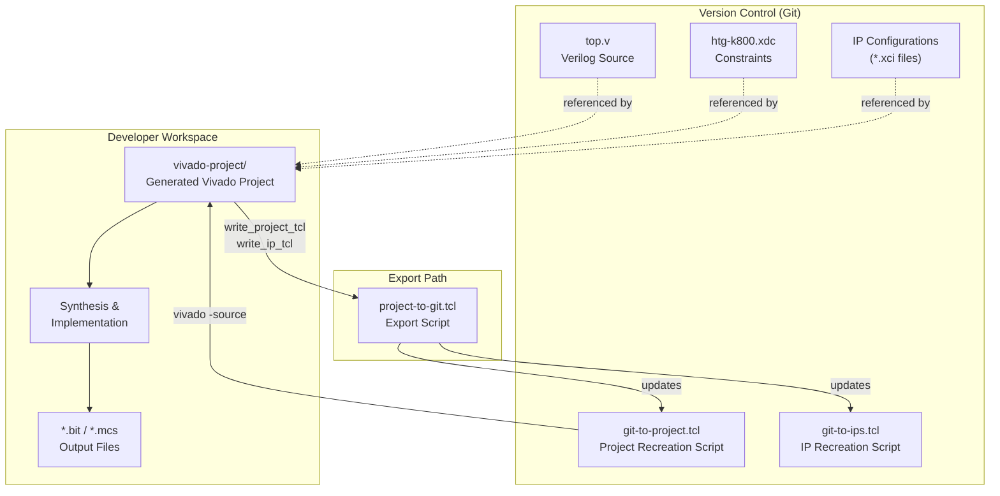
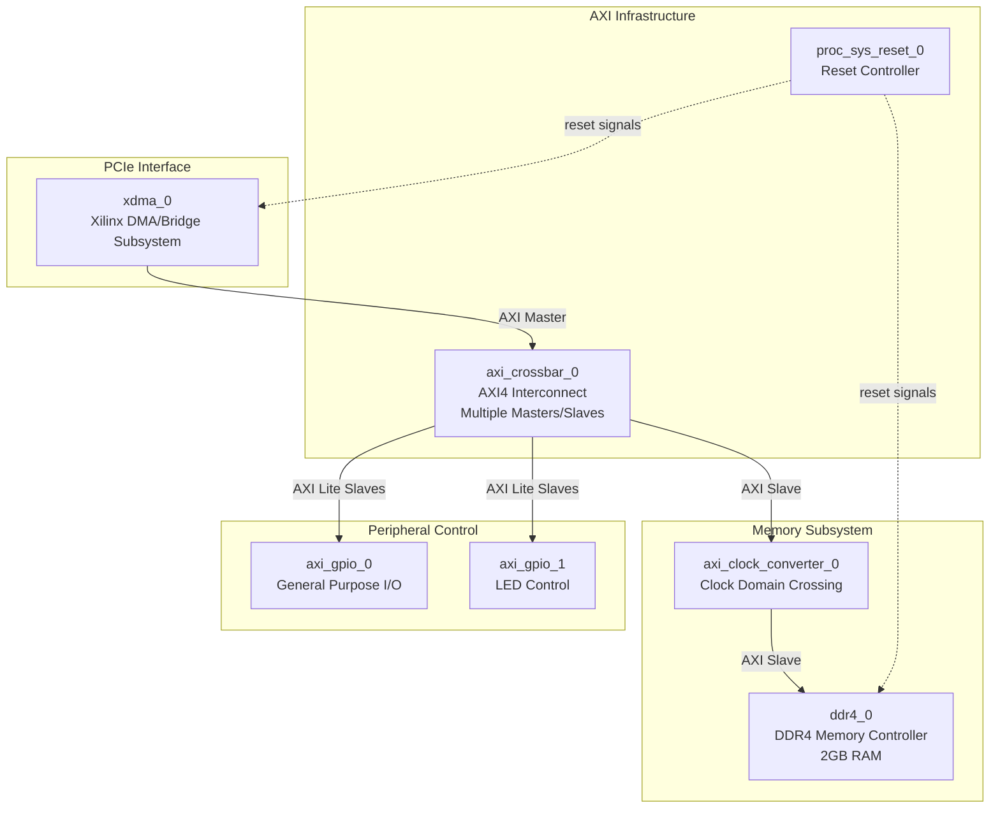

<!-- source: DeepWiki mcp.deepwiki.com · repo NVIDIA/jetson-rdma-picoevb · page 6.1 FPGA Project Structure · fetched 2026-10-26 -->

# FPGA Project Structure

<details>
<summary>Relevant source files</summary>

The following files were used as context for generating this wiki page:

- [fpga-htg-k800/git-to-project.tcl](fpga-htg-k800/git-to-project.tcl)
- [fpga-htg-k800/project-to-git.tcl](fpga-htg-k800/project-to-git.tcl)

</details>


## Purpose and Scope

This document explains how the FPGA projects for the HTG-K800 and PicoEVB boards are organized, version controlled, and integrated with Xilinx Vivado. It covers the project structure, the Tcl-based version control strategy, and the source file organization. For instructions on synthesizing bitstreams, see [Building Bitstreams](#6.2). For programming the FPGA hardware, see [Programming FPGAs](#6.3).

The FPGA project structure is designed to support reproducible builds from version control while avoiding the storage of large binary Vivado project files in Git. This is accomplished through Tcl scripts that regenerate the complete Vivado project from source files and IP configurations.

---

## Version Control Strategy

The FPGA projects use a **Tcl-based version control approach** instead of storing binary Vivado project files directly in Git. This strategy provides several benefits:

- **Compact repository**: Only source files and Tcl scripts are stored, not large binary databases
- **Diff-friendly**: Tcl scripts are text-based and can be meaningfully compared across versions
- **Reproducible**: Any developer can recreate an identical Vivado project from the scripts
- **Portable**: Projects can be recreated in different directory locations

### Workflow Overview



**Sources:** [fpga-htg-k800/git-to-project.tcl:1-427](), [fpga-htg-k800/project-to-git.tcl:1-34]()

---

## Directory Organization

The HTG-K800 FPGA project is organized in the `fpga-htg-k800/` directory with the following structure:

| Path | Type | Purpose |
|------|------|---------|
| `top.v` | Verilog Source | Top-level RTL module integrating all IP cores |
| `htg-k800.xdc` | XDC Constraints | Pin assignments, timing constraints, I/O standards |
| `git-to-project.tcl` | Tcl Script | Recreates Vivado project from version control |
| `project-to-git.tcl` | Tcl Script | Exports Vivado project back to version control |
| `git-to-ips.tcl` | Tcl Script | Recreates IP core configurations |
| `vivado-project/` | Generated Directory | Working Vivado project (not in Git) |
| `vivado-project.srcs/sources_1/ip/` | Generated Directory | IP core instance files (.xci) |

The `vivado-project/` directory and its contents are **not stored in version control**—they are regenerated from the Tcl scripts as needed.

**Sources:** [fpga-htg-k800/git-to-project.tcl:138-146](), [fpga-htg-k800/git-to-project.tcl:168-173]()

---

## Project Recreation Scripts

### git-to-project.tcl

This script recreates the complete Vivado project from version control. It is the primary entry point for developers setting up their workspace.

**Key Operations:**

1. **Project Creation** [fpga-htg-k800/git-to-project.tcl:109-110]()
   - Creates project named `vivado-project`
   - Targets FPGA part `xcku060-ffva1517-2-i` (Xilinx Kintex UltraScale+ FPGA on HTG-K800)

2. **Source File Integration** [fpga-htg-k800/git-to-project.tcl:137-147]()
   - Adds `top.v` as top-level Verilog module
   - Imports all IP core `.xci` files from the IP directory

3. **Constraints Integration** [fpga-htg-k800/git-to-project.tcl:168-173]()
   - Adds `htg-k800.xdc` constraints file
   - Sets file type to XDC

4. **Synthesis Run Configuration** [fpga-htg-k800/git-to-project.tcl:192-215]()
   - Creates `synth_1` run with default Vivado synthesis strategy
   - Configures utilization reports

5. **Implementation Run Configuration** [fpga-htg-k800/git-to-project.tcl:218-421]()
   - Creates `impl_1` run with `Performance_Explore` strategy
   - Enables physical optimization
   - Configures multiple report types (DRC, timing, power, utilization, etc.)

**Usage:**
```bash
cd fpga-htg-k800
vivado -source git-to-project.tcl
```

**Sources:** [fpga-htg-k800/git-to-project.tcl:1-427]()

### project-to-git.tcl

This script exports an existing Vivado project back to version-controllable Tcl scripts. It is run after making changes to the project in Vivado GUI.

**Key Operations:**

1. **IP Configuration Export** [fpga-htg-k800/project-to-git.tcl:22-25]()
   - Calls `write_ip_tcl` to export all IP configurations to `git-to-ips.tcl`

2. **Project Structure Export** [fpga-htg-k800/project-to-git.tcl:26-33]()
   - Calls `write_project_tcl` to export project structure to `git-to-project.tcl`
   - Uses relative paths for portability
   - Does not copy source files (references them in place)

**Usage:**
```bash
# From within Vivado Tcl Console
source ../project-to-git.tcl
```

**Sources:** [fpga-htg-k800/project-to-git.tcl:1-34]()

---

## FPGA Project Components

### Top-Level Module

The `top.v` file contains the top-level Verilog module that instantiates and interconnects all IP cores. It serves as the integration point for:

- **PCIe Interface**: Xilinx XDMA IP core
- **DDR4 Memory Controller**: For the 2GB onboard RAM
- **AXI Interconnect**: Connecting PCIe, DDR4, and GPIO peripherals
- **GPIO Controllers**: For LEDs and control signals

**Sources:** [fpga-htg-k800/git-to-project.tcl:138]()

### IP Cores

The HTG-K800 project uses the following Xilinx IP cores:



**IP Core Descriptions:**

| IP Core | File | Purpose |
|---------|------|---------|
| `xdma_0` | `vivado-project.srcs/sources_1/ip/xdma_0/xdma_0.xci` | PCIe Gen3 x16 endpoint with integrated DMA engine |
| `ddr4_0` | `vivado-project.srcs/sources_1/ip/ddr4_0/ddr4_0.xci` | DDR4 memory controller for 2GB onboard SDRAM |
| `axi_crossbar_0` | `vivado-project.srcs/sources_1/ip/axi_crossbar_0/axi_crossbar_0.xci` | AXI4 interconnect routing transactions between masters and slaves |
| `axi_clock_converter_0` | `vivado-project.srcs/sources_1/ip/axi_clock_converter_0/axi_clock_converter_0.xci` | Clock domain crossing between PCIe and DDR4 clock domains |
| `proc_sys_reset_0` | `vivado-project.srcs/sources_1/ip/proc_sys_reset_0/proc_sys_reset_0.xci` | System reset controller with synchronous reset generation |
| `axi_gpio_0` | `vivado-project.srcs/sources_1/ip/axi_gpio_0/axi_gpio_0.xci` | General purpose I/O control registers |
| `axi_gpio_1` | `vivado-project.srcs/sources_1/ip/axi_gpio_1/axi_gpio_1.xci` | LED control registers accessible from host |

**Sources:** [fpga-htg-k800/git-to-project.tcl:139-145]()

### Constraints File

The `htg-k800.xdc` constraints file defines:

- **Pin Assignments**: Maps FPGA pins to physical board signals (PCIe, DDR4, LEDs)
- **Timing Constraints**: Clock definitions and timing requirements
- **I/O Standards**: Voltage levels and drive strengths for each I/O bank
- **Physical Constraints**: Placement constraints for optimal routing

**Sources:** [fpga-htg-k800/git-to-project.tcl:168]()

---

## Vivado Project Configuration

### Target FPGA

The project targets the **Xilinx Kintex UltraScale+ XCKU060** FPGA in the FFVA1517 package with speed grade -2I (industrial temperature range).

**Part Number:** `xcku060-ffva1517-2-i`

This FPGA provides:
- 216,960 logic cells
- 432 block RAMs (75.9 Mb)
- 1,080 DSP slices
- PCIe Gen3 x16 hard IP
- DDR4 memory controller hard IP

**Sources:** [fpga-htg-k800/git-to-project.tcl:110](), [fpga-htg-k800/git-to-project.tcl:125]()

### Build Strategies

#### Synthesis Strategy

The project uses the **Vivado Synthesis Defaults** strategy for the synthesis run (`synth_1`).

Configuration:
- Standard synthesis flow
- Default optimization settings
- Utilization report generation enabled

**Sources:** [fpga-htg-k800/git-to-project.tcl:192-215]()

#### Implementation Strategy

The project uses the **Performance_Explore** strategy for implementation (`impl_1`), which optimizes for maximum performance (Fmax).

Configuration details [fpga-htg-k800/git-to-project.tcl:415-419]():
- **Optimization Directive**: `Explore` - Tries multiple optimization strategies
- **Placement Directive**: `Explore` - Explores different placement solutions
- **Physical Optimization**: Enabled with `Explore` directive
- **Routing Directive**: `Explore` - Tries advanced routing algorithms

This aggressive strategy increases build time but maximizes timing closure probability for the high-speed PCIe and DDR4 interfaces.

**Sources:** [fpga-htg-k800/git-to-project.tcl:218-421]()

### Report Generation

The implementation run is configured to generate extensive reports for analysis:

| Report Type | Step | Purpose |
|-------------|------|---------|
| DRC | `opt_design`, `route_design` | Design rule checking |
| Utilization | `place_design` | Resource usage by module |
| Timing Summary | Multiple steps | Setup/hold timing analysis |
| Power | `route_design` | Power consumption estimates |
| Methodology | `route_design` | Best practices violations |
| Clock Utilization | `route_design` | Clock resource usage |
| Bus Skew | `route_design`, `post_route_phys_opt` | Multi-bit signal timing |

These reports are automatically generated during the build process and help identify timing violations, resource constraints, and design issues.

**Sources:** [fpga-htg-k800/git-to-project.tcl:228-411]()

---

## PicoEVB Project Differences

While this document focuses on the HTG-K800 project structure, the PicoEVB board uses a similar organization with these key differences:

| Aspect | HTG-K800 | PicoEVB |
|--------|----------|---------|
| **Directory** | `fpga-htg-k800/` | `fpga-picoevb/` |
| **Vivado Version** | 2018.1 | 2018.3 |
| **FPGA Part** | `xcku060-ffva1517-2-i` | Smaller Artix-7 or similar |
| **RAM Size** | 2GB DDR4 | 64KB block RAM |
| **Form Factor** | PCIe x16 card | M.2 module |
| **IP Cores** | Includes `ddr4_0` controller | No external DRAM controller |

The version control strategy, Tcl script structure, and workflow remain identical between both projects.

**Sources:** Inferred from system architecture diagrams

---

## Workflow Summary

### Initial Setup (First Time)

1. Clone the repository
2. Navigate to `fpga-htg-k800/` directory
3. Run `vivado -source git-to-project.tcl`
4. Vivado opens with the project fully configured

### Making Changes

1. Open project in Vivado GUI
2. Modify IP configurations, source files, or constraints
3. From Vivado Tcl Console: `source ../project-to-git.tcl`
4. Commit updated `git-to-project.tcl` and `git-to-ips.tcl` to Git

### Building

1. In Vivado: Launch synthesis and implementation runs
2. Generate bitstream
3. See [Building Bitstreams](#6.2) for detailed build instructions

### Clean Rebuild

If the project becomes corrupted or you need to start fresh:

```bash
rm -rf vivado-project/
vivado -source git-to-project.tcl
```

This regenerates the entire project from scratch.

**Sources:** [fpga-htg-k800/git-to-project.tcl:1-427](), [fpga-htg-k800/project-to-git.tcl:1-34]()

---

