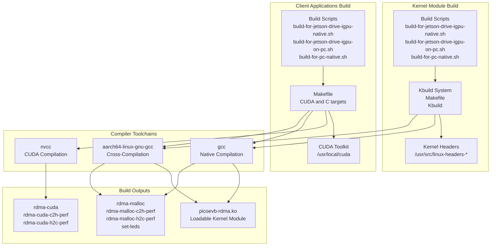
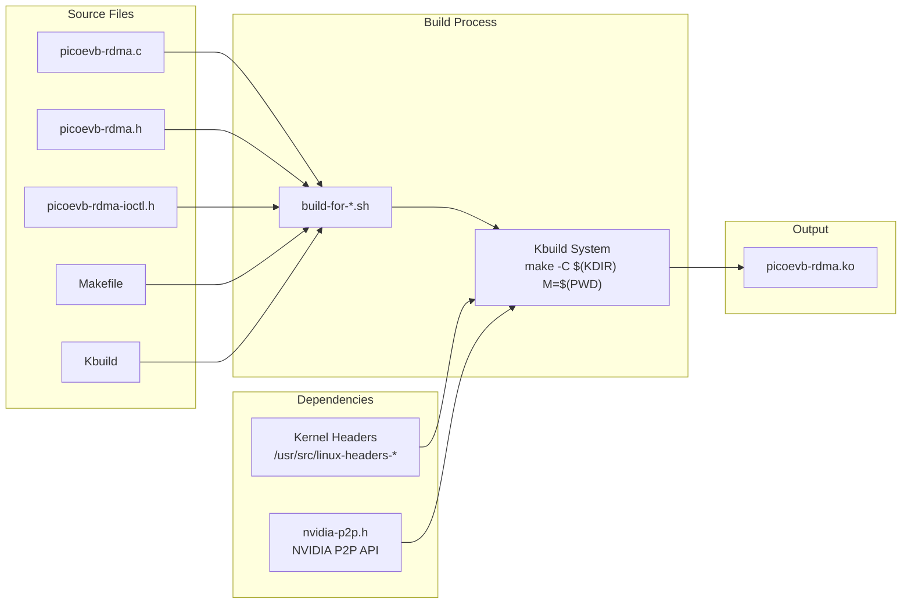
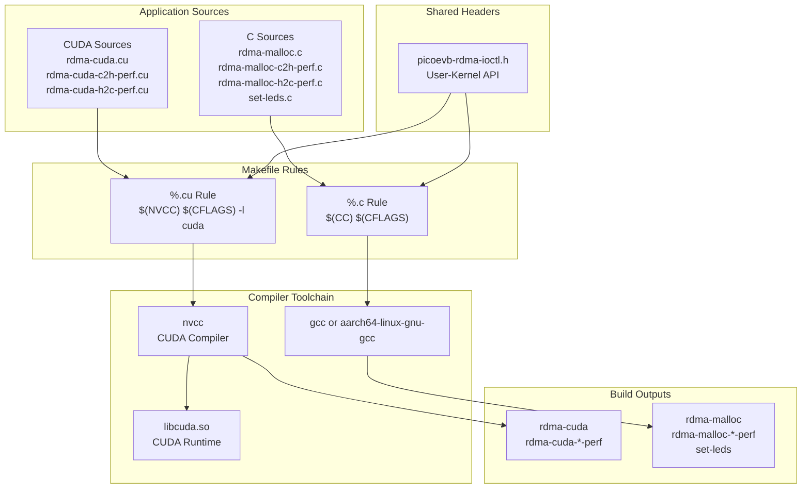
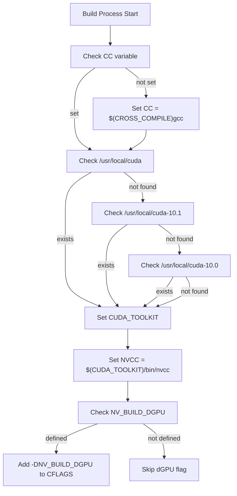

<!-- source: DeepWiki mcp.deepwiki.com · repo NVIDIA/jetson-rdma-picoevb · page 7 Building and Deployment · fetched 2026-10-26 -->

# Building and Deployment

<details>
<summary>Relevant source files</summary>

The following files were used as context for generating this wiki page:

- [README.md](README.md)
- [client-applications/Makefile](client-applications/Makefile)

</details>


This page provides comprehensive instructions for compiling and installing all system components across supported platforms. The build system supports both native and cross-compilation scenarios for the kernel module and client applications. For FPGA bitstream synthesis and programming, see [FPGA Development](#6). For post-deployment testing procedures, see [Testing and Validation](#8).

---

## Build System Overview

The jetson-rdma-picoevb system uses two independent build systems for its software components:

### Build System Architecture



**Sources**: [README.md:207-321](), [client-applications/Makefile:1-61]()

### Build Configuration Matrix

The system supports three primary build configurations:

| Configuration | Build Host | Target Platform | Compilation Type | Use Case |
|---------------|------------|-----------------|------------------|----------|
| **Jetson Native** | Jetson/Drive Xavier | Jetson/Drive Xavier | Native | Development on target device |
| **Cross-Compile** | x86 Linux PC | Jetson/Drive Xavier | Cross | Development on PC for ARM target |
| **PC Native** | x86 Linux PC | x86 Linux PC | Native | Development on PC with dGPU |

**Sources**: [README.md:211-321]()

### Key Build Variables

| Variable | Purpose | Example Value |
|----------|---------|---------------|
| `KDIR` | Path to kernel headers for module build | `/usr/src/linux-headers-4.9.140-tegra` |
| `CROSS_COMPILE` | Cross-compiler prefix | `aarch64-linux-gnu-` |
| `CUDA_TOOLKIT` | Path to CUDA installation | `/usr/local/cuda-10.1` |
| `NV_BUILD_DGPU` | Flag to enable dGPU-specific code paths | Defined for PC, undefined for Jetson/Drive |
| `CC` | C compiler | `gcc` or `aarch64-linux-gnu-gcc` |
| `NVCC` | NVIDIA CUDA compiler | `$(CUDA_TOOLKIT)/bin/nvcc` |

**Sources**: [client-applications/Makefile:21-38]()

---

## Building the Kernel Module

The kernel module `picoevb-rdma.ko` requires kernel headers matching the target system's kernel version.

### Kernel Module Build Flow



**Sources**: [README.md:211-255]()

### Native Build on Jetson/Drive AGX Xavier

This method compiles the module directly on the target ARM64 platform.

**Prerequisites:**
- `build-essential` package
- `bc` package
- Kernel headers installed in `/usr/src/`

**Build Commands:**

```bash
sudo apt update
sudo apt install build-essential bc
cd /path/to/this/project/kernel-module/
./build-for-jetson-drive-igpu-native.sh
```

The script [kernel-module/build-for-jetson-drive-igpu-native.sh]() automatically detects the running kernel version and uses the appropriate headers. Output: `picoevb-rdma.ko` in the `kernel-module/` directory.

**Sources**: [README.md:211-222]()

### Cross-Compilation on x86 PC for Jetson/Drive

This method builds the ARM64 module on an x86 development workstation.

**Prerequisites:**
- `build-essential` package
- `bc` package
- Cross-compiler toolchain: `aarch64-linux-gnu-gcc`
- L4T kernel headers for the target kernel version

**Obtaining Kernel Headers:**

Kernel headers can be obtained from:
1. `/usr/src/` on a running Jetson/Drive system
2. NVIDIA L4T or Drive downloads website
3. Extracted from L4T BSP packages

**Build Commands:**

```bash
sudo apt update
sudo apt install build-essential bc gcc-aarch64-linux-gnu
cd /path/to/this/project/kernel-module/
KDIR=/path/to/linux-headers-4.9.140-tegra-linux_x86_64/kernel-4.9/ \
  ./build-for-jetson-drive-igpu-on-pc.sh
```

The `KDIR` variable must point to the kernel module build tree containing `Makefile`, `Module.symvers`, and kernel configuration. Output: `picoevb-rdma.ko` (ARM64 binary) that must be copied to the target system.

**Sources**: [README.md:224-244]()

### Native Build on x86 Linux PC

This method builds the module for discrete GPU systems.

**Prerequisites:**
- `build-essential` package
- `bc` package
- NVIDIA driver installed with kernel headers

**Build Commands:**

```bash
sudo apt update
sudo apt install build-essential bc
cd /path/to/this/project/kernel-module/
./build-for-pc-native.sh
```

Output: `picoevb-rdma.ko` for the running x86 kernel.

**Sources**: [README.md:246-255]()

---

## Building Client Applications

Client applications include CUDA-based tests and C-based utilities. The build system handles mixed CUDA and C sources through a unified Makefile.

### Application Build Dependencies



**Sources**: [client-applications/Makefile:40-57]()

### Makefile Target List

The Makefile defines the following build targets in [client-applications/Makefile:40-47]():

| Target | Type | Source File | Description |
|--------|------|-------------|-------------|
| `rdma-cuda` | CUDA | `rdma-cuda.cu` | Functional test for CUDA memory transfers |
| `rdma-cuda-c2h-perf` | CUDA | `rdma-cuda-c2h-perf.cu` | Card-to-Host bandwidth measurement |
| `rdma-cuda-h2c-perf` | CUDA | `rdma-cuda-h2c-perf.cu` | Host-to-Card bandwidth measurement |
| `rdma-malloc` | C | `rdma-malloc.c` | Functional test for malloc'd memory |
| `rdma-malloc-c2h-perf` | C | `rdma-malloc-c2h-perf.c` | Card-to-Host bandwidth (malloc) |
| `rdma-malloc-h2c-perf` | C | `rdma-malloc-h2c-perf.c` | Host-to-Card bandwidth (malloc) |
| `set-leds` | C | `set-leds.c` | LED control utility |

**Sources**: [client-applications/Makefile:40-47]()

### Native Build on Jetson/Drive AGX Xavier

**Prerequisites:**
- `build-essential` package
- CUDA toolkit (typically pre-installed on Jetson)

**Build Commands:**

```bash
sudo apt update
sudo apt install build-essential
cd /path/to/this/project/client-applications/
./build-for-jetson-drive-igpu-native.sh
```

The build script invokes `make` with default compiler settings. The Makefile automatically detects CUDA installation paths, searching in order:
1. `/usr/local/cuda`
2. `/usr/local/cuda-10.1`
3. `/usr/local/cuda-10.0`

See [client-applications/Makefile:22-31]() for CUDA toolkit detection logic.

**Sources**: [README.md:282-292](), [client-applications/Makefile:22-31]()

### Cross-Compilation for Jetson/Drive on x86 PC

**Limitations**: The current Makefile does not fully support cross-compiling CUDA applications. Only C-based applications (`rdma-malloc*`, `set-leds`) can be cross-compiled.

**Prerequisites:**
- Cross-compiler: `aarch64-linux-gnu-gcc`
- `build-essential` package

**Build Commands:**

```bash
sudo apt update
sudo apt install build-essential gcc-aarch64-linux-gnu
cd /path/to/this/project/client-applications/
./build-for-jetson-drive-igpu-on-pc.sh
```

The script sets `CROSS_COMPILE=aarch64-linux-gnu-` before invoking `make`. You may need to adjust this variable in the build script to match your cross-compiler installation.

**Cross-Compilation Status:**
- ✅ Supported: `rdma-malloc`, `rdma-malloc-c2h-perf`, `rdma-malloc-h2c-perf`, `set-leds`
- ❌ Not Supported: `rdma-cuda`, `rdma-cuda-c2h-perf`, `rdma-cuda-h2c-perf`

**Sources**: [README.md:294-310]()

### Native Build on x86 PC with dGPU

**Prerequisites:**
- `build-essential` package
- CUDA toolkit installed (typically in `/usr/local/cuda`)
- NVIDIA driver

**Build Commands:**

```bash
sudo apt update
sudo apt install build-essential
cd /path/to/this/project/client-applications/
./build-for-pc-native.sh
```

The script sets `NV_BUILD_DGPU` preprocessor flag, which changes memory allocation strategy in CUDA applications from `cudaHostAlloc()` (unified memory for iGPU) to `cudaMalloc()` (device memory for dGPU). See [client-applications/Makefile:35-38]() for flag definition.

**Sources**: [README.md:312-321](), [client-applications/Makefile:35-38]()

### CUDA Compilation Details

CUDA applications are compiled using the pattern rule in [client-applications/Makefile:50-51]():

```makefile
%: %.cu ../kernel-module/picoevb-rdma-ioctl.h Makefile
	$(NVCC) $(addprefix -Xcompiler ,$(CFLAGS)) -o $@ $< -l cuda
```

This rule:
- Uses `nvcc` as the compiler
- Passes `CFLAGS` to the host compiler via `-Xcompiler`
- Links against `libcuda.so`
- Includes dependency on `picoevb-rdma-ioctl.h` for IOCTL definitions

**Sources**: [client-applications/Makefile:50-51]()

---

## Installation and Module Loading

### Installing Binaries

After successful compilation, binaries can be used directly from their build directories or copied to system directories.

**Recommended Installation Locations:**

| Component | Build Location | Installation Location (Optional) |
|-----------|----------------|----------------------------------|
| `picoevb-rdma.ko` | `kernel-module/` | `/lib/modules/$(uname -r)/extra/` |
| Client applications | `client-applications/` | `/usr/local/bin/` |

For module auto-loading on boot, copy to the kernel module directory and run `depmod`:

```bash
sudo mkdir -p /lib/modules/$(uname -r)/extra/
sudo cp picoevb-rdma.ko /lib/modules/$(uname -r)/extra/
sudo depmod -a
```

### Loading the Kernel Module

The module must be loaded before running any client applications.

**Manual Loading:**

```bash
cd /path/to/kernel-module/
sudo insmod ./picoevb-rdma.ko
```

**Verification:**

Check that the module is loaded and bound to the FPGA device:

```bash
lspci -v
```

Expected output excerpt from [README.md:268-278]():

```
0003:01:00.0 Memory controller: NVIDIA Corporation Device 0001
	Subsystem: NVIDIA Corporation Device 0001
	Flags: bus master, fast devsel, latency 0, IRQ 36
	Memory at 34210000 (32-bit, non-prefetchable) [size=4K]
	Memory at 34200000 (32-bit, non-prefetchable) [size=64K]
	Capabilities: <access denied>
	Kernel driver in use: picoevb-rdma
```

The critical line is `Kernel driver in use: picoevb-rdma`, confirming the module has successfully bound to the FPGA PCIe device.

**Device File:**

Upon loading, the module creates `/dev/picoevb`, which client applications use for IOCTL communication. Default permissions require root access. To allow non-root access:

```bash
sudo chmod 666 /dev/picoevb
```

**Unloading:**

```bash
sudo rmmod picoevb-rdma
```

**Sources**: [README.md:257-278]()

---

## Build System Configuration Details

### Compiler and Flag Selection Logic

The Makefile uses the following selection logic in [client-applications/Makefile:21-38]():



**Sources**: [client-applications/Makefile:21-38]()

### Platform-Specific Build Differences

| Platform | iGPU/dGPU | Memory API | Compiler Flag | Memory Model |
|----------|-----------|------------|---------------|--------------|
| Jetson AGX Xavier | iGPU | `cudaHostAlloc()` | Default | Unified memory |
| Drive AGX Xavier | iGPU | `cudaHostAlloc()` | Default | Unified memory |
| x86 PC with Quadro/Tesla | dGPU | `cudaMalloc()` | `NV_BUILD_DGPU` | Discrete device memory |

The `NV_BUILD_DGPU` flag triggers conditional compilation in CUDA test applications to use device-specific memory allocation strategies appropriate for discrete vs. integrated GPU architectures.

**Sources**: [client-applications/Makefile:35-38]()

### Dependency Tracking

Both build systems track dependencies to enable incremental rebuilds:

**Kernel Module**: The Kbuild system automatically tracks source file changes and kernel header modifications.

**Client Applications**: The Makefile explicitly declares dependencies in [client-applications/Makefile:50-57]():

```makefile
%: %.cu ../kernel-module/picoevb-rdma-ioctl.h Makefile
rdma-malloc%: rdma-malloc%.c ../kernel-module/picoevb-rdma-ioctl.h Makefile
set-leds: set-leds.c ../kernel-module/picoevb-rdma-ioctl.h Makefile
```

Changes to `picoevb-rdma-ioctl.h` trigger rebuilds of all client applications since they depend on the IOCTL interface definitions.

**Sources**: [client-applications/Makefile:50-57]()

---

## Troubleshooting Build Issues

### Common Build Problems

| Problem | Cause | Solution |
|---------|-------|----------|
| `nvidia_p2p_get_pages` undefined | Missing NVIDIA driver headers | Install NVIDIA driver and headers; verify `/usr/src/nvidia-*/nvidia-p2p.h` exists |
| `KDIR` not found | Incorrect kernel headers path | Set `KDIR` to actual kernel headers location; verify `$KDIR/Makefile` exists |
| `nvcc: command not found` | CUDA toolkit not in PATH | Install CUDA toolkit; set `CUDA_TOOLKIT` variable in Makefile |
| Cross-compile CUDA apps fail | CUDA cross-compilation unsupported | Build CUDA apps natively on target, or use remote build server |
| Module version mismatch | Kernel headers don't match running kernel | Use kernel headers matching `uname -r` output |
| `libcuda.so` not found | NVIDIA driver not installed | Install NVIDIA driver matching CUDA toolkit version |

### Verifying Build Prerequisites

**Check Kernel Headers:**
```bash
ls /usr/src/linux-headers-$(uname -r)/
```

**Check CUDA Installation:**
```bash
nvcc --version
ls -la /usr/local/cuda/bin/nvcc
```

**Check Cross-Compiler:**
```bash
aarch64-linux-gnu-gcc --version
```

**Check NVIDIA Driver:**
```bash
nvidia-smi
cat /proc/driver/nvidia/version
```

**Sources**: [README.md:211-321]()

---

