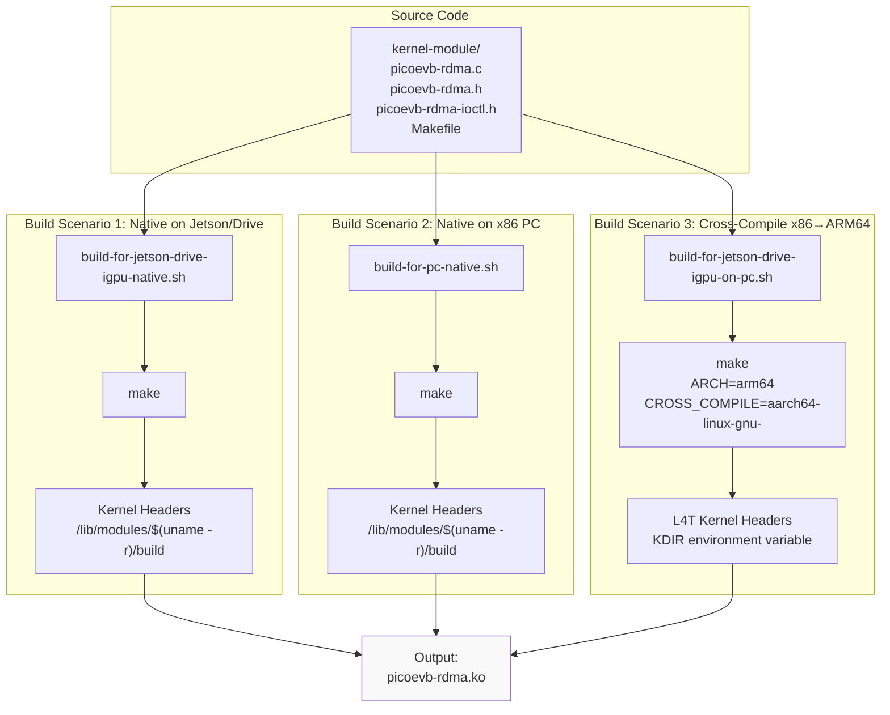
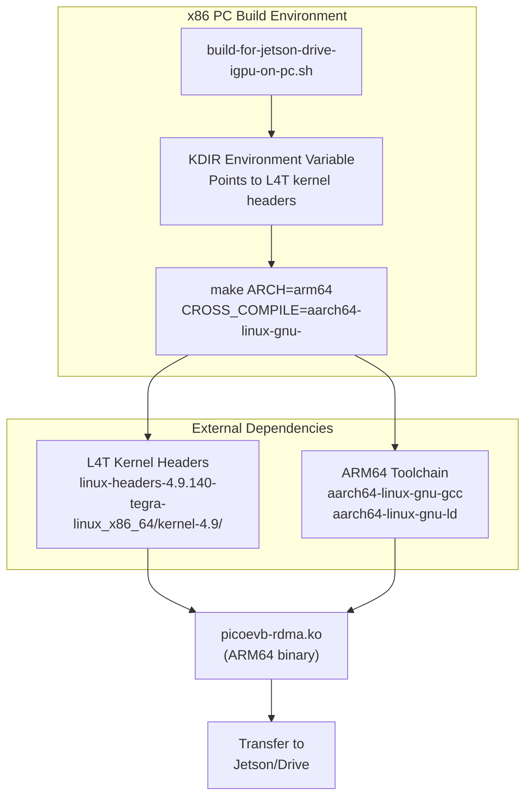

<!-- source: DeepWiki mcp.deepwiki.com · repo NVIDIA/jetson-rdma-picoevb · page 7.2 Building the Kernel Module · fetched 2026-10-26 -->

# Building the Kernel Module

<details>
<summary>Relevant source files</summary>

The following files were used as context for generating this wiki page:

- [README.md](README.md)
- [kernel-module/build-for-jetson-drive-igpu-native.sh](kernel-module/build-for-jetson-drive-igpu-native.sh)
- [kernel-module/build-for-jetson-drive-igpu-on-pc.sh](kernel-module/build-for-jetson-drive-igpu-on-pc.sh)

</details>


## Purpose and Scope

This page provides detailed instructions for compiling the `picoevb-rdma.ko` kernel module on various platforms and configurations. The kernel module is the core driver that enables GPUDirect RDMA functionality by interfacing with the PCIe hardware and NVIDIA's P2P API.

For information about the build system architecture and cross-compilation concepts, see [Build System Overview](#7.1). For instructions on loading and installing the compiled module, see [Installation and Module Loading](#7.5). For building user-space applications, see [Building Client Applications](#7.3).

**Sources:** [README.md:207-255]()

---

## Build Scenarios Overview

The kernel module supports three primary build scenarios, each using a dedicated build script wrapper around the Linux kernel build system.



**Diagram: Build Scenario Decision Tree and Script Flow**

**Sources:** [README.md:207-255](), [kernel-module/build-for-jetson-drive-igpu-native.sh:1-24](), [kernel-module/build-for-jetson-drive-igpu-on-pc.sh:1-29]()

---

## Prerequisites by Build Scenario

| Build Scenario | Platform | Required Packages | Kernel Headers Source | Cross-Compiler |
|----------------|----------|-------------------|----------------------|----------------|
| Native Jetson/Drive | ARM64 Jetson/Drive AGX Xavier | `build-essential`, `bc` | Auto-detected from running kernel | Not required |
| Native x86 PC | x86_64 PC | `build-essential`, `bc` | Auto-detected from running kernel | Not required |
| Cross-compile x86→ARM64 | x86_64 PC | `build-essential`, `bc`, `gcc-aarch64-linux-gnu` | Must provide L4T kernel headers via `KDIR` | `aarch64-linux-gnu-` |

**Table: Build Prerequisites Matrix**

**Sources:** [README.md:211-240]()

---

## Native Build on Jetson/Drive AGX Xavier

### System Requirements

- NVIDIA Jetson AGX Xavier or Drive AGX Xavier
- Linux for Tegra (L4T) kernel 4.9 or later (kernel 5.9+ requires `rel-36+` branch)
- Kernel headers installed (typically in `/lib/modules/$(uname -r)/build`)

### Build Process


**Diagram: Native Build Execution Flow on Jetson/Drive**

### Step-by-Step Instructions

1. **Install prerequisites:**
   ```bash
   sudo apt update
   sudo apt install build-essential bc
   ```

2. **Navigate to kernel module directory:**
   ```bash
   cd /path/to/jetson-rdma-picoevb/kernel-module/
   ```

3. **Execute the native build script:**
   ```bash
   ./build-for-jetson-drive-igpu-native.sh
   ```

### Build Script Details

The `build-for-jetson-drive-igpu-native.sh` script [kernel-module/build-for-jetson-drive-igpu-native.sh:23]() is a minimal wrapper that executes:

```bash
exec make
```

This invokes the Linux kernel module build system (`Kbuild`), which automatically:
- Detects kernel headers from `/lib/modules/$(uname -r)/build`
- Sets appropriate compiler flags for the running kernel version
- Compiles `picoevb-rdma.c` against kernel headers
- Links the module and produces `picoevb-rdma.ko`

**Sources:** [README.md:211-222](), [kernel-module/build-for-jetson-drive-igpu-native.sh:1-24]()

---

## Native Build on x86 PC

### System Requirements

- x86_64 Linux PC
- NVIDIA CUDA drivers installed
- Kernel headers for the running kernel

### Build Process

The native x86 build follows the same pattern as Jetson/Drive, but uses a different build script to distinguish the platform:

```bash
sudo apt update
sudo apt install build-essential bc
cd /path/to/jetson-rdma-picoevb/kernel-module/
./build-for-pc-native.sh
```

This script also executes `make` without additional parameters, relying on the kernel build system to detect the local kernel configuration.

**Sources:** [README.md:246-255]()

---

## Cross-Compilation from x86 PC to ARM64

Cross-compilation is used when building the kernel module on an x86 PC for deployment on Jetson/Drive AGX Xavier. This approach is useful for development workflows where the x86 PC has more computing resources.

### Additional Prerequisites

1. **ARM64 cross-compiler toolchain:**
   ```bash
   sudo apt install gcc-aarch64-linux-gnu
   ```

2. **L4T Kernel Headers:** Obtain the kernel headers package from:
   - The target Jetson/Drive device: `/usr/src/linux-headers-*`
   - NVIDIA L4T/Drive downloads website

### Cross-Compilation Configuration



**Diagram: Cross-Compilation Dependencies and Data Flow**

### Step-by-Step Instructions

1. **Install prerequisites:**
   ```bash
   sudo apt update
   sudo apt install build-essential bc gcc-aarch64-linux-gnu
   ```

2. **Obtain L4T kernel headers.** Example directory structure:
   ```
   /path/to/linux-headers-4.9.140-tegra-linux_x86_64/
   └── kernel-4.9/
       ├── Makefile
       ├── Module.symvers
       ├── include/
       └── ...
   ```

3. **Set KDIR environment variable:**
   ```bash
   export KDIR=/path/to/linux-headers-4.9.140-tegra-linux_x86_64/kernel-4.9/
   ```

4. **Execute the cross-compilation script:**
   ```bash
   cd /path/to/jetson-rdma-picoevb/kernel-module/
   ./build-for-jetson-drive-igpu-on-pc.sh
   ```

### Build Script Details

The cross-compilation script [kernel-module/build-for-jetson-drive-igpu-on-pc.sh:23-28]() validates the `KDIR` environment variable and invokes:

```bash
exec make ARCH=arm64 CROSS_COMPILE=aarch64-linux-gnu- KDIR="${KDIR}"
```

**Key parameters:**
- `ARCH=arm64`: Instructs the kernel build system to compile for ARM64 architecture
- `CROSS_COMPILE=aarch64-linux-gnu-`: Prefix for the cross-compiler toolchain (e.g., `aarch64-linux-gnu-gcc`)
- `KDIR="${KDIR}"`: Explicit path to kernel headers directory

The script exits with an error if `KDIR` is not set [kernel-module/build-for-jetson-drive-igpu-on-pc.sh:23-26]():

```bash
if [ -z "${KDIR}" ]; then
    echo Must set KDIR environment variable
    exit 1
fi
```

**Sources:** [README.md:224-244](), [kernel-module/build-for-jetson-drive-igpu-on-pc.sh:1-29]()

---

## Build Output and Verification

### Generated Artifacts

All build scenarios produce a single output file:

**`picoevb-rdma.ko`** - Linux kernel module (loadable kernel object)

File location: `kernel-module/picoevb-rdma.ko`

### Verifying the Build

1. **Check file exists:**
   ```bash
   ls -lh picoevb-rdma.ko
   ```

2. **Verify module architecture:**
   ```bash
   file picoevb-rdma.ko
   ```
   
   Expected output examples:
   - Native ARM64: `picoevb-rdma.ko: ELF 64-bit LSB relocatable, ARM aarch64, ...`
   - Native x86: `picoevb-rdma.ko: ELF 64-bit LSB relocatable, x86-64, ...`

3. **Check module information:**
   ```bash
   modinfo picoevb-rdma.ko
   ```
   
   Should display module metadata including filename, license, description, and vermagic string.

### Next Steps

After successfully building the kernel module:
- For installation and loading instructions, see [Installation and Module Loading](#7.5)
- For cross-compilation, transfer `picoevb-rdma.ko` to the target Jetson/Drive system
- To verify proper operation, test with client applications described in [Running Tests](#8.1)

**Sources:** [README.md:222-244](), [README.md:257-278]()

---

## Troubleshooting Build Issues

### Common Problems and Solutions

| Problem | Possible Cause | Solution |
|---------|---------------|----------|
| `make: *** No rule to make target 'modules'` | Kernel headers not installed or not found | Install kernel headers package for running kernel |
| `KDIR environment variable not set` (cross-compile) | Missing KDIR export | Set `KDIR` to point to L4T kernel headers directory |
| `aarch64-linux-gnu-gcc: command not found` | Cross-compiler not installed | Install `gcc-aarch64-linux-gnu` package |
| Module version mismatch when loading | Built against wrong kernel version | Rebuild against correct kernel headers matching target system |
| Permission denied errors | Insufficient file permissions | Check read/write permissions on build directory |

### Kernel Version Compatibility

The README [README.md:209]() notes:
> Please use rel-36+ branch for kernel 5.9+ version.

Ensure you are using the correct branch for your target kernel version. The main branch targets kernel 4.9.x series used in earlier L4T releases.

**Sources:** [README.md:207-255](), [kernel-module/build-for-jetson-drive-igpu-on-pc.sh:23-26]()

---

