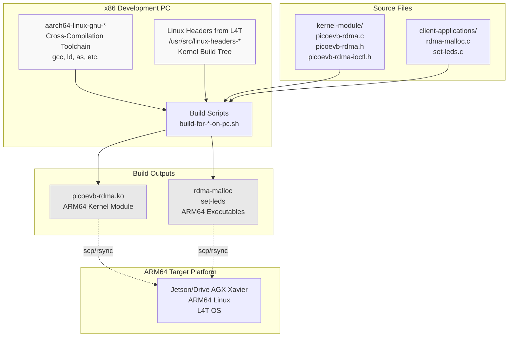
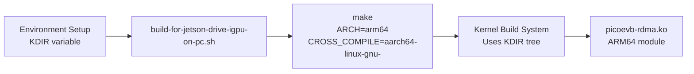
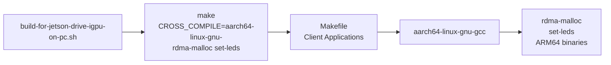
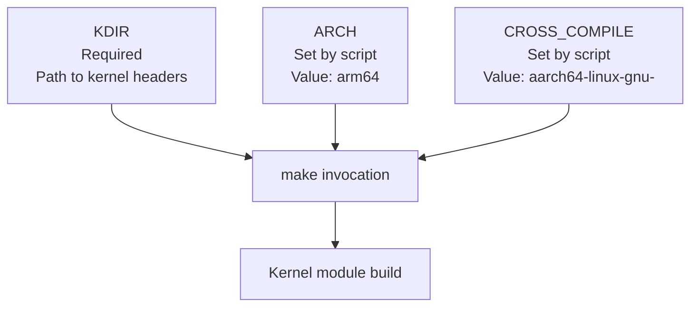

<!-- source: DeepWiki mcp.deepwiki.com · repo NVIDIA/jetson-rdma-picoevb · page 7.4 Cross-Compilation Guide · fetched 2026-10-26 -->

# Cross-Compilation Guide

<details>
<summary>Relevant source files</summary>

The following files were used as context for generating this wiki page:

- [README.md](README.md)
- [client-applications/build-for-jetson-drive-igpu-on-pc.sh](client-applications/build-for-jetson-drive-igpu-on-pc.sh)
- [kernel-module/build-for-jetson-drive-igpu-on-pc.sh](kernel-module/build-for-jetson-drive-igpu-on-pc.sh)

</details>


## Purpose and Scope

This guide covers cross-compilation of the jetson-rdma-picoevb components from an x86 Linux PC targeting ARM64 platforms (Jetson AGX Xavier and Drive AGX Xavier). Cross-compilation allows developers to build binaries on a more powerful x86 development workstation rather than on the embedded target device itself.

For native compilation directly on target platforms, see [Building the Kernel Module](#7.2) and [Building Client Applications](#7.3). For general build system architecture, see [Build System Overview](#7.1).

**Important Limitation**: CUDA-based client applications (`rdma-cuda`, `rdma-cuda-c2h-perf`, `rdma-cuda-h2c-perf`) cannot currently be cross-compiled due to CUDA toolchain constraints. Only the kernel module and non-CUDA client applications can be cross-compiled.

## Cross-Compilation Architecture



**Diagram**: Cross-compilation workflow showing x86 PC generating ARM64 binaries for deployment to Jetson/Drive platforms.

**Sources**: [README.md:224-310](), [kernel-module/build-for-jetson-drive-igpu-on-pc.sh](), [client-applications/build-for-jetson-drive-igpu-on-pc.sh]()

## Prerequisites

### Cross-Compilation Toolchain

Install the ARM64 cross-compilation toolchain on your x86 Linux PC:

```bash
sudo apt update
sudo apt install build-essential bc gcc-aarch64-linux-gnu
```

This provides the `aarch64-linux-gnu-*` toolchain used by both build scripts.

**Sources**: [README.md:235-236](), [README.md:302-303]()

### Linux Kernel Headers for L4T

For kernel module cross-compilation, you must obtain the Linux kernel headers (external module build tree) that match the kernel version running on your target Jetson/Drive platform. These headers are available from two sources:

| Source | Location | Notes |
|--------|----------|-------|
| Target device | `/usr/src/linux-headers-*-tegra-*` | Copy from installed Jetson/Drive system |
| NVIDIA downloads | L4T/Drive downloads website | Download matching L4T release package |

The headers directory contains the kernel build infrastructure needed for out-of-tree module compilation, including Makefiles, Kconfig files, and architecture-specific headers.

**Sources**: [README.md:227-230]()

### Directory Structure Example

Typical setup on the x86 development PC:

```
~/cross-compile-workspace/
├── jetson-rdma-picoevb/          # This repository
│   ├── kernel-module/
│   └── client-applications/
└── linux-headers-4.9.140-tegra-linux_x86_64/
    └── kernel-4.9/                # Kernel build tree
        ├── Makefile
        ├── Module.symvers
        ├── arch/
        ├── include/
        └── scripts/
```

**Sources**: [README.md:238-240]()

## Cross-Compiling the Kernel Module

### Build Process

The kernel module cross-compilation script wraps the kernel build system with ARM64-specific parameters:



**Diagram**: Kernel module cross-compilation flow from environment setup to ARM64 binary output.

**Sources**: [kernel-module/build-for-jetson-drive-igpu-on-pc.sh]()

### Execution Steps

1. **Navigate to kernel module directory**:
   ```bash
   cd /path/to/jetson-rdma-picoevb/kernel-module/
   ```

2. **Set the KDIR environment variable** pointing to your kernel headers:
   ```bash
   export KDIR=/path/to/linux-headers-4.9.140-tegra-linux_x86_64/kernel-4.9/
   ```

3. **Execute the build script**:
   ```bash
   ./build-for-jetson-drive-igpu-on-pc.sh
   ```

The script performs the following operations [kernel-module/build-for-jetson-drive-igpu-on-pc.sh:23-28]():
- Validates that `KDIR` is set
- Invokes `make` with `ARCH=arm64` to target ARM64 architecture
- Sets `CROSS_COMPILE=aarch64-linux-gnu-` to use the cross-compiler
- Passes `KDIR` to the kernel build system

### Build Script Parameters

| Parameter | Value | Purpose |
|-----------|-------|---------|
| `ARCH` | `arm64` | Target architecture specification |
| `CROSS_COMPILE` | `aarch64-linux-gnu-` | Toolchain prefix for all build tools |
| `KDIR` | `/path/to/headers` | Kernel build tree location |

The `CROSS_COMPILE` prefix is automatically prepended to all build tool invocations (gcc, ld, ar, etc.), resulting in invocations like `aarch64-linux-gnu-gcc` instead of `gcc`.

**Sources**: [kernel-module/build-for-jetson-drive-igpu-on-pc.sh:28]()

### Output Artifact

Successful compilation produces:
- **File**: `picoevb-rdma.ko`
- **Architecture**: ARM64 (aarch64)
- **Location**: `kernel-module/picoevb-rdma.ko`

Verify the architecture using `file`:
```bash
$ file picoevb-rdma.ko
picoevb-rdma.ko: ELF 64-bit LSB relocatable, ARM aarch64, version 1 (SYSV), BuildID[sha1]=..., not stripped
```

**Sources**: [README.md:242-244](), [kernel-module/build-for-jetson-drive-igpu-on-pc.sh]()

## Cross-Compiling Client Applications

### Supported Applications

The client applications cross-compilation has limited support. Only non-CUDA applications can be cross-compiled:

| Application | Cross-Compile Support | Reason |
|-------------|----------------------|--------|
| `rdma-malloc` | ✓ Supported | Pure C code with no CUDA dependencies |
| `set-leds` | ✓ Supported | Pure C code for GPIO control |
| `rdma-cuda` | ✗ Not supported | Requires CUDA runtime and nvcc cross-compilation |
| `rdma-cuda-*-perf` | ✗ Not supported | CUDA applications |
| `rdma-malloc-*-perf` | ✗ Not supported | Not configured in build script |

The limitation stems from CUDA's `nvcc` compiler not being configured for cross-compilation in the current Makefile.

**Sources**: [README.md:296-298](), [client-applications/build-for-jetson-drive-igpu-on-pc.sh:23]()

### Build Process



**Diagram**: Client applications cross-compilation using standard Makefile with cross-compiler override.

**Sources**: [client-applications/build-for-jetson-drive-igpu-on-pc.sh]()

### Execution Steps

1. **Navigate to client applications directory**:
   ```bash
   cd /path/to/jetson-rdma-picoevb/client-applications/
   ```

2. **Execute the build script**:
   ```bash
   ./build-for-jetson-drive-igpu-on-pc.sh
   ```

The script [client-applications/build-for-jetson-drive-igpu-on-pc.sh:23]() executes:
```bash
make CROSS_COMPILE=aarch64-linux-gnu- rdma-malloc set-leds
```

This invokes the Makefile with explicit targets, overriding the default compiler with the cross-compilation toolchain.

**Sources**: [README.md:302-306](), [client-applications/build-for-jetson-drive-igpu-on-pc.sh]()

### Customizing the Cross-Compiler

If your x86 PC uses a different cross-compiler prefix, modify the `CROSS_COMPILE` variable in [client-applications/build-for-jetson-drive-igpu-on-pc.sh:23]():

```bash
# Default:
exec make CROSS_COMPILE=aarch64-linux-gnu- rdma-malloc set-leds

# Alternative toolchain example:
exec make CROSS_COMPILE=aarch64-unknown-linux-gnu- rdma-malloc set-leds
```

Common alternative prefixes include:
- `aarch64-unknown-linux-gnu-`
- `aarch64-linux-`
- `aarch64-none-linux-gnu-`

**Sources**: [README.md:308-310]()

### Output Artifacts

Successful compilation produces:
- **Files**: `rdma-malloc`, `set-leds`
- **Architecture**: ARM64 (aarch64)
- **Location**: `client-applications/rdma-malloc`, `client-applications/set-leds`

Verify architecture:
```bash
$ file rdma-malloc set-leds
rdma-malloc: ELF 64-bit LSB executable, ARM aarch64, version 1 (SYSV), dynamically linked, ...
set-leds:    ELF 64-bit LSB executable, ARM aarch64, version 1 (SYSV), dynamically linked, ...
```

**Sources**: [client-applications/build-for-jetson-drive-igpu-on-pc.sh]()

## Transferring Files to Target

### File Transfer Methods

Cross-compiled binaries must be transferred from the x86 development PC to the target ARM64 platform:

| Method | Command Example | Use Case |
|--------|-----------------|----------|
| `scp` | `scp picoevb-rdma.ko user@jetson:/tmp/` | Single file transfer |
| `rsync` | `rsync -av kernel-module/ user@jetson:/remote/path/` | Directory synchronization |
| USB drive | Mount and copy | No network connectivity |
| NFS | Mount NFS share | Development workflow |

**Recommended workflow for iterative development**:
```bash
# One-time setup: Create deployment directory on target
ssh user@jetson mkdir -p /home/user/picoevb-deploy

# Kernel module
scp kernel-module/picoevb-rdma.ko user@jetson:/home/user/picoevb-deploy/

# Client applications
scp client-applications/rdma-malloc client-applications/set-leds user@jetson:/home/user/picoevb-deploy/
```

**Sources**: [README.md:242-244]()

### Deployment and Testing

After transfer, on the target Jetson/Drive system:

1. **Load kernel module**:
   ```bash
   cd /home/user/picoevb-deploy
   sudo insmod ./picoevb-rdma.ko
   ```

2. **Run applications**:
   ```bash
   sudo ./rdma-malloc
   sudo ./set-leds 3
   ```

For CUDA applications, they must be built natively on the target platform. See [Building Client Applications](#7.3).

**Sources**: [README.md:259-263](), [README.md:344-347]()

## Environment Variables Reference

### Kernel Module Cross-Compilation



**Diagram**: Environment variables flow for kernel module cross-compilation.

| Variable | Required | Set By | Default | Purpose |
|----------|----------|--------|---------|---------|
| `KDIR` | Yes | User | None | Specifies kernel headers directory path |
| `ARCH` | Yes | Script | `arm64` | Target architecture |
| `CROSS_COMPILE` | Yes | Script | `aarch64-linux-gnu-` | Cross-compiler toolchain prefix |

**Script validation** [kernel-module/build-for-jetson-drive-igpu-on-pc.sh:23-26]():
```bash
if [ -z "${KDIR}" ]; then
    echo Must set KDIR environment variable
    exit 1
fi
```

The script exits with error if `KDIR` is not set, preventing build attempts with invalid configuration.

**Sources**: [kernel-module/build-for-jetson-drive-igpu-on-pc.sh:23-28]()

### Client Applications Cross-Compilation

| Variable | Required | Set By | Default | Purpose |
|----------|----------|--------|---------|---------|
| `CROSS_COMPILE` | Yes | Script | `aarch64-linux-gnu-` | Cross-compiler toolchain prefix |

The client applications script does not require `KDIR` since userspace applications do not depend on kernel headers for cross-compilation.

**Sources**: [client-applications/build-for-jetson-drive-igpu-on-pc.sh:23]()

## Troubleshooting Cross-Compilation

### Common Issues and Solutions

| Issue | Symptom | Solution |
|-------|---------|----------|
| KDIR not set | "Must set KDIR environment variable" | Set `KDIR` to kernel headers path before running script |
| Wrong kernel version | Module fails to load with version mismatch | Ensure kernel headers match target kernel version exactly |
| Missing cross-compiler | "aarch64-linux-gnu-gcc: not found" | Install `gcc-aarch64-linux-gnu` package |
| CUDA cross-compile | Script only builds rdma-malloc | CUDA apps cannot be cross-compiled; build natively on target |
| Incorrect permissions | Cannot execute .sh files | Run `chmod +x *.sh` to make scripts executable |

### Verifying Kernel Headers

Check that your kernel headers match the target platform:

```bash
# On target Jetson/Drive
uname -r
# Output: 4.9.140-tegra (example)

# On x86 PC
ls -la /path/to/linux-headers-4.9.140-tegra-linux_x86_64/kernel-4.9/
# Should contain Makefile, scripts/, arch/, etc.
```

The kernel version in the headers path must match the `uname -r` output from the target.

**Sources**: [README.md:227-230](), [README.md:238-240]()

### Build Output Verification

Always verify that cross-compiled binaries are correct architecture:

```bash
# Check kernel module
file kernel-module/picoevb-rdma.ko
# Expected: ARM aarch64 relocatable

# Check applications
file client-applications/rdma-malloc client-applications/set-leds
# Expected: ARM aarch64 executable

# Wrong output (x86) indicates cross-compilation failed:
# "ELF 64-bit LSB executable, x86-64" means native x86 build occurred
```

If binaries show x86-64 architecture, cross-compilation parameters were not correctly applied.

**Sources**: [kernel-module/build-for-jetson-drive-igpu-on-pc.sh](), [client-applications/build-for-jetson-drive-igpu-on-pc.sh]()

---

**Complete Sources**:
- [README.md:224-310]() - Cross-compilation documentation
- [kernel-module/build-for-jetson-drive-igpu-on-pc.sh]() - Kernel module cross-build script
- [client-applications/build-for-jetson-drive-igpu-on-pc.sh]() - Client applications cross-build script

---

