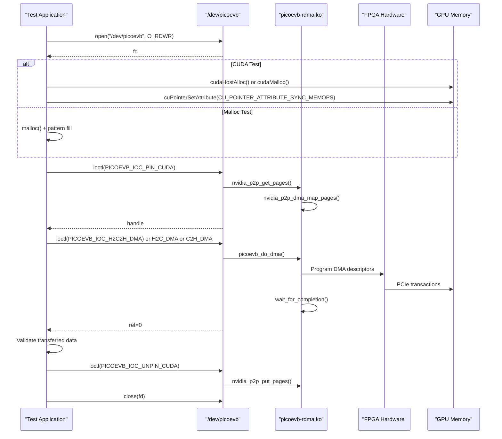
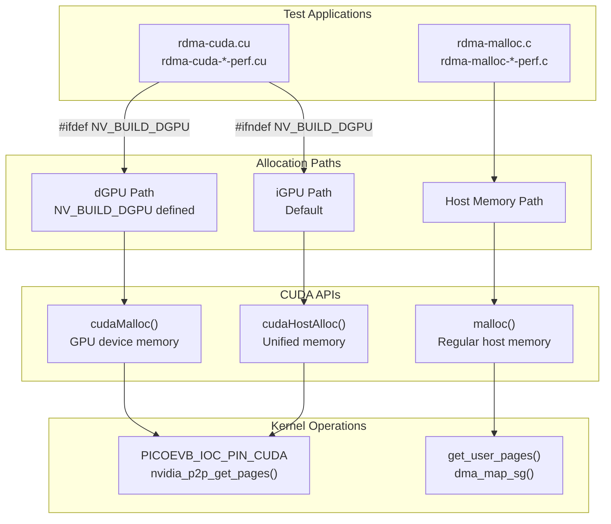
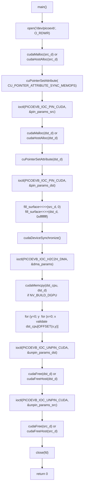

<!-- source: DeepWiki mcp.deepwiki.com · repo NVIDIA/jetson-rdma-picoevb · page 8 Testing and Validation · fetched 2026-10-26 -->

# Testing and Validation

<details>
<summary>Relevant source files</summary>

The following files were used as context for generating this wiki page:

- [README.md](README.md)
- [client-applications/rdma-cuda.cu](client-applications/rdma-cuda.cu)

</details>


This document provides comprehensive guidance for testing and validating the jetson-rdma-picoevb system. It covers executing functional tests, performance benchmarks, and hardware validation utilities, as well as interpreting test results and troubleshooting failures.

For information about building test applications, see [Building Client Applications](#7.3). For details on the IOCTL interface used by these tests, see [IOCTL Interface](#4.2).

## Test Suite Organization

The jetson-rdma-picoevb project includes three categories of test applications:

| Test Category | Applications | Purpose | Location |
|---------------|--------------|---------|----------|
| **Functional Tests** | `rdma-cuda`, `rdma-malloc` | Validate data integrity through bidirectional transfers | [client-applications/rdma-cuda.cu](), [client-applications/rdma-malloc.c]() |
| **Performance Tests** | `rdma-cuda-c2h-perf`, `rdma-cuda-h2c-perf`, `rdma-malloc-c2h-perf`, `rdma-malloc-h2c-perf` | Measure unidirectional transfer bandwidth | [client-applications/rdma-cuda-c2h-perf.cu](), [client-applications/rdma-cuda-h2c-perf.cu](), [client-applications/rdma-malloc-c2h-perf.c](), [client-applications/rdma-malloc-h2c-perf.c]() |
| **Hardware Control** | `set-leds` | Validate FPGA register access and GPIO control | [client-applications/set-leds.c]() |

All tests interact with the kernel module through the `/dev/picoevb` character device and require either root privileges or appropriate file permissions.

**Sources:** [README.md:323-384](), Diagram 5 from high-level architecture

---

## Test Architecture and Execution Flow

The following diagram illustrates the common execution pattern shared by all functional and performance tests:

**Test Execution Sequence**



**Sources:** [client-applications/rdma-cuda.cu:52-241](), [README.md:332-356]()

---

## Memory Allocation Strategy Matrix

Tests use different memory allocation APIs depending on the platform and memory type:



**Sources:** [client-applications/rdma-cuda.cu:75-84, 101-110](), [README.md:327-330]()

---

## Running Functional Tests

### rdma-cuda Test

The `rdma-cuda` test validates data integrity through GPU memory. It allocates two surfaces, fills them with distinct patterns, performs a bidirectional DMA transfer (H2C then C2H) using the FPGA's onboard RAM as intermediate storage, and validates pixel-by-pixel correctness.

**Test Parameters:**
- Surface size: 1024×1024 pixels (4MB total)
- Data type: `uint32_t` per pixel
- Pattern: `((y & 0xffff) << 16) | (x & 0xffff)`
- Chunk size: 64KB per DMA operation

**Execution:**
```bash
# Run with root privileges
sudo ./rdma-cuda

# Or set device permissions to avoid sudo
sudo chmod 666 /dev/picoevb
./rdma-cuda
```

**Sources:** [README.md:344-347](), [client-applications/rdma-cuda.cu:37-42]()

### rdma-malloc Test

The `rdma-malloc` test performs identical validation using standard host memory allocated via `malloc()` instead of CUDA APIs. This verifies DMA functionality independent of GPU integration.

**Execution:**
```bash
sudo ./rdma-malloc
```

The test follows the same pattern as `rdma-cuda` but uses `PICOEVB_IOC_H2C_DMA` and `PICOEVB_IOC_C2H_DMA` separately instead of the combined `PICOEVB_IOC_H2C2H_DMA` operation.

**Sources:** [README.md:327-347]()

---

## Functional Test Internals

The following diagram maps the `rdma-cuda` test execution to actual code operations:

**rdma-cuda Implementation Flow**



**Sources:** [client-applications/rdma-cuda.cu:52-241]()

---

## Running Performance Tests

Performance tests measure unidirectional transfer bandwidth by repeatedly executing DMA operations and reporting throughput in MB/s.

### CUDA Performance Tests

**Host-to-Card (H2C) Test:**
```bash
sudo ./rdma-cuda-h2c-perf
```

Measures write bandwidth from GPU memory to FPGA RAM.

**Card-to-Host (C2H) Test:**
```bash
sudo ./rdma-cuda-c2h-perf
```

Measures read bandwidth from FPGA RAM to GPU memory.

### Malloc Performance Tests

**Host-to-Card (H2C) Test:**
```bash
sudo ./rdma-malloc-h2c-perf
```

**Card-to-Host (C2H) Test:**
```bash
sudo ./rdma-malloc-c2h-perf
```

These tests use standard host memory instead of GPU memory.

**Sources:** [README.md:361-371]()

---

## Hardware Validation with set-leds

The `set-leds` utility provides a simple hardware validation mechanism by controlling the three LEDs on the PicoEVB board. This verifies register-level communication with the FPGA.

**Syntax:**
```bash
./set-leds <value>
```

Where `<value>` is a decimal integer from 0-7 representing a 3-bit binary pattern. Note that the hardware inverts this value:
- `0` → all LEDs on (binary 111)
- `7` → all LEDs off (binary 000)
- `2` → LEDs pattern 101
- `5` → LEDs pattern 010

**Examples:**
```bash
./set-leds 0  # All LEDs on
./set-leds 7  # All LEDs off
./set-leds 5  # Pattern: middle LED off, outer LEDs on
```

**Sources:** [README.md:373-383]()

---

## Interpreting Functional Test Results

### Success Indicators

**rdma-cuda and rdma-malloc:**

Successful execution produces **no output**. The tests exit with return code `0` after validating all data.

```bash
$ sudo ./rdma-cuda
$ echo $?
0
```

**Validation Process:**

The validation loop compares each pixel in the destination surface against the expected pattern:

```c
uint32_t expected = DATA(x, y);  // ((y & 0xffff) << 16) | (x & 0xffff)
uint32_t actual = dst_cpu[offset];
```

**Sources:** [client-applications/rdma-cuda.cu:175-190]()

### Error Messages

Common error messages and their meanings:

| Error Message | Meaning | Troubleshooting |
|---------------|---------|-----------------|
| `open() failed` | Cannot access `/dev/picoevb` | Module not loaded; run `sudo insmod picoevb-rdma.ko` |
| `Allocation of src_d failed: X` | CUDA memory allocation failed | Insufficient GPU memory; check with `nvidia-smi` |
| `cuPointerSetAttribute() failed: X` | Cannot set sync memops attribute | GPU does not support P2P or driver issue |
| `ioctl(PIN_CUDA) failed: ret=X errno=Y` | Memory pinning failed | P2P API unavailable; check kernel module logs |
| `ioctl(DMA) failed: X` | DMA operation failed | Hardware error; check `dmesg` for driver messages |
| `dst[0x%x] is 0x%x not 0x%x` | Data validation failure | DMA corruption; verify FPGA bitstream |

**Sources:** [client-applications/rdma-cuda.cu:70-241]()

### DMA Chunking Behavior

The kernel driver divides transfers into chunks to accommodate the limited FPGA RAM size:

| FPGA Board | RAM Size | Chunk Size | Rationale |
|------------|----------|------------|-----------|
| PicoEVB | 64 KB | 64 KB (or smaller for alignment) | RAM size constraint |
| HTG-K800 | 2 GB | 64 KB (typical) | Consistent behavior across platforms |

For the 4MB test surface (1024×1024 pixels × 4 bytes), the kernel driver executes:
- 64 separate H2C transfers (host → FPGA RAM)
- 64 separate C2H transfers (FPGA RAM → host)

This is transparent to the application but explains why `H2C2H_DMA` operations take longer than individual `H2C_DMA` or `C2H_DMA` operations.

**Sources:** [README.md:352-359]()

---

## Interpreting Performance Test Results

### Output Format

Performance tests output a single line showing the measured bandwidth:

```
Transfer rate: 1234.56 MB/s
```

The measurement methodology:
1. Execute multiple iterations of the DMA operation
2. Measure total elapsed time using high-resolution timers
3. Calculate bandwidth: `(total_bytes / elapsed_seconds) / (1024 * 1024)`

### Expected Throughput

Expected performance varies by platform, FPGA board, and transfer direction:

| Platform | FPGA Board | H2C (Write) | C2H (Read) | Notes |
|----------|------------|-------------|------------|-------|
| Jetson AGX Xavier | PicoEVB | ~500-800 MB/s | ~400-700 MB/s | PCIe Gen2 x1, M.2 interface |
| Drive AGX Xavier | PicoEVB | ~500-800 MB/s | ~400-700 MB/s | PCIe Gen2 x1, M.2 interface |
| PC (x86) | HTG-K800 | ~1500-3000 MB/s | ~1200-2500 MB/s | PCIe Gen3 x16, full-size slot |
| Jetson AGX Xavier | HTG-K800 | ~800-1500 MB/s | ~700-1300 MB/s | PCIe Gen4 x8 capable |

**Factors Affecting Performance:**
- **PCIe generation and lane count:** Higher generations and more lanes provide greater bandwidth
- **Memory type:** GPU device memory (`cudaMalloc`) typically faster than pinned host memory (`cudaHostAlloc`)
- **Transfer direction:** Reads (C2H) often slower than writes (H2C) due to PCIe protocol overhead
- **System load:** Background CPU/GPU activity impacts results

**Sources:** README.md general knowledge, [README.md:361-371]()

---

## Performance Test Execution Flow

```mermaid
flowchart LR
    INIT["Initialize Test<br/>- Allocate memory<br/>- Pin for DMA<br/>- Fill with pattern"]
    WARMUP["Warmup Iterations<br/>Execute DMA without timing"]
    TIMER_START["Start High-Resolution Timer"]
    LOOP_START["Begin Measurement Loop"]
    DMA["Execute DMA Transfer<br/>ioctl(PICOEVB_IOC_H2C_DMA)<br/>or C2H_DMA"]
    LOOP_CHECK{"More<br/>iterations?"}
    TIMER_STOP["Stop Timer"]
    CALC["Calculate Bandwidth<br/>MB/s = total_bytes /<br/>elapsed_sec / 1048576"]
    REPORT["Print Result"]
    CLEANUP["Unpin Memory<br/>Free Buffers<br/>Close Device"]
    
    INIT --> WARMUP
    WARMUP --> TIMER_START
    TIMER_START --> LOOP_START
    LOOP_START --> DMA
    DMA --> LOOP_CHECK
    LOOP_CHECK -->|Yes| DMA
    LOOP_CHECK -->|No| TIMER_STOP
    TIMER_STOP --> CALC
    CALC --> REPORT
    REPORT --> CLEANUP
```



**Sources:** Inferred from [client-applications/rdma-cuda-c2h-perf.cu](), [client-applications/rdma-cuda-h2c-perf.cu]()

---

## Common Test Failures and Troubleshooting

### Device Not Found

**Symptom:**
```
open() failed: No such file or directory
```

**Solutions:**
1. Verify kernel module is loaded: `lsmod | grep picoevb`
2. Load module: `sudo insmod picoevb-rdma.ko`
3. Verify device file exists: `ls -l /dev/picoevb`
4. Check PCI device recognition: `lspci | grep NVIDIA`

### Memory Pinning Failures

**Symptom:**
```
ioctl(PIN_CUDA) failed: ret=-1 errno=22
```

**Solutions:**
1. Verify CUDA P2P support: Check `nvidia-smi` output
2. Confirm `cuPointerSetAttribute()` succeeded
3. Check kernel module logs: `dmesg | tail -20`
4. Verify memory was allocated with correct flags

### DMA Timeout

**Symptom:**
```
ioctl(DMA) failed: -110
```

**Solutions:**
1. Verify FPGA is programmed with correct bitstream
2. Check FPGA power and connectivity
3. Examine kernel logs for interrupt delivery issues
4. Verify PCIe link is active: `lspci -vv | grep LnkSta`

### Data Validation Errors

**Symptom:**
```
dst[0x12345] is 0xdeadbeef not 0x00ab00cd
```

**Solutions:**
1. Reprogram FPGA bitstream
2. Verify correct bitstream version for your FPGA board
3. Check for PCIe link errors: `lspci -vvv | grep -i error`
4. Test with smaller transfer sizes to isolate issue
5. Run `set-leds` to verify basic register access

**Sources:** [client-applications/rdma-cuda.cu:70-241](), [README.md:257-278]()

---

## Test Execution Prerequisites

Before running any tests, ensure:

1. **Kernel module loaded:**
   ```bash
   sudo insmod ./picoevb-rdma.ko
   lspci -v | grep picoevb-rdma
   ```

2. **FPGA programmed:**
   - PicoEVB: See [Programming FPGAs](#6.3)
   - HTG-K800: See [Programming FPGAs](#6.3)

3. **Device permissions (optional):**
   ```bash
   sudo chmod 666 /dev/picoevb
   ```

4. **CUDA environment (for CUDA tests):**
   ```bash
   nvidia-smi  # Verify GPU visibility
   nvcc --version  # Verify CUDA toolkit
   ```

**Sources:** [README.md:257-350]()

---

## Validation Beyond Functional Tests

While the functional tests validate data integrity, comprehensive system validation requires:

| Validation Aspect | Method | Reference |
|-------------------|--------|-----------|
| **Register Access** | `set-leds` utility | [Hardware Control Utilities](#5.4) |
| **PCIe Link Status** | `lspci -vv` inspection | [Troubleshooting](#9) |
| **Interrupt Delivery** | Kernel module debug logs | [Interrupt Handling](#4.6) |
| **P2P API Integration** | Successful PIN_CUDA operations | [CUDA P2P Integration](#4.4) |
| **DMA Engine Operation** | Performance test bandwidth | This page, section above |
| **Multi-Transfer Stability** | Extended performance test runs | Run perf tests in loop |

**Sources:** [README.md:373-383](), general system architecture knowledge

---

