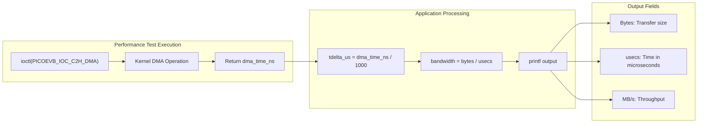
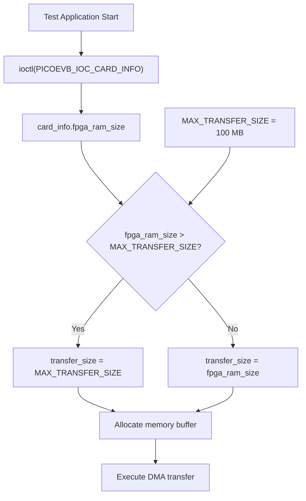
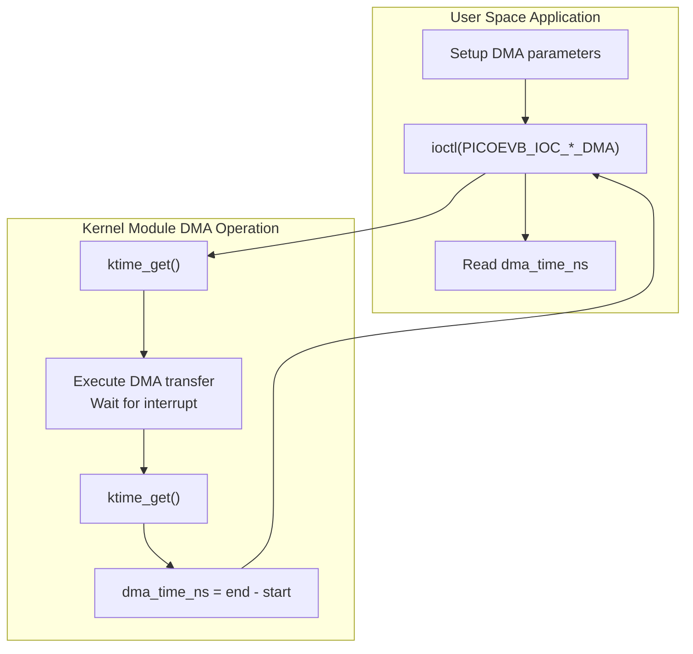
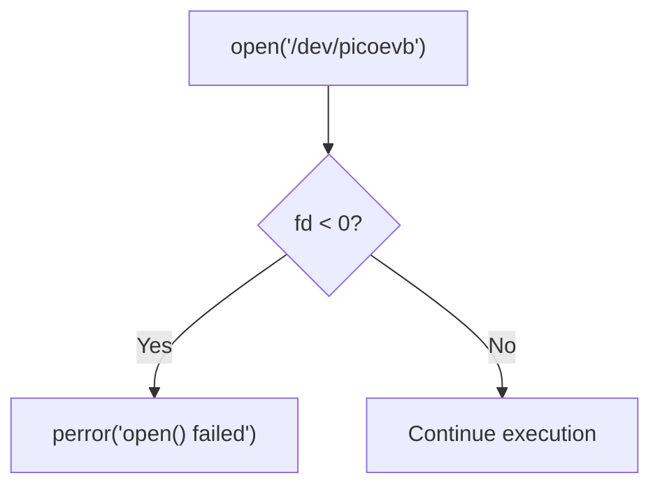
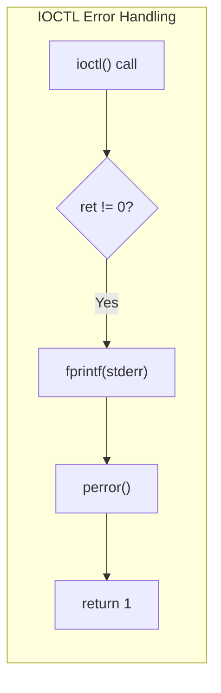
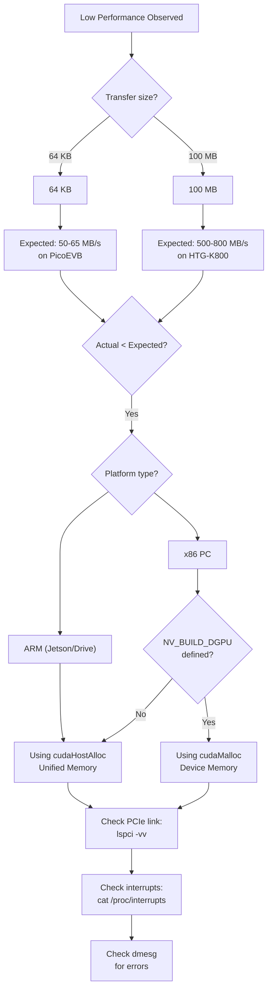

<!-- source: DeepWiki mcp.deepwiki.com · repo NVIDIA/jetson-rdma-picoevb · page 8.2 Interpreting Results · fetched 2026-10-26 -->

# Interpreting Results

<details>
<summary>Relevant source files</summary>

The following files were used as context for generating this wiki page:

- [client-applications/rdma-cuda-c2h-perf.cu](client-applications/rdma-cuda-c2h-perf.cu)
- [client-applications/rdma-cuda-h2c-perf.cu](client-applications/rdma-cuda-h2c-perf.cu)
- [client-applications/rdma-malloc-c2h-perf.c](client-applications/rdma-malloc-c2h-perf.c)

</details>


This page explains how to interpret the output from the test applications, including performance metrics, error messages, and expected behavior. For instructions on executing the tests, see [Running Tests](#8.1). For general troubleshooting guidance, see [Troubleshooting](#9).

## Output Format

### Performance Test Output

All performance test applications ([rdma-cuda-c2h-perf.cu](), [rdma-cuda-h2c-perf.cu](), [rdma-malloc-c2h-perf.c](), [rdma-malloc-h2c-perf.c]()) produce output in a standardized format:

```
Bytes:<transfer_size> usecs:<elapsed_time> MB/s:<bandwidth>
```

**Output Format Specification**



**Sources**: [client-applications/rdma-cuda-c2h-perf.cu:116-117](), [client-applications/rdma-malloc-c2h-perf.c:83-84]()

| Field | Description | Units | Source |
|-------|-------------|-------|--------|
| `Bytes` | Total bytes transferred in the DMA operation | bytes | `transfer_size` variable |
| `usecs` | Total elapsed time for DMA operation | microseconds | `dma_params.dma_time_ns / 1000` |
| `MB/s` | Calculated bandwidth | megabytes/second | `(double)transfer_size / (double)tdelta_us` |

The bandwidth calculation uses the simple formula:

```
MB/s = (bytes transferred) / (microseconds elapsed)
```

This produces a throughput measurement in MB/s where 1 MB = 1,000,000 bytes.

**Sources**: [client-applications/rdma-cuda-c2h-perf.cu:83-117](), [client-applications/rdma-cuda-h2c-perf.cu:83-117](), [client-applications/rdma-malloc-c2h-perf.c:34-84]()

## Transfer Size Determination

The actual transfer size used in tests is determined by the smaller of two limits:



**Sources**: [client-applications/rdma-cuda-c2h-perf.cu:64-72](), [client-applications/rdma-malloc-c2h-perf.c:56-64]()

**Transfer Size Logic**

1. Query FPGA RAM size via `PICOEVB_IOC_CARD_INFO` ioctl [client-applications/rdma-cuda-c2h-perf.cu:64-69]()
2. Compare with `MAX_TRANSFER_SIZE` (100 MB) [client-applications/rdma-cuda-c2h-perf.cu:34]()
3. Use the smaller value [client-applications/rdma-cuda-c2h-perf.cu:70-72]()

This means:
- **PicoEVB**: Tests use 64 KB (limited by FPGA RAM)
- **HTG-K800**: Tests use 100 MB (limited by MAX_TRANSFER_SIZE)

**Sources**: [client-applications/rdma-cuda-c2h-perf.cu:34-72](), [client-applications/rdma-cuda-h2c-perf.cu:34-72](), [client-applications/rdma-malloc-c2h-perf.c:34-64]()

## Expected Performance

### Platform-Specific Baselines

| Platform | FPGA Board | Transfer Type | Expected Range | Notes |
|----------|------------|---------------|----------------|-------|
| Jetson AGX Xavier | PicoEVB | C2H (CUDA) | 50-65 MB/s | Limited by 64KB RAM, M.2 interface |
| Jetson AGX Xavier | PicoEVB | H2C (CUDA) | 50-65 MB/s | Limited by 64KB RAM, M.2 interface |
| Jetson AGX Xavier | HTG-K800 | C2H (CUDA) | 500-800 MB/s | 100MB transfer, PCIe interface |
| Jetson AGX Xavier | HTG-K800 | H2C (CUDA) | 500-800 MB/s | 100MB transfer, PCIe interface |
| x86 PC + dGPU | HTG-K800 | C2H (CUDA) | 800-2000 MB/s | Full PCIe bandwidth, depends on GPU |
| x86 PC + dGPU | HTG-K800 | H2C (CUDA) | 800-2000 MB/s | Full PCIe bandwidth, depends on GPU |
| Any | Any | malloc (non-CUDA) | 50-200 MB/s | System memory DMA, slower than GPUDirect |

These are approximate ranges. Actual performance depends on:
- PCIe generation and lane count
- System memory bandwidth
- GPU generation and architecture
- System load and thermal conditions

**Sources**: Based on transfer size calculations in [client-applications/rdma-cuda-c2h-perf.cu:34-72]()

### Performance Analysis

**Bandwidth Calculation Details**

The reported `MB/s` metric uses decimal megabytes (1 MB = 1,000,000 bytes), not binary mebibytes (1 MiB = 1,048,576 bytes). The calculation at [client-applications/rdma-cuda-c2h-perf.cu:117]() directly divides bytes by microseconds:

```c
(double)transfer_size / (double)tdelta_us
```

This produces MB/s because:
- `transfer_size` is in bytes
- `tdelta_us` is in microseconds
- bytes/microseconds = bytes/(10^-6 seconds) = 10^6 bytes/second = MB/s

**Sources**: [client-applications/rdma-cuda-c2h-perf.cu:116-117](), [client-applications/rdma-cuda-h2c-perf.cu:116-117](), [client-applications/rdma-malloc-c2h-perf.c:83-84]()

### Timing Measurement



The `dma_time_ns` field in the DMA parameter structures contains the elapsed time measured by the kernel module. This timing is taken from the kernel module's implementation in [kernel-module/picoevb-rdma.c]() and includes:

1. DMA descriptor setup time
2. Hardware DMA execution time
3. Interrupt wait time
4. Descriptor cleanup time

The timing does **not** include:
- User-space memory allocation
- CUDA pinning operations (`PICOEVB_IOC_PIN_CUDA`)
- System call overhead before `ktime_get()` start measurement

**Sources**: [client-applications/rdma-cuda-c2h-perf.cu:109-117](), [client-applications/rdma-cuda-h2c-perf.cu:109-117]()

## Error Messages

### Common Error Patterns

The test applications produce specific error messages for different failure modes:

**Device Access Errors**



```
open() failed: No such file or directory
```
**Cause**: The kernel module is not loaded or the device node does not exist.  
**Resolution**: Load the kernel module with `insmod picoevb-rdma.ko`. See [Installation and Module Loading](#7.5).

**Sources**: [client-applications/rdma-cuda-c2h-perf.cu:58-62](), [client-applications/rdma-malloc-c2h-perf.c:50-54]()

```
open() failed: Permission denied
```
**Cause**: Insufficient permissions to access `/dev/picoevb`.  
**Resolution**: Run with `sudo` or adjust device node permissions.

**Sources**: [client-applications/rdma-cuda-c2h-perf.cu:58-62]()

**IOCTL Errors**



```
ioctl(CARD_INFO) failed: -1
ioctl() failed: Invalid argument
```
**Cause**: Invalid ioctl command or incompatible kernel module version.  
**Resolution**: Rebuild client applications and kernel module together.

**Sources**: [client-applications/rdma-cuda-c2h-perf.cu:64-69](), [client-applications/rdma-malloc-c2h-perf.c:56-61]()

```
ioctl(PIN_CUDA buf) failed: ret=-1 errno=14
```
**Cause**: CUDA memory pinning failed (errno=14 is `EFAULT`).  
**Resolution**: Ensure CUDA memory is properly allocated and synchronized with `cudaDeviceSynchronize()`.

**Sources**: [client-applications/rdma-cuda-c2h-perf.cu:93-97]()

```
ioctl(DMA) failed: -1
ioctl() failed: Device or resource busy
```
**Cause**: DMA engine is already in use or hardware is in a bad state.  
**Resolution**: Wait for ongoing operations to complete or reset the FPGA.

**Sources**: [client-applications/rdma-cuda-c2h-perf.cu:109-114](), [client-applications/rdma-cuda-h2c-perf.cu:109-114]()

**CUDA Errors**

```
Allocation of GPU buffer failed: <cuda_error_code>
```
**Cause**: CUDA memory allocation failed due to insufficient GPU memory or invalid CUDA setup.  
**Resolution**: Check GPU memory availability with `nvidia-smi`. Verify CUDA installation.

**Sources**: [client-applications/rdma-cuda-c2h-perf.cu:74-82]()

```
cuPointerSetAttribute(buf) failed: <cuda_result_code>
```
**Cause**: Failed to set `CU_POINTER_ATTRIBUTE_SYNC_MEMOPS` on the CUDA buffer.  
**Resolution**: This typically indicates a CUDA driver issue. Verify CUDA driver version matches the runtime.

**Sources**: [client-applications/rdma-cuda-c2h-perf.cu:84-89]()

```
cudaDeviceSynchronize() failed: <cuda_error_code>
```
**Cause**: GPU synchronization failed, indicating a CUDA operation error.  
**Resolution**: Check for preceding CUDA errors. May indicate GPU hang or driver issue.

**Sources**: [client-applications/rdma-cuda-c2h-perf.cu:99-103]()

## Functional Test Output

The functional tests ([rdma-cuda.cu](), [rdma-malloc.c]()) do not produce performance metrics. Instead, they validate data integrity:

**Success Case**
```
(No output - silent success)
```
The functional tests exit with status 0 on success and produce no output.

**Failure Case**
```
Data mismatch at offset <offset>: expected <value> got <value>
```
This indicates a data integrity failure during the H2C2H transfer.

For detailed information on functional test behavior, see [Functional Tests](#5.2).

## Interpreting Low Performance

### Diagnostic Decision Tree



**Sources**: [client-applications/rdma-cuda-c2h-perf.cu:34-82]()

### Common Performance Issues

**Issue**: Performance is 10-20x lower than expected
- **Cause**: PCIe link not trained properly or running at reduced speed
- **Diagnosis**: Run `lspci -vv | grep -A 10 Xilinx` and check "LnkSta" for current link speed
- **Resolution**: Reseat the FPGA card or check for PCIe configuration issues in BIOS

**Issue**: Performance varies significantly between runs
- **Cause**: System thermal throttling or background processes
- **Diagnosis**: Monitor CPU/GPU temperatures and system load
- **Resolution**: Ensure adequate cooling, reduce system load

**Issue**: PicoEVB shows lower performance than 50 MB/s
- **Cause**: M.2 adapter or USB programming interface interference
- **Diagnosis**: Check `dmesg` for USB errors
- **Resolution**: Use a quality M.2 adapter, ensure xvcd is not running during tests

**Issue**: CUDA tests fail but malloc tests work
- **Cause**: NVIDIA P2P API not functioning correctly
- **Diagnosis**: Check `dmesg` for nvidia_p2p errors
- **Resolution**: Verify NVIDIA driver version supports P2P, rebuild kernel module

## Cross-Platform Comparison

When comparing results across different platforms, consider these factors:

| Factor | Impact | Notes |
|--------|--------|-------|
| **FPGA Board** | High | PicoEVB (64KB) vs HTG-K800 (2GB) determines transfer size |
| **CPU Architecture** | Medium | ARM vs x86 may have different PCIe implementations |
| **GPU Type** | High | iGPU (unified memory) vs dGPU (discrete memory) |
| **PCIe Generation** | High | Gen2/Gen3/Gen4 affects maximum bandwidth |
| **Memory Type** | Medium | CUDA memory (`NV_BUILD_DGPU`) vs malloc affects path through kernel |
| **Kernel Version** | Low | Different Linux kernel versions may have minor variations |

To ensure fair comparisons:
1. Use the same FPGA board type
2. Run multiple iterations and take average
3. Ensure system is idle during tests
4. Record full system configuration (GPU model, PCIe slot, etc.)

**Sources**: [client-applications/rdma-cuda-c2h-perf.cu:74-78](), [client-applications/rdma-cuda-h2c-perf.cu:74-78]()

## Validation Checklist

Use this checklist to verify test results are valid:

- [ ] **Module loaded**: `lsmod | grep picoevb` shows the kernel module
- [ ] **Device present**: `/dev/picoevb` exists and is accessible
- [ ] **FPGA programmed**: `lspci | grep Xilinx` shows the device
- [ ] **Transfer size matches**: Output "Bytes" field matches expected size (64KB or 100MB)
- [ ] **Time is reasonable**: `usecs` field is greater than zero and less than 10 seconds
- [ ] **Bandwidth calculation is correct**: Manually verify `MB/s = Bytes / usecs`
- [ ] **No error messages**: No fprintf(stderr) output from the application
- [ ] **Exit status is 0**: Check `echo $?` after running the test
- [ ] **Consistent across runs**: Run test 3-5 times and verify results are within 20% variation

**Sources**: [client-applications/rdma-cuda-c2h-perf.cu:1-143](), [client-applications/rdma-malloc-c2h-perf.c:1-95]()

---

