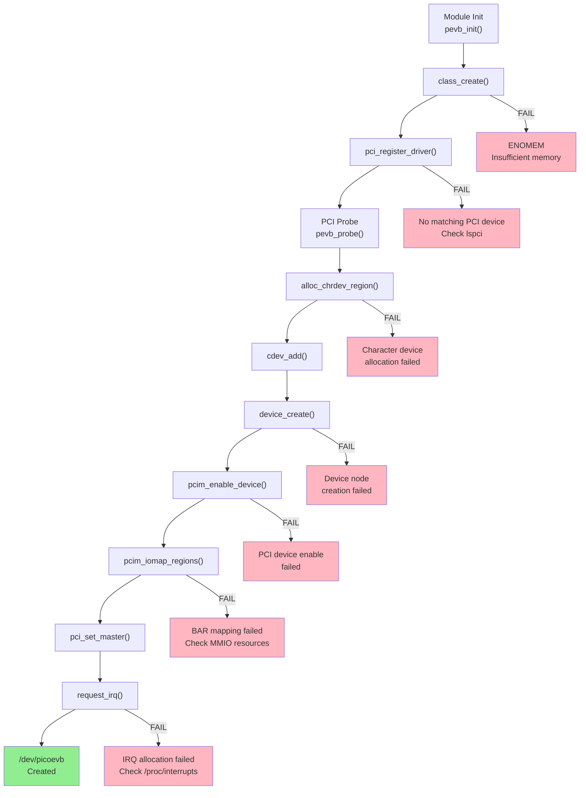
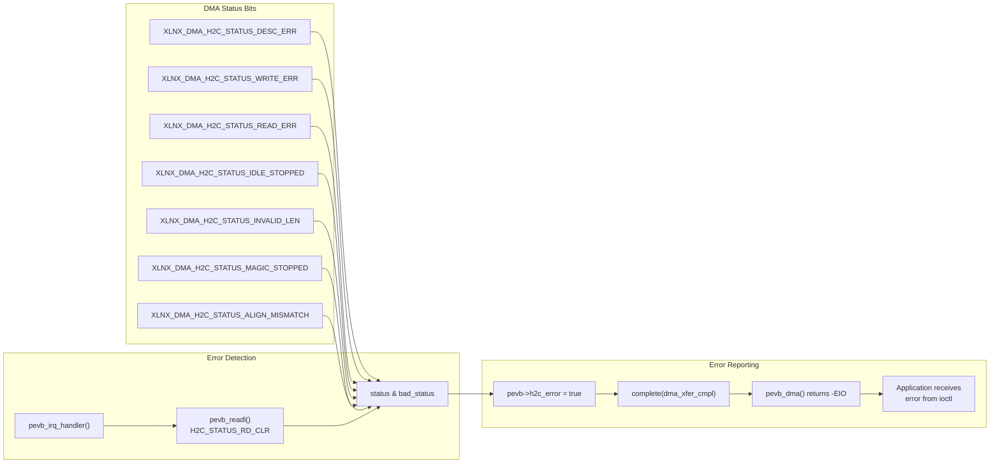
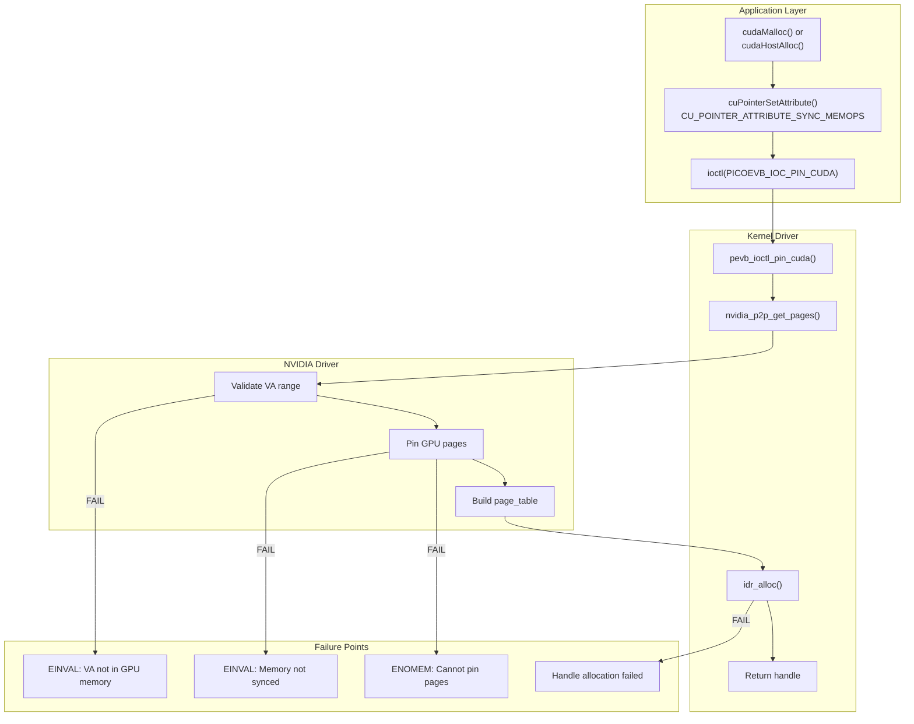
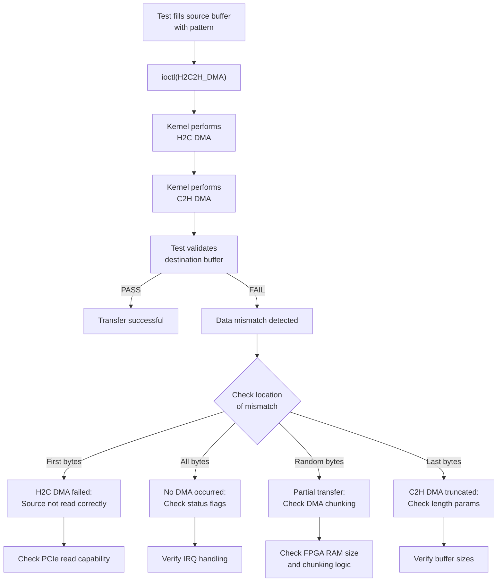
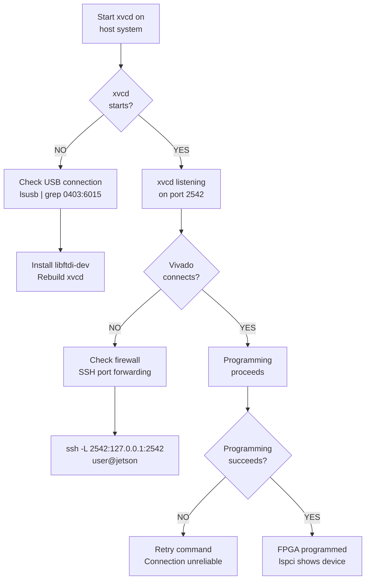

<!-- source: DeepWiki mcp.deepwiki.com · repo NVIDIA/jetson-rdma-picoevb · page 9 Troubleshooting · fetched 2026-10-26 -->

# Troubleshooting

<details>
<summary>Relevant source files</summary>

The following files were used as context for generating this wiki page:

- [README.md](README.md)
- [kernel-module/picoevb-rdma.c](kernel-module/picoevb-rdma.c)

</details>


This page documents common issues encountered when setting up and operating the jetson-rdma-picoevb system, along with diagnostic procedures and solutions. It covers hardware connectivity problems, kernel module loading failures, DMA transfer errors, CUDA P2P integration issues, and application-level test failures.

For build and compilation issues, see [Building and Deployment](#7). For understanding the expected system behavior during normal operation, see [Testing and Validation](#8).

---

## Hardware Issues

### FPGA Board Not Detected

**Symptom**: The FPGA board does not appear in `lspci` output after installation.

**Diagnostic Steps**:

1. Verify physical connection:
   - For PicoEVB: Check M.2 connector seating and adapter chain integrity
   - For HTG-K800: Verify PCIe slot engagement and power connections

2. Check PCIe bus enumeration:
```bash
lspci -nn | grep -i nvidia
lspci -nn | grep "10de:0001"
```

3. Examine kernel logs for PCIe enumeration:
```bash
dmesg | grep -i pci
dmesg | grep -i "10de:0001"
```

**Common Causes and Solutions**:

| Issue | Cause | Solution |
|-------|-------|----------|
| Board not visible | Mechanical connection failure | Reseat board and verify adapter compatibility |
| Wrong PCIe vendor/device ID | FPGA not programmed or programming corrupted | Reprogram FPGA using instructions in [FPGA Development](#6) |
| PCIe link training failure | Insufficient power or signal integrity | Try different PCIe slot; check power supply capacity |
| Adapter incompatibility | Wrong M.2 key type or electrical mismatch | Verify adapter supports correct M.2 key (E for Jetson, M for Drive) |

**Sources**: README.md:17-84, kernel-module/picoevb-rdma.c:1266-1270

### PCIe Link Width or Speed Issues

**Symptom**: FPGA detected but operating at reduced PCIe speed or link width.

**Diagnostic Command**:
```bash
sudo lspci -vv -s $(lspci | grep "10de:0001" | cut -d' ' -f1) | grep -i "lnk"
```

Expected output should show negotiated link width and speed. The PicoEVB should negotiate at least PCIe Gen2 x1. The HTG-K800 should negotiate PCIe Gen3 with wider link width depending on the slot.

**Common Causes**:
- Mechanical slot limitations (e.g., M.2 Key E limited to x1)
- Adapter signal integrity degradation
- FPGA configuration issues

**Sources**: README.md:40-73

---

## Kernel Module Issues

### Module Loading Failures

The following diagram shows the kernel module initialization sequence and common failure points:



**Sources**: kernel-module/picoevb-rdma.c:1281-1294, kernel-module/picoevb-rdma.c:1138-1229

#### Error: "Unknown symbol" When Loading Module

**Symptom**:
```
insmod: ERROR: could not insert module picoevb-rdma.ko: Unknown symbol in module
```

**Diagnostic**:
```bash
dmesg | tail -20
```

**Common Causes**:

| Error Message | Cause | Solution |
|---------------|-------|----------|
| `nvidia_p2p_get_pages` | NVIDIA kernel driver not loaded or version mismatch | Load `nvidia` kernel module; verify CUDA driver installation |
| Kernel version mismatch | Module compiled for different kernel version | Rebuild module for current kernel |
| Module built without CUDA support | `NV_BUILD_NO_CUDA` defined incorrectly | Use correct build script for platform |

**Sources**: kernel-module/picoevb-rdma.c:26-32, kernel-module/picoevb-rdma.c:250-259

#### Error: Device File `/dev/picoevb` Not Created

**Symptom**: Module loads successfully but `/dev/picoevb` does not exist.

**Diagnostic**:
```bash
ls -l /sys/class/picoevb/
dmesg | grep picoevb
```

**Root Causes**:
- `device_create()` failed in [kernel-module/picoevb-rdma.c:1188-1193]()
- udev rules not processing device events
- Character device registration failed

**Solution**:
```bash
# Check if device is registered
cat /proc/devices | grep picoevb
# Manually create device node if needed
sudo mknod /dev/picoevb c MAJOR 0
```

**Sources**: kernel-module/picoevb-rdma.c:1175-1193

---

## DMA Transfer Errors

### Understanding DMA Error Flags

The Xilinx DMA engine reports errors through status registers. The kernel module checks for these error conditions in [kernel-module/picoevb-rdma.c:534-544]():



**Sources**: kernel-module/picoevb-rdma.c:529-568, kernel-module/picoevb-rdma.c:570-677

### Common DMA Error Scenarios

#### Descriptor Errors (`DESC_ERR`)

**Symptom**: `dmesg` shows "DMA failed" and descriptor error bits set.

**Diagnostic**:
```bash
dmesg | grep -A5 "DMA.*status"
```

**Causes**:
- Descriptor memory corruption (check [kernel-module/picoevb-rdma.c:1167-1173]())
- Descriptor address misalignment
- Invalid descriptor chain pointers

**Solution**: Verify descriptor allocation is properly aligned and coherent:
```bash
# Check descriptor DMA address from kernel logs
dmesg | grep "dma_alloc_coherent(descriptors)"
```

**Sources**: kernel-module/picoevb-rdma.c:682-726, kernel-module/picoevb-rdma.c:1167-1173

#### PCIe Read/Write Errors

**Symptom**: `READ_ERR` or `WRITE_ERR` status bits set.

**Root Causes and Diagnostics**:

| Error Type | Cause | Diagnostic Command | Fix |
|------------|-------|-------------------|-----|
| PCIe read timeout | GPU memory not accessible | Check GPU memory pinning status | Verify P2P pinning succeeded |
| PCIe write error | Host memory not mapped for DMA | `cat /proc/iomem \| grep RAM` | Check `get_user_pages()` success |
| Address out of range | Invalid DMA address | Check kernel logs for DMA addresses | Validate address calculations |
| Non-posted write failure | PCIe bus error | `lspci -vv \| grep -i error` | Check PCIe AER logs |

**Sources**: kernel-module/picoevb-rdma.c:534-544

#### Alignment Mismatch Errors

**Symptom**: `ALIGN_MISMATCH` status bit set.

**Cause**: DMA descriptor contains addresses or lengths not aligned to 4-byte boundaries. The Xilinx DMA engine requires word-aligned transfers.

**Code Reference**: [kernel-module/picoevb-rdma.c:764]() shows chunk size calculation constrained to `XLNX_DMA_DESC_LEN_MAX_WORD_ALIGNED`.

**Solution**: Ensure all buffer allocations and DMA offsets maintain 4-byte alignment:
- Use `posix_memalign()` for malloc'd buffers
- CUDA allocations are automatically aligned
- Check offset parameters in IOCTL calls

**Sources**: kernel-module/picoevb-rdma.c:764, kernel-module/picoevb-rdma.c:819

#### Invalid Length Errors

**Symptom**: `INVALID_LEN` status bit set.

**Causes**:
- Transfer length exceeds maximum descriptor size (see `XLNX_DMA_DESC_LEN_MAX_WORD_ALIGNED`)
- Zero-length transfer requested
- Length not word-aligned

**Diagnostic Code Path**:
The kernel module chunks large transfers in [kernel-module/picoevb-rdma.c:762-765]():
```
len_chunk = min_t(u64, len_chunk, pevb->drvdata->fpga_ram_size);
len_chunk = min_t(u64, len_chunk, XLNX_DMA_DESC_LEN_MAX_WORD_ALIGNED);
```

**Sources**: kernel-module/picoevb-rdma.c:762-765

---

## CUDA P2P Integration Issues

### Memory Pinning Failures

The following diagram maps application-level P2P operations to kernel functions:



**Sources**: kernel-module/picoevb-rdma.c:228-295

#### Error: `nvidia_p2p_get_pages()` Returns -EINVAL

**Symptom**: PIN_CUDA ioctl fails with EINVAL.

**Diagnostic Application Code**:
```bash
# Run with strace to see ioctl parameters
strace -e ioctl ./rdma-cuda
```

**Common Causes**:

1. **Memory Not Allocated via CUDA APIs**
   - Solution: Ensure buffer allocated with `cudaMalloc()` or `cudaHostAlloc()`

2. **Missing `CU_POINTER_ATTRIBUTE_SYNC_MEMOPS`**
   - Required by [kernel-module/picoevb-rdma.c:250-259]()
   - Application must call `cuPointerSetAttribute()` before pinning

3. **Virtual Address Alignment Issue**
   - The kernel aligns VA to GPU page boundaries in [kernel-module/picoevb-rdma.c:244-248]()
   - Check GPU_PAGE_SHIFT: 16 for dGPU, 12 for iGPU [kernel-module/picoevb-rdma.c:42-49]()

4. **Wrong Build Configuration**
   - Built with `NV_BUILD_NO_CUDA` but trying to use CUDA features
   - Solution: Use correct build script for platform

**Sources**: kernel-module/picoevb-rdma.c:228-295, kernel-module/picoevb-rdma.c:42-49

#### Error: `nvidia_p2p_dma_map_pages()` Fails

**Symptom**: DMA operations fail after successful pinning.

**Code Path**: Mapping occurs in [kernel-module/picoevb-rdma.c:378-386]() for dGPU and [kernel-module/picoevb-rdma.c:382-384]() for iGPU.

**Causes**:
- PCI device not capable of accessing GPU memory address range
- IOMMU configuration blocks P2P transfers
- GPU in incorrect P2P state

**Diagnostics**:
```bash
# Check IOMMU configuration
dmesg | grep -i iommu
cat /proc/cmdline | grep iommu

# Verify GPU P2P support
nvidia-smi topo -m
```

**Solution**: May require IOMMU configuration changes or verifying GPU supports P2P with the FPGA's PCIe hierarchy.

**Sources**: kernel-module/picoevb-rdma.c:378-386

### Page Table Structure Mismatches

**Symptom**: Crashes or memory corruption during DMA to CUDA memory.

**Platform-Specific Differences**:

The kernel module handles different P2P APIs for dGPU vs iGPU:

| Platform | Page Size | Page Table Access | DMA Mapping API |
|----------|-----------|-------------------|-----------------|
| dGPU (NV_BUILD_DGPU) | 64KB (2^16) | `map->dma_addresses[i]` | `nvidia_p2p_dma_map_pages(pdev, ...)` |
| iGPU (default) | 4KB (2^12) | `map->hw_address[i]`, `map->hw_len[i]` | `nvidia_p2p_dma_map_pages(dev, ..., direction)` |

**Code References**: 
- Page size definitions: [kernel-module/picoevb-rdma.c:42-49]()
- dGPU mapping: [kernel-module/picoevb-rdma.c:396-398]()
- iGPU mapping: [kernel-module/picoevb-rdma.c:400-401]()

**Diagnostic**: Verify correct build configuration for platform:
```bash
# For dGPU builds
grep NV_BUILD_DGPU /path/to/build-script.sh

# Check compiled module
modinfo picoevb-rdma.ko | grep vermagic
```

**Sources**: kernel-module/picoevb-rdma.c:42-49, kernel-module/picoevb-rdma.c:378-411

---

## Application Test Failures

### Data Validation Failures in Functional Tests

**Symptom**: `rdma-cuda` or `rdma-malloc` reports data mismatch after DMA transfer.

**Diagnostic Flow**:



**Sources**: README.md:326-347

**Common Root Causes**:

1. **Cache Coherency Issues (iGPU platforms)**
   - Symptom: Random data mismatches on Jetson/Drive AGX Xavier
   - Cause: CPU/GPU cache not synchronized before DMA
   - Solution: Ensure `CU_POINTER_ATTRIBUTE_SYNC_MEMOPS` is set
   - Code: Required for iGPU builds [kernel-module/picoevb-rdma.c:250-259]()

2. **Incomplete DMA Transfer**
   - Check kernel logs for "DMA interrupted" message [kernel-module/picoevb-rdma.c:638]()
   - Verify IRQ is firing: `cat /proc/interrupts | grep picoevb`

3. **Buffer Size Exceeds FPGA RAM**
   - PicoEVB: 64KB limit [kernel-module/picoevb-rdma.c:1250]()
   - HTG-K800: 2GB limit [kernel-module/picoevb-rdma.c:1255]()
   - Transfer chunked automatically in [kernel-module/picoevb-rdma.c:729-788]()

**Sources**: kernel-module/picoevb-rdma.c:729-788, kernel-module/picoevb-rdma.c:1248-1256

### Performance Test Reports Zero or Low Bandwidth

**Symptom**: `rdma-*-perf` applications show unexpectedly low throughput.

**Expected Performance Ranges**:
- H2C transfers: 500-2000 MB/s depending on platform and memory type
- C2H transfers: 500-2000 MB/s depending on platform and memory type

**Diagnostic Checklist**:

| Issue | Check | Expected Value |
|-------|-------|----------------|
| PCIe link speed | `lspci -vv \| grep LnkSta` | Gen2+ for PicoEVB, Gen3+ for HTG-K800 |
| DMA time measurement | Kernel logs | `dma_time_ns` should be reasonable |
| IRQ latency | `cat /proc/interrupts` | IRQ count incrementing |
| Transfer size | Application parameter | Should be large (>1MB) for accurate measurement |
| Memory type | Build configuration | CUDA memory faster than malloc'd |

**Code Reference**: DMA timing measured in [kernel-module/picoevb-rdma.c:1031-1037]() for H2C and [kernel-module/picoevb-rdma.c:1086-1092]() for C2H.

**Common Causes**:
- Small transfer sizes amortized by per-transfer overhead
- IRQ coalescing causing artificial delays
- IOMMU overhead on platforms without P2P support
- Memory allocated in slow regions (e.g., non-pinned system memory)

**Sources**: kernel-module/picoevb-rdma.c:1031-1037, kernel-module/picoevb-rdma.c:1086-1092

### Permission Denied Errors

**Symptom**:
```
./rdma-cuda: Permission denied
ioctl: Operation not permitted
```

**Solution**:
```bash
# Option 1: Run with sudo
sudo ./rdma-cuda

# Option 2: Set device permissions
sudo chmod 666 /dev/picoevb

# Option 3: Add udev rule (persistent)
echo 'KERNEL=="picoevb", MODE="0666"' | sudo tee /etc/udev/rules.d/99-picoevb.rules
sudo udevadm control --reload-rules
```

**Sources**: README.md:349-350

---

## Build and Compilation Issues

### Kernel Module Build Failures

#### Missing Kernel Headers

**Symptom**:
```
make: *** /lib/modules/X.X.X/build: No such file or directory. Stop.
```

**Solution**:
```bash
# On Jetson/Drive AGX Xavier
sudo apt install linux-headers-$(uname -r)

# On Ubuntu PC
sudo apt install linux-headers-generic
```

**Sources**: README.md:213-220

#### CUDA Header Not Found

**Symptom**:
```
fatal error: nv-p2p.h: No such file or directory
```

**Platform-Specific Header Locations**:
- dGPU: `<nv-p2p.h>` [kernel-module/picoevb-rdma.c:28]()
- iGPU: `<linux/nv-p2p.h>` [kernel-module/picoevb-rdma.c:30]()

**Solution**: Verify NVIDIA driver installation:
```bash
# Check driver installation
ls /usr/src/nvidia-*/nv-p2p.h

# For Jetson/Drive
dpkg -l | grep nvidia
```

**Sources**: kernel-module/picoevb-rdma.c:26-32

### Client Application Build Failures

#### NVCC Not Found

**Symptom**: `nvcc: command not found` when building CUDA applications.

**Solution**:
```bash
# Add CUDA to PATH
export PATH=/usr/local/cuda/bin:$PATH

# Verify installation
which nvcc
nvcc --version
```

**Sources**: README.md:282-292

#### Wrong Architecture for Platform

**Symptom**: Application builds but segfaults or shows "invalid device function" at runtime.

**Cause**: Incorrect memory allocation API for platform type.

**Platform-Specific Requirements**:
- **iGPU (Jetson/Drive)**: Must use `cudaHostAlloc()` for unified memory
- **dGPU (PC)**: Must use `cudaMalloc()` for device memory

**Build Flags**:
- Set `NV_BUILD_DGPU` for discrete GPU builds
- Default (unset) for integrated GPU builds

**Sources**: README.md:282-322, kernel-module/picoevb-rdma.c:42-49

---

## FPGA Programming Issues

### xvcd Connection Failures (PicoEVB Only)

**Symptom**: Vivado cannot connect to xvcd for FPGA programming.

**Diagnostic Flow**:



**Sources**: README.md:109-192

**Common Issues**:

1. **USB Device Not Found**
   ```bash
   lsusb | grep "0403:6015"
   ```
   If not found: Check USB cable, try different USB port

2. **Port Already in Use**
   ```bash
   sudo netstat -tlnp | grep 2542
   ```
   Solution: Kill existing xvcd process

3. **Permission Denied**
   - xvcd requires root for USB access
   - Run with `sudo ./xvcd -P 0x6015`

**Sources**: README.md:176-178

### JTAG Programming Failures (HTG-K800 Only)

**Symptom**: Vivado cannot detect FPGA via Platform Cable USB II.

**Diagnostics**:
```bash
# Check if cable is detected
lsusb | grep -i xilinx

# Test cable connection
vivado -mode tcl
# In Vivado TCL console:
connect_hw_server
open_hw_target
```

**Common Causes**:
- Cable driver not installed (install Vivado cable drivers)
- Multiple devices on JTAG chain (specify target)
- Insufficient USB power (use powered USB hub)

**Sources**: README.md:87-91, README.md:193-205

### Programming Takes Excessively Long

**Expected Duration**:
- PicoEVB via xvcd: 20-40 minutes
- HTG-K800 via JTAG: 2-5 minutes

**If Much Longer**:
- Check for network latency (if using SSH forwarding for PicoEVB)
- Verify bitstream file integrity
- Check USB connection quality

**Sources**: README.md:189-205

---

## Diagnostic Command Reference

### Quick Health Check Script

```bash
#!/bin/bash
echo "=== PCIe Device Check ==="
lspci -nn | grep "10de:0001"

echo "=== Kernel Module Status ==="
lsmod | grep picoevb

echo "=== Device File ==="
ls -l /dev/picoevb

echo "=== IRQ Status ==="
cat /proc/interrupts | grep picoevb

echo "=== Recent Kernel Logs ==="
dmesg | grep -i picoevb | tail -20

echo "=== NVIDIA Driver Status ==="
lsmod | grep nvidia
```

### DMA Performance Debugging

To enable verbose DMA logging, the kernel module uses `dev_dbg()` throughout. Enable dynamic debug:

```bash
# Enable all picoevb debug messages
echo 'module picoevb_rdma +p' | sudo tee /sys/kernel/debug/dynamic_debug/control

# Run test
sudo ./rdma-cuda-h2c-perf

# Check detailed logs
dmesg | grep picoevb

# Disable debug
echo 'module picoevb_rdma -p' | sudo tee /sys/kernel/debug/dynamic_debug/control
```

**Useful Debug Messages**:
- DMA descriptor contents: [kernel-module/picoevb-rdma.c:684]()
- Register read/write: [kernel-module/picoevb-rdma.c:125-134]()
- Performance counters: [kernel-module/picoevb-rdma.c:663-674]()

**Sources**: kernel-module/picoevb-rdma.c:121-135, kernel-module/picoevb-rdma.c:663-674

---

## Advanced Troubleshooting

### Analyzing DMA Descriptor State

When DMA fails, examine the descriptor structure programmed by the kernel:

**Descriptor Fields** ([kernel-module/picoevb-rdma.c:682-699]()):
- `control`: Should include `XLNX_DMA_DESC_CONTROL_MAGIC | XLNX_DMA_DESC_CONTROL_EOP`
- `len`: Transfer length (must be word-aligned)
- `src_adr/src_adr_hi`: 64-bit source address
- `dst_adr/dst_adr_hi`: 64-bit destination address  
- `nxt_adr/nxt_adr_hi`: Should be 0 (single descriptor per transfer)

**Inspection Method**:
Enable kernel debug messages and examine descriptor dump in logs.

**Sources**: kernel-module/picoevb-rdma.c:682-726

### PCIe Transaction Layer Packet Analysis

For deep PCIe-level debugging:

1. **Enable AER (Advanced Error Reporting)**:
   ```bash
   setpci -s $(lspci | grep "10de:0001" | cut -d' ' -f1) ECAP_AER+0x08.L
   ```

2. **Monitor PCIe errors**:
   ```bash
   watch -n1 'lspci -vv -s $(lspci | grep "10de:0001" | cut -d' ' -f1) | grep -A20 "Capabilities: .* Advanced Error"'
   ```

3. **Check root complex status**:
   ```bash
   lspci -vvv | grep -A50 "Root Port"
   ```

**Sources**: kernel-module/picoevb-rdma.c:1209-1217

### Memory Barrier Analysis

The kernel module uses memory barriers to ensure ordering:

**Critical Barrier** [kernel-module/picoevb-rdma.c:633]():
```
wmb(); /* Ensure descriptor writes complete before triggering DMA */
pevb_writel(pevb, BAR_DMA, val, reg);
```

If DMA sees stale descriptor data, this barrier may not be sufficient for your platform's memory model. Consider replacing with stronger barrier (`mb()` or platform-specific).

**Sources**: kernel-module/picoevb-rdma.c:629-634

---

## Reporting Bugs

When reporting issues on the GitHub issue tracker, include:

1. **Platform Information**:
   - Hardware: Jetson/Drive AGX Xavier/PC
   - FPGA board: PicoEVB/HTG-K800
   - Kernel version: `uname -r`
   - NVIDIA driver version: `cat /proc/driver/nvidia/version`

2. **Logs**:
   ```bash
   # Capture full diagnostic output
   sudo dmesg > dmesg.log
   lspci -vvv > lspci.log
   lsmod > lsmod.log
   ```

3. **Test Output**: Full console output from failing application

4. **Build Configuration**: Which build script was used

**Issue Tracker**: [https://github.com/NVIDIA/jetson-rdma-picoevb/issues]()

**Sources**: kernel-module/picoevb-rdma.c:1304-1308

---

