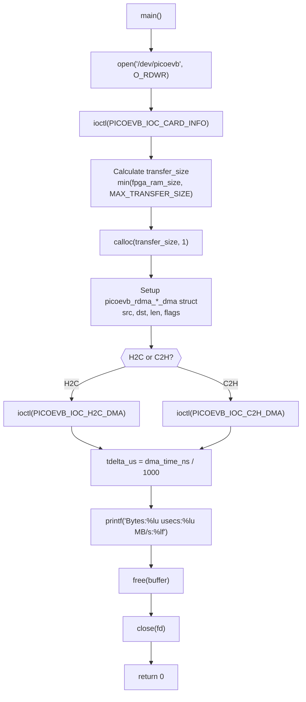

<!-- source: DeepWiki mcp.deepwiki.com · repo NVIDIA/jetson-rdma-picoevb · extra page Malloc Performance Tests · fetched 2026-10-26 -->

# Malloc Performance Tests

<details>
<summary>Relevant source files</summary>

The following files were used as context for generating this wiki page:

- [client-applications/rdma-malloc-c2h-perf.c](client-applications/rdma-malloc-c2h-perf.c)
- [client-applications/rdma-malloc-h2c-perf.c](client-applications/rdma-malloc-h2c-perf.c)

</details>


This page documents the `rdma-malloc-c2h-perf` and `rdma-malloc-h2c-perf` applications, which measure DMA bandwidth for transfers involving regular host memory allocated with `malloc`. These tests benchmark PCIe and DMA performance for system memory without GPU involvement.

For GPU memory performance tests, see [CUDA Performance Tests](#5.3.1). For functional validation with data integrity checking, see [rdma-malloc Test](#5.2.2).

## Purpose and Scope

The malloc performance test applications provide unidirectional bandwidth measurements for:
- **Host-to-Card (H2C)**: Transfer data from host system memory to FPGA RAM
- **Card-to-Host (C2H)**: Transfer data from FPGA RAM to host system memory

These tests use standard `malloc`/`calloc` memory allocation, making them suitable for:
- Benchmarking baseline DMA performance without GPU overhead
- Testing systems without CUDA support
- Measuring PCIe bandwidth for non-GPU applications
- Validating DMA engine functionality with regular system memory

**Sources**: [client-applications/rdma-malloc-c2h-perf.c:1-95](), [client-applications/rdma-malloc-h2c-perf.c:1-95]()

## Application Overview

| Application | Transfer Direction | Memory Type | Source File |
|-------------|-------------------|-------------|-------------|
| `rdma-malloc-h2c-perf` | Host → FPGA | Host malloc buffer | [rdma-malloc-h2c-perf.c]() |
| `rdma-malloc-c2h-perf` | FPGA → Host | Host malloc buffer | [rdma-malloc-c2h-perf.c]() |

Both applications share a nearly identical structure, differing only in transfer direction and IOCTL command used.

**Sources**: [client-applications/rdma-malloc-c2h-perf.c:36-95](), [client-applications/rdma-malloc-h2c-perf.c:36-95]()

## Program Execution Flow



**Sources**: [client-applications/rdma-malloc-c2h-perf.c:36-95](), [client-applications/rdma-malloc-h2c-perf.c:36-95]()

## Implementation Details

### Memory Allocation Strategy

Both applications use `calloc` to allocate zero-initialized host memory:

```c
void *dst = calloc(transfer_size, 1);  // C2H test
void *src = calloc(transfer_size, 1);  // H2C test
```

The `calloc` function allocates regular system memory that is:
- **Pageable**: Not pinned in physical memory initially
- **Mapped on-demand**: Kernel driver uses `get_user_pages` during DMA
- **DMA-mapped**: Driver performs `dma_map_sg` to get bus addresses

This differs from `cudaHostAlloc` (pinned host memory) or `cudaMalloc` (device memory) used in CUDA tests.

**Sources**: [client-applications/rdma-malloc-c2h-perf.c:66-70](), [client-applications/rdma-malloc-h2c-perf.c:66-70]()

### Transfer Size Determination

Transfer size is determined by querying the FPGA card information and capping at a maximum:

```c
#define MAX_TRANSFER_SIZE (100 * 1024 * 1024)

transfer_size = card_info.fpga_ram_size;
if (transfer_size > MAX_TRANSFER_SIZE)
    transfer_size = MAX_TRANSFER_SIZE;
```

| FPGA Board | RAM Size | Typical Transfer Size |
|------------|----------|----------------------|
| PicoEVB | 64 KB | 64 KB |
| HTG-K800 | 2 GB | 100 MB (capped) |

The 100 MB cap prevents excessive memory allocation while still testing substantial transfers.

**Sources**: [client-applications/rdma-malloc-c2h-perf.c:34-64](), [client-applications/rdma-malloc-h2c-perf.c:34-64]()

### IOCTL Command Usage

```mermaid
graph TB
    subgraph "H2C Performance Test"
        H2C_STRUCT["struct picoevb_rdma_h2c_dma<br/>dma_params"]
        H2C_SRC["dma_params.src = (u64)src"]
        H2C_DST["dma_params.dst = 0"]
        H2C_LEN["dma_params.len = transfer_size"]
        H2C_FLAGS["dma_params.flags = 0"]
        H2C_IOCTL["ioctl(fd, PICOEVB_IOC_H2C_DMA,<br/>&dma_params)"]
        H2C_TIME["dma_params.dma_time_ns"]
    end
    
    subgraph "C2H Performance Test"
        C2H_STRUCT["struct picoevb_rdma_c2h_dma<br/>dma_params"]
        C2H_SRC["dma_params.src = 0"]
        C2H_DST["dma_params.dst = (u64)dst"]
        C2H_LEN["dma_params.len = transfer_size"]
        C2H_FLAGS["dma_params.flags = 0"]
        C2H_IOCTL["ioctl(fd, PICOEVB_IOC_C2H_DMA,<br/>&dma_params)"]
        C2H_TIME["dma_params.dma_time_ns"]
    end
    
    H2C_STRUCT --> H2C_SRC
    H2C_SRC --> H2C_DST
    H2C_DST --> H2C_LEN
    H2C_LEN --> H2C_FLAGS
    H2C_FLAGS --> H2C_IOCTL
    H2C_IOCTL --> H2C_TIME
    
    C2H_STRUCT --> C2H_SRC
    C2H_SRC --> C2H_DST
    C2H_DST --> C2H_LEN
    C2H_LEN --> C2H_FLAGS
    C2H_FLAGS --> C2H_IOCTL
    C2H_IOCTL --> C2H_TIME
```



**Key Parameters**:
- **src/dst = 0**: Indicates FPGA RAM base address (offset 0)
- **src/dst = host pointer**: Cast to `__u64`, represents user-space virtual address
- **len**: Transfer size in bytes
- **flags = 0**: No special flags for these simple performance tests
- **dma_time_ns**: Returned by kernel after transfer completes

**Sources**: [client-applications/rdma-malloc-c2h-perf.c:72-81](), [client-applications/rdma-malloc-h2c-perf.c:72-81]()

### Performance Calculation

The bandwidth calculation converts nanoseconds to microseconds and computes MB/s:

```c
tdelta_us = dma_params.dma_time_ns / 1000;
printf("Bytes:%lu usecs:%lu MB/s:%lf\n", 
       transfer_size, 
       tdelta_us, 
       (double)transfer_size / (double)tdelta_us);
```

The formula: **MB/s = Bytes / microseconds**

This works because: `Bytes / μs = Bytes / (10^-6 s) = 10^6 Bytes/s = MB/s`

**Sources**: [client-applications/rdma-malloc-c2h-perf.c:83-84](), [client-applications/rdma-malloc-h2c-perf.c:83-84]()

## Execution and Output

### Command Line

Both applications accept no arguments:

```bash
./rdma-malloc-h2c-perf
./rdma-malloc-c2h-perf
```

**Sources**: [client-applications/rdma-malloc-c2h-perf.c:45-48](), [client-applications/rdma-malloc-h2c-perf.c:45-48]()

### Output Format

The applications produce a single line of output:

```
Bytes:65536 usecs:42 MB/s:1560.952381
```

**Output Fields**:
- **Bytes**: Total bytes transferred
- **usecs**: Transfer time in microseconds
- **MB/s**: Calculated bandwidth (megabytes per second)

### Example Results

| FPGA Board | Transfer Size | Typical Bandwidth |
|------------|---------------|-------------------|
| PicoEVB | 64 KB | ~1500 MB/s |
| HTG-K800 | 100 MB | ~3000-5000 MB/s |

Actual bandwidth depends on:
- PCIe generation (Gen2 vs Gen3)
- PCIe lane count (x1, x4, x16)
- System memory bandwidth
- CPU/chipset configuration

**Sources**: [client-applications/rdma-malloc-c2h-perf.c:83-84](), [client-applications/rdma-malloc-h2c-perf.c:83-84]()

## Comparison: Malloc vs CUDA Tests

```mermaid
graph TB
    subgraph "rdma-malloc-*-perf Applications"
        MALLOC_ALLOC["calloc(transfer_size, 1)"]
        MALLOC_MEM["Regular System Memory<br/>Pageable"]
        MALLOC_PIN["Kernel: get_user_pages()"]
        MALLOC_MAP["Kernel: dma_map_sg()"]
        MALLOC_IOCTL["PICOEVB_IOC_H2C_DMA<br/>or PICOEVB_IOC_C2H_DMA"]
    end
    
    subgraph "rdma-cuda-*-perf Applications"
        CUDA_ALLOC["cudaMalloc() or cudaHostAlloc()"]
        CUDA_MEM["GPU Memory or Pinned Memory"]
        CUDA_PIN["PICOEVB_IOC_PIN_CUDA"]
        CUDA_P2P["Kernel: nvidia_p2p_get_pages()<br/>nvidia_p2p_dma_map_pages()"]
        CUDA_IOCTL["PICOEVB_IOC_H2C_DMA<br/>or PICOEVB_IOC_C2H_DMA"]
    end
    
    MALLOC_ALLOC --> MALLOC_MEM
    MALLOC_MEM --> MALLOC_PIN
    MALLOC_PIN --> MALLOC_MAP
    MALLOC_MAP --> MALLOC_IOCTL
    
    CUDA_ALLOC --> CUDA_MEM
    CUDA_MEM --> CUDA_PIN
    CUDA_PIN --> CUDA_P2P
    CUDA_P2P --> CUDA_IOCTL
```



### Key Differences

| Aspect | Malloc Tests | CUDA Tests |
|--------|-------------|------------|
| **Memory Allocation** | `calloc()` | `cudaMalloc()` or `cudaHostAlloc()` |
| **Memory Type** | Regular system memory | GPU device or pinned host memory |
| **Pinning Method** | Implicit via DMA IOCTL | Explicit via `PICOEVB_IOC_PIN_CUDA` |
| **Kernel API** | `get_user_pages`, `dma_map_sg` | `nvidia_p2p_get_pages`, `nvidia_p2p_dma_map_pages` |
| **GPU Involvement** | None | Direct GPU memory access |
| **CUDA Dependency** | Not required | Requires CUDA runtime |
| **Compilation** | GCC (C source) | NVCC (CUDA source) |
| **Use Case** | Baseline DMA benchmarking | GPU-accelerated workloads |

**Sources**: [client-applications/rdma-malloc-c2h-perf.c:66-81](), [client-applications/rdma-malloc-h2c-perf.c:66-81]()

## Error Handling

Both applications implement basic error checking:

| Operation | Error Check | Example Message |
|-----------|-------------|-----------------|
| Device open | `fd < 0` | `"open() failed"` |
| Card info IOCTL | `ret != 0` | `"ioctl(CARD_INFO) failed"` |
| Memory allocation | `!src` or `!dst` | `"malloc(src) failed"` |
| DMA IOCTL | `ret != 0` | `"ioctl(DMA) failed"` |
| Device close | `ret < 0` | `"close() failed"` |

All error paths print diagnostic messages using `fprintf(stderr, ...)` and `perror()`, then return exit code 1.

**Sources**: [client-applications/rdma-malloc-c2h-perf.c:50-92](), [client-applications/rdma-malloc-h2c-perf.c:50-92]()

## Use Cases

The malloc performance tests are appropriate for:

1. **Baseline Performance Measurement**: Establish maximum achievable DMA bandwidth without GPU overhead
2. **System Validation**: Verify PCIe and DMA subsystem functionality
3. **Comparison with CUDA**: Compare GPU-involved transfers vs system memory transfers
4. **Non-GPU Workloads**: Benchmark applications that process data in CPU memory
5. **Quick Testing**: Simpler compilation and execution than CUDA tests (no CUDA dependency)

**Sources**: [client-applications/rdma-malloc-c2h-perf.c:1-95](), [client-applications/rdma-malloc-h2c-perf.c:1-95]()

---

