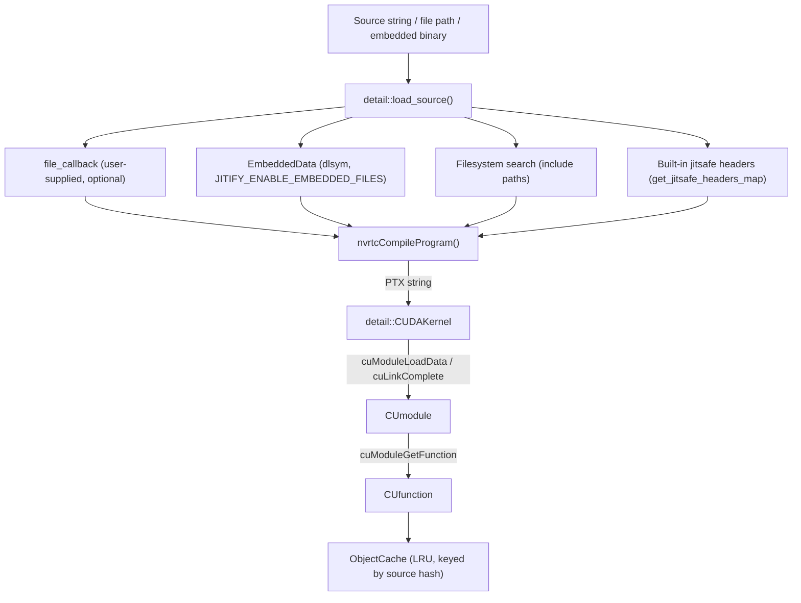
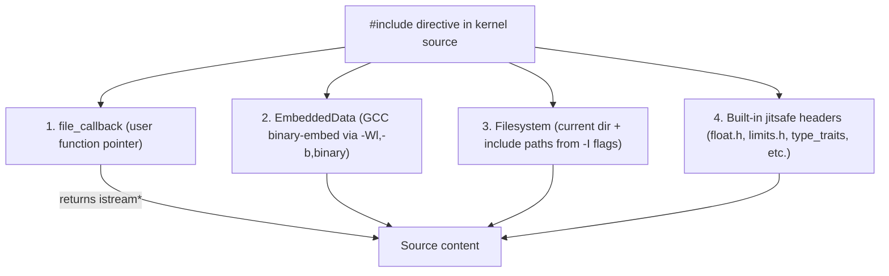

<!-- source: DeepWiki mcp.deepwiki.com · repo NVIDIA/jitify · page 1 Overview · fetched 2026-10-26 -->

# Overview

Relevant source files

The following files were used as context for generating this wiki page:

- [README.md](README.md)
- [jitify.hpp](jitify.hpp)
- [jitify_example.cpp](jitify_example.cpp)

This page describes the purpose, architecture, and key capabilities of the **Jitify** library. For detailed API reference, see [Core API Reference](#2). For practical usage patterns, see the [Usage Guide](#3).

---

## What is Jitify?

Jitify is a single-header C++ library (`jitify.hpp`) that wraps CUDA's NVRTC (NVIDIA Runtime Compilation) API to simplify just-in-time compilation of CUDA kernels from within a host application.

Without Jitify, using NVRTC directly requires managing:
- Low-level NVRTC and CUDA Driver API calls (`nvrtcCreateProgram`, `cuModuleLoadData`, `cuLaunchKernel`, etc.)
- Name mangling for templated kernels
- Manual header resolution during compilation
- Linking of compiled PTX against external libraries
- Cache invalidation and reuse of compiled binaries

Jitify replaces all of this with a concise object-oriented interface.

**Minimum requirements**

| Requirement | Value |
|---|---|
| C++ standard | C++11 (`-std=c++11`) |
| Compile flag | `-pthread` (unless `JITIFY_THREAD_SAFE=0`) |
| Link libraries | `-lcuda -lcudart -lnvrtc` (Linux also: `-ldl`) |
| Header | `jitify.hpp` (single file, no build step) |
| Supported platforms | Linux, Windows |
| Tested CUDA versions | 7.0, 7.5, 8.0, 9.x, 10.x |

Sources: [README.md:1-52](), [jitify.hpp:29-62]()

---

## High-Level Architecture

The central flow in a Jitify application moves through a chain of five objects. Each step narrows from a compiled program to a specific kernel launch.

**Object model overview**

Sources: [jitify.hpp:68-81](), [jitify_example.cpp:88-116](), [README.md:14-34]()

---

**Internal compilation pipeline**

When `program()` is called on a `JitCache`, Jitify performs source resolution, compilation via NVRTC, optional linking, and module loading. The result is cached in an `ObjectCache` keyed by source hash.

Sources: [jitify.hpp:556-714](), [jitify.hpp:1111-1376](), [jitify.hpp:205-274]()

---

## Key Features

### 1. Kernel Caching

`jitify::JitCache` wraps an `ObjectCache<KeyType, ValueType>` that implements an LRU eviction policy. The cache size (number of compiled programs to retain) is set at construction. When the same source string and options are used again, the compiled `CUDAKernel` is returned directly from the cache without recompilation.

For user-managed persistence (e.g., distributed caches), the `jitify::experimental` namespace exposes `serialize()` and `deserialize()` on `Program` and `KernelInstantiation`. See [Experimental API](#2.6).

Sources: [jitify.hpp:205-274](), [jitify_example.cpp:119-150]()

---

### 2. Template Kernel Instantiation and Reflection

Jitify's `jitify::reflection` namespace converts C++ types and compile-time values into the string representations NVRTC requires for template instantiation.

| Helper | Input | Output string |
|---|---|---|
| `reflect<float>()` | type parameter | `"float"` |
| `reflect(3.14f)` | value | `"(float)3.14"` |
| `reflect<int, 7>()` | non-type parameter | `"(int)7"` |
| `NonType<int, 7>` | wrapper type | used in `reflect<NonType<int,7>>()` |
| `type_of(*ptr)` | dereferenced pointer | `Type<T>` object |
| `instance_of(obj)` | abstract/polymorphic value | runtime-derived type string |

These strings are passed directly to `KernelInstantiation::instantiate()`. See [Reflection Utilities](#2.5) and [Template Kernel Instantiation](#3.2).

Sources: [jitify.hpp:720-1025](), [jitify_example.cpp:177-225]()

---

### 3. Header Management

Jitify resolves `#include` directives in JIT-compiled source through a layered lookup:

Built-in "jitsafe" headers are simplified versions of standard C/C++ headers (e.g., `float.h`, `limits.h`, `iterator`, `type_traits`) that are safe to compile on the device. These live as string literals in `jitify.hpp` and are returned by `detail::get_jitsafe_headers_map()`.

The `JITIFY_INCLUDE_EMBEDDED_FILE(name)` macro declares symbols placed in the binary by the GCC linker's `-Wl,-b,binary` option. The stringify utility converts header files into C string literals (`.jit` files) for a simpler embedding strategy. See [Header Management](#3.3) and [stringify Utility](#4.1).

Sources: [jitify.hpp:164-183](), [jitify.hpp:309-342](), [jitify.hpp:556-714](), [jitify.hpp:1378-1406]()

---

### 4. Device and Constant Variable Access

`KernelInstantiation` exposes host-side read/write of `__device__` and `__constant__` variables in JIT-compiled modules. Internally, `detail::CUDAKernel` builds a `_global_map` by scanning the PTX for `.const .align` and `.global .align` directives at construction time, then uses `cuModuleGetGlobal` for address resolution.

See [Device and Constant Memory](#3.4) for usage details.

Sources: [jitify.hpp:1222-1244](), [jitify.hpp:1329-1370]()

---

### 5. Linking

`KernelInstantiation` can link compiled PTX against pre-built PTX, CUBIN, FATBIN, object files, or static libraries via `cuLinkCreate` / `cuLinkAddFile` / `cuLinkComplete`. File type is inferred from the file extension. The special value `"."` links against the current executable (used with `JITIFY_ENABLE_EMBEDDED_FILES`). See [KernelInstantiation](#2.3).

Sources: [jitify.hpp:1079-1210]()

---

### 6. Parallel For and Lambda Support

`jitify::parallel_for` and the `JITIFY_LAMBDA` macro allow expressing a device-side loop without naming a kernel function explicitly. The lambda body is JIT-compiled under the hood. See [Parallel For and Lambda Support](#3.5).

Sources: [jitify.hpp:68-81](), [jitify_example.cpp:302-325]()

---

## Namespaces and File Structure

Since Jitify is a single header, all code lives in `jitify.hpp`. The public surface is organized into namespaces:

| Namespace | Role |
|---|---|
| `jitify` | Top-level: `JitCache`, `Program`, `Kernel`, `KernelInstantiation`, `KernelLauncher`, `parallel_for`, `JITIFY_LAMBDA` |
| `jitify::reflection` | Type/value → string conversion: `reflect`, `type_of`, `instance_of`, `Type`, `NonType`, `Instance` |
| `jitify::experimental` | Serializable `Program` and `KernelInstantiation` for user-managed caching |
| `jitify::detail` | Internal helpers: `CUDAKernel`, `ObjectCache`, `load_source`, `EmbeddedData`, path utilities |

Sources: [jitify.hpp:185-198](), [jitify.hpp:720-722]()

---

## Debug and Configuration Macros

The following preprocessor macros control optional behavior:

| Macro | Default | Effect |
|---|---|---|
| `JITIFY_THREAD_SAFE` | `1` | Enables mutex guards in `JitCache` |
| `JITIFY_ENABLE_EMBEDDED_FILES` | `0` | Enables `dlopen`/`dlsym` for binary-embedded files |
| `JITIFY_PRINT_LOG` | `1` | Prints NVRTC compiler log on error |
| `JITIFY_PRINT_INSTANTIATION` | `0` | Logs each kernel instantiation |
| `JITIFY_PRINT_SOURCE` | `0` | Prints processed source before compilation |
| `JITIFY_PRINT_PTX` | `0` | Prints generated PTX |
| `JITIFY_PRINT_LINKER_LOG` | `0` | Prints CUDA linker info/error logs |
| `JITIFY_PRINT_LAUNCH` | `0` | Logs each kernel launch |
| `JITIFY_PRINT_ALL` | `0` | Enables all `JITIFY_PRINT_*` flags |

Sources: [jitify.hpp:84-162]()

---

