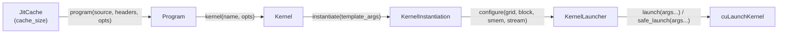
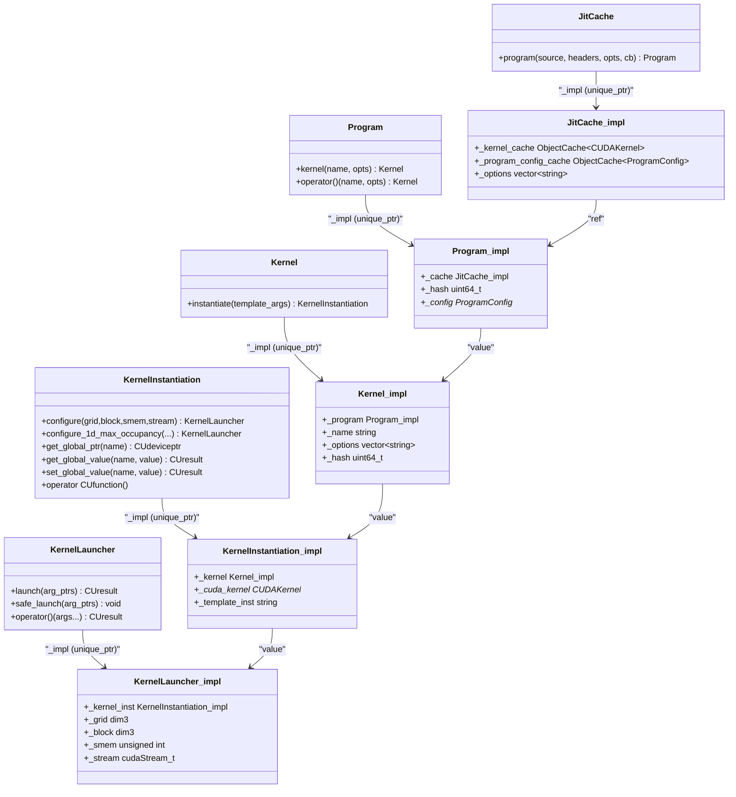
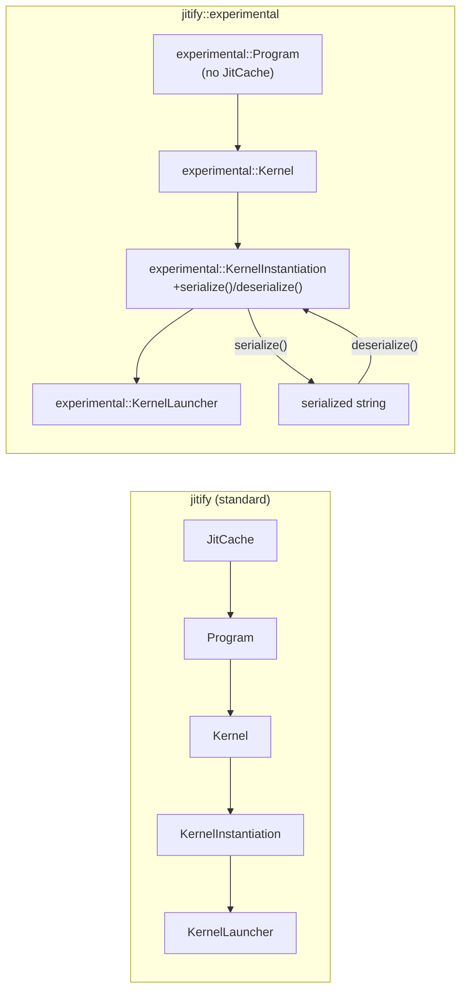

<!-- source: DeepWiki mcp.deepwiki.com · repo NVIDIA/jitify · page 2 Core API Reference · fetched 2026-10-26 -->

# Core API Reference

<details>
<summary>Relevant source files</summary>

The following files were used as context for generating this wiki page:

- [jitify.hpp](jitify.hpp)

</details>


This page describes the complete C++ object model exposed by `jitify.hpp` and the chain of objects required to compile and launch a JIT-compiled CUDA kernel. It serves as an index over the API and summarizes each class at a glance; detailed coverage of each class is in the linked sub-pages.

This page does not cover build setup, the `stringify` tool, or `nvrtc_cli`. For practical step-by-step patterns see [Usage Guide](#3). For the experimental serialization API see [Experimental API](#2.6).

---

## Object Chain

Every kernel launch follows one fixed chain of object construction. Each step narrows the scope: from a general cache, down to a specific instantiation with concrete template arguments and launch parameters.

**Diagram: Standard API Object Chain**



Sources: [jitify.hpp:3492-3570]()

**Diagram: Class-to-Impl Relationship (Pimpl pattern)**



Sources: [jitify.hpp:3041-3171](), [jitify.hpp:3176-3570]()

---

## Classes at a Glance

| Class | Namespace | Header Location | Purpose |
|---|---|---|---|
| `JitCache` | `jitify` | [jitify.hpp:3492-3548]() | Root object; manages LRU caches for compiled programs and kernel instances |
| `Program` | `jitify` | [jitify.hpp:3457-3487]() | Holds parsed source, headers, and compiler options; keyed in the program cache |
| `Kernel` | `jitify` | [jitify.hpp:3392-3452]() | Identifies a named `__global__` function within a `Program` |
| `KernelInstantiation` | `jitify` | [jitify.hpp:3244-3388]() | Compiles a specific template instantiation to PTX and loads a `CUmodule` |
| `KernelLauncher` | `jitify` | [jitify.hpp:3176-3239]() | Binds launch parameters (grid, block, smem, stream) and dispatches the kernel |
| `NonType<T,V>` | `jitify::reflection` | [jitify.hpp:734-737]() | Wrapper for non-type template parameters for use with `reflect()` |
| `Type<T>` | `jitify::reflection` | [jitify.hpp:913-914]() | Wrapper used to pass a type as a value to `instantiate()` |
| `Instance<T>` | `jitify::reflection` | [jitify.hpp:897-909]() | Captures a reference to extract the runtime (derived) type via `reflect()` |
| `ExecutionPolicy` | `jitify` | [jitify.hpp:3739-3772]() | Configuration for `parallel_for` (stream, block size, headers, cache size) |
| `experimental::Program` | `jitify::experimental` | [jitify.hpp:4071-4172]() | Like `Program`, but adds `serialize()` / `deserialize()` without `JitCache` |
| `experimental::KernelInstantiation` | `jitify::experimental` | [jitify.hpp:4229-4417]() | Like `KernelInstantiation`, but adds `serialize()` / `deserialize()` |

---

## Internal / Support Types

These types are used by the public classes but are not part of the user-facing API.

| Type | Location | Role |
|---|---|---|
| `ObjectCache<K,V>` | [jitify.hpp:206-274]() | LRU cache with configurable capacity used by `JitCache_impl` |
| `ProgramConfig` | [jitify.hpp:3046-3052]() | Plain struct holding `options`, `sources`, `include_paths`, and `name` stored in the program cache |
| `detail::CUDAKernel` | [jitify.hpp:1111-1376]() | Wraps a `CUmodule` + `CUfunction`; handles PTX linking and global variable lookup |
| `file_callback_type` | [jitify.hpp:196-197]() | `typedef std::istream* (*)(std::string, std::iostream&)` — user-supplied source loader |

---

## JitCache

[Detailed reference → JitCache](#2.1)

`JitCache` is the root object. It must outlive all `Program` objects derived from it. It owns two `ObjectCache` instances, one keyed on a `uint64_t` hash of (source + headers + options) for `ProgramConfig` objects, and one keyed on a `uint64_t` hash of (program hash + kernel name + template args) for `detail::CUDAKernel` objects.

```
JitCache cache(128);  // holds up to 128 entries per cache tier
```

The default cache size is `JitCache::DEFAULT_CACHE_SIZE` = 128.

Thread safety is controlled by `JITIFY_THREAD_SAFE` (default `1`). When enabled, separate `std::mutex` instances guard each cache tier inside `JitCache_impl`.

---

## Program

[Detailed reference → Program and Kernel](#2.2)

`Program` is created via `JitCache::program()` [jitify.hpp:3542-3547]() and stored in the `_program_config_cache` under a hash of the source string, header strings, and options. On a cache hit the source is not re-parsed.

**Key parameters to `program()`:**

| Parameter | Type | Notes |
|---|---|---|
| `source` | `std::string` | Filename **or** inline source. For inline source, the first line is the program name. |
| `headers` | `vector<string>` | Each entry is a filename or inline header (first line = include name). |
| `options` | `vector<string>` | Passed to NVRTC. `-I` paths are extracted and used for header search. |
| `file_callback` | `file_callback_type` | Optional; called first for every `#include` encountered. |

Source loading priority (per include): `file_callback` → embedded binary (if `JITIFY_ENABLE_EMBEDDED_FILES`) → filesystem → built-in JIT-safe headers. See [jitify.hpp:556-714]().

---

## Kernel

[Detailed reference → Program and Kernel](#2.2)

`Kernel` is created by `Program::kernel(name, options)` [jitify.hpp:3475-3486]() or via `operator()`. It records the unmangled function name and any additional per-kernel NVRTC options. Options are merged with the parent `Program`'s options.

---

## KernelInstantiation

[Detailed reference → KernelInstantiation](#2.3)

`KernelInstantiation` is the step that triggers actual NVRTC compilation. It is created by one of three `Kernel::instantiate()` overloads:

| Overload | Syntax | Notes |
|---|---|---|
| String args | `instantiate({"float", "7"})` | Most flexible; strings are used verbatim |
| Template params | `instantiate<float, NonType<int,7>>()` | C++ template syntax; limited to compile-time values |
| Value args | `instantiate(Type<float>(), val)` | Uses `reflect()` to convert each argument |

The resulting PTX and mangled function name are cached in `_kernel_cache` under a hash that incorporates the program hash, kernel name, and template instantiation string. The compiled `CUfunction` handle is accessible via implicit conversion:

```cpp
CUfunction f = my_instantiation;  // implicit operator CUfunction()
```

Global variable access methods operate on the loaded `CUmodule`:

| Method | Direction |
|---|---|
| `get_global_ptr(name)` → `CUdeviceptr` | Address only |
| `get_global_value(name, &val)` | Device → Host (single element) |
| `get_global_array(name, data, count)` | Device → Host (array) |
| `set_global_value(name, val)` | Host → Device (single element) |
| `set_global_array(name, data, count)` | Host → Device (array) |
| `get_constant_ptr(name)` | Deprecated; delegates to `get_global_ptr` |

---

## KernelLauncher

[Detailed reference → KernelLauncher](#2.4)

`KernelLauncher` is created by `KernelInstantiation::configure()` or `configure_1d_max_occupancy()`. It stores grid/block/smem/stream and provides three ways to dispatch:

| Method | Behaviour on CUDA error |
|---|---|
| `launch(vector<void*>)` → `CUresult` | Returns error code |
| `safe_launch(vector<void*>)` | Throws `std::runtime_error` |
| `operator()(args...)` / `launch(args...)` | Variadic; builds `void*` vector internally; returns `CUresult` |

`configure_1d_max_occupancy()` calls `cuOccupancyMaxPotentialBlockSizeWithFlags` internally [jitify.hpp:3016-3035]() to choose grid and block dimensions.

---

## Reflection Utilities

[Detailed reference → Reflection Utilities](#2.5)

The `jitify::reflection` namespace provides helpers to convert C++ types and values into the strings required by `instantiate()`.

**Diagram: Reflection Function Map**

```mermaid
flowchart TD
  A["reflect&lt;T&gt;()"] -->|"demangle typeid"| S1["\"float\""]
  B["reflect(value)"] -->|"cast + stream"| S2["\"(float)3.14\""]
  C["reflect&lt;N&gt;()"] -->|"NonType&lt;int64_t,N&gt;"| S3["\"(int64_t)7\""]
  D["reflect&lt;T,N&gt;()"] -->|"NonType&lt;T,N&gt;"| S4["\"(int)7\""]
  E["type_of(var)"] -->|"returns Type&lt;T&gt;"| F["Type&lt;T&gt;"]
  F -->|"reflect(Type&lt;T&gt;())"| S1
  G["instance_of(obj)"] -->|"returns Instance&lt;T&gt;"| H["Instance&lt;T&gt;"]
  H -->|"reflect(instance)"| S5["runtime derived type string"]
  I["reflect_template&lt;Ts...&gt;()"] -->|"join with commas"| S6["\"&lt;float,int&gt; \""]
```

Sources: [jitify.hpp:722-1025]()

Key free functions:

| Function | Return | Example output |
|---|---|---|
| `reflect<T>()` | `std::string` | `"float"` |
| `reflect(value)` | `std::string` | `"(float)3.14"` |
| `reflect<N>()` | `std::string` | `"(int64_t)7"` |
| `reflect<T,N>()` | `std::string` | `"(int)7"` |
| `type_of(var)` | `Type<T>` | Used with `reflect()` |
| `instance_of(obj)` | `Instance<T const>` | Used with `reflect()` for runtime types |
| `reflect_template<Ts...>()` | `std::string` | `"<float,int >"` |

---

## Experimental API

[Detailed reference → Experimental API](#2.6)

The `jitify::experimental` namespace [jitify.hpp:3927-4532]() provides `Program`, `Kernel`, `KernelInstantiation`, and `KernelLauncher` classes with the same interface as the standard API, but without `JitCache`. Instead, `experimental::Program` and `experimental::KernelInstantiation` expose `serialize()` and `deserialize()` static methods for user-managed persistence.

**Diagram: Standard vs Experimental API Comparison**



Sources: [jitify.hpp:3927-4532]()

---

## Compile-Time Macros

Several macros modify Jitify's behaviour before `#include <jitify.hpp>`:

| Macro | Default | Effect |
|---|---|---|
| `JITIFY_THREAD_SAFE` | `1` | Guards caches with `std::mutex` |
| `JITIFY_ENABLE_EMBEDDED_FILES` | undefined | Enables `dlopen`-based embedded file lookup |
| `JITIFY_PRINT_LOG` | `1` | Prints NVRTC compile logs |
| `JITIFY_PRINT_ALL` | undefined | Enables all print flags |
| `JITIFY_OPTIONS` | undefined | Additional compiler options added to every program |

Sources: [jitify.hpp:84-162]()

---

## Parallel For and Lambda Support

For use cases that do not require a named kernel, Jitify provides `parallel_for` [jitify.hpp:3868-3925]() and the `JITIFY_LAMBDA` macro, controlled by `ExecutionPolicy`. See [Parallel For and Lambda Support](#3.5) for a usage guide.

---

