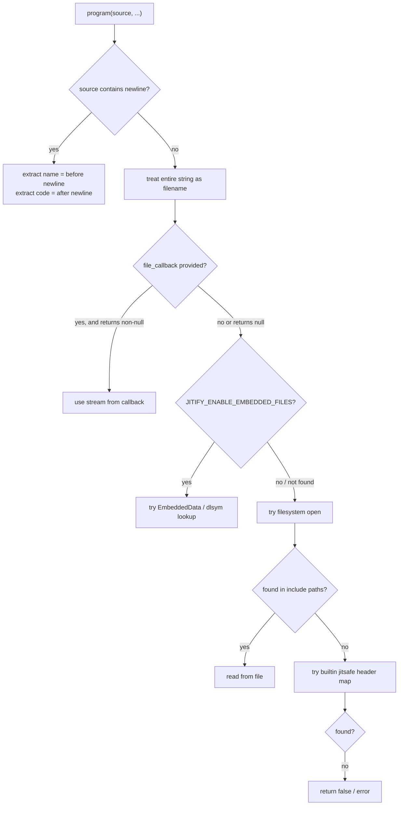
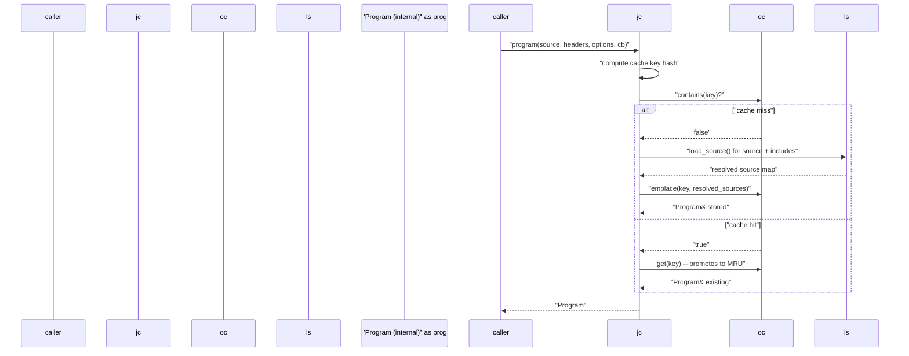
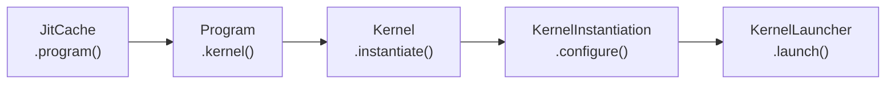

<!-- source: DeepWiki mcp.deepwiki.com · repo NVIDIA/jitify · page 2.1 JitCache · fetched 2026-10-26 -->

# JitCache

<details>
<summary>Relevant source files</summary>

The following files were used as context for generating this wiki page:

- [jitify.hpp](jitify.hpp)
- [jitify_example.cpp](jitify_example.cpp)
- [jitify_test.cu](jitify_test.cu)

</details>


This page is a reference for the `jitify::JitCache` class: its constructor, internal cache mechanics, the `program()` method and all its parameters, and thread-safety behavior. For details on the objects that `program()` returns and how to use them to launch kernels, see [Program and Kernel](#2.2). For the experimental (non-cached) API, see [Experimental API](#2.6).

---

## Overview

`JitCache` is the primary entry point for managed JIT compilation in Jitify. It holds an in-process LRU cache of compiled programs, so that repeated calls with identical source and options skip recompilation. The caller constructs one `JitCache` instance (typically as a `static` or `thread_local static`) and calls `program()` each time a JIT-compiled kernel is needed.

**Typical usage pattern:**

```cpp
static jitify::JitCache kernel_cache;
jitify::Program program = kernel_cache.program(source, headers, options, callback);
```

*Sources: [jitify_test.cu:107-131](), [jitify_example.cpp:99-116]()*

---

## Internal Cache Structure

`JitCache` is backed by the `ObjectCache` template class, which implements a fixed-capacity LRU eviction policy.

**Internal LRU Cache: `ObjectCache<KeyType, ValueType>`**

```mermaid
classDiagram
    class "ObjectCache~K,V~" {
        -object_map _objects
        -key_rank _ranked_keys
        -size_t _capacity
        +ObjectCache(size_t capacity)
        +resize(size_t capacity)
        +contains(key) bool
        +touch(key)
        +get(key) V&
        +insert(key, value) V&
        +emplace(key, args...) V&
        -discard_old(n)
    }
    class "JitCache" {
        -ObjectCache _program_cache
        +JitCache(size_t cache_size)
        +program(source, headers, options, callback) Program
    }
    "JitCache" --> "ObjectCache~K,V~" : "contains"
```

*Sources: [jitify.hpp:204-274](), [jitify.hpp:202]()*

Key properties of `ObjectCache`:

| Property | Detail |
|---|---|
| Eviction policy | LRU: least-recently-used entry is discarded when capacity is exceeded |
| Default capacity | `8` entries |
| Key type | Hash derived from source text and compiler options |
| Value type | Compiled `Program` internal state |
| On capacity overflow | Evicts the entry at the back of the `_ranked_keys` deque |
| On cache hit | Promotes the entry to the front via `touch()` |

*Sources: [jitify.hpp:219-273]()*

---

## Constructor

```cpp
jitify::JitCache kernel_cache;              // default capacity
jitify::JitCache kernel_cache(cache_size);  // explicit capacity
```

The single constructor parameter `cache_size` is passed directly to `ObjectCache` as its capacity. It controls how many distinct programs (identified by unique source + option combinations) can reside in the cache simultaneously. When a new program exceeds this count, the least-recently-used existing entry is evicted.

**Declaration site:** [jitify.hpp:202]()

**Typical lifetime patterns observed in practice:**

| Pattern | When to use |
|---|---|
| `static jitify::JitCache kernel_cache;` | Single shared cache across all calls in the process |
| `thread_local static jitify::JitCache kernel_cache;` | Per-thread cache, avoids lock contention |
| Local variable | Throwaway use; cache is not reused across calls |

*Sources: [jitify_test.cu:108](), [jitify_test.cu:226](), [jitify_test.cu:377](), [jitify_example.cpp:99](), [jitify_example.cpp:183]()*

---

## The `program()` Method

`program()` is the sole public method on `JitCache` for obtaining a `Program`. Its full signature is:

```cpp
Program program(
    const std::string& source,
    const std::vector<std::string>& headers = {},
    const std::vector<std::string>& options = {},
    file_callback_type file_callback = nullptr
);
```

On the first call with a given combination of `source`, `headers`, and `options`, Jitify parses and pre-processes the source (resolving includes), stores the result in the `ObjectCache`, and returns a `Program`. Subsequent calls with identical arguments retrieve the `Program` from cache without re-running NVRTC. Full NVRTC compilation is deferred until `KernelInstantiation` is first requested.

**Parameter reference:**

| Parameter | Type | Description |
|---|---|---|
| `source` | `const std::string&` | Kernel source. See format rules below. |
| `headers` | `std::vector<std::string>` | Inline header source strings (e.g. from `stringify`). Pass `0` or `{}` if none. |
| `options` | `std::vector<std::string>` | NVRTC compiler flags, e.g. `"--use_fast_math"`, `"-std=c++14"`, `"-IFOO"`. |
| `file_callback` | `file_callback_type` | Optional function pointer called when an include cannot be resolved by other means. |

*Sources: [jitify_test.cu:227-230](), [jitify_example.cpp:184-187](), [jitify.hpp:196-197]()*

### Source String Format

The `source` parameter accepts two distinct formats:

**Format 1 — Inline source with embedded name:**

```
"<program_name>\n<cuda_source_code>"
```

The program name is the substring before the first `\n`. Everything after it is the CUDA C++ source. This is the most common format.

**Format 2 — Filename reference:**

```
"example_headers/constant_header.cuh"
```

When no `\n` is present, the entire string is treated as a file path. Jitify resolves it using the file-loading chain described in the `file_callback` section below.

*Sources: [jitify.hpp:567-573](), [jitify_test.cu:431](), [jitify_test.cu:386-387]()*

**Source resolution diagram:**



*Sources: [jitify.hpp:556-714]()*

### The `headers` Parameter

Each entry in the `headers` vector is a self-contained header source string. The first line of each string must be the header's filename; subsequent lines are its content. This is the output format produced by the `stringify` tool (see [stringify Utility](#4.1)).

```cpp
// example_headers_my_header1_cuh is a const char* from a .jit file
kernel_cache.program(source, {example_headers_my_header1_cuh}, options);
```

These headers are made available to the NVRTC compiler by name, so the kernel source can `#include` them normally.

*Sources: [jitify_test.cu:228-230](), [jitify_example.cpp:185-187]()*

### The `options` Parameter

`options` is passed directly to NVRTC. Common flags:

| Flag | Effect |
|---|---|
| `--use_fast_math` | Enable fast math intrinsics |
| `-std=c++11` / `-std=c++14` | Set C++ standard |
| `-IFOO` | Add include path `FOO` |
| `-rdc=true` | Enable relocatable device code (for linking) |
| `--remove-unused-globals` | Strip unreferenced `__device__` / `__constant__` variables from PTX |

Options are also read from the `JITIFY_OPTIONS` environment variable, which is prepended to the options list automatically.

*Sources: [jitify_test.cu:230](), [jitify_test.cu:754-756](), [jitify_test.cu:1131-1138]()*

### The `file_callback` Parameter

`file_callback_type` is a function pointer:

```cpp
typedef std::istream* (*file_callback_type)(std::string filename,
                                            std::iostream& tmp_stream);
```

When an `#include` directive cannot be satisfied by inline `headers`, embedded files, or the filesystem, Jitify calls `file_callback` with the requested filename. The callback either:
- Writes source into `tmp_stream` and returns `&tmp_stream`, **or**
- Returns `nullptr` / `0` to let Jitify continue trying other resolution mechanisms.

*Sources: [jitify.hpp:189-197](), [jitify_test.cu:79-93](), [jitify_example.cpp:71-85]()*

---

## Cache Keying and Hit/Miss Behavior

**How the cache key is formed:** The `ObjectCache` key is a hash derived from the combination of the source string and compiler options. The hash function used internally is `hash_larson64` combined with `hash_combine`.

**Call flow:**



*Sources: [jitify.hpp:428-440](), [jitify.hpp:204-274](), [jitify.hpp:556-714]()*

**Note:** NVRTC compilation (PTX generation) does **not** happen during `program()`. It is deferred until `KernelInstantiation` is first created. What is cached at the `JitCache` level is the pre-processed source and the resolved header map.

---

## Thread Safety

Thread safety is controlled by the compile-time macro `JITIFY_THREAD_SAFE`, which defaults to `1`.

```cpp
#ifndef JITIFY_THREAD_SAFE
#define JITIFY_THREAD_SAFE 1
#endif
```

When `JITIFY_THREAD_SAFE=1`, a `std::mutex` guards all accesses to the internal `ObjectCache`, making concurrent calls to `program()` from multiple threads safe. When set to `0`, no locking is performed and the caller is responsible for external synchronization.

A common pattern to avoid lock contention in multi-threaded code is `thread_local static`:

```cpp
thread_local static jitify::JitCache kernel_cache;
```

Each thread gets its own cache instance and never contends on the mutex.

*Sources: [jitify.hpp:84-86](), [jitify.hpp:108-110](), [jitify_test.cu:226](), [jitify_test.cu:377]()*

---

## Relationship to Other API Classes

The `program()` method returns a `jitify::Program`, which is the starting point for selecting and launching kernels. The full object chain is:



| Class | Obtained from | See |
|---|---|---|
| `Program` | `JitCache::program()` | [Program and Kernel](#2.2) |
| `Kernel` | `Program::kernel()` | [Program and Kernel](#2.2) |
| `KernelInstantiation` | `Kernel::instantiate()` | [KernelInstantiation](#2.3) |
| `KernelLauncher` | `KernelInstantiation::configure()` | [KernelLauncher](#2.4) |

*Sources: [jitify_test.cu:107-131](), [jitify_example.cpp:99-116]()*

---

