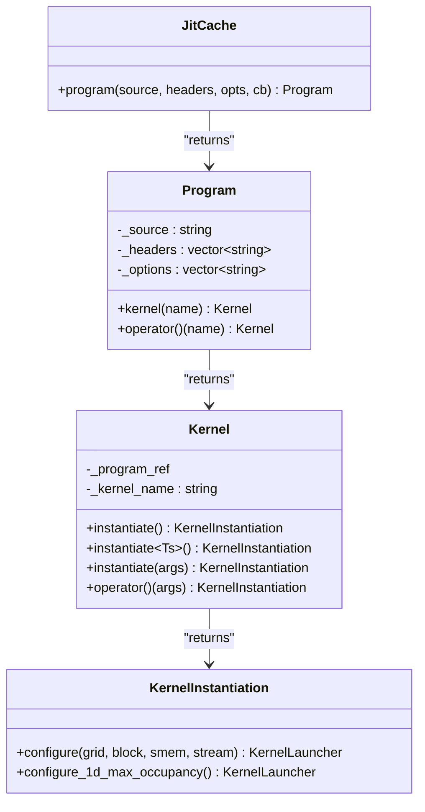

<!-- source: DeepWiki mcp.deepwiki.com · repo NVIDIA/jitify · page 2.2 Program and Kernel · fetched 2026-10-26 -->

# Program and Kernel

<details>
<summary>Relevant source files</summary>

The following files were used as context for generating this wiki page:

- [jitify.hpp](jitify.hpp)
- [jitify_example.cpp](jitify_example.cpp)
- [jitify_test.cu](jitify_test.cu)

</details>


This page covers `jitify::Program` and `jitify::Kernel`: what they store, how they are constructed, the overloads available on each, and how they chain together toward compilation and launch. For how `Program` is obtained in the first place, see [JitCache](#2.1). For what happens after `Kernel::instantiate()` is called, see [KernelInstantiation](#2.3) and [KernelLauncher](#2.4).

---

## Position in the API Chain

`Program` and `Kernel` sit in the middle of Jitify's object chain. Neither one triggers NVRTC compilation on its own; compilation is deferred until `instantiate()` is called on `Kernel`.

**Jitify object chain**


Sources: [jitify_test.cu:163-195](), [jitify_example.cpp:99-115]()

---

## Program

### What Program Stores

A `Program` object is a lightweight handle returned by `JitCache::program()`. It holds:

- The **source identifier**: either an inline source string (program name + code) or a file path.
- The **supplementary headers** provided at construction time.
- The **compiler options** (`nvrtc` flags) and any `file_callback`.
- A reference into the `JitCache` that owns the underlying compiled object cache.

`Program` is default-constructable and move-assignable, so it can be declared and assigned separately:

```cpp
// from jitify_test.cu:167-168
jitify::Program program;
program = kernel_cache.program(simple_program_source);
```

Sources: [jitify_test.cu:163-195]()

---

### Source String Format

The source argument passed to `JitCache::program()` (and hence stored in `Program`) can take two forms:

| Form | Example | Behaviour |
|---|---|---|
| Inline source | `"my_program\n__global__ void k() {}"` | First line before `\n` is the program name; remaining text is the CUDA C source. |
| File path | `"example_headers/constant_header.cuh"` | Jitify loads the file via the callback, embedded data, or the filesystem. |

The name (first line) is used as the cache key. If the same name is seen again with the same headers/options, the cached compiled form is reused.

Sources: [jitify_test.cu:95-105](), [jitify_test.cu:431-432](), [jitify.hpp:567-576]()

---

### Program::kernel()

```
Kernel Program::kernel(std::string kernel_name)
```

Selects a named `__global__` function within the program source. This call is cheap — it simply captures the name string alongside a reference to the program state. No compilation occurs here.

```cpp
// from jitify_example.cpp:108
program.kernel("my_kernel")
       .instantiate(3, type_of(*d_data))
       .configure(grid, block)
       .launch(d_data);
```

`Program::operator()` is an equivalent shorthand for `kernel()`.

Sources: [jitify_example.cpp:107-111](), [jitify_test.cu:242-245]()

---

## Kernel

### What Kernel Stores

`Kernel` is a pair of (Program reference, kernel name string). It has no compiled state; it is purely a selector.

`Kernel` is also default-constructable and move-assignable:

```cpp
// from jitify_test.cu:175-176
jitify::Kernel kernel;
kernel = program.kernel("my_kernel");
```

Sources: [jitify_test.cu:175-178]()

---

### Kernel::instantiate() Overloads

`instantiate()` is where template arguments are resolved and NVRTC compilation is triggered (or the cache is consulted). It returns a `KernelInstantiation`.

There are several equivalent calling conventions:

| Style | Syntax | Notes |
|---|---|---|
| No template args | `.instantiate()` | For non-template kernels. |
| Compile-time types | `.instantiate<NonType<int,C>, T>()` | Uses `reflection::NonType` for non-type params. |
| String list | `.instantiate({reflect((int)C), reflect<T>()})` | Explicit string representation of each arg. |
| Mixed value + type | `.instantiate((int)C, Type<T>())` | Recommended; uses `reflection::Type<T>`. |
| Value + type_of | `.instantiate((int)C, type_of(*ptr))` | Deduces type from existing variable. |
| Value + instance_of | `.instantiate((int)C, instance_of(*ptr))` | Resolves runtime-derived types. |

All five non-empty forms in the table above are demonstrated in the same test and are functionally equivalent (and will hit cache after the first call):

Sources: [jitify_test.cu:247-268](), [jitify_example.cpp:203-224]()

---

## Relationship Between Program and Kernel

**Class relationships and methods**



Sources: [jitify_test.cu:163-195](), [jitify.hpp:1111-1376]()

---

## Experimental API Counterparts

`jitify::experimental::Program` and its associated `Kernel` follow the same chaining interface but add `serialize()` and `deserialize()` for persistence. Construction is direct rather than through a `JitCache`:

```cpp
// from jitify_test.cu:135-136
jitify::experimental::Program program_orig(simple_program_source, {}, opts);
auto program = jitify::experimental::Program::deserialize(program_orig.serialize());
```

The `kernel()` method and all `instantiate()` overloads are identical in both the standard and experimental APIs.

For full detail on the experimental API, see [Experimental API](#2.6).

Sources: [jitify_test.cu:133-161](), [jitify_test.cu:278-346]()

---

## Summary Table

| Class | Namespace | Created By | Key Method | Returns |
|---|---|---|---|---|
| `Program` | `jitify` | `JitCache::program()` | `kernel(name)` | `Kernel` |
| `Program` | `jitify::experimental` | Direct constructor | `kernel(name)` | `Kernel` |
| `Kernel` | `jitify` | `Program::kernel()` | `instantiate(...)` | `KernelInstantiation` |
| `Kernel` | `jitify::experimental` | `Program::kernel()` | `instantiate(...)` | `KernelInstantiation` |

Both `Program::operator()` and `Kernel::operator()` are shorthands for `kernel()` and `instantiate()` respectively.

Sources: [jitify_test.cu:107-131](), [jitify_test.cu:219-276](), [jitify_example.cpp:87-116](), [jitify_example.cpp:152-234]()

---

