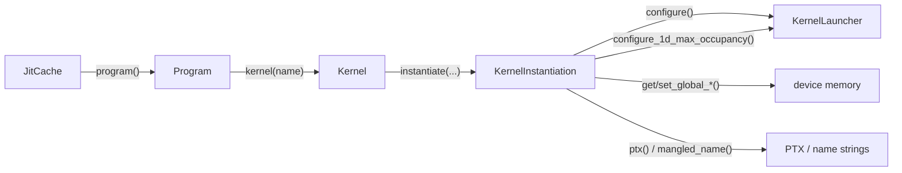
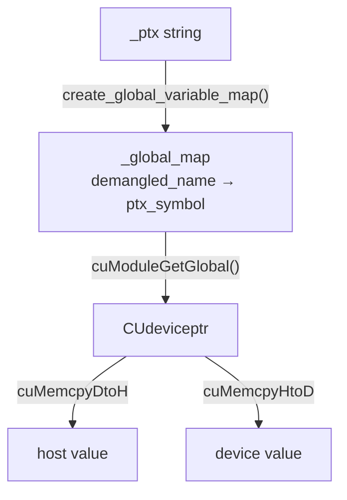
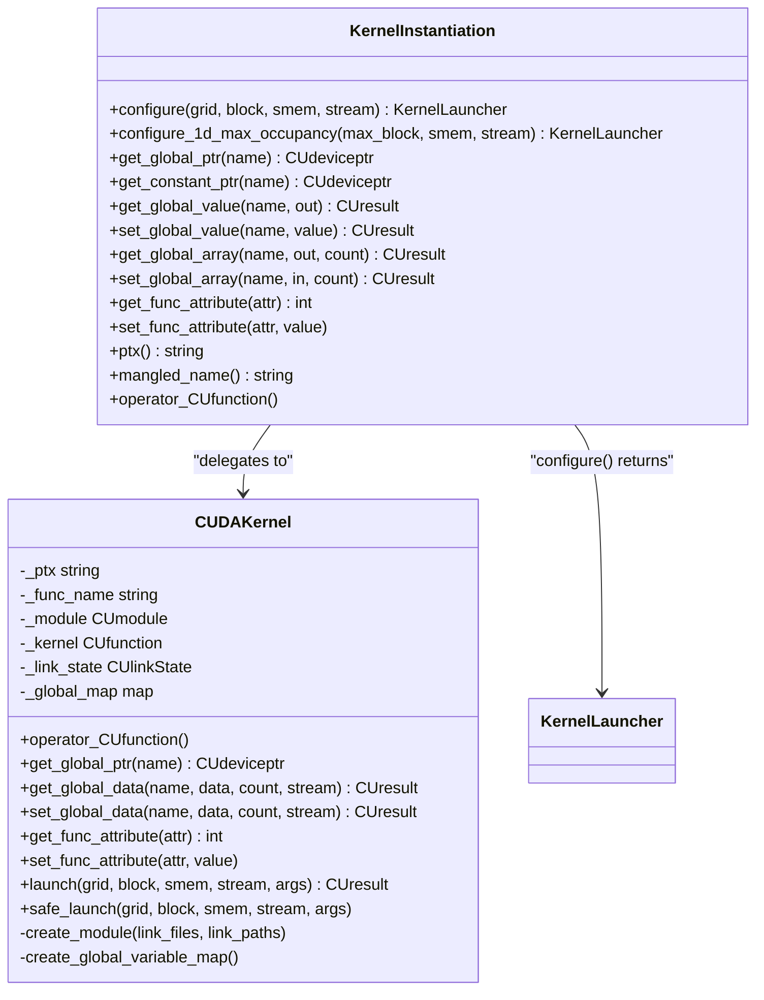

<!-- source: DeepWiki mcp.deepwiki.com · repo NVIDIA/jitify · page 2.3 KernelInstantiation · fetched 2026-10-26 -->

# KernelInstantiation

Relevant source files

The following files were used as context for generating this wiki page:

- [example_headers/constant_header.cuh](example_headers/constant_header.cuh)
- [jitify.hpp](jitify.hpp)
- [jitify_example.cpp](jitify_example.cpp)
- [jitify_test.cu](jitify_test.cu)

## Purpose and Scope

`jitify::KernelInstantiation` represents a single compiled, template-instantiated `__global__` kernel function. It is the object produced by calling `Kernel::instantiate()` (see [Program and Kernel](#2.2)) and is the central point for all pre-launch operations: configuring execution geometry, reading and writing device/constant memory variables, and inspecting compiled output.

This page covers:
- The `instantiate()` overloads and how template arguments are resolved
- Implicit `CUfunction` conversion
- `configure()` and `configure_1d_max_occupancy()`
- `__device__` and `__constant__` variable access by name
- PTX and mangled-name introspection
- Function attribute get/set

For the `KernelLauncher` object returned by `configure()`, see [KernelLauncher](#2.4). For the `reflect<T>()`, `type_of()`, and `NonType` helpers used when building template argument strings, see [Reflection Utilities](#2.5). For `serialize()`/`deserialize()` in the experimental namespace, see [Experimental API](#2.6).

---

## Position in the Object Chain

**Object chain diagram**

Sources: [jitify_test.cu:107-131](), [jitify_test.cu:219-276]()

---

## `instantiate()` Overloads

`Kernel::instantiate()` accepts template arguments in several forms. All forms ultimately produce a vector of string representations that are combined into the kernel's mangled symbol name.

| Form | Code example | How args are resolved |
|---|---|---|
| No args | `.instantiate()` | Non-template kernel |
| String vector | `.instantiate({"float", "7"})` | Passed as-is |
| Variadic values | `.instantiate((int)C, Type<T>())` | Each arg passed through `reflect()` |
| `type_of` | `.instantiate(N, type_of(*ptr))` | Deduces type from lvalue at compile time |
| `instance_of` | `.instantiate(N, instance_of(base))` | Deduces dynamic type at runtime via `typeid` |
| Template params | `.instantiate<NonType<int,C>, T>()` | `reflect<Ts>()...` expansion |

Each variadic argument is individually dispatched through the `reflect()` overload set (see [Reflection Utilities](#2.5)):
- A plain value `v` of type `T` → `"(T)v"`
- A `Type<T>()` wrapper → `"T"`
- A `NonType<T,V>` wrapper → `"(T)V"`
- An `instance_of(x)` wrapper → the demangled runtime type of `x`

Sources: [jitify_test.cu:116-117](), [jitify_test.cu:248-268](), [jitify_example.cpp:198-224](), [jitify.hpp:919-1023]()

---

## Implicit `CUfunction` Conversion

The backing `detail::CUDAKernel` class provides `operator CUfunction()`, which means a `KernelInstantiation` can be passed directly anywhere a `CUfunction` handle is expected.

Sources: [jitify.hpp:1303]()

---

## `configure()` and `configure_1d_max_occupancy()`

Both methods return a `KernelLauncher` (see [KernelLauncher](#2.4)).

| Method | Parameters | Description |
|---|---|---|
| `configure` | `dim3 grid, dim3 block, unsigned smem = 0, CUstream stream = 0` | Stores explicit launch parameters |
| `configure_1d_max_occupancy` | `int max_block_size = 0, unsigned smem = 0, CUstream stream = 0` | Calls `cuOccupancyMaxPotentialBlockSize` to choose grid and block dimensions automatically |

Sources: [jitify_test.cu:120-128](), [jitify_test.cu:126-128](), [jitify_test.cu:187-192]()

---

## Global Variable Access

`KernelInstantiation` can read and write `__device__` and `__constant__` variables in the compiled module by their demangled C++ names. Namespace-qualified names and anonymous namespace names are both supported.

### How Name Lookup Works

When the underlying `detail::CUDAKernel` is constructed from PTX, it calls `create_global_variable_map()`, which scans the PTX text for `.const .align` and `.global .align` directives and builds a map from the demangled symbol name to the raw PTX mangled name. The demangle step is handled by `detail::demangle_ptx_variable_name()`.

**Global variable name resolution diagram**

Sources: [jitify.hpp:1224-1244](), [jitify.hpp:1033-1059](), [jitify.hpp:1329-1350]()

### Methods

| Method | Return | Description |
|---|---|---|
| `get_global_ptr(name)` | `CUdeviceptr` | Raw device pointer to a `__device__` or `__constant__` variable |
| `get_constant_ptr(name)` | `CUdeviceptr` | Deprecated alias for `get_global_ptr` |
| `get_global_value(name, T* out)` | `CUresult` | Copies a scalar or struct from device to host |
| `get_global_value(name, T(*)[N] out)` | `CUresult` | Copies a fixed-size array from device to host |
| `get_global_array(name, T* out, count)` | `CUresult` | Copies `count` elements of type `T` from device to host |
| `set_global_value(name, T value)` | `CUresult` | Copies a scalar or struct from host to device |
| `set_global_value(name, T(&)[N] value)` | `CUresult` | Copies a fixed-size C array from host to device |
| `set_global_array(name, T* in, count)` | `CUresult` | Copies `count` elements of type `T` from host to device |

`get_global_value` / `set_global_value` size-check against the variable's actual device size and throw `std::runtime_error` on mismatch. All methods accept an optional `CUstream` argument for async operations.

### Name format examples

| C++ declaration | Name string passed to API |
|---|---|
| `__constant__ int a;` | `"a"` |
| `namespace b { __device__ int a; }` | `"b::a"` |
| `namespace c { namespace b { __constant__ int a; } }` | `"c::b::a"` |
| `namespace { namespace b { __constant__ int a[3]; } }` | `"(anonymous namespace)::b::a"` |

Sources: [jitify_test.cu:388-416](), [jitify_test.cu:436-451](), [jitify_example.cpp:264-295](), [jitify.hpp:1224-1244](), [jitify.hpp:1329-1350]()

---

## PTX and Name Introspection

| Method | Return type | Description |
|---|---|---|
| `ptx()` | `std::string` | The full PTX text produced by NVRTC for this instantiation |
| `mangled_name()` | `std::string` | The CUDA mangled symbol name of the instantiated kernel function |

`ptx()` is used to inspect generated code, verify that `--remove-unused-globals` removed dead symbols, or write PTX to disk for external linking (as in `TEST(JitifyTest, LinkExternalFiles)`).

`mangled_name()` is used to compare instantiations or verify that template reflection resolves to the same symbol regardless of which `instantiate()` overload is used.

Sources: [jitify_test.cu:752-783](), [jitify_test.cu:897-926]()

---

## Function Attribute Get/Set

`KernelInstantiation` wraps `cuFuncGetAttribute` and `cuFuncSetAttribute` via `detail::CUDAKernel`.

| Method | Signature | Underlying CUDA call |
|---|---|---|
| `get_func_attribute` | `(CUfunction_attribute attr) → int` | `cuFuncGetAttribute` |
| `set_func_attribute` | `(CUfunction_attribute attr, int value)` | `cuFuncSetAttribute` |

Common usage patterns:

| Attribute | Use case |
|---|---|
| `CU_FUNC_ATTRIBUTE_SHARED_SIZE_BYTES` | Read static shared memory consumption |
| `CU_FUNC_ATTRIBUTE_MAX_DYNAMIC_SHARED_SIZE_BYTES` | Increase dynamic shared memory limit on Volta+ devices |

Sources: [jitify.hpp:1318-1327](), [jitify_test.cu:1079-1088](), [jitify_test.cu:1099-1129]()

---

## Internal Structure

**Class relationship diagram**

Sources: [jitify.hpp:1111-1350]()

The `detail::CUDAKernel` owns the `CUmodule` and `CUfunction` handles. Its constructor calls both `create_module()` (which runs `cuModuleLoadDataEx` or `cuLinkCreate`/`cuLinkComplete`/`cuModuleLoadData` for multi-file linking) and `create_global_variable_map()` to populate `_global_map`.

Sources: [jitify.hpp:1135-1210](), [jitify.hpp:1224-1244](), [jitify.hpp:1267-1283]()

---

## Lifetime and Caching

`KernelInstantiation` objects are default-constructible and move-assignable, so they can be stored as class members and populated later. Inside `JitCache`, compiled `CUDAKernel` instances are stored in an LRU `ObjectCache` keyed on a hash of the program source and template argument strings. Repeated calls to `Kernel::instantiate()` with identical arguments return the cached result without recompilation.

Sources: [jitify_test.cu:163-195](), [jitify.hpp:204-274]()

---

