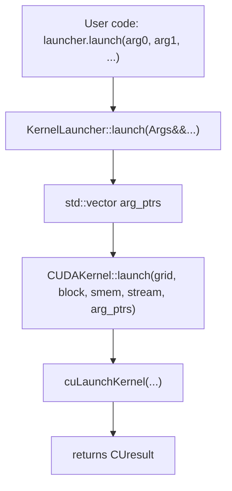
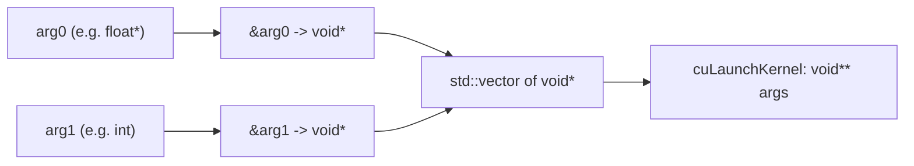
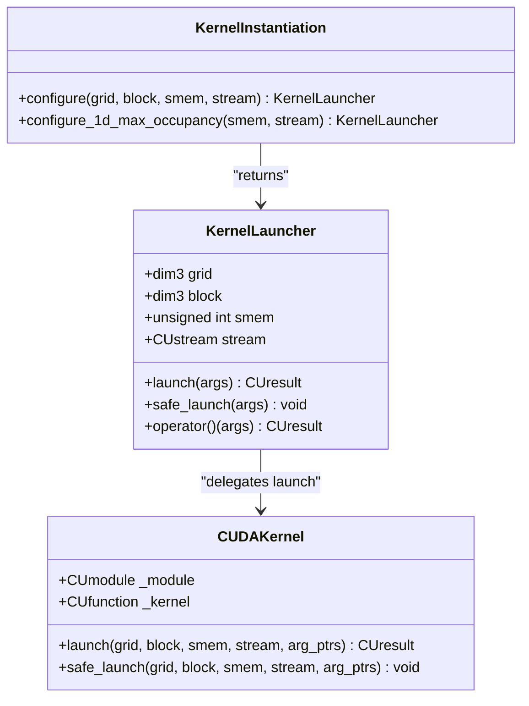

<!-- source: DeepWiki mcp.deepwiki.com · repo NVIDIA/jitify · page 2.4 KernelLauncher · fetched 2026-10-26 -->

# KernelLauncher

<details>
<summary>Relevant source files</summary>

The following files were used as context for generating this wiki page:

- [jitify.hpp](jitify.hpp)
- [jitify_example.cpp](jitify_example.cpp)
- [jitify_test.cu](jitify_test.cu)

</details>


## Purpose and Scope

This page documents the `jitify::KernelLauncher` class: the final step in the Jitify launch chain. A `KernelLauncher` holds a resolved `CUfunction` together with its launch geometry parameters (grid, block, shared memory, stream) and provides methods to invoke the kernel with host-side arguments. It does **not** perform compilation or instantiation — those steps belong to `KernelInstantiation` (see [2.3](#2.3)). For details on how `KernelInstantiation` is obtained from a `Program` and `Kernel`, see [2.2](#2.2).

---

## Position in the Object Chain

**Launch chain diagram**


Sources: [jitify.hpp:1111-1376](), [jitify_test.cu:107-131](), [jitify_example.cpp:88-116]()

---

## Obtaining a KernelLauncher

`KernelLauncher` objects are not constructed directly. They are returned by two methods on `KernelInstantiation`.

| Factory Method | Signature | Description |
|---|---|---|
| `configure` | `configure(dim3 grid, dim3 block, unsigned smem = 0, CUstream stream = 0)` | Explicit launch geometry. |
| `configure_1d_max_occupancy` | `configure_1d_max_occupancy(unsigned smem = 0, CUstream stream = 0, int flags = 0)` | Uses `cuOccupancyMaxPotentialBlockSize` to auto-select a 1-D grid/block pair that maximises occupancy. |

Both methods return a `KernelLauncher` by value.

**Example patterns from tests**

```
// Explicit grid and block
kernel_inst.configure(grid, block).launch(d_data);

// With shared memory
instance.configure(grid, block, shared_bytes).launch(out, in);

// Auto-occupancy
kernel_inst.configure_1d_max_occupancy().launch(d_data);
```

Sources: [jitify_test.cu:119-128](), [jitify_test.cu:179-192](), [jitify_test.cu:1124-1125]()

---

## Stored Launch Parameters

When `configure()` is called, the resulting `KernelLauncher` captures:

| Parameter | Type | Source |
|---|---|---|
| `grid` | `dim3` | First argument to `configure` |
| `block` | `dim3` | Second argument to `configure` |
| `smem` | `unsigned int` | Third argument (default `0`) |
| `stream` | `CUstream` | Fourth argument (default `0`, i.e., the default CUDA stream) |

The object also holds a reference (or pointer) to the underlying `CUDAKernel` (the internal `detail::CUDAKernel` class [jitify.hpp:1111-1376]()) so it can delegate the actual `cuLaunchKernel` call.

---

## Launch Methods

**Dispatch diagram**



Sources: [jitify.hpp:1305-1316](), [jitify_test.cu:119-128]()

### `launch()`

```
CUresult launch(Args&&... args)
```

- Accepts an arbitrary number of arguments of any types.
- Takes the address of each argument to form a `std::vector<void*>` of argument pointers, which is passed to `cuLaunchKernel` via `CUDAKernel::launch`.
- **Returns `CUresult` directly** — the caller must check for errors (e.g., using the `CHECK_CUDA` macro pattern).
- Zero-argument launches (e.g., `launch()`) are valid.

### `safe_launch()`

```
void safe_launch(Args&&... args)
```

- Identical argument handling to `launch`.
- Wraps the `cuLaunchKernel` result in an internal `cuda_safe_call` that **throws `std::runtime_error`** on any non-`CUDA_SUCCESS` result.
- Has no return value.

### `operator()()`

```
CUresult operator()(Args&&... args)
```

- Variadic template shorthand equivalent to calling `launch(args...)`.
- Returns `CUresult`, matching `launch` semantics.

| Method | Return | On CUDA error |
|---|---|---|
| `launch(args...)` | `CUresult` | Returns error code |
| `safe_launch(args...)` | `void` | Throws `std::runtime_error` |
| `operator()(args...)` | `CUresult` | Returns error code |

Sources: [jitify.hpp:1305-1316](), [jitify_test.cu:120](), [jitify_test.cu:126](), [jitify_test.cu:183]()

---

## Argument Passing Mechanics

The variadic template expands each argument into a `void*` pointer to the argument's storage. This mirrors the CUDA driver API's expected `void** args` parameter for `cuLaunchKernel`.

**Key points:**

- **Scalars, structs, and raw pointers** are all passed by address. A device pointer `float* d_ptr` is passed as `(void*)&d_ptr`, not `(void*)d_ptr`.
- **Temporary/rvalue arguments** work correctly — the `KernelLauncher::operator()` and `launch` methods take forwarding references, and the temporaries' lifetimes extend to the end of the full expression.
- **Class objects** (e.g., a `Arg` struct) can be passed by value or by pointer. See [3.6](#3.6) for patterns.

**Argument pointer assembly diagram**



Sources: [jitify.hpp:1305-1309](), [jitify_test.cu:244-245](), [jitify_example.cpp:198-201]()

---

## Default Construction and Move Semantics

`KernelLauncher` is **default-constructible** and **move-assignable**, allowing it to be declared before assignment:

```
jitify::KernelLauncher kernel_launcher;           // default construct
kernel_launcher = kernel_inst.configure(grid, block);  // move-assign
CHECK_CUDA(kernel_launcher.launch(d_data));
```

This is demonstrated in `TEST(JitifyTest, DefaultConstructable)` [jitify_test.cu:163-195]().

---

## Relationship to `CUDAKernel`

`KernelLauncher` does not own any CUDA resources. The actual `CUmodule` and `CUfunction` are owned by the internal `detail::CUDAKernel` object, which is managed by the caching layer. `KernelLauncher` holds a reference to this object and forwards the launch call to `CUDAKernel::launch` [jitify.hpp:1305-1309]() or `CUDAKernel::safe_launch` [jitify.hpp:1311-1316]().



Sources: [jitify.hpp:1111-1376](), [jitify_test.cu:163-195]()

---

## Summary

| Concern | API surface |
|---|---|
| Create a launcher | `KernelInstantiation::configure(grid, block[, smem[, stream]])` |
| Auto-occupancy launcher | `KernelInstantiation::configure_1d_max_occupancy([smem[, stream]])` |
| Launch (caller checks error) | `KernelLauncher::launch(args...)` / `operator()(args...)` |
| Launch (throws on error) | `KernelLauncher::safe_launch(args...)` |
| Underlying CUDA call | `cuLaunchKernel` via `detail::CUDAKernel::launch` |

---

