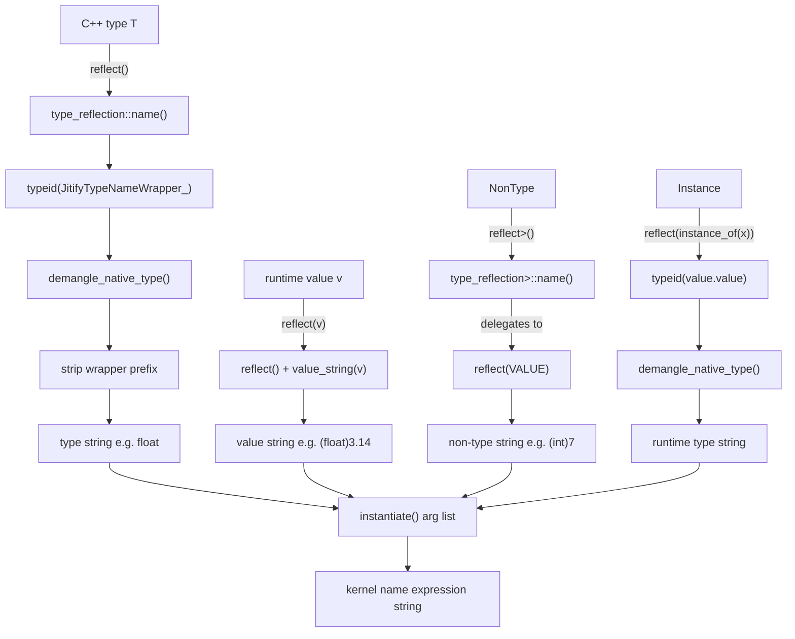
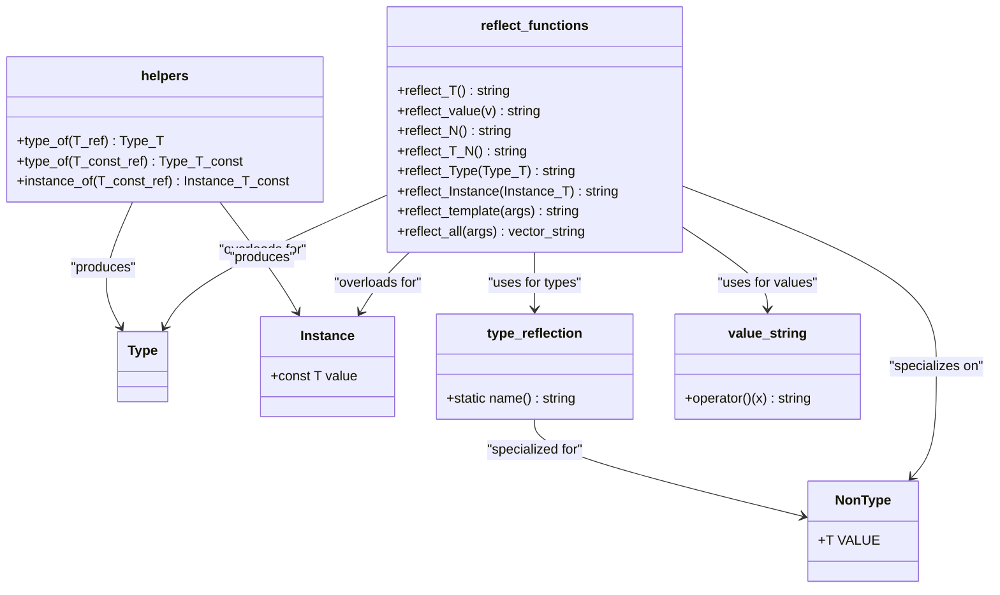

<!-- source: DeepWiki mcp.deepwiki.com · repo NVIDIA/jitify · page 2.5 Reflection Utilities · fetched 2026-10-26 -->

# Reflection Utilities

<details>
<summary>Relevant source files</summary>

The following files were used as context for generating this wiki page:

- [jitify.hpp](jitify.hpp)
- [jitify_example.cpp](jitify_example.cpp)
- [jitify_test.cu](jitify_test.cu)

</details>


## Purpose and Scope

This page documents the `jitify::reflection` namespace, which provides utilities for converting C++ types and compile-time values into code strings. These strings are used as template arguments when instantiating JIT-compiled CUDA kernels at runtime via `KernelInstantiation::instantiate()`.

For how reflection strings feed into the kernel instantiation workflow, see [KernelInstantiation](#2.3). For a practical guide to using these helpers with templated kernels, see [Template Kernel Instantiation](#3.2).

---

## Overview

NVRTC compiles kernels from source strings. When a kernel is templated, Jitify must build a string like `my_kernel<float, (int)7>` to pass to NVRTC as a name expression. The `jitify::reflection` namespace provides functions that produce exactly these substrings for any C++ type or compile-time value.

**Summary of the namespace contents:**

| Symbol | Kind | Produces |
|---|---|---|
| `NonType<T, V>` | struct | Wraps a non-type template parameter |
| `Type<T>` | struct | Wraps a type as a passable value |
| `Instance<T>` | struct | Wraps a reference for runtime type deduction |
| `reflect<T>()` | function | `"float"` |
| `reflect(value)` | function | `"(float)3.14"` |
| `reflect<N>()` | function | `"(int64_t)7"` |
| `reflect<T,N>()` | function | `"(int)7"` |
| `reflect(Type<T>())` | function | `"float"` |
| `reflect(Instance<T>&)` | function | demangled runtime type name |
| `type_of(x)` | function | `Type<T>()` capturing `T` from `x` |
| `instance_of(x)` | function | `Instance<T const>` capturing `x` |
| `reflect_template<Ts...>()` | function | `"<float,int >"` |
| `reflect_template(args)` | function | `"<float,int >"` |
| `reflect_all(args...)` | function | `vector<string>` of reflected strings |

All symbols are defined in [jitify.hpp:720-1025]().

---

## Wrapper Types

### `NonType<T, VALUE>`

[jitify.hpp:734-737]()

```
template <typename T, T VALUE_>
struct NonType { constexpr static T VALUE = VALUE_; };
```

Used to represent a non-type template parameter as a type argument. When passed to `reflect<>()`, it produces a value string like `"(int)7"`. The specialization of `type_reflection` for `NonType` delegates to `reflect(VALUE)`.

| Usage | Result |
|---|---|
| `reflect<NonType<int,7>>()` | `"(int)7"` |
| `instantiate<NonType<int,C>, T>()` | Passes `C` as non-type and `T` as type arg |

### `Type<T>`

[jitify.hpp:913-914]()

An empty struct used to carry a type as a value. Passing `Type<float>()` to `reflect()` or `instantiate()` produces `"float"`. The overload `reflect(Type<T>)` delegates directly to `reflect<T>()`.

### `Instance<T>`

[jitify.hpp:897-909]()

Holds a `const T&` reference. When passed to `reflect()`, the function calls `typeid(value.value)` to determine the **runtime** (i.e., potentially derived) type. This is the mechanism for reflecting polymorphic objects.

```
struct Instance {
  const T& value;
};
```

---

## Helper Factories

### `type_of(x)`

[jitify.hpp:981-990]()

Two overloads:
- `type_of(T&)` → `Type<T>()`
- `type_of(T const&)` → `Type<T const>()`

Captures the static type of a variable as a `Type` object that can be passed to `instantiate()`. No string conversion happens at call time.

### `instance_of(x)`

[jitify.hpp:907-909]()

Returns `Instance<T const>(value)`. The actual type string is only resolved when `reflect(instance_of(x))` is called, at which point `typeid` is queried for the dynamic type.

---

## The `reflect` Family

### Type reflection: `reflect<T>()`

[jitify.hpp:922-925]()

Invokes `detail::type_reflection<T>::name()`. Internally, this wraps `T` inside `JitifyTypeNameWrapper_<T>`, calls `typeid()` on the wrapped type (to preserve cv-qualifiers that `typeid(T)` would strip), then demangles the result and strips the wrapper prefix.

[jitify.hpp:844-878]()

| Input | Output |
|---|---|
| `reflect<float>()` | `"float"` |
| `reflect<const volatile float>()` | `"const volatile float"` |
| `reflect<int*>()` | `"int *"` |
| `reflect<const float[4]>()` | `"const float [4]"` |

### Value reflection: `reflect(value)`

[jitify.hpp:931-934]()

Combines `reflect<T>()` with `detail::value_string(value)` to produce a cast expression.

```
reflect(3.14f)   →  "(float)3.14"
reflect(true)    →  "(bool)true"
reflect('A')     →  "(char)65"     // char cast to int for readability
```

Specializations of `value_string` exist for `char`, `signed char`, `unsigned char`, `wchar_t`, and `bool` to ensure readable output.

[jitify.hpp:748-782]()

### Non-type template arg reflection

[jitify.hpp:940-952]()

Two overloads:

| Overload | Example | Output |
|---|---|---|
| `reflect<N>()` (int64_t) | `reflect<7>()` | `"(int64_t)7"` |
| `reflect<T,N>()` (explicit type) | `reflect<int,7>()` | `"(int)7"` |

Both delegate to `reflect<NonType<T,N>>()`.

### `reflect(Type<T>)`

[jitify.hpp:958-961]()

Unwraps the `Type<T>` wrapper and calls `reflect<T>()`. Allows `Type<float>()` to be passed directly to any function expecting a reflected string.

### `reflect(Instance<T>&)`

[jitify.hpp:971-973]()

Calls `detail::demangle_native_type(typeid(value.value))` to get the dynamic type at runtime. Used when the actual type is a derived class and only the base class type is known at compile time.

### `reflect_template`

[jitify.hpp:1013-1023]()

Two forms:
- `reflect_template({"float","7","char"})` → `"<float,7,char >"` (note the trailing space before `>` to avoid `>>` parsing issues)
- `reflect_template<float, NonType<int,7>, char>()` → `"<float,(int64_t)7,char >"`

### `reflect_all` and `reflect_list`

[jitify.hpp:993-1009]()

- `reflect_all(args...)` — returns a `vector<string>` by calling `reflect()` on each argument
- `reflect_list(args, opener, closer)` — joins a vector of strings with a separator, adding surrounding brackets

---

## Internal Implementation Details

### Demangling

[jitify.hpp:797-841]()

Platform-specific demangling:
- **Linux/GCC**: `abi::__cxa_demangle` from `<cxxabi.h>`
- **MSVC**: `UnDecorateSymbolName` from `<dbghelp.h>`, followed by `strip_double_underscore_tokens` to remove MSVC-specific keywords like `__cdecl` and `__ptr64`

The function `demangle_cuda_symbol` handles the CUDA mangled name format. `demangle_native_type` wraps it for use with `std::type_info`.

### `JitifyTypeNameWrapper_<T>` trick

[jitify.hpp:844-877]()

`typeid(T)` discards top-level cv-qualifiers on non-reference types. To work around this, `type_reflection<T>::name()` wraps the type:

```
typeid(JitifyTypeNameWrapper_<const volatile float>)
  → "jitify::reflection::detail::JitifyTypeNameWrapper_<const volatile float>"
```

Then strips the `JitifyTypeNameWrapper_<` prefix and the trailing `>` to extract `"const volatile float"`.

---

## Data Flow Diagram

**How reflect helpers produce instantiation strings:**



Sources: [jitify.hpp:844-884](), [jitify.hpp:922-973](), [jitify.hpp:797-841]()

---

## API Reference Diagram

**Code entities in `jitify::reflection` and their relationships:**



Sources: [jitify.hpp:734-737](), [jitify.hpp:897-925](), [jitify.hpp:981-1023]()

---

## Practical Equivalences

The following forms for passing template arguments to `instantiate()` are all equivalent. They are taken from actual test code in [jitify_test.cu:247-268]() and [jitify_example.cpp:204-224]():

| Form | Description |
|---|---|
| `instantiate<NonType<int, C>, T>()` | Pure template-arg syntax, no strings |
| `instantiate({reflect((int)C), reflect<T>()})` | Manual string construction |
| `instantiate((int)C, Type<T>())` | Recommended: value + type wrapper |
| `instantiate((int)C, type_of(*indata))` | Recommended: value + `type_of` helper |
| `instantiate((int)C, instance_of(*indata))` | Dynamic type from instance |

The `Type<T>()` and `type_of()` approaches are preferred because they avoid string manipulation in user code while still supporting cv-qualified and pointer types correctly.

---

## Notes on Edge Cases

- **`char` values**: `value_string<char>` casts to `int` before streaming, avoiding non-printable character output. [jitify.hpp:755-758]()
- **`bool` values**: `value_string<bool>` returns `"true"` or `"false"` rather than `1`/`0`. [jitify.hpp:779-782]()
- **Template closing bracket**: `reflect_template` always produces `" >"` (with a space) to prevent `>>` from being misinterpreted as a right-shift operator in generated source. [jitify.hpp:1015-1017]()
- **CUDA version guard**: The `NVRTC_GET_TYPE_NAME` define is set for CUDA >= 8000, but the code comments indicate that `nvrtcGetTypeName` was not used because its behavior differed from the demangle-based approach. The host-side demangling path is always used. [jitify.hpp:114-116](), [jitify.hpp:851-876]()

---

