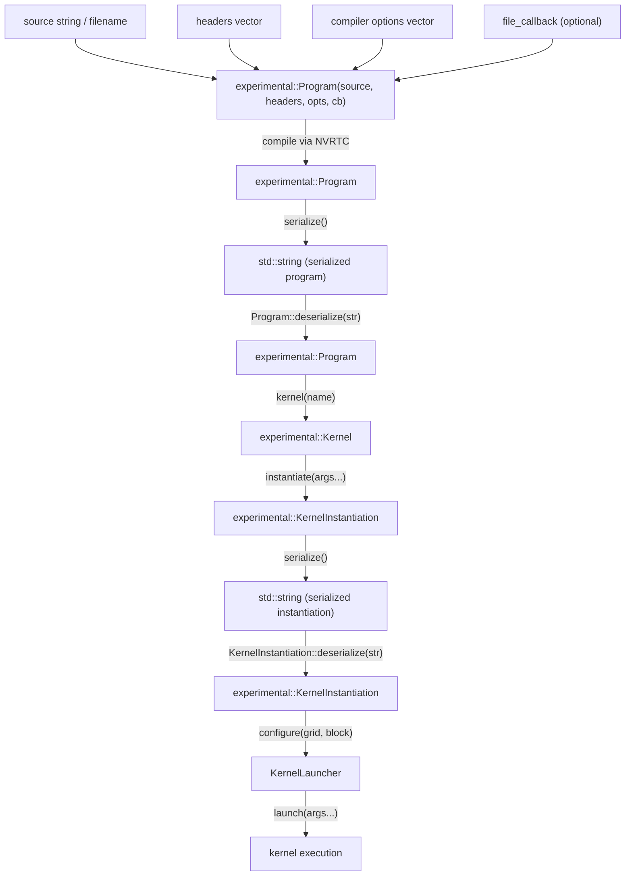
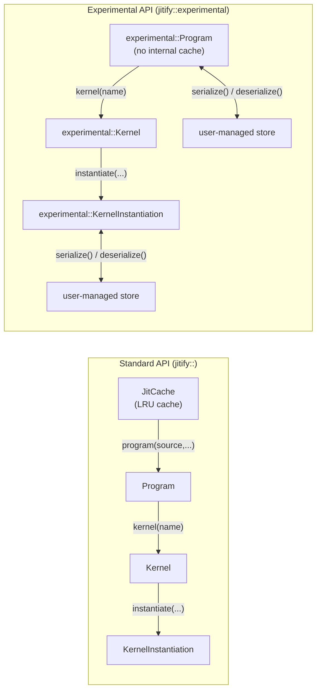

<!-- source: DeepWiki mcp.deepwiki.com · repo NVIDIA/jitify · page 2.6 Experimental API · fetched 2026-10-26 -->

# Experimental API

<details>
<summary>Relevant source files</summary>

The following files were used as context for generating this wiki page:

- [jitify.hpp](jitify.hpp)
- [jitify_example.cpp](jitify_example.cpp)
- [jitify_test.cu](jitify_test.cu)

</details>


This page covers the `jitify::experimental` namespace: its two primary classes, `Program` and `KernelInstantiation`, the `serialize()`/`deserialize()` round-trip that enables user-managed kernel caching, and how this approach differs from the `JitCache`-based API. For the standard caching API (`JitCache`, `Program`, `KernelInstantiation` in the root `jitify::` namespace), see [Core API Reference](#2). For launch configuration and kernel arguments, see [KernelLauncher](#2.4).

---

## Purpose

The `jitify::experimental` namespace provides an alternative front-end to NVRTC compilation that gives the caller direct control over how compiled programs are stored and reused. Rather than an opaque LRU in-process cache (`JitCache`), the experimental API exposes `serialize()` and `deserialize()` methods on both `Program` and `KernelInstantiation`. The caller decides where, how long, and in what form a compiled artifact is persisted.

Typical use cases include:

- Saving compiled PTX or module state to disk between process restarts.
- Distributing pre-compiled kernel instances across worker processes in a cluster.
- Integrating JIT compilation with an application-specific cache keyed on arbitrary metadata.

---

## Class Overview

| Class | Namespace | Role |
|---|---|---|
| `Program` | `jitify::experimental` | Compiles and holds source + preprocessed state for a CUDA program |
| `KernelInstantiation` | `jitify::experimental` | Holds a fully compiled, linked, and loaded kernel for a specific template instantiation |
| `Kernel` | `jitify::experimental` | Intermediate handle returned by `Program::kernel(name)` |
| `KernelLauncher` | `jitify::experimental` | Holds launch parameters; returned by `KernelInstantiation::configure()` |

The `Kernel` and `KernelLauncher` types in the experimental namespace mirror those in the root `jitify::` namespace (see [Program and Kernel](#2.2) and [KernelLauncher](#2.4)); `KernelLauncher` is shared between both namespaces.

---

## Object Lifecycle

**Experimental lifecycle diagram**



Sources: [jitify_test.cu:133-161](), [jitify_test.cu:278-346](), [jitify_example.cpp:119-150]()

---

## `experimental::Program`

### Construction

```
jitify::experimental::Program(
    const std::string& source,
    const std::vector<std::string>& headers = {},
    const std::vector<std::string>& options = {},
    file_callback_type file_callback = nullptr
)
```

- `source` — either a program name followed by a newline and the full source body, or a filename that Jitify will load. The same format as accepted by `JitCache::program()`.
- `headers` — inline header strings, each formatted as `"filename\nsource"`. These are passed to NVRTC as virtual files.
- `options` — NVRTC compiler flags (e.g., `"-I/path"`, `"--use_fast_math"`, `"-rdc=true"`, `"--remove-unused-globals"`).
- `file_callback` — optional callback invoked when Jitify cannot locate a `#include`d file through the normal mechanisms. See [Header Management](#3.3).

Compilation occurs eagerly in the constructor. If compilation fails, a `std::runtime_error` is thrown.

Example from tests [jitify_test.cu:285-290]():
```
jitify::experimental::Program program_orig(
    multiple_kernels_program_source,
    {example_headers_my_header1_cuh},
    {"--use_fast_math", "-I" CUDA_INC_DIR},
    file_callback);
auto program =
    jitify::experimental::Program::deserialize(program_orig.serialize());
```

### `serialize()` and `deserialize()`

| Method | Signature | Description |
|---|---|---|
| `serialize` | `std::string serialize() const` | Returns a self-contained string encoding the compiled program state |
| `deserialize` | `static Program deserialize(const std::string&)` | Reconstructs a `Program` from a previously serialized string |

The serialized string encodes everything needed to later call `kernel()` and `instantiate()` without re-invoking NVRTC. This allows the output to be written to a file, stored in a database, or transmitted over a network.

### `kernel(name)`

```
Kernel kernel(const std::string& name)
```

Returns an `experimental::Kernel` handle referencing the named `__global__` function. Passing an empty string (`""`) is valid and is used to obtain PTX output without requiring a specific kernel symbol [jitify_test.cu:827-831]().

---

## `experimental::KernelInstantiation`

### Creation

`KernelInstantiation` is obtained by calling `instantiate()` on a `Kernel`. Template arguments follow the same conventions as the standard namespace — variadic values, `Type<T>()`, `NonType<T,N>`, `type_of()`, `instance_of()`, or a vector of strings. For full details see [Template Kernel Instantiation](#3.2).

```
// Type-safe variadic form
auto ki = program.kernel("my_kernel").instantiate(3, type_of(*d_data));

// String form
auto ki = program.kernel("my_kernel2")
              .instantiate({reflect((int)C), reflect<T>()});
```
[jitify_test.cu:144-147](), [jitify_test.cu:307-319]()

### `serialize()` and `deserialize()`

| Method | Signature | Description |
|---|---|---|
| `serialize` | `std::string serialize() const` | Encodes the instantiation (PTX, linked module state, function name) as a string |
| `deserialize` | `static KernelInstantiation deserialize(const std::string&)` | Reloads a `CUmodule` and `CUfunction` from the serialized string |

After `deserialize()`, the returned `KernelInstantiation` is fully operational — it holds a loaded `CUmodule` and can be launched immediately.

Example [jitify_test.cu:308-313]():
```
auto ki = jitify::experimental::KernelInstantiation::deserialize(
    program.kernel("my_kernel2")
        .instantiate<NonType<int, C>, T>()
        .serialize());
CHECK_CUDA(ki.configure(grid, block).launch(indata, outdata));
```

### Launch Methods

| Method | Returns | Description |
|---|---|---|
| `configure(grid, block, smem=0, stream=0)` | `KernelLauncher` | Sets launch dimensions; see [KernelLauncher](#2.4) |
| `configure_1d_max_occupancy(...)` | `KernelLauncher` | Auto-selects block size for maximum occupancy |

### Introspection Methods

| Method | Return Type | Description |
|---|---|---|
| `ptx()` | `std::string` | Returns the PTX string produced by NVRTC |
| `mangled_name()` | `std::string` | Returns the lowered (mangled) name of the instantiated kernel |
| `get_func_attribute(attr)` | `int` | Reads a `CUfunction_attribute` |
| `set_func_attribute(attr, val)` | `void` | Writes a `CUfunction_attribute` |

`ptx()` is used in the link-test pattern to write compiled PTX to disk for subsequent linking [jitify_test.cu:827-831]():
```
std::ofstream ptx_file("linktest.ptx");
ptx_file << jitify::experimental::Program(src, {}, {"-rdc=true"})
                .kernel("").instantiate().ptx();
```

### Device and Constant Variable Access

These methods are identical to the standard `KernelInstantiation` API described in [Device and Constant Memory](#3.4):

| Method | Description |
|---|---|
| `get_global_ptr(name, size=nullptr)` | Returns `CUdeviceptr` for a `__device__` or `__constant__` variable |
| `get_constant_ptr(name)` | Alias for `get_global_ptr` (deprecated, kept for compatibility) |
| `get_global_value(name, ptr)` | Async device→host copy of a scalar global |
| `set_global_value(name, val)` | Async host→device copy of a scalar global |
| `get_global_array(name, ptr, count)` | Async device→host copy of an array global |
| `set_global_array(name, ptr, count)` | Async host→device copy of an array global |

---

## Comparison with the `JitCache` API

**Side-by-side comparison of caching models**



| Attribute | `JitCache` / `jitify::` | `jitify::experimental` |
|---|---|---|
| Cache management | Automatic LRU, in-process | Caller-managed via `serialize()`/`deserialize()` |
| Persistence across processes | No | Yes (caller writes serialized string to disk) |
| Thread safety | Mutex-protected (when `JITIFY_THREAD_SAFE=1`) | Caller-managed |
| Construction cost | `JitCache` constructor only; compilations are lazily cached | Compilation occurs in `Program` constructor |
| Caching granularity | Keyed by source hash inside `JitCache` | Arbitrary (caller decides key and storage) |
| Implicit re-use | Yes, within same process | No; caller must explicitly deserialize |

Sources: [jitify.hpp:204-274](), [jitify_test.cu:107-131](), [jitify_test.cu:133-161]()

---

## Special Compiler Options in the Experimental API

The experimental API is the primary path for several compile-time options that influence the PTX output:

| Option | Effect |
|---|---|
| `"-rdc=true"` | Enables relocatable device code (required for device-side linking) |
| `"--remove-unused-globals"` or `"-remove-unused-globals"` | Strips unused `__device__` and `__constant__` symbols from PTX output |
| `"-l<file>"` | Links an external PTX, CUBIN, object, or library at load time |
| `"-L<path>"` | Adds a path to search when resolving `-l` link targets |
| `"-l."` | Links against the current executable (for calling host-compiled device functions) |

The `--remove-unused-globals` option is demonstrated with CuRAND to strip large precomputed tables from the PTX [jitify_test.cu:793-799](), and with general device-global management [jitify_test.cu:752-784]().

Linking against an external PTX file requires `"-rdc=true"` in both the producing and consuming programs [jitify_test.cu:819-847](). Linking against the current executable uses the special `"-l."` flag [jitify_test.cu:863-878]().

---

## `JITIFY_OPTIONS` Environment Variable

Both `JitCache`-based and experimental programs respect the `JITIFY_OPTIONS` environment variable. If set, its value is appended to the compiler option list before each compilation. Invalid options in `JITIFY_OPTIONS` cause a `std::runtime_error` at compile time [jitify_test.cu:1131-1139]().

---

## Error Handling

Both `Program` construction and `KernelInstantiation` creation throw `std::runtime_error` on failure (compilation error, missing file, invalid PTX, etc.). The standard pattern is to let exceptions propagate or catch them explicitly:

- `Program("missing_filename")` → throws because the file cannot be loaded [jitify_test.cu:573-577]()
- `Program("bad_program\nNOT CUDA C!")` → throws because NVRTC rejects the source [jitify_test.cu:575-577]()

Sources: [jitify_test.cu:564-578]()

---

