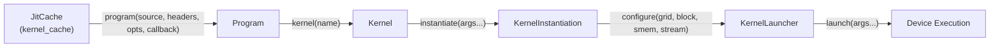
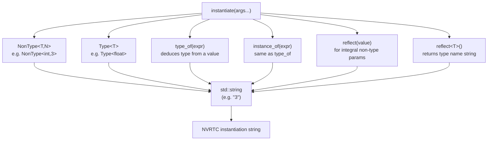
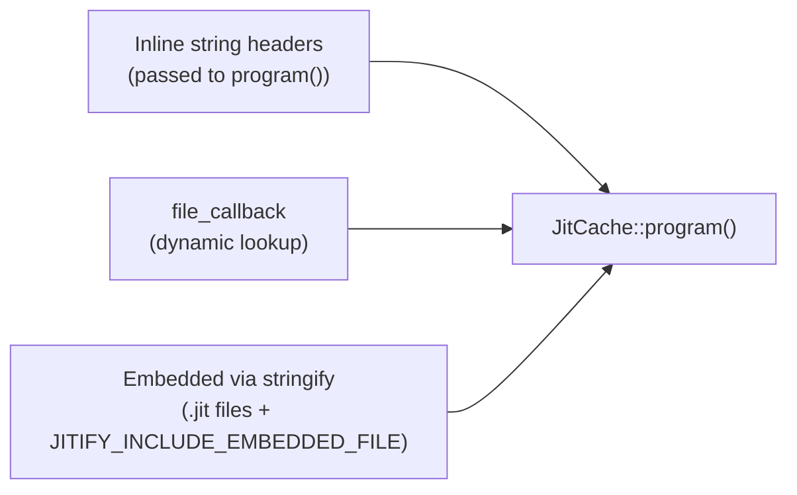

<!-- source: DeepWiki mcp.deepwiki.com · repo NVIDIA/jitify · page 3 Usage Guide · fetched 2026-10-26 -->

# Usage Guide

Relevant source files

The following files were used as context for generating this wiki page:

- [README.md](README.md)
- [jitify_example.cpp](jitify_example.cpp)

This page is the index for practical integration guides covering the most common patterns for embedding Jitify in a CUDA application. It summarizes the complete workflow at a high level and directs readers to detailed sub-pages for each topic. For API class reference material, see [Core API Reference](#2). For build system setup and the `stringify` utility, see [Build System and Tooling](#4).

---

## What Jitify Does

Jitify wraps NVRTC (CUDA Runtime Compilation) behind a chainable C++ API. The caller writes kernel source as a string, selects a kernel by name, instantiates it with template arguments (which may include C++ types resolved at runtime), configures launch dimensions, and launches — all without manually managing `nvrtcProgram` handles, PTX compilation, driver API linkage, or name mangling.

---

## The Core Workflow

Every Jitify usage follows the same five-step chain:

**Workflow: JitCache → Program → Kernel → KernelInstantiation → KernelLauncher**

Sources: [jitify_example.cpp:88-116](), [README.md:14-34]()

Each step maps to a concrete type in `jitify.hpp`:

| Step | Class / Function | Responsibility |
|---|---|---|
| 1 | `jitify::JitCache` | Holds a compiled-program cache; size configurable |
| 2 | `jitify::Program` | Encapsulates source, headers, and compiler options |
| 3 | `jitify::Kernel` | Selects one `__global__` function by name |
| 4 | `jitify::KernelInstantiation` | Resolves template arguments; holds `CUfunction` |
| 5 | `jitify::KernelLauncher` | Holds grid/block/smem/stream; calls `launch()` |

Sources: [jitify_example.cpp:99-111](), [README.md:24-33]()

---

## Minimal Working Pattern

The following condensed pattern appears in `test_simple` in [jitify_example.cpp:88-116]():

1. Define kernel source as a `const char*`, with the **program name on the first line** followed by CUDA C++ source.
2. Declare a `static jitify::JitCache kernel_cache` (static ensures the cache persists across calls).
3. Call `kernel_cache.program(source)` → `Program`.
4. Call `.kernel("name")` → `Kernel`.
5. Call `.instantiate(template_args...)` → `KernelInstantiation`.
6. Call `.configure(grid, block)` → `KernelLauncher`.
7. Call `.launch(device_ptrs...)`.

Wrap each step in the `CHECK_CUDA` macro defined in [jitify_example.cpp:54-64]() to surface driver-level errors with file and line information.

---

## Key Input Types to `program()`

`JitCache::program()` accepts four parameters. Understanding each is important for header management:

| Parameter | Type | Purpose |
|---|---|---|
| `source` | `const char*` | Program name + kernel source, or a filename |
| `headers` | initializer list of `const char*` | Inline header strings (name on first line) |
| `options` | `std::vector<std::string>` | NVRTC compiler flags, e.g. `--use_fast_math` |
| `file_callback` | function pointer | Dynamic header resolution by filename |

Sources: [jitify_example.cpp:183-187]()

---

## Template Argument Resolution

When a kernel is templated, `instantiate()` accepts a mix of argument types resolved at compile-or-runtime. The `jitify::reflection` namespace provides helpers that convert C++ types and values to strings:

Sources: [jitify_example.cpp:177-224]()

All five invocation forms in [jitify_example.cpp:203-224]() are equivalent at runtime; the results are cached after the first compilation.

---

## Header Supply Mechanisms

Three mechanisms exist for supplying headers to a JIT-compiled program:

- **Inline strings**: The `headers` argument to `program()` is a list of `const char*` where the first line of each string is the header filename. See [jitify_example.cpp:186]().
- **`file_callback`**: A user-supplied function `std::istream*(std::string filename, std::iostream& tmp_stream)` that returns a stream for a given filename or `nullptr` to fall through to other resolution. See [jitify_example.cpp:71-85]().
- **Embedded via `stringify`**: The `stringify` tool converts `.cuh` files to `.jit` C string literal files. Include the `.jit` file, then register it with `JITIFY_INCLUDE_EMBEDDED_FILE`. See [jitify_example.cpp:45-48]().

Sources: [jitify_example.cpp:34-48](), [jitify_example.cpp:71-85](), [jitify_example.cpp:183-187]()

---

## `__constant__` and `__device__` Variable Access

After calling `instantiate()`, the resulting `KernelInstantiation` object exposes methods to read and write device-side named variables by their mangled names:

| Method | Direction | Namespace support |
|---|---|---|
| `get_constant_ptr("name")` | returns `CUdeviceptr` | Yes, including `(anonymous namespace)::` |
| `get_global_value()` | host read of `__device__` var | — |
| `set_global_value()` | host write of `__device__` var | — |

Example usage with `cuMemcpyHtoD` after `get_constant_ptr` is shown in [jitify_example.cpp:266-268]() and [jitify_example.cpp:285-286]().

Sources: [jitify_example.cpp:236-299]()

---

## Parallel For and Lambda Kernels

Jitify provides `jitify::parallel_for` and the `JITIFY_LAMBDA` macro as an alternative to writing named kernels. The pattern is:

1. Create a `jitify::ExecutionPolicy` with `jitify::DEVICE`.
2. Define a lambda using `JITIFY_LAMBDA((captured_vars...), body_using_index_i)`.
3. Call `jitify::parallel_for(policy, begin, end, lambda)`.

The index variable inside the lambda body is `i`. See [jitify_example.cpp:302-325]() for a complete example.

Sources: [jitify_example.cpp:302-325]()

---

## Experimental Serialization API

The `jitify::experimental` namespace provides `Program` and `KernelInstantiation` with `serialize()` and `deserialize()` methods for user-managed persistent caches. The standard `JitCache` approach is simpler for in-process caching; use `experimental` when caching must survive process restarts or cross-machine distribution.

See [jitify_example.cpp:119-150]() for a side-by-side example. Detailed reference is in [Experimental API](#2.6).

---

## Sub-Pages in This Section

| Sub-page | Topic |
|---|---|
| [Basic Compilation and Launch](#3.1) | Minimal `JitCache` → `launch()` walkthrough |
| [Template Kernel Instantiation](#3.2) | `reflect`, `Type`, `NonType`, `type_of`, `instance_of` |
| [Header Management](#3.3) | Inline strings, `file_callback`, `stringify`, embedded files |
| [Device and Constant Memory](#3.4) | `get_constant_ptr`, `get_global_value`, `set_global_value` |
| [Parallel For and Lambda Support](#3.5) | `jitify::parallel_for`, `JITIFY_LAMBDA`, `ExecutionPolicy` |
| [Passing Class Objects as Kernel Arguments](#3.6) | By value/reference/pointer, `Managed` base class |

---

