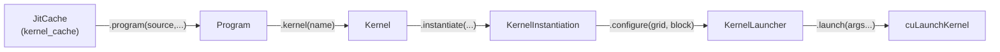

<!-- source: DeepWiki mcp.deepwiki.com · repo NVIDIA/jitify · page 3.1 Basic Compilation and Launch · fetched 2026-10-26 -->

# Basic Compilation and Launch

<details>
<summary>Relevant source files</summary>

The following files were used as context for generating this wiki page:

- [README.md](README.md)
- [jitify.hpp](jitify.hpp)
- [jitify_example.cpp](jitify_example.cpp)

</details>


## Purpose and Scope

This page covers the minimal end-to-end workflow for compiling a CUDA kernel at runtime with Jitify and launching it: from writing the kernel source string, through `JitCache`, `Program`, `Kernel`, `KernelInstantiation`, and `KernelLauncher`, to the actual kernel dispatch. It also covers the `CHECK_CUDA` error-checking pattern used throughout examples.

For template argument reflection utilities (`reflect<T>()`, `NonType`, `type_of()`) used inside `instantiate()` calls, see [Reflection Utilities](#2.5). For reading and writing `__device__`/`__constant__` variables after instantiation, see [Device and Constant Memory](#3.4). For the experimental serializable API, see [Experimental API](#2.6).

---

## The Compilation and Launch Chain

Every Jitify kernel execution passes through five objects in sequence. Each object is produced by calling a method on the previous one.

**Object chain diagram**



Sources: [jitify_example.cpp:99-111](), [jitify_example.cpp:183-220]()

---

## Step 1 — Writing the Kernel Source String

The kernel source is passed as a C string. The **first line must be the program name**, followed by a newline, followed by the actual CUDA source code.

```
"my_program\n"
"template<int N, typename T>\n"
"__global__ void my_kernel(T* data) { ... }\n"
```

This format is required because Jitify's `load_source()` function splits on the first newline to extract the program name from the source content. See [jitify.hpp:567-573]() for the parsing logic.

| Segment | Content | Example |
|---|---|---|
| First line (before `\n`) | Program name (used as cache key) | `my_program` |
| Remainder | Valid CUDA source | `__global__ void my_kernel(...)` |

Sources: [jitify_example.cpp:89-98](), [jitify.hpp:567-573]()

---

## Step 2 — Constructing a JitCache

`jitify::JitCache` is the top-level manager. Construct it once and reuse it. It holds an LRU `ObjectCache` of compiled programs, keyed by source hash and options.

Typical usage makes the cache `static` or `thread_local static` so it persists across repeated calls:

```cpp
static jitify::JitCache kernel_cache;
// or
thread_local static jitify::JitCache kernel_cache;
```

The default constructor uses a cache capacity of 8 entries. A repeated call with the same source and options will return the cached `Program` without recompiling.

Sources: [jitify_example.cpp:99](), [jitify_example.cpp:183](), [jitify_example.cpp:238]()

---

## Step 3 — Calling program()

`JitCache::program()` accepts the source string, optional inline headers, optional compiler options, and an optional file callback.

```
JitCache::program(source, headers, options, file_callback)
```

| Parameter | Type | Purpose |
|---|---|---|
| `source` | `const char*` | Kernel source with name on line 1 |
| `headers` | initializer list / `std::vector` | Inline header `name → content` pairs |
| `options` | `std::vector<std::string>` | NVRTC compiler flags (e.g. `--use_fast_math`) |
| `file_callback` | `file_callback_type` | Called when an `#include` cannot be resolved |

The simplest call passes only source and `0` for the rest:

[jitify_example.cpp:100]()

A more complete call with headers, options, and a callback:

[jitify_example.cpp:183-187]()

For header supply strategies see [Header Management](#3.3). The `file_callback_type` signature is defined at [jitify.hpp:196-197]().

Sources: [jitify_example.cpp:99-100](), [jitify_example.cpp:183-187]()

---

## Step 4 — Selecting a Kernel

`Program::kernel(name)` identifies which `__global__` function in the compiled source to use. It returns a `jitify::Kernel` object. The name is the unmangled function name as it appears in the source.

```cpp
jitify::Kernel k = program.kernel("my_kernel");
// or inline:
program.kernel("my_kernel1").instantiate()...
```

Sources: [jitify_example.cpp:108](), [jitify_example.cpp:198](), [jitify_example.cpp:204]()

---

## Step 5 — Instantiating the Kernel

`Kernel::instantiate(...)` resolves template arguments and produces a `jitify::KernelInstantiation`. For a non-templated kernel, call it with no arguments:

```cpp
.instantiate()
```

For a templated kernel, pass arguments that Jitify converts to strings. The arguments can be:
- Integer values for non-type parameters (e.g. `3` for `N`)
- `type_of(*ptr)` to deduce a type from an existing device pointer
- `jitify::reflection::Type<T>()` to name a type explicitly
- Strings via `reflect<T>()`

See [jitify_example.cpp:109]() for `instantiate(3, type_of(*d_data))` and [Template Kernel Instantiation](#3.2) for the full reference.

**Instantiation resolves the mangled CUDA function name** and triggers NVRTC compilation (or cache lookup) to produce the underlying `CUfunction`. The resulting `KernelInstantiation` implicitly converts to `CUfunction` for use with raw CUDA Driver API calls.

Sources: [jitify_example.cpp:108-110](), [jitify_example.cpp:199](), [jitify_example.cpp:204-206]()

---

## Step 6 — Configuring Launch Parameters

`KernelInstantiation::configure(grid, block, smem, stream)` returns a `jitify::KernelLauncher` that holds the launch dimensions. The `smem` (shared memory bytes) and `stream` parameters are optional and default to `0`.

```cpp
dim3 grid(1);
dim3 block(1);
.configure(grid, block)
// or with shared memory and stream:
.configure(grid, block, smem_bytes, cuda_stream)
```

Sources: [jitify_example.cpp:105-111]()

---

## Step 7 — Launching the Kernel

`KernelLauncher::launch(args...)` or `KernelLauncher::operator()(args...)` dispatches the kernel. Arguments are passed directly as typed values; Jitify takes their addresses internally to build the `void*[]` array required by `cuLaunchKernel`.

`launch()` returns a `CUresult`. `safe_launch()` throws `std::runtime_error` on failure instead.

The actual dispatch calls `cuLaunchKernel` via `CUDAKernel::launch()` at [jitify.hpp:1305-1309]().

Sources: [jitify_example.cpp:111](), [jitify.hpp:1305-1316]()

---

## Complete Minimal Example

The following annotated trace maps directly to the `test_simple<float>()` function in `jitify_example.cpp`:

**Workflow with code locations**

```mermaid
flowchart TD
  S1["1. Define source string\n[jitify_example.cpp:89-98]"] --> S2
  S2["2. static JitCache kernel_cache\n[jitify_example.cpp:99]"] --> S3
  S3["3. kernel_cache.program(source, 0)\n→ jitify::Program\n[jitify_example.cpp:100]"] --> S4
  S4["4. program.kernel(\"my_kernel\")\n→ jitify::Kernel\n[jitify_example.cpp:108]"] --> S5
  S5["5. .instantiate(3, type_of(*d_data))\n→ jitify::KernelInstantiation\n[jitify_example.cpp:109]"] --> S6
  S6["6. .configure(grid, block)\n→ jitify::KernelLauncher\n[jitify_example.cpp:110]"] --> S7
  S7["7. .launch(d_data)\n→ CUresult\n[jitify_example.cpp:111]"] --> S8
  S8["cuLaunchKernel\n[jitify.hpp:1307-1308]"]
```

Sources: [jitify_example.cpp:88-116](), [jitify.hpp:1305-1309]()

---

## Error Checking with CHECK_CUDA

`jitify_example.cpp` defines a `CHECK_CUDA` macro that wraps any `CUresult`-returning call, prints the CUDA error name with file/line/function context, and returns `false` from the enclosing function on failure.

[jitify_example.cpp:54-64]()

Usage with the launch chain:

```cpp
CHECK_CUDA(program.kernel("my_kernel1")
               .instantiate()
               .configure(grid, block)
               .launch(indata, outdata));
```

[jitify_example.cpp:198-201]()

The macro wraps the entire chain expression because `launch()` returns `CUresult` directly. `safe_launch()` is an alternative that throws instead of returning.

Sources: [jitify_example.cpp:54-64](), [jitify.hpp:1311-1316]()

---

## Object Lifetimes and Caching

The table below summarizes which objects should be created once versus per-launch:

| Object | Typical lifetime | Notes |
|---|---|---|
| `JitCache` | Program lifetime | `static` or `thread_local static`; owns the LRU cache |
| `Program` | Reuse per-set-of-options | Returned from cache after first compilation |
| `Kernel` | Cheap; create inline | Just a name selector; no compilation involved |
| `KernelInstantiation` | Reuse if template args are fixed | Holds the compiled `CUfunction`; cache hit avoids recompile |
| `KernelLauncher` | Per-launch | Holds `grid`, `block`, `smem`, `stream` |

The `ObjectCache` inside `JitCache` uses LRU eviction with a default capacity of 8. Exceeding capacity discards the least-recently-used entry, triggering recompilation on the next access. See [JitCache](#2.1) for constructor options.

Sources: [jitify_example.cpp:99](), [jitify_example.cpp:183](), [jitify.hpp:206-274]()

---

