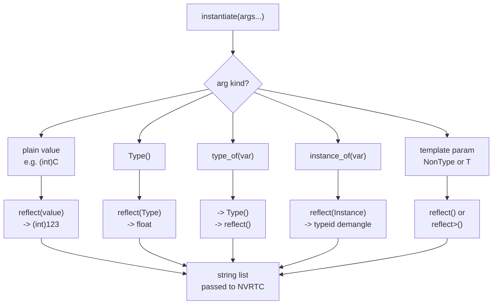
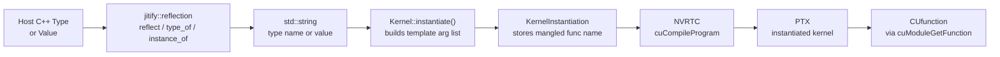

<!-- source: DeepWiki mcp.deepwiki.com · repo NVIDIA/jitify · page 3.2 Template Kernel Instantiation · fetched 2026-10-26 -->

# Template Kernel Instantiation

<details>
<summary>Relevant source files</summary>

The following files were used as context for generating this wiki page:

- [jitify.hpp](jitify.hpp)
- [jitify_example.cpp](jitify_example.cpp)
- [jitify_test.cu](jitify_test.cu)

</details>


This page explains how to instantiate templated CUDA kernels at runtime using Jitify's reflection utilities. It covers converting C++ types and compile-time values into the string representations that NVRTC requires, and shows the different calling conventions for `instantiate()`.

For the full API reference for `KernelInstantiation` (the object returned by `instantiate()`), see [2.3](#2.3). For the base workflow of writing a kernel string and calling `instantiate()`, see [3.1](#3.1).

---

## Overview

NVRTC compiles kernels as strings. When a kernel is templated, Jitify must construct the template argument list as a string (e.g., `"<int, float>"`) before passing it to the compiler. The `jitify::reflection` namespace provides the functions that perform this conversion.

The calling site looks like:

```
program.kernel("my_kernel").instantiate(<template args>)
```

The template arguments can be supplied in four ways, all of which are semantically equivalent for the same kernel template signature.

**Reflection utilities used in instantiation:**

| Helper | Input | Output String Example |
|---|---|---|
| `reflect<T>()` | type parameter | `"float"` |
| `reflect(value)` | runtime value | `"(int)123"` |
| `reflect<T, N>()` | typed non-type param | `"(int)7"` |
| `NonType<T, N>` | compile-time non-type | used as template arg |
| `Type<T>()` | type wrapped as value | `"float"` |
| `type_of(var)` | lvalue of known type | `"float"` |
| `instance_of(var)` | polymorphic base ref | derived type name |

Sources: [jitify.hpp:720-1025]()

---

## The `reflection` Namespace

All helpers live in `jitify::reflection`. The typical usage in a translation unit is:

```cpp
using jitify::reflection::NonType;
using jitify::reflection::Type;
using jitify::reflection::type_of;
using jitify::reflection::instance_of;
using jitify::reflection::reflect;
```

Sources: [jitify_test.cu:220-224](), [jitify_example.cpp:177-181]()

---

## Type Parameters — `reflect<T>()` and `Type<T>`

### `reflect<T>()`

Converts a C++ type to its string name. The underlying implementation wraps the type in a dummy template class and uses `typeid` demangling to recover the name.

```cpp
reflect<float>()         // -> "float"
reflect<const float*>()  // -> "const float *"
```

Sources: [jitify.hpp:922-925](), [jitify.hpp:847-878]()

### `Type<T>` wrapper

`Type<T>` is an empty struct that carries a type as a value. It is the idiomatic way to pass a type as an argument to the variadic `instantiate()` overload.

```cpp
Type<float>()   // passed as a value, resolved to "float"
```

`reflect(Type<float>())` and `reflect<float>()` produce identical output.

Sources: [jitify.hpp:913-914](), [jitify.hpp:958-961]()

---

## Non-Type Parameters — `NonType<T, N>` and `reflect(value)`

### `reflect(value)`

Converts a runtime value to a cast-style string. This is the standard way to pass a non-type template argument.

```cpp
reflect(123)       // -> "(int)123"
reflect(3.14f)     // -> "(float)3.14"
```

Sources: [jitify.hpp:931-934]()

### `reflect<T, N>()` and `reflect<N>()`

Compile-time versions for integer non-type template arguments.

```cpp
reflect<int, 7>()   // -> "(int)7"
reflect<7>()        // -> "(int64_t)7"
```

Sources: [jitify.hpp:940-952]()

### `NonType<T, VALUE>` wrapper

`NonType<T, VALUE>` is a compile-time wrapper for a non-type template parameter. It is used when calling the template-parameter form of `instantiate<...>()`.

```cpp
NonType<int, 123>   // represents the value 123 of type int
```

When used in `reflect<NonType<T, VALUE>>()`, it emits the value string for `VALUE`.

Sources: [jitify.hpp:734-737](), [jitify.hpp:879-884]()

---

## Deducing Types from Existing Variables — `type_of()` and `instance_of()`

### `type_of(var)`

Creates a `Type<T>` from an lvalue or const lvalue. The type is resolved at compile time. This avoids writing the type explicitly when you already have a variable.

```cpp
float* d_data;
type_of(*d_data)   // equivalent to Type<float>()
```

Sources: [jitify.hpp:980-990]()

### `instance_of(var)`

Creates an `Instance<T>` that deduces the *runtime* (dynamic) type from a polymorphic reference. This is for cases where the static type is a base class but you want to template on the derived type.

```cpp
Derived<float> obj;
Base& base = obj;
instance_of(base)   // -> reflect yields "Derived<float>"
```

`reflect(Instance<T>)` calls `typeid(value).name()` on the wrapped value and demangles the result, rather than using the static type.

Sources: [jitify.hpp:896-909](), [jitify.hpp:970-973]()

---

## Calling Conventions for `instantiate()`

All five forms below produce the same compiled kernel for the kernel `template<int C, typename T> __global__ void my_kernel2(...)`:

**1. Template parameter pack form** (compile-time types and NonType values)

```cpp
program.kernel("my_kernel2")
    .instantiate<NonType<int, C>, T>()
```

**2. String vector form** (explicit string arguments)

```cpp
program.kernel("my_kernel2")
    .instantiate({reflect((int)C), reflect<T>()})
```

**3. Mixed value + `Type<T>` form** (recommended, most readable)

```cpp
program.kernel("my_kernel2")
    .instantiate((int)C, Type<T>())
```

**4. Mixed value + `type_of()` form** (deduces type from existing variable)

```cpp
program.kernel("my_kernel2")
    .instantiate((int)C, type_of(*indata))
```

**5. Mixed value + `instance_of()` form** (runtime polymorphic type)

```cpp
program.kernel("my_kernel2")
    .instantiate((int)C, instance_of(*indata))
```

Sources: [jitify_test.cu:248-268](), [jitify_example.cpp:204-224]()

---

## How Arguments Are Resolved

The variadic `instantiate()` overload accepts arguments of heterogeneous types. Each argument is passed through `reflect()`. The overload set in `jitify::reflection` covers:

- Plain integer or float values → cast string via `reflect(value)`
- `Type<T>` instances → type name via `reflect(Type<T>)`
- `Instance<T>` instances → dynamic type name via `reflect(Instance<T>)`
- Plain types (template form) → type name via `reflect<T>()`
- `NonType<T, N>` (template form) → value string via `reflect<NonType<T,N>>()`

**Argument-to-string resolution flow:**



Sources: [jitify.hpp:922-996](), [jitify.hpp:731-737]()

---

## Data Flow: From Host Type to PTX Instantiation



Sources: [jitify.hpp:720-1025](), [jitify.hpp:1111-1376]()

---

## Example: Mixed Non-Type and Type Parameters

The kernel in the test suite has the signature `template<int N, typename T> __global__ void my_kernel(T* data)`. The first parameter is a non-type `int`, the second is a type parameter.

From [jitify_test.cu:95-105]():
- `N` is the non-type integer loop count.
- `T` is the element type.

Instantiation using `type_of`:

```cpp
// d_data is float*
auto kernel_inst =
    program.kernel("my_kernel").instantiate(3, type_of(*d_data));
```

`type_of(*d_data)` dereferences the pointer (yielding a `float`) and returns `Type<float>`. The integer `3` is passed as a value and resolved by `reflect(3)` → `"(int)3"`. The final template string built is `<(int)3, float>`.

Sources: [jitify_test.cu:116-117](), [jitify_test.cu:95-105]()

---

## Special Cases

### No template arguments

For a non-templated kernel, call `instantiate()` with no arguments or an empty initializer list:

```cpp
program.kernel("my_kernel1").instantiate()
program.kernel("my_kernel1").instantiate({})
```

Sources: [jitify_test.cu:242-245]()

### `char` and `bool` values

`reflect<char>(const char& x)` casts to `int` to avoid printing a non-printable character. `reflect<bool>` produces `"true"` or `"false"` as literals.

Sources: [jitify.hpp:754-782]()

### `const`/`volatile` qualifiers

`type_of(T const&)` returns `Type<T const>`, preserving the `const` qualifier in the reflected string. The `type_reflection` machinery wraps `T` in `JitifyTypeNameWrapper_<T>` to prevent `typeid` from stripping cv-qualifiers before demangling.

Sources: [jitify.hpp:987-990](), [jitify.hpp:847-878]()

---

## Summary Table: Which Helper to Use

| Scenario | Recommended Helper |
|---|---|
| Type known at compile time | `Type<float>()` or template form `<float>` |
| Type deduced from an existing variable | `type_of(*ptr)` or `type_of(var)` |
| Runtime polymorphic type (base/derived) | `instance_of(base_ref)` |
| Non-type integer value (compile time) | `NonType<int, N>` in template form |
| Non-type integer value (runtime variable) | pass as `(int)val` directly |
| Explicit string override | `reflect<T>()` or `reflect(val)` in vector form |

Sources: [jitify.hpp:720-1025](), [jitify_test.cu:219-276](), [jitify_example.cpp:177-233]()

---

