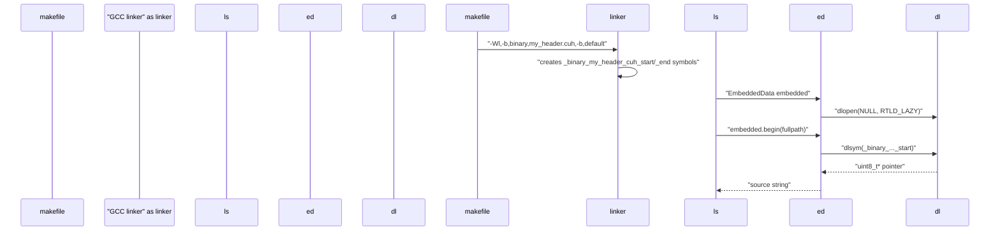

<!-- source: DeepWiki mcp.deepwiki.com · repo NVIDIA/jitify · page 3.3 Header Management · fetched 2026-10-26 -->

# Header Management

<details>
<summary>Relevant source files</summary>

The following files were used as context for generating this wiki page:

- [Makefile](Makefile)
- [example_headers/my_header1.cuh](example_headers/my_header1.cuh)
- [example_headers/my_header2.cuh](example_headers/my_header2.cuh)
- [example_headers/my_header3.cuh](example_headers/my_header3.cuh)
- [jitify.hpp](jitify.hpp)
- [jitify_example.cpp](jitify_example.cpp)
- [stringify.cpp](stringify.cpp)

</details>


## Purpose and Scope

This page explains the mechanisms Jitify provides for supplying header files to JIT-compiled CUDA programs. When NVRTC compiles a source string at runtime, it has no access to the host filesystem by default. Jitify intercepts `#include` directives and resolves them through a priority-ordered chain of sources. This page covers each source in that chain: inline string headers, the `file_callback` mechanism, the `stringify` tool for C string literals, and binary embedding via the GCC linker.

For the `program()` call signature itself, see [2.1](#2.1). For the `stringify` utility in detail, see [4.1](#4.1).

---

## Header Resolution Order

When a `#include` directive fails during compilation, Jitify re-attempts compilation by loading the missing file through the following ordered strategy, implemented in `detail::load_source` in [jitify.hpp:556-714]():

**Resolution priority diagram:**

```mermaid
flowchart TD
    A["#include directive fails"] --> B["load_source() called"]
    B --> C{"filename contains newline?"}
    C -- "yes" --> D["\"Direct source string\"\nuse embedded source"]
    C -- "no" --> E{"file_callback != NULL?"}
    E -- "returns non-NULL" --> F["\"file_callback result\"\nuse stream from callback"]
    E -- "returns NULL" --> G{"JITIFY_ENABLE_EMBEDDED_FILES?"}
    G -- "yes" --> H["EmbeddedData::begin/end\nvia dlsym"]
    H -- "found" --> I["use embedded binary data"]
    H -- "not found" --> J["filesystem search"]
    G -- "no" --> J
    J --> K{"search_current_dir?"}
    K -- "yes" --> L["open current_dir/filename"]
    K -- "no" --> M["search include_paths[]"]
    L -- "not found" --> M
    M -- "not found" --> N["get_jitsafe_headers_map()"]
    N -- "found" --> O["use built-in jitsafe header"]
    N -- "not found" --> P["return false\ncompilation error"]
```

Sources: [jitify.hpp:556-714]()

---

## Method 1: Inline String Headers

The second parameter of `JitCache::program()` accepts a list of `const char*` strings. Each string must follow the same format as a kernel source string: the **first line must be the filename**, followed by a newline, followed by the header source.

```
"example_headers/my_header1.cuh\n"
"#pragma once\n"
"template<typename T> T square(T x) { return x*x; }\n"
```

Jitify's `load_source` detects the embedded filename by searching for the first `\n` in the string [jitify.hpp:567-573](). When found, it extracts the filename prefix and uses the rest as source.

This format is exactly what the `stringify` tool produces (see Method 3 below).

**Example from the codebase:**

[jitify_example.cpp:183-187]() shows passing an inline string header alongside a `file_callback`:

```cpp
jitify::Program program = kernel_cache.program(
    program1,
    {example_headers_my_header1_cuh},   // const char* from .jit file
    {"--use_fast_math", "-I" CUDA_INC_DIR},
    file_callback);
```

Sources: [jitify.hpp:556-573](), [jitify_example.cpp:183-187]()

---

## Method 2: The `file_callback` Mechanism

### Type Definition

[jitify.hpp:196-197]() defines the callback signature:

```cpp
typedef std::istream* (*file_callback_type)(std::string filename,
                                            std::iostream& tmp_stream);
```

| Parameter | Description |
|-----------|-------------|
| `filename` | The full path as requested by the `#include` directive, joined with the current directory |
| `tmp_stream` | A `std::iostream` provided for convenience to hold dynamically constructed content |
| **Return value** | Pointer to an `std::istream` with the source content, or `NULL` to defer to other mechanisms |

Returning `NULL` tells Jitify to continue down the resolution chain (embedded files, filesystem, built-ins). Returning a pointer stops the search and uses that stream's content.

### Callback registration

The callback is passed as the fourth argument to `JitCache::program()`. It is invoked once per missing include, with the full path formed by joining the current directory with the include filename [jitify.hpp:583-586]().

### Example

[jitify_example.cpp:71-85]() shows a complete callback that handles one specific header and defers everything else:

```cpp
std::istream* file_callback(std::string filename, std::iostream& tmp_stream) {
  if (filename == "example_headers/my_header4.cuh") {
    tmp_stream << "#pragma once\n"
                  "template<typename T>\n"
                  "T pointless_func(T x) { return x; }\n";
    return &tmp_stream;
  } else {
    return 0;  // defer to Jitify's other mechanisms
  }
}
```

The callback is appropriate when header content is generated at runtime, fetched from a database, or comes from a non-standard location.

Sources: [jitify.hpp:196-197](), [jitify.hpp:581-586](), [jitify_example.cpp:71-85]()

---

## Method 3: stringify — Embedding Headers as C String Literals

### What stringify does

`stringify` ([stringify.cpp]()) is a command-line tool that converts a `.cuh` or `.h` file into a C string literal declaration, producing a `.jit` file. The output is a single `const char* const` variable whose value starts with the filename on the first line.

**Output format:**

```
const char* const example_headers_my_header1_cuh =
"example_headers/my_header1.cuh\n"
"#pragma once\n"
"template <typename T>\n"
"__device__ inline T square(T x) {\n"
"  return x * x;\n"
"}\n"
;
```

The variable name is produced by `sanitize_varname`, which replaces all non-alphanumeric characters with underscores [stringify.cpp:40-51](). The filename appears as the first line of the string literal so that `load_source` can extract it [stringify.cpp:79-80]().

### Build integration

The `Makefile` rule [Makefile:50-51]() generates `.jit` files automatically:

```makefile
%.jit: % stringify
    ./stringify $< > $@
```

`example_headers/my_header1.cuh.jit` is listed as a build dependency and is generated from `example_headers/my_header1.cuh`.

### Usage in host code

Include the `.jit` file to declare the variable, then pass it in the headers list:

```cpp
#include "example_headers/my_header1.cuh.jit"
// ...
jitify::Program program = kernel_cache.program(
    source,
    {example_headers_my_header1_cuh},
    options);
```

Sources: [stringify.cpp](), [Makefile:39-51](), [jitify_example.cpp:45-46](), [jitify_example.cpp:184-187]()

---

## Method 4: Binary Embedding via the GCC Linker

On Linux with GCC, raw files can be embedded directly into the executable binary. This requires no source transformation.

### Build flags

The linker flag sequence [jitify.hpp:45-48](), [Makefile:16-29]():

| Compiler | Flags |
|----------|-------|
| `g++` | `-rdynamic -DJITIFY_ENABLE_EMBEDDED_FILES=1 -Wl,-b,binary,<file1>,<file2>,...,-b,default` |
| `nvcc` | `-rdynamic -Xcompiler "-Wl\,-b\,binary\,<file1>,...\,-b\,default"` |

The Makefile sets this up in `EMBED` and `NVCC_EMBED` variables [Makefile:16-29](), embedding `example_headers/my_header2.cuh` on Linux.

### Declaring embedded files in host code

After linking, each file must be declared using `JITIFY_INCLUDE_EMBEDDED_FILE`. The macro argument is the sanitized filename (all non-alphanumeric characters replaced with `_`) [jitify.hpp:166-183]():

```cpp
JITIFY_INCLUDE_EMBEDDED_FILE(example_headers_my_header2_cuh);
```

This expands to `extern "C"` declarations for the linker-generated `_binary_<name>_start` and `_binary_<name>_end` symbols [jitify.hpp:176-182]().

The `JITIFY_FORCE_UNDEFINED_SYMBOL` helper [jitify.hpp:165]() prevents the linker from discarding the symbols as unreferenced.

### Runtime resolution

When `JITIFY_ENABLE_EMBEDDED_FILES=1`, `load_source` instantiates `detail::EmbeddedData` and calls `dlopen(NULL, RTLD_LAZY)` to access the current process's symbol table. The file content is retrieved by resolving `_binary_<sanitized_name>_start` and `_binary_<sanitized_name>_end` via `dlsym` [jitify.hpp:310-342]().

The `EmbeddedData::operator[]` sanitizes the key using `sanitize_filename` before the `dlsym` lookup [jitify.hpp:328-335]().

**Binary embedding flow diagram:**



Sources: [jitify.hpp:88-90](), [jitify.hpp:164-183](), [jitify.hpp:309-342](), [jitify.hpp:586-595](), [Makefile:16-29](), [jitify_example.cpp:34-36](), [jitify_example.cpp:46-48]()

---

## `#pragma once` Handling

NVRTC does not support `#pragma once`. Jitify handles this by detecting the directive during `load_source` [jitify.hpp:664-671]() and replacing it with an `#ifndef / #define / #endif` include guard. The guard name is derived from a Larson-64 hash of the file content [jitify.hpp:697-710](), making it unique per file even when the same header is included from multiple paths.

---

## Summary of Methods

| Method | Mechanism | Platform | Use case |
|--------|-----------|----------|----------|
| Inline string | `const char*` in `headers` list | All | Small or generated headers |
| `file_callback` | `file_callback_type` function pointer | All | Dynamic or conditional resolution |
| stringify `.jit` | C string literal via `stringify` tool | All | Static headers compiled into the binary |
| Binary embedding | `-Wl,-b,binary` + `JITIFY_INCLUDE_EMBEDDED_FILE` | Linux/GCC only | Raw file embedding without transformation |
| Filesystem | `-I` include path options | All | Headers available on disk at runtime |
| Built-in jitsafe | `get_jitsafe_headers_map()` | All | Standard C/CUDA headers shimmed by Jitify |

Sources: [jitify.hpp:556-714](), [jitify_example.cpp:71-85](), [jitify_example.cpp:183-187](), [stringify.cpp](), [Makefile:16-51]()

---

