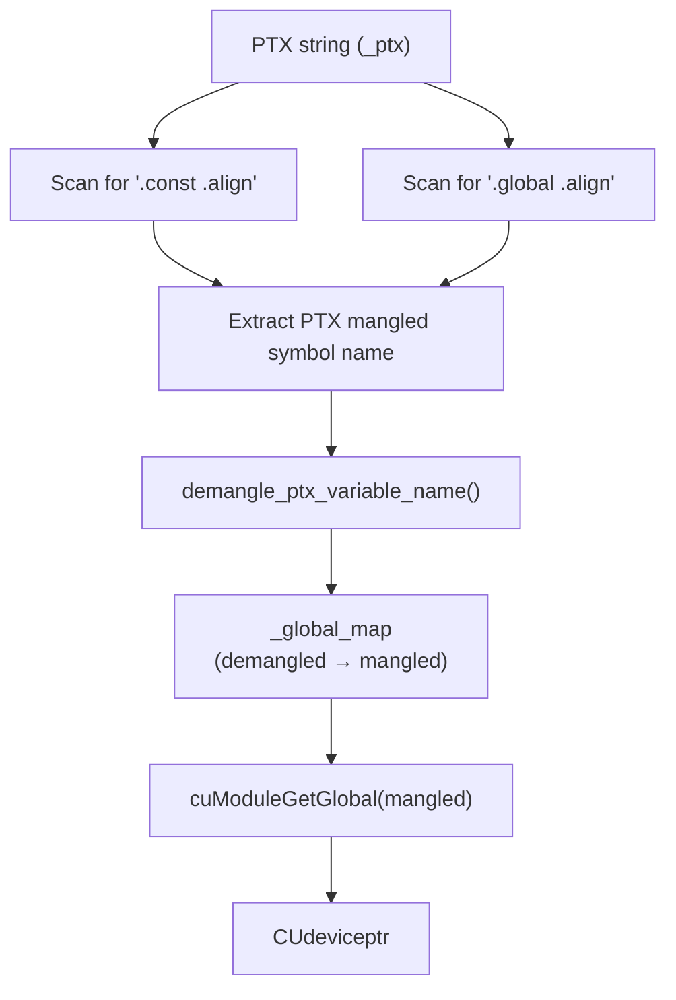
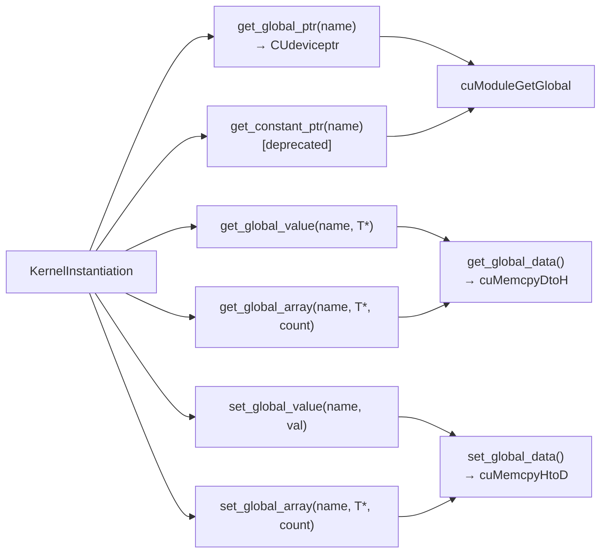
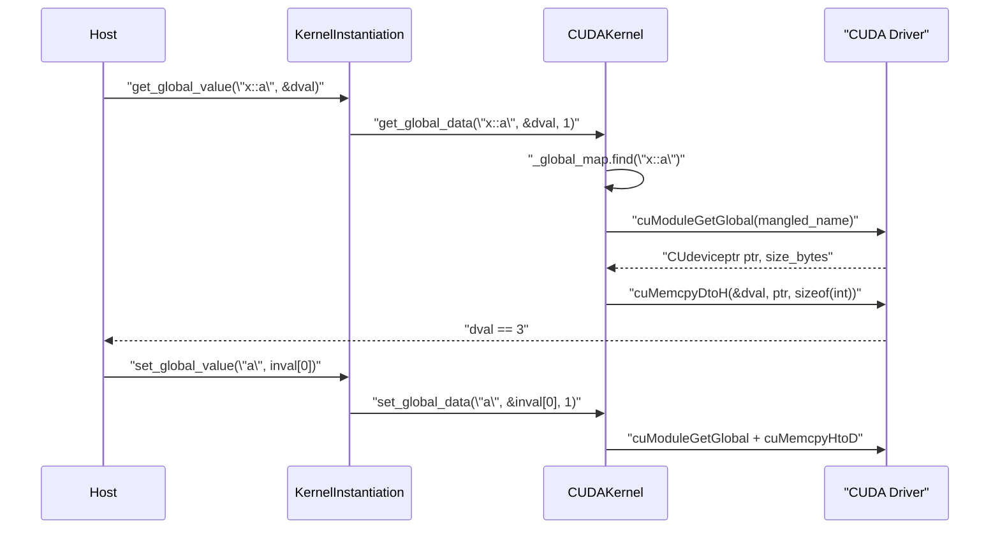

<!-- source: DeepWiki mcp.deepwiki.com · repo NVIDIA/jitify · page 3.4 Device and Constant Memory · fetched 2026-10-26 -->

# Device and Constant Memory

<details>
<summary>Relevant source files</summary>

The following files were used as context for generating this wiki page:

- [example_headers/constant_header.cuh](example_headers/constant_header.cuh)
- [jitify.hpp](jitify.hpp)
- [jitify_example.cpp](jitify_example.cpp)
- [jitify_test.cu](jitify_test.cu)

</details>


## Purpose and Scope

This page covers how to read and write `__device__` and `__constant__` variables in JIT-compiled CUDA programs from host code, using the methods provided on `jitify::KernelInstantiation`. It explains how Jitify discovers these variables in compiled PTX, how to look them up by name including namespaced names, and how to use each access method.

This page does not cover kernel launch configuration or argument passing — for those, see [KernelInstantiation](#2.3) and [KernelLauncher](#2.4).

---

## Background

CUDA provides two special memory spaces accessible from device code:

| Qualifier | CUDA Memory Space | Typical Use |
|---|---|---|
| `__device__` | Global device memory | Read/write from device; read/write from host via driver API |
| `__constant__` | Constant memory (cached, read-only on device) | Read-only on device; written from host before launch |

In normal (non-JIT) CUDA code, the driver API functions `cuModuleGetGlobal` and `cuMemcpyHtoD`/`cuMemcpyDtoH` are used to access these. Jitify wraps this functionality and adds automatic name resolution from demangled C++ variable names.

---

## How Jitify Discovers Global Variables

When a `KernelInstantiation` is created, it internally holds a `detail::CUDAKernel` instance. During module loading, `create_global_variable_map()` scans the compiled PTX for all global variable declarations.

**Variable discovery in PTX (create_global_variable_map)**



Sources: [jitify.hpp:1222-1244](), [jitify.hpp:1033-1059]()

The `_global_map` is a `std::map<std::string, std::string>` where the key is the demangled C++ name (e.g., `"b::a"`) and the value is the PTX mangled symbol (e.g., `"_ZN1b1aE"`). Static variables defined inside functions are excluded from the map because they are not externally addressable.

Sources: [jitify.hpp:1119](), [jitify.hpp:1222-1244]()

---

## API Overview

All global variable access methods are exposed on `jitify::KernelInstantiation`. Internally they delegate to the `detail::CUDAKernel` member.

**KernelInstantiation method call chain**



Sources: [jitify.hpp:1329-1357](), [jitify_test.cu:388-426]()

### Method Reference

| Method | Return | Description |
|---|---|---|
| `get_global_ptr(name)` | `CUdeviceptr` | Returns device pointer to named variable; optionally returns size via `size_t*` |
| `get_global_value(name, T* val)` | `CUresult` | Copies one element from device to host |
| `set_global_value(name, val)` | `CUresult` | Copies one element from host to device; also accepts array types via template deduction |
| `get_global_array(name, T* arr, count)` | `CUresult` | Copies `count` elements from device to host |
| `set_global_array(name, T* arr, count)` | `CUresult` | Copies `count` elements from host to device |
| `get_constant_ptr(name)` | `CUdeviceptr` | **Deprecated.** Equivalent to `get_global_ptr`. |

Sources: [jitify.hpp:1329-1357](), [jitify_test.cu:388-426](), [jitify_example.cpp:236-299]()

---

## Name Resolution and Namespace Support

Variable names are passed as strings using C++ `::` namespace notation. Jitify resolves these to PTX mangled names via the `_global_map` built during compilation.

**Supported name formats**

| Variable declaration | String to pass |
|---|---|
| `__constant__ int a;` | `"a"` |
| `namespace b { __constant__ int a; }` | `"b::a"` |
| `namespace c { namespace b { __constant__ int a; } }` | `"c::b::a"` |
| `namespace { namespace b { __constant__ int a[3]; } }` | `"(anonymous namespace)::b::a"` |

This naming convention follows the Itanium C++ ABI demangling scheme used by `demangle_ptx_variable_name()`.

Sources: [jitify.hpp:1033-1059](), [jitify_test.cu:348-373](), [example_headers/constant_header.cuh:31-38]()

---

## Worked Example: Scalars and Named Namespaces

The following source from `jitify_test.cu` illustrates the full round-trip for reading and writing `__constant__` and `__device__` variables declared at various namespace depths:

**Kernel source (constmem_program_source)**

```
__constant__ int a;
__device__ int d;
namespace b { __constant__ int a; __device__ int d; }
namespace c { namespace b { __constant__ int a; __device__ int d; } }
namespace x { __constant__ int a = 3; __device__ int d = 7; }
namespace y { __constant__ int a[] = {4, 5}; __device__ int d[] = {8, 9}; }
```

Sources: [jitify_test.cu:348-373]()

**Host-side access sequence**



Sources: [jitify_test.cu:388-426]()

Reading the pre-initialized value of `x::a` (which is `3`) and then overwriting `a` with a new value before launching `constant_test` is the typical usage pattern. All writes must happen before the kernel launch to ensure the device sees the updated values.

---

## Worked Example: Arrays

Both `set_global_value` and `set_global_array` / `get_global_array` handle array types. The difference is how the element count is specified:

- `set_global_value("y::d", inarr)` — the array size is deduced from the type `T[N]`
- `set_global_array("y::a", &inval[8], 2)` — the count is passed explicitly as the third argument
- `get_global_array("y::a", &darr[0], 2)` — reads exactly 2 elements

`get_global_data` performs a size check: if the byte count computed from `count * sizeof(T)` does not match the actual variable size in the module, a `std::runtime_error` is thrown.

Sources: [jitify_test.cu:396-416](), [jitify.hpp:1342-1357]()

---

## Anonymous Namespace Variables

Anonymous namespace variables are supported. The string `"(anonymous namespace)"` is used as the namespace component in the lookup key, matching the output of the PTX demangler.

This is demonstrated in `example_headers/constant_header.cuh`, which declares:

```
namespace {
namespace b {
__constant__ int a[3];
__device__ int d[3];
}
}
```

Sources: [example_headers/constant_header.cuh:31-38]()

These are accessed using:
- `get_constant_ptr("(anonymous namespace)::b::a")` — deprecated but still present in example code
- `get_global_ptr("(anonymous namespace)::b::d")`

Sources: [jitify_test.cu:437-441](), [jitify_example.cpp:283-293]()

---

## Deprecated: `get_constant_ptr`

`get_constant_ptr(name)` is a legacy method that returns a `CUdeviceptr` to a `__constant__` variable. It is functionally equivalent to `get_global_ptr(name)`.

The preferred replacement is `get_global_ptr`, `get_global_value`, or `set_global_value` depending on the operation. The reason both `__constant__` and `__device__` variables share the same API is that Jitify's `_global_map` is built from both `.const .align` and `.global .align` PTX directives without distinction.

Sources: [jitify.hpp:1222-1244](), [jitify_test.cu:437-441]()

---

## Runtime Size Validation

`get_global_data` (called internally by `get_global_value` and `get_global_array`) validates that the requested byte transfer matches the declared size of the variable in the module:

- If `count * sizeof(T) != size_bytes`, a `std::runtime_error` is thrown with a descriptive message.
- This protects against type mismatches and out-of-bounds reads.

Sources: [jitify.hpp:1342-1357]()

---

## Relationship to the `experimental` API

The `jitify::experimental::KernelInstantiation` class exposes the same `get_global_*` / `set_global_*` / `get_global_ptr` / `get_constant_ptr` interface as the standard `jitify::KernelInstantiation`. The test suite exercises both paths identically. See [Experimental API](#2.6) for how `experimental::KernelInstantiation` differs from the standard one in terms of serialization and caching.

Sources: [jitify_test.cu:456-540]()

---

