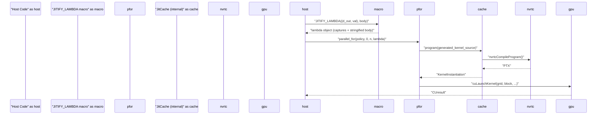
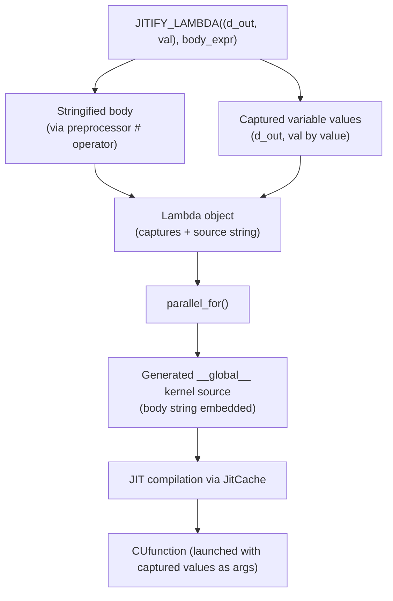
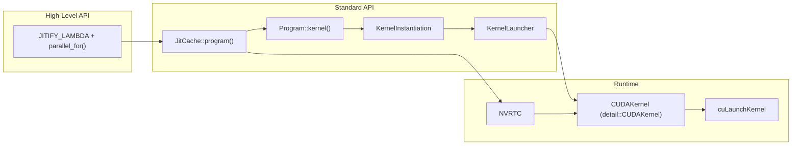

<!-- source: DeepWiki mcp.deepwiki.com · repo NVIDIA/jitify · page 3.5 Parallel For and Lambda Support · fetched 2026-10-26 -->

# Parallel For and Lambda Support

<details>
<summary>Relevant source files</summary>

The following files were used as context for generating this wiki page:

- [jitify.hpp](jitify.hpp)
- [jitify_example.cpp](jitify_example.cpp)
- [jitify_test.cu](jitify_test.cu)

</details>


## Purpose and Scope

This page covers `jitify::parallel_for` and the `JITIFY_LAMBDA` macro, which together provide a way to express simple device-side parallel loops without writing a named `__global__` kernel. This is a higher-level convenience interface built on top of the same JIT compilation pipeline described in pages [2.1](#2.1) through [2.4](#2.4).

For manually writing, instantiating, and launching named kernels, see [3.1 Basic Compilation and Launch](#3.1). For template instantiation of named kernels, see [3.2 Template Kernel Instantiation](#3.2).

---

## Overview

The `parallel_for` pattern in Jitify allows a host-side C++ lambda body to be stringified, JIT-compiled into a CUDA kernel, and launched over an integer range — all with a single call. The three pieces are:

| Component | Type | Role |
|---|---|---|
| `jitify::ExecutionPolicy` | class | Specifies where and how to run (device, stream, etc.) |
| `JITIFY_LAMBDA(captures, body)` | macro | Bundles captured variables and a stringified body expression |
| `jitify::parallel_for(policy, begin, end, lambda)` | function | Compiles and launches the lambda as a kernel over `[begin, end)` |

Sources: [jitify.hpp:68-80](), [jitify_test.cu:542-562](), [jitify_example.cpp:301-325]()

---

## Core Concepts

### The Loop Variable `i`

The body expression given to `JITIFY_LAMBDA` is executed once per integer index. The implicit loop variable is always named `i`, which ranges over the half-open interval `[begin, end)` provided to `parallel_for`.

### Captures

The capture list is passed as a parenthesized, comma-separated list of variable names as the first argument to `JITIFY_LAMBDA`. These variables are captured by value and passed as kernel arguments. Device pointers are valid captures.

### Execution Policy

`jitify::ExecutionPolicy` is constructed with an execution target. Currently the relevant constant is `jitify::DEVICE`, which routes the parallel loop to a GPU kernel launch.

---

## Usage Pattern

The canonical usage pattern, drawn from the test suite and examples:

**Test example** ([jitify_test.cu:542-562]()):
```
ExecutionPolicy policy(DEVICE);
lambda = JITIFY_LAMBDA((d_out, val), d_out[i] = (float)i * val);
parallel_for(policy, 0, n, lambda);
```

**Example with explicit cast** ([jitify_example.cpp:308-311]()):
```
ExecutionPolicy policy(DEVICE);
lambda = JITIFY_LAMBDA((d_out, val),
                       d_out[i] = static_cast<decltype(val)>(i) * val);
parallel_for(policy, 0, n, lambda);
```

The body is an arbitrary device-executable expression. `decltype` and other C++ constructs that NVRTC understands are valid in the body.

---

## How the Components Interact

**Call flow diagram: `parallel_for` execution**



Sources: [jitify_test.cu:542-562](), [jitify_example.cpp:301-325](), [jitify.hpp:68-80]()

---

## Data Flow: From Macro to Kernel

**Structure of the JITIFY_LAMBDA object**



Sources: [jitify_test.cu:542-562](), [jitify_example.cpp:301-325]()

---

## `JITIFY_LAMBDA` Macro

**Syntax:**
```
JITIFY_LAMBDA((var1, var2, ...), expression)
```

- **First argument**: parenthesized list of variable names to capture. These become kernel parameters.
- **Second argument**: an expression forming the kernel body. This expression is stringified by the preprocessor using the `#` operator. The string is later embedded in a generated `__global__` kernel.
- The variable `i` is the implicit index variable within the expression.
- All captured variables must be trivially copyable (they are passed as kernel arguments).

**Key constraints:**

| Constraint | Reason |
|---|---|
| Loop variable must be referenced as `i` | The generated kernel uses `i` as the thread index name |
| Captures are by value | Variables are passed as kernel arguments |
| Body must be a valid NVRTC-compilable expression | The stringified body is compiled by NVRTC at runtime |
| No commas at the top level of the body | The macro uses comma as a delimiter |

Sources: [jitify_test.cu:542-562](), [jitify_example.cpp:301-325](), [jitify.hpp:68-80]()

---

## `jitify::ExecutionPolicy`

`ExecutionPolicy` is constructed by passing an execution location constant. The constant `jitify::DEVICE` directs execution to a GPU kernel.

The policy object may also carry grid/block configuration parameters, which `parallel_for` uses to calculate the launch dimensions over the specified integer range.

---

## `jitify::parallel_for`

**Signature (inferred from usage):**
```
CUresult parallel_for(ExecutionPolicy policy, int begin, int end, Lambda lambda);
```

- `policy`: controls execution target and parameters.
- `begin`, `end`: integer range, half-open `[begin, end)`.
- `lambda`: a lambda object produced by `JITIFY_LAMBDA`.
- Returns `CUresult`.

Internally, `parallel_for`:
1. Constructs a `__global__` kernel source string by embedding the stringified body from the lambda.
2. Uses the Jitify JIT pipeline (equivalent to `JitCache::program()`) to compile the source.
3. Passes the captured variable values as kernel arguments.
4. Launches the kernel over the integer range, mapping thread indices to `i`.

---

## Complete Working Example

From [jitify_test.cu:542-562]() — allocates a device array, uses `parallel_for` to write `i * val` to each element, then validates on the host:

```
int n = 10000;
float* d_out;
cudaMalloc((void**)&d_out, n * sizeof(float));
float val = 3.14159f;

jitify::ExecutionPolicy policy(jitify::DEVICE);
auto lambda = JITIFY_LAMBDA((d_out, val), d_out[i] = (float)i * val);
CHECK_CUDA(jitify::parallel_for(policy, 0, n, lambda));

// After device sync, h_out[i] == (float)i * 3.14159f
```

From [jitify_example.cpp:301-325]() — the same pattern with `decltype` to handle type inference:

```
JITIFY_LAMBDA((d_out, val), d_out[i] = static_cast<decltype(val)>(i) * val)
```

---

## Relationship to the Standard Jitify Pipeline

`parallel_for` is not a standalone system — it reuses the same JIT compilation infrastructure as the `JitCache`/`Program`/`KernelInstantiation` chain described in [2](#2). The difference is that the kernel source is **generated** from the lambda body string rather than supplied by the user. Caching behavior follows the same LRU object cache described in [2.1](#2.1).



Sources: [jitify.hpp:68-80](), [jitify_test.cu:542-562](), [jitify_example.cpp:301-325]()

---

