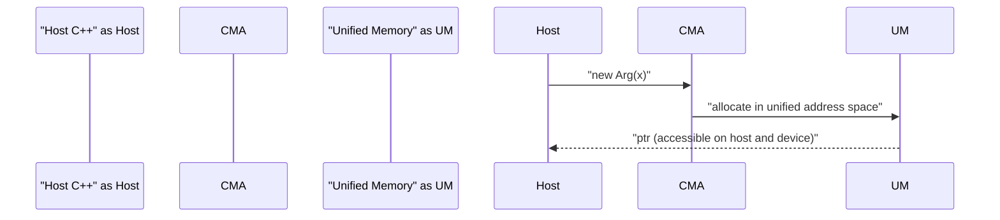
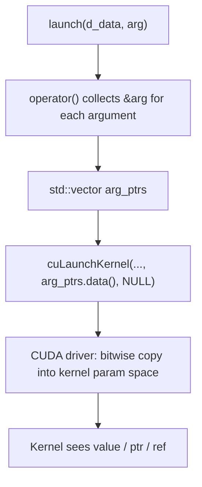

<!-- source: DeepWiki mcp.deepwiki.com · repo NVIDIA/jitify · page 3.6 Passing Class Objects as Kernel Arguments · fetched 2026-10-26 -->

# Passing Class Objects as Kernel Arguments

<details>
<summary>Relevant source files</summary>

The following files were used as context for generating this wiki page:

- [example_headers/class_arg_kernel.cuh](example_headers/class_arg_kernel.cuh)
- [jitify.hpp](jitify.hpp)
- [jitify_test.cu](jitify_test.cu)

</details>


This page covers how to pass C++ class and struct instances as arguments to JIT-compiled CUDA kernels using Jitify, including the by-value, by-reference, and by-pointer calling patterns and the role of the `Managed` helper class for unified memory allocation.

For the general kernel launch workflow, see the [Basic Compilation and Launch](#3.1) guide. For the `KernelLauncher` API that accepts these arguments, see the [KernelLauncher reference](#2.4). For a reference listing all example headers including `class_arg_kernel.cuh`, see the [Example Headers Reference](#5).

---

## Motivation

CUDA kernels can accept user-defined structs and class instances as parameters — by value, by reference, or by pointer. Jitify's `KernelLauncher::operator()` and `launch()` collect raw pointers to each argument and forward them to `cuLaunchKernel`. Because CUDA performs a **bitwise copy** of argument data into kernel parameter space at launch time, C++ copy constructors and move semantics are bypassed entirely. This has specific consequences for class design, particularly around deleted copy constructors and memory residency.

---

## The `Managed` Base Class

[example_headers/class_arg_kernel.cuh:31-46]()

The `Managed` class overrides `operator new` and `operator delete` to route heap allocation through `cudaMallocManaged`. Any class inheriting from `Managed` will be allocated in CUDA Unified Memory, making it accessible from both host code and device kernels.

| Member | Behavior |
|---|---|
| `operator new(size_t len)` | Calls `cudaMallocManaged`, then `cudaDeviceSynchronize` before returning |
| `operator delete(void* ptr)` | Calls `cudaDeviceSynchronize`, then `cudaFree` |

> **Note:** The `#ifndef __CUDACC_RTC__` guard around `cudaMallocManaged` means the `Managed` class body is shared between host compilation and device-side JIT compilation — the allocation call is stripped at JIT-compile time.

**`Managed` allocation flow:**



Sources: [example_headers/class_arg_kernel.cuh:31-46]()

---

## The `Arg` Example Struct

[example_headers/class_arg_kernel.cuh:48-54]()

```
struct Arg : public Managed {
  const int x;
  Arg(int x_) : x(x_) {}
  Arg(const Arg& arg) = delete;   // no copy constructor
};
```

Key design decisions in `Arg`:

- Inherits `Managed` so heap-allocated instances (`new Arg(...)`) reside in unified memory.
- The copy constructor is explicitly deleted. This is safe because CUDA's `cuLaunchKernel` performs a raw memory copy of argument data — it does not invoke C++ constructors.
- `x` is `const int`, keeping the struct small enough that by-value kernel passing works without unified memory.

Sources: [example_headers/class_arg_kernel.cuh:48-54]()

---

## Kernel Variants

Three kernel templates in `class_arg_kernel.cuh` demonstrate each passing pattern:

[example_headers/class_arg_kernel.cuh:56-69]()

| Kernel | Signature | Pattern |
|---|---|---|
| `class_arg_kernel` | `(int* x, T arg)` | By value |
| `class_arg_ref_kernel` | `(int* x, T& arg)` | By reference |
| `class_arg_ptr_kernel` | `(int* x, T* arg)` | By pointer |

**Kernel variants and their argument types:**

```mermaid
classDiagram
    class "class_arg_kernel" {
        +int* x
        +T arg (by value)
        reads arg.x
    }
    class "class_arg_ref_kernel" {
        +int* x
        +T& arg (by reference)
        reads arg.x
    }
    class "class_arg_ptr_kernel" {
        +int* x
        +T* arg (by pointer)
        reads arg->x
    }
    class "Arg" {
        +const int x
        +Managed base
        copy ctor deleted
    }
    "class_arg_kernel" --> "Arg" : "T = Arg"
    "class_arg_ref_kernel" --> "Arg" : "T = Arg"
    "class_arg_ptr_kernel" --> "Arg" : "T = Arg"
```

Sources: [example_headers/class_arg_kernel.cuh:56-69]()

---

## Passing Patterns in Practice

The test `TEST(JitifyTest, ClassKernelArg)` in [jitify_test.cu:995-1061]() exercises all three patterns.

### 1 — By Value (stack-allocated object)

[jitify_test.cu:1010-1020]()

```
Arg arg(-1);
program.kernel("class_arg_kernel")
    .instantiate(Type<Arg>())
    .configure(grid, block)
    .launch(d_data, arg);
```

- `Arg arg(-1)` is stack-allocated; `Managed::operator new` is **not** called here.
- The `Arg` struct is small (one `int`), so CUDA can copy it bitwise into the kernel argument buffer.
- The deleted copy constructor is not a problem: the C++ copy constructor path is never taken.

### 2 — By Value (rvalue / temporary)

[jitify_test.cu:1022-1032]()

```
int value = -2;
program.kernel("class_arg_kernel")
    .instantiate(Type<Arg>())
    .configure(grid, block)
    .launch(d_data, Arg(value));
```

- A temporary `Arg(value)` is constructed in place. The `KernelLauncher::operator()` template captures a pointer to the temporary before the CUDA driver copies it.

### 3 — By Reference

[jitify_test.cu:1034-1046]()

```
Arg* arg = new Arg(-3);
program.kernel("class_arg_ref_kernel")
    .instantiate(Type<Arg>())
    .configure(grid, block)
    .launch(d_data, arg);
// ...
delete(arg);
```

- `new Arg(-3)` routes through `Managed::operator new` → `cudaMallocManaged`. The object is in unified memory.
- A reference parameter (`T& arg`) in a CUDA kernel is, at the ABI level, identical to a pointer. The test comment reads: *"references are passed as pointers since references are just pointers from an ABI point of view"*.
- The host-side `arg` is a raw pointer; it is passed directly to `launch()`, which gives `cuLaunchKernel` the pointer value. The device then dereferences it.
- The object must be in unified (or device-mapped) memory so the device pointer is valid.

### 4 — By Pointer

[jitify_test.cu:1048-1058]()

```
Arg* arg = new Arg(-4);
program.kernel("class_arg_ptr_kernel")
    .instantiate(Type<Arg>())
    .configure(grid, block)
    .launch(d_data, arg);
// ...
delete(arg);
```

- Same allocation pattern as the reference case.
- The kernel receives `T* arg` and accesses `arg->x`.
- The `Managed`-allocated pointer is valid on device.

---

## How Arguments Reach the Device

All passing patterns go through the same launch mechanism. `KernelLauncher::operator()` collects the address of each argument into a `std::vector<void*>` and passes that array to `cuLaunchKernel` via the `launch()` method.

[jitify.hpp:1305-1309]()



Sources: [jitify.hpp:1305-1309](), [jitify_test.cu:995-1061]()

---

## Memory Residency Requirements

| Passing mode | Must be in unified memory? | Why |
|---|---|---|
| By value (small struct) | No | CUDA driver bitwise copies the struct into parameter space; host-resident data is fine |
| By value (rvalue) | No | Same — temporary lives on the host stack for the duration of the call |
| By reference | **Yes** | The device dereferences the pointer at execution time; must be valid on device |
| By pointer | **Yes** | Same as reference |

Using `new` with a `Managed`-derived class (or `cudaMallocManaged` directly) is the standard mechanism to satisfy the unified memory requirement for reference and pointer modes.

---

## Deleted Copy Constructor and CUDA ABI

`Arg` deletes its copy constructor ([example_headers/class_arg_kernel.cuh:53]()). This does not prevent by-value kernel passing because:

1. `KernelLauncher::operator()` takes each argument as a forwarded reference and stores `(void*)&arg`.
2. The CUDA driver reads `sizeof(Arg)` bytes from that address and places them in the kernel's parameter space.
3. No C++ copy or move constructor is invoked anywhere in this chain.

This means a class can safely delete its copy constructor and still be passed by value to a kernel, provided its data is trivially copyable at the byte level.

Sources: [example_headers/class_arg_kernel.cuh:48-54](), [jitify_test.cu:995-1061](), [jitify.hpp:1305-1316]()

---

