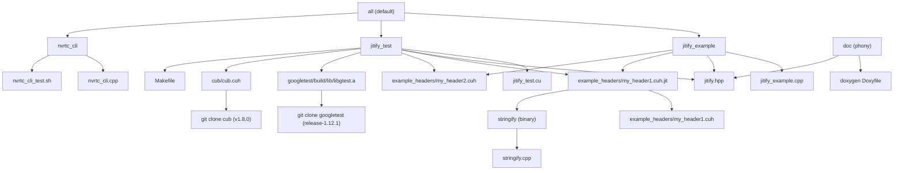
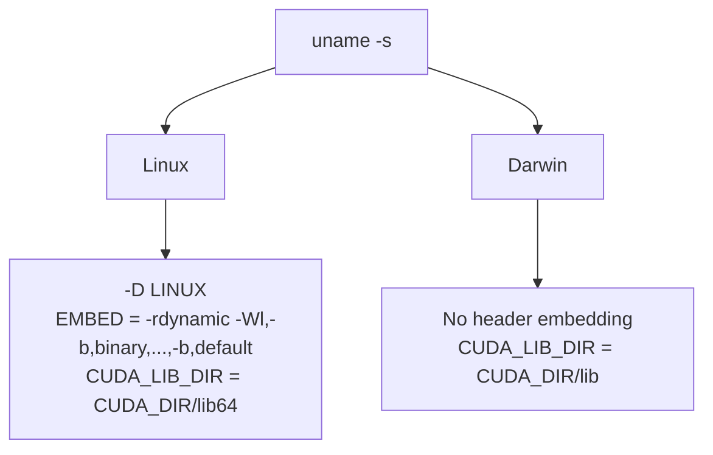

<!-- source: DeepWiki mcp.deepwiki.com · repo NVIDIA/jitify · page 4 Build System and Tooling · fetched 2026-10-26 -->

# Build System and Tooling

<details>
<summary>Relevant source files</summary>

The following files were used as context for generating this wiki page:

- [.clang-format](.clang-format)
- [.gitignore](.gitignore)
- [Doxyfile](Doxyfile)
- [Makefile](Makefile)

</details>


## Purpose and Scope

This page documents the `Makefile`-based build system used for building, testing, and documenting Jitify. It covers all build targets, compiler flag conventions, platform-specific behavior, external dependency acquisition, and code formatting configuration.

For documentation of the `stringify` utility itself (which converts `.cuh` headers into embeddable C string files), see [stringify Utility](#4.1). For documentation of the `nvrtc_cli` command-line compiler tool, see [nvrtc_cli](#4.2).

---

## Build Targets at a Glance

| Target | Type | Description |
|---|---|---|
| `all` | Default | Builds `jitify_example`, `jitify_test`, and `nvrtc_cli` |
| `jitify_example` | Binary | Example application demonstrating the Jitify API |
| `jitify_test` | Binary | Full test suite using GoogleTest and NVCC |
| `stringify` | Binary | Utility for embedding headers as C strings |
| `nvrtc_cli` | Binary | Standalone NVRTC command-line compiler |
| `test` | Phony | Runs `./jitify_test` |
| `doc` | Phony | Generates Doxygen HTML and LaTeX documentation |
| `get-deps` | Phony | Installs system-level prerequisites via `apt-get` |
| `clean` | Phony | Removes all build artifacts and fetched dependencies |

[Makefile:43-43]()

---

## Build Graph

**Build Dependency Graph**



Sources: [Makefile:39-100]()

---

## Compiler Variables and Flags

The Makefile exposes several overridable variables:

| Variable | Default | Purpose |
|---|---|---|
| `CXX` | System default | C++ compiler used for host-only builds |
| `NVCC` | `$(CUDA_DIR)/bin/nvcc` | CUDA compiler for `jitify_test` |
| `CUDA_DIR` | `/usr/local/cuda` | Root CUDA installation path |
| `CUDA_INC_DIR` | `$(CUDA_DIR)/include` | CUDA header directory |
| `CXX11` | `1` | When set to `1`, adds `-std=c++11` |
| `DOXYGEN` | `doxygen` | Doxygen executable |
| `CUB_DIR` | `/tmp/cub` | Path where CUB headers are fetched |

[Makefile:2-22]()

### `CXXFLAGS`

The base flags used for all host C++ compilations:

```
-O3 -Wall -Wconversion -Wextra -Wshadow -g -fmessage-length=80 -pthread
```

When `CXX11=1` (the default), `-std=c++11` is also appended.

[Makefile:3-13]()

### Library and Include Flags

```
INC  = -I$(CUDA_INC_DIR)
LIB  = -ldl -L$(CUDA_LIB_DIR) -lcuda -lcudart -lnvrtc
```

[Makefile:36-37]()

---

## Platform Detection

The Makefile uses `uname -s` to detect the operating system and branches on it:

**Platform-Specific Behavior**



Sources: [Makefile:25-34]()

The `-rdynamic -Wl,-b,binary,...,-b,default` linker trick is a GCC/Linux feature that embeds arbitrary binary files directly into the executable. Jitify uses this to embed `example_headers/my_header2.cuh` into `jitify_example` and `jitify_test` so the kernel source file can be accessed at runtime without a filesystem lookup. This technique is not available on macOS.

[Makefile:16-29]()

---

## `.jit` File Generation

The `.jit` pattern rule converts any `.cuh` header into a C string literal file suitable for `#include` at compile time:

```makefile
%.jit: % stringify
    ./stringify $< > $@
```

[Makefile:50-51]()

For example, `example_headers/my_header1.cuh.jit` is generated from `example_headers/my_header1.cuh` by running `./stringify`. The `stringify` tool itself is built from `stringify.cpp` with plain `$(CXX) -o $@ $< -O3 -Wall`. See [stringify Utility](#4.1) for a full description of what the tool produces.

---

## External Dependency Acquisition

### GoogleTest

GoogleTest is not bundled; the Makefile downloads and builds it on demand.

[Makefile:66-74]()

| Variable | Value |
|---|---|
| `GTEST_DIR` | `googletest` |
| `GTEST_STATIC_LIB` | `googletest/build/lib/libgtest.a` |
| Pinned version | `release-1.12.1` |
| Build method | `cmake .. && make -j8` |

The `$(GTEST_STATIC_LIB)` rule clones the repo, checks out the pinned tag, and runs CMake + make. It is an automatic prerequisite of the `jitify_test` target.

### CUB

CUB headers are similarly fetched on demand:

[Makefile:76-83]()

| Variable | Value |
|---|---|
| `CUB_DIR` | `/tmp/cub` (overridable) |
| `CUB_HEADER` | `$(CUB_DIR)/cub/cub.cuh` |
| Pinned version | `v1.8.0` |

`JITIFY_TEST_DEFINES` passes both `CUDA_INC_DIR` and `CUB_DIR` as preprocessor macros into `jitify_test.cu`:

```makefile
JITIFY_TEST_DEFINES = -DCUDA_INC_DIR="\"$(CUDA_INC_DIR)\"" -DCUB_DIR="\"$(CUB_DIR)\""
```

[Makefile:84-84]()

### System Prerequisites

The `get-deps` phony target installs `cmake` via `apt-get`, which is required to build GoogleTest:

[Makefile:60-64]()

---

## `jitify_test` Build

The test binary uses NVCC as the top-level driver, not `$(CXX)`. This is necessary because `jitify_test.cu` contains CUDA device code.

**Key build aspects:**

1. **Two compilation units**: Before invoking NVCC, the Makefile generates `jitify_2nd_compilation_unit.cpp` on the fly. This file `#include`s `jitify.hpp` and `example_headers/my_header1.cuh.jit`, verifying that Jitify's single-header design does not produce multiple-definition errors when included in more than one translation unit.

2. **Relocatable device code**: The `-rdc=true` flag enables CUDA relocatable device code, required for linking multiple `.cu` compilation units.

3. **Passing host flags through NVCC**: The `-Xcompiler` argument forwards `$(CXXFLAGS)`, `$(NVCC_EMBED)`, and `-pthread` to the host C++ compiler. Because NVCC requires escaping commas in linker flags, `NVCC_EMBED` uses backslash-escaped commas (`\,-b\,binary\,`).

[Makefile:86-92]()

---

## `nvrtc_cli` Build and Test

`nvrtc_cli` is built with a simpler invocation, requiring only the NVRTC library:

```makefile
$(CXX) -o $@ $< -O3 -Wall -Wextra -std=c++11 -I$(CUDA_INC_DIR) -L$(CUDA_LIB_DIR) -lnvrtc
```

After compilation, `nvrtc_cli_test.sh` is executed automatically as part of the build rule to validate the binary.

[Makefile:56-58]()

---

## Phony Targets

| Target | Action |
|---|---|
| `test` | Executes `./jitify_test` |
| `doc` | Runs `$(DOXYGEN) Doxyfile`, writes output to `doc/` |
| `clean` | Removes `stringify`, `*.jit`, `jitify_example`, `jitify_test`, `googletest/`, `$(CUB_DIR)`, `*.o` |
| `get-deps` | `sudo apt-get install -y cmake` |

[Makefile:94-110]()

---

## Documentation Generation

Documentation is generated from `jitify.hpp` using Doxygen. The configuration is in `Doxyfile`.

Key Doxyfile settings:

| Setting | Value |
|---|---|
| `PROJECT_NAME` | `Jitify` |
| `INPUT` | `jitify.hpp` |
| `OUTPUT_DIRECTORY` | `doc` |
| `GENERATE_HTML` | `YES` (output in `doc/html`) |
| `GENERATE_LATEX` | `YES` (output in `doc/latex`) |
| `PREDEFINED` | `__cplusplus=201103L` |
| `HAVE_DOT` | `NO` |

[Doxyfile:35-61](), [Doxyfile:774-774](), [Doxyfile:1607-1607](), [Doxyfile:2038-2040](), [Doxyfile:2155-2155]()

---

## Code Formatting

The repository includes a `.clang-format` configuration based on the Google C++ style with the following notable overrides:

| Setting | Value |
|---|---|
| `BasedOnStyle` | Google |
| `ColumnLimit` | 80 |
| `IndentWidth` | 2 |
| `AlwaysBreakTemplateDeclarations` | Yes |
| `Standard` | Auto |
| `UseTab` | Never |
| `SortIncludes` | true |
| `PointerAlignment` | Left |

[.clang-format:1-148]()

---

## `.gitignore` Coverage

The following build artifacts are excluded from version control:

| Pattern | Source |
|---|---|
| `jitify_example` | Built binary |
| `stringify` | Built binary |
| `*.jit` | Generated string-embed files |
| `*.o` | Object files |
| `jitify_2nd_compilation_unit.cpp` | Auto-generated source |
| `jitify_test` | Built binary |
| `googletest/` | Fetched dependency |

[.gitignore:1-10]()

---

