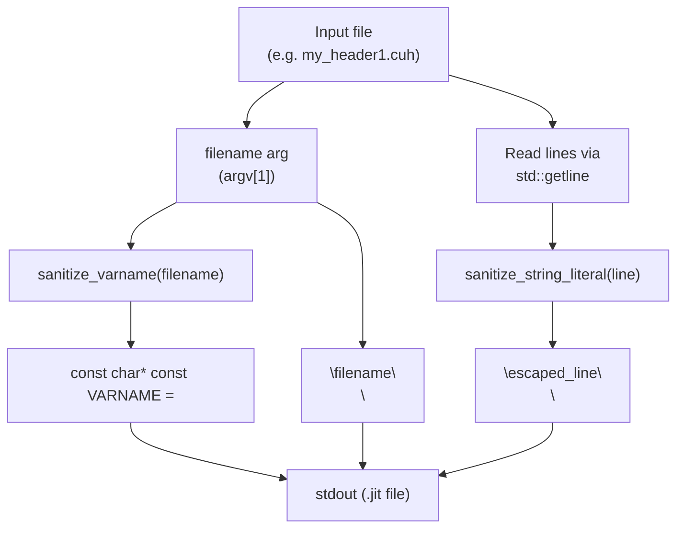
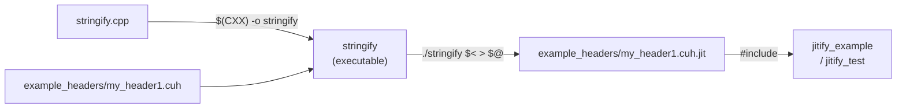

<!-- source: DeepWiki mcp.deepwiki.com · repo NVIDIA/jitify · page 4.1 stringify Utility · fetched 2026-10-26 -->

# stringify Utility

<details>
<summary>Relevant source files</summary>

The following files were used as context for generating this wiki page:

- [Makefile](Makefile)
- [stringify.cpp](stringify.cpp)

</details>


## Purpose and Scope

This page covers the `stringify` command-line program ([stringify.cpp]()) — a small build-time tool that converts plain text files (typically CUDA header files) into C string literals suitable for embedding directly in a compiled binary. This enables headers to be included in a program without requiring them to be present on the filesystem at runtime.

For information on how embedded headers are referenced and loaded at runtime via Jitify, see the Header Management guide [3.3](#3.3). For information on the alternative binary-embedding approach using `-Wl,-b,binary`, also see [3.3](#3.3).

---

## What stringify Does

The program reads a text file and writes a C `const char*` variable declaration to `stdout`. Each line of the input file is escaped and wrapped in a string literal, and the variable name is derived from the filename (or supplied explicitly).

**Output structure:**

```
const char* const <varname> = "<filename>\n"
"<line1>\n"
"<line2>\n"
...
;
```

The first element in the concatenated string is always the filename followed by a newline. This is not cosmetic — Jitify expects the filename as the first line of the string when it parses embedded headers.

> **Note (from source):** *"This puts `"filename\n"` at the beginning of the string, which is what jitify expects."* — [stringify.cpp:77-80]()

---

## Transformation Pipeline

The following diagram shows the data flow from input file to output C declaration.

**Diagram: stringify data flow**



Sources: [stringify.cpp:64-86]()

---

## String Transformation Functions

### `sanitize_varname`

[stringify.cpp:40-51]()

Converts a filename string into a valid C identifier:

| Input character | Output character |
|---|---|
| Alphanumeric (`[a-zA-Z0-9]`) | Unchanged |
| Any other character (`.`, `/`, `-`, etc.) | `_` |
| Digit at position 0 | Prepend `_`, then keep digit |

**Examples:**

| Input | Output |
|---|---|
| `example_headers/my_header1.cuh` | `example_headers_my_header1_cuh` |
| `my_header2.cuh` | `my_header2_cuh` |

### `sanitize_string_literal`

[stringify.cpp:53-62]()

Escapes characters that would break a C string literal:

| Input character | Escaped output |
|---|---|
| `"` | `\"` |
| `\` | `\\` |
| All other characters | Unchanged |

---

## Command-Line Interface

```
stringify <infile> [varname] > outfile
```

| Argument | Required | Description |
|---|---|---|
| `infile` | Yes | Path to the input text file |
| `varname` | No | Override for the C variable name; defaults to `sanitize_varname(infile)` |

If no arguments are given, or the first argument starts with `-`, a usage message is printed and the program exits with code `-1`.

[stringify.cpp:65-71]()

---

## Build Integration

The Makefile defines a pattern rule that invokes `stringify` to produce `.jit` files from CUDA headers. The `.jit` files are then compiled into the host binary as part of the normal C++ compilation step.

**Diagram: Makefile build flow for .jit files**



Sources: [Makefile:50-54]()

**Relevant Makefile rules:**

| Rule | Command |
|---|---|
| Build `stringify` | `$(CXX) -o stringify stringify.cpp -O3 -Wall` |
| Generate `.jit` from any file | `./stringify $< > $@` |
| `clean` removes `.jit` files | `rm -f example_headers/*.jit` |

[Makefile:50-54](), [Makefile:103-104]()

The `HEADERS` variable in the Makefile lists `example_headers/my_header1.cuh.jit` as a build dependency, ensuring the `.jit` file is regenerated before any dependent target is compiled.

[Makefile:39-41]()

---

## Why the Filename Must Be the First Line

Jitify's header-loading logic identifies embedded headers by scanning the beginning of each string literal for a filename. When a `#include` directive is encountered during JIT compilation, Jitify searches all registered string headers for one whose first line matches the requested filename. If the filename is absent or in a different position, the header will not be matched.

This contract between `stringify` and `jitify.hpp` is why the output format unconditionally prepends `"<filename>\n"` before any file content, regardless of what the content is.

[stringify.cpp:77-80]()

For the runtime side of this mechanism, see [3.3](#3.3).

---

