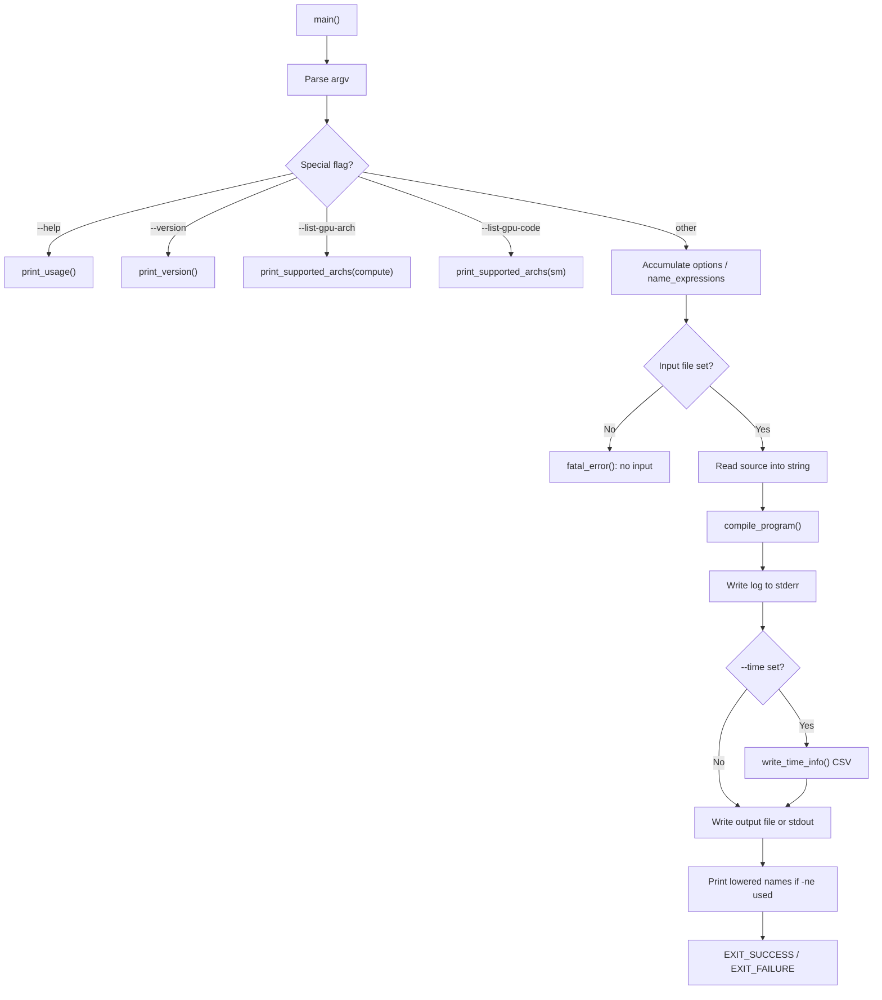
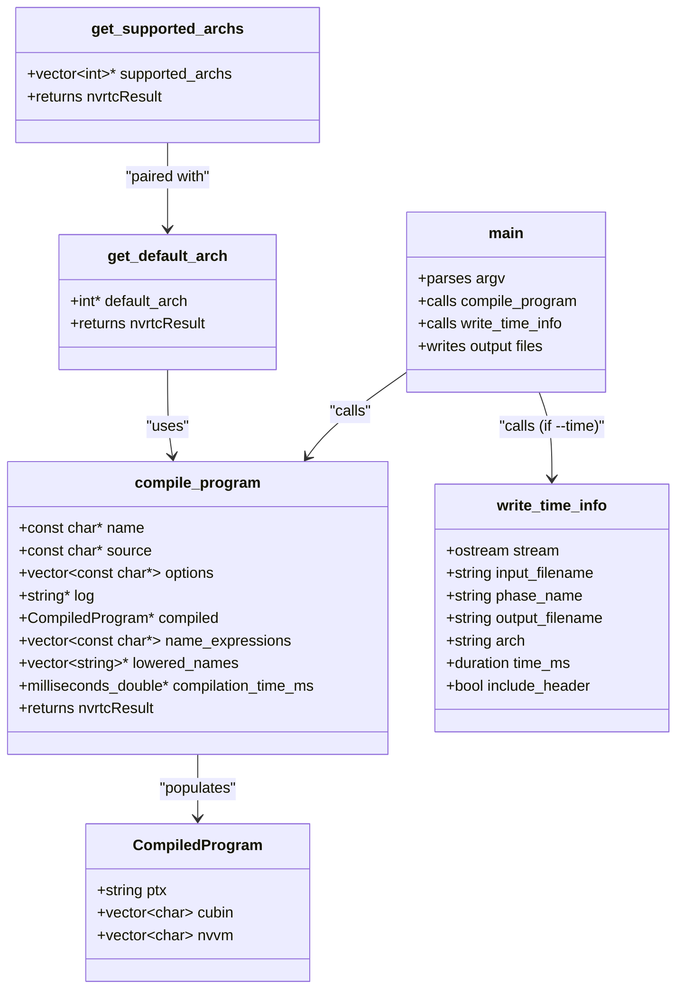
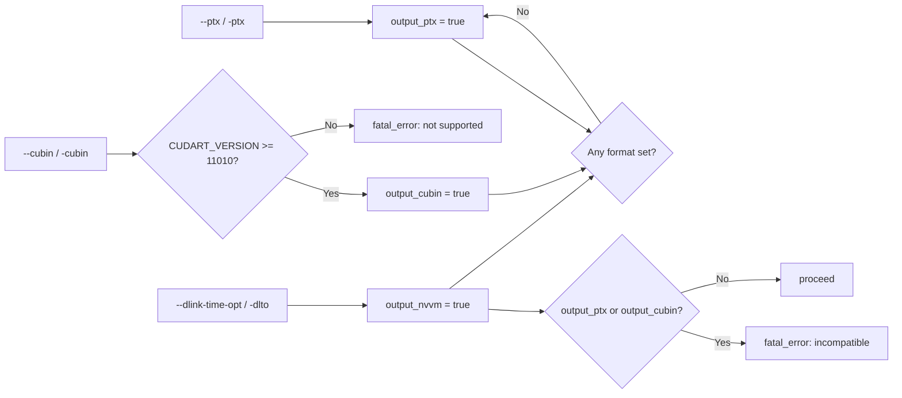

<!-- source: DeepWiki mcp.deepwiki.com · repo NVIDIA/jitify · page 4.2 nvrtc_cli · fetched 2026-10-26 -->

# nvrtc_cli

<details>
<summary>Relevant source files</summary>

The following files were used as context for generating this wiki page:

- [Makefile](Makefile)
- [nvrtc_cli.cpp](nvrtc_cli.cpp)
- [nvrtc_cli_test.sh](nvrtc_cli_test.sh)

</details>


## Purpose and Scope

`nvrtc_cli` is a standalone command-line tool that exposes NVRTC (the CUDA C++ Runtime Compilation library) as a compiler driver. Its interface is designed to mirror NVCC as closely as possible for device-code compilation, allowing PTX, CUBIN, and NVVM IR to be produced from CUDA source files without invoking NVCC.

This page covers the tool's flags, internal architecture, output formats, name-expression handling, timing output, and CUDA version feature guards. For documentation on how Jitify uses NVRTC at the API level, see the Core API Reference ([2](#2)).

---

## Source Files

| File | Role |
|---|---|
| `nvrtc_cli.cpp` | Full implementation of the tool |
| `nvrtc_cli_test.sh` | Shell-based smoke test suite, run automatically by the build |
| `Makefile` | Build target `nvrtc_cli` [Makefile:56-58]() |

---

## Build

The tool is compiled by the Makefile's `nvrtc_cli` target:

[Makefile:56-58]()

```
nvrtc_cli: nvrtc_cli.cpp
    $(CXX) -o $@ $< -O3 -Wall -Wextra -std=c++11 -I$(CUDA_INC_DIR) -L$(CUDA_LIB_DIR) -lnvrtc
    bash nvrtc_cli_test.sh
```

Note that the test script runs automatically as part of the build step. Dependencies are only `nvrtc` (no `libcuda`, no `libcudart` at link time—`cuda_runtime_api.h` is included only for the `CUDART_VERSION` preprocessor macro).

---

## Command-Line Flags

### Flags Reference Table

| Long form | Short form | Argument | Description |
|---|---|---|---|
| `--help` | `-h` | — | Print usage and exit |
| `--version` | `-V` | — | Print NVRTC version info and exit |
| `--output-file` | `-o` | `<file>` | Path for the output file |
| `--ptx` | `-ptx` | — | Emit PTX output (default if no format given) |
| `--cubin` | `-cubin` | — | Emit CUBIN output (requires CUDART ≥ 11.1) |
| `--dlink-time-opt` | `-dlto` | — | Emit NVVM IR (LTO); mutually exclusive with `--ptx`/`--cubin` |
| `--name-expression` | `-ne` | `"<name>"` | Register a name expression; repeatable |
| `--list-gpu-arch` | `-arch-ls` | — | List `compute_XX` virtual architectures and exit |
| `--list-gpu-code` | `-code-ls` | — | List `sm_XX` real architectures and exit |
| `--time` | `-time` | `<file>` or `-` | Write compilation timing as CSV; `-` means stdout |
| All other `-` flags | — | — | Passed directly through to NVRTC |

Sources: [nvrtc_cli.cpp:58-112](), [nvrtc_cli.cpp:384-463]()

### Input File

The positional argument is the input CUDA C++ source file. Passing `-` (a single dash) reads from standard input; in that case no default output filename is derived and PTX goes to stdout if `--output-file` is not given.

[nvrtc_cli.cpp:438-445](), [nvrtc_cli.cpp:500-518]()

### Default Output File Naming

When `--output-file` is not provided and the input is not stdin, the output filename is derived from the input filename's basename with the extension replaced:

| Output format | Extension |
|---|---|
| PTX | `.ptx` |
| CUBIN | `.cubin` |
| NVVM IR | `.nvvm` |

[nvrtc_cli.cpp:493-498]()

---

## Internal Architecture

### Control Flow Overview

**Diagram: main() execution flow**



Sources: [nvrtc_cli.cpp:371-593]()

---

### Key Functions and Structs

**Diagram: code entities and their relationships**



Sources: [nvrtc_cli.cpp:116-201](), [nvrtc_cli.cpp:230-268](), [nvrtc_cli.cpp:314-328]()

---

## `compile_program` Function

`compile_program` is the central compilation routine [nvrtc_cli.cpp:122-201]().

It performs the following steps in order:

1. **Create NVRTC program** — `nvrtcCreateProgram` with no inline headers (headers must be accessible through include paths passed as options)
2. **Register name expressions** — `nvrtcAddNameExpression` for each entry in `name_expressions`
3. **Compile** — `nvrtcCompileProgram`; wall-clock time is captured if `compilation_time_ms` is non-null
4. **Retrieve log** — `nvrtcGetProgramLog`; always retrieved even on failure
5. **Extract PTX** — `nvrtcGetPTX` (always attempted)
6. **Extract CUBIN** — `nvrtcGetCUBIN` (guarded by `CUDART_VERSION >= 11010`)
7. **Extract NVVM IR** — `nvrtcGetLTOIR` (CUDART ≥ 13000) or `nvrtcGetNVVM` (CUDART ≥ 11040)
8. **Resolve lowered names** — `nvrtcGetLoweredName` for each registered name expression

> **Note**: There is a known workaround at [nvrtc_cli.cpp:159]() — if `ptx_size == 1`, it is reset to 0. This addresses an NVRTC 11.4 bug with `-dlto`.

---

## Name Expressions and Lowered Names

NVRTC supports registering C++ name expressions (including templated names) before compilation. After compilation, the mangled (lowered) symbol name can be retrieved. `nvrtc_cli` exposes this via `--name-expression` / `-ne`.

**Example** (from the test script):

```
./nvrtc_cli input.cu -ne "my_kernel<float>" -ptx -o out.ptx
```

Output to stdout:
```
Lowered name expressions:
"my_kernel<float>" -> _Z9my_kernelIfEvPKT_PS1_
```

If name expressions are provided, the resolved mappings are always printed to stdout after compilation, regardless of the output format.

[nvrtc_cli.cpp:580-586](), [nvrtc_cli_test.sh:39-41]()

---

## Output Formats and Mutual Exclusivity

**Diagram: output format selection logic**



Sources: [nvrtc_cli.cpp:407-491]()

If no format flag is given, `output_ptx` is set to `true` as the default [nvrtc_cli.cpp:489-491]().

---

## CUDART_VERSION Feature Guards

The tool uses `CUDART_VERSION` (from `<cuda_runtime_api.h>`) to conditionally enable features. This macro encodes `major*1000 + minor*10`.

| `CUDART_VERSION` threshold | Feature enabled |
|---|---|
| `>= 9000` | Minimum supported version for arch list |
| `>= 10010` | Arch list: adds sm_75 |
| `>= 11000` | Arch list: adds sm_80 range |
| `>= 11010` | `--cubin` / CUBIN output (`nvrtcGetCUBINSize`, `nvrtcGetCUBIN`) |
| `>= 11020` | `nvrtcGetNumSupportedArchs`, `nvrtcGetSupportedArchs` |
| `>= 11040` | NVVM IR output (`nvrtcGetNVVMSize`, `nvrtcGetNVVM`) |
| `>= 13000` | LTO IR via `nvrtcGetLTOIRSize`, `nvrtcGetLTOIR` (supersedes NVVM path) |

Sources: [nvrtc_cli.cpp:165-188](), [nvrtc_cli.cpp:239-256](), [nvrtc_cli.cpp:410-417]()

---

## Timing Output

When `--time <file>` or `--time -` is passed, the tool appends a CSV row to the specified file (or stdout) after compilation. Two rows are emitted:

1. **`nvrtcCompileProgram`** — time spent inside the NVRTC compile call only
2. **`nvrtc_cli (driver)`** — total wall-clock time minus compile time (driver overhead)

**CSV column headers** (written only when the file is empty or output is stdout):

```
source file name , phase name , phase input files , phase output file , arch , tool, metric , unit
```

The `arch` column is derived by parsing the `.target` directive from the output PTX via `get_arch_string()`.

[nvrtc_cli.cpp:314-328](), [nvrtc_cli.cpp:529-578]()

---

## Architecture Query Helpers

| Function | Behavior |
|---|---|
| `get_default_arch(int*)` | Compiles an empty program and parses the `.target` line from its PTX to determine the default architecture [nvrtc_cli.cpp:230-237]() |
| `get_supported_archs(vector<int>*)` | Calls `nvrtcGetSupportedArchs` on CUDART ≥ 11020; falls back to hardcoded lists on older versions [nvrtc_cli.cpp:239-256]() |
| `print_supported_archs(const char*)` | Calls both helpers; marks the default arch with `(default)` in output [nvrtc_cli.cpp:258-268]() |
| `get_arch_string(CompiledProgram&, int*)` | Scans PTX for `.target` line; returns `compute_XX` or `sm_XX` based on whether CUBIN was produced [nvrtc_cli.cpp:213-228]() |

---

## NVRTC Option Pass-Through

Any unrecognized flag beginning with `-` is passed directly to `nvrtcCompileProgram` in the `options` vector. NVRTC options that take values **must** use the `--opt=val` form, not `--opt val`, because `nvrtc_cli` only separates the argument with a space for its own recognized options.

Library path flags (`-L`, `--library-path`) are silently ignored since NVRTC does not use dynamic linking [nvrtc_cli.cpp:432-437]().

---

## Test Coverage

`nvrtc_cli_test.sh` exercises the following cases automatically after each build:

- PTX output with `-lineinfo`
- CUBIN output
- Architecture targeting with `-arch=sm_70`
- Name expression lowering with `-ne`
- `--help`, `--version`, `--list-gpu-arch`, `--list-gpu-code`
- Timing output (`-time -`)
- Library path flag silencing (`-L`, `--library-path`)
- Reading source from stdin via `-`

Sources: [nvrtc_cli_test.sh:1-58]()

---

