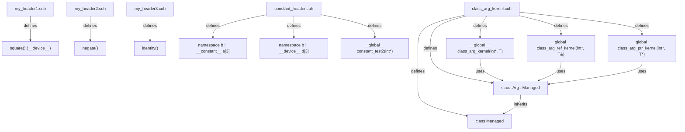
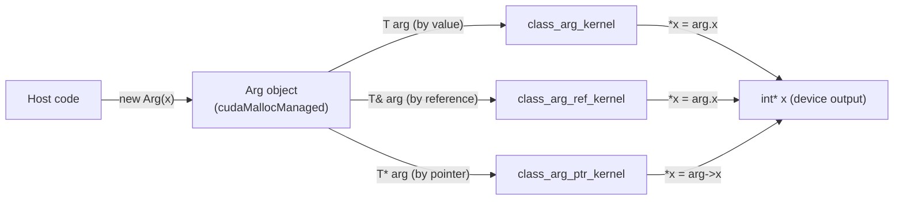

<!-- source: DeepWiki mcp.deepwiki.com · repo NVIDIA/jitify · page 5 Example Headers Reference · fetched 2026-10-26 -->

# Example Headers Reference

<details>
<summary>Relevant source files</summary>

The following files were used as context for generating this wiki page:

- [example_headers/class_arg_kernel.cuh](example_headers/class_arg_kernel.cuh)
- [example_headers/constant_header.cuh](example_headers/constant_header.cuh)
- [example_headers/my_header1.cuh](example_headers/my_header1.cuh)
- [example_headers/my_header2.cuh](example_headers/my_header2.cuh)
- [example_headers/my_header3.cuh](example_headers/my_header3.cuh)

</details>


## Purpose and Scope

This page documents all headers under `example_headers/`. These files are not part of the Jitify library itself; they are self-contained CUDA header fixtures used by the example programs and test suite to exercise specific Jitify features. Each header is designed to illustrate one pattern: simple device math, constant/device memory access, or passing class objects as kernel arguments.

For guidance on how to supply headers like these to a JIT-compiled program at runtime, see the Header Management guide ([3.3](#3.3)). For usage of device/constant memory patterns demonstrated here, see Device and Constant Memory ([3.4](#3.4)). For the class-argument patterns, see Passing Class Objects as Kernel Arguments ([3.6](#3.6)).

---

## Header Overview

| File | Key Symbols | Primary Feature Demonstrated |
|---|---|---|
| `example_headers/my_header1.cuh` | `square<T>` | `__device__` template function |
| `example_headers/my_header2.cuh` | `negate<T>` | Host/device template helper |
| `example_headers/my_header3.cuh` | `identity<T>` | Host/device template helper |
| `example_headers/constant_header.cuh` | `b::a`, `b::d`, `constant_test2` | `__constant__` and `__device__` arrays in a nested namespace |
| `example_headers/class_arg_kernel.cuh` | `Managed`, `Arg`, `class_arg_kernel`, `class_arg_ref_kernel`, `class_arg_ptr_kernel` | Passing class objects by value, reference, and pointer |

---

## Dependency Map

The diagram below shows which headers define which symbols and the inheritance/usage relationships among them.

**Figure: example_headers symbol map**



Sources: [example_headers/my_header1.cuh:31-34](), [example_headers/my_header2.cuh:31-34](), [example_headers/my_header3.cuh:31-34](), [example_headers/constant_header.cuh:31-43](), [example_headers/class_arg_kernel.cuh:31-69]()

---

## `my_header1.cuh` — `square<T>`

[example_headers/my_header1.cuh:31-34]()

Defines a single `__device__ inline` function template:

```
square<T>(T x) → T
```

- Marked `__device__`, so it is callable only from device (GPU) code.
- Marked `inline` to avoid multiple-definition issues when included in multiple translation units.
- Used in examples to verify that a JIT-compiled kernel can call a device helper defined in an included header.

---

## `my_header2.cuh` — `negate<T>`

[example_headers/my_header2.cuh:31-34]()

Defines a plain (no `__device__` qualifier) function template:

```
negate<T>(T x) → T
```

- Not annotated with `__device__`; usable on host or device depending on the calling context.
- Demonstrates that Jitify can handle headers with ordinary C++ templates, not just CUDA-specific ones.

---

## `my_header3.cuh` — `identity<T>`

[example_headers/my_header3.cuh:31-34]()

Defines a plain function template:

```
identity<T>(T x) → T
```

- Returns its argument unchanged. Used as a trivial baseline operation in tests that verify header inclusion and template instantiation mechanics without any arithmetic complexity.

---

## `constant_header.cuh` — Constant and Device Memory

[example_headers/constant_header.cuh:31-43]()

### Globals

Both arrays are declared inside an anonymous namespace wrapping a named namespace `b`:

| Symbol | Storage Class | Type | Scope |
|---|---|---|---|
| `b::a` | `__constant__` | `int[3]` | anonymous + `b` namespace |
| `b::d` | `__device__` | `int[3]` | anonymous + `b` namespace |

The anonymous outer namespace (`namespace { namespace b { ... } }`) restricts these globals to internal linkage within the translation unit, which is the expected pattern for avoiding symbol collisions when headers are included in multiple compilation units.

### Kernel: `constant_test2`

[example_headers/constant_header.cuh:40-43]()

```
__global__ constant_test2(int* x)
```

- Reads all three elements of `b::a` into `x[0..2]`.
- Reads all three elements of `b::d` into `x[3..5]`.
- Used in tests that exercise `set_global_value` / `get_global_value` on `__constant__` and `__device__` arrays via `KernelInstantiation`.

---

## `class_arg_kernel.cuh` — Class Arguments

[example_headers/class_arg_kernel.cuh:31-69]()

This header defines a base class for CUDA Unified Memory allocation and three kernel variants that accept a struct instance through different argument-passing conventions.

### `Managed`

[example_headers/class_arg_kernel.cuh:31-46]()

A base class that overrides `operator new` and `operator delete` to use `cudaMallocManaged` and `cudaFree`.

| Method | Behavior |
|---|---|
| `operator new(size_t)` | Calls `cudaMallocManaged` (guarded by `#ifndef __CUDACC_RTC__`), then `cudaDeviceSynchronize`. |
| `operator delete(void*)` | Calls `cudaDeviceSynchronize`, then `cudaFree`. |

The `__CUDACC_RTC__` guard prevents the `cudaMallocManaged` call from being compiled during JIT (NVRTC) compilation of device code, where it is not available.

### `Arg`

[example_headers/class_arg_kernel.cuh:48-54]()

A concrete struct that inherits `Managed`:

- Holds a single `const int x` member.
- Constructor: `Arg(int x_)`.
- Copy constructor is explicitly deleted (`= delete`). This is intentional: passing by value requires the compiler to bitwise-copy the struct without invoking a user-defined copy constructor, which CUDA requires for kernel arguments.

### Kernel Variants

[example_headers/class_arg_kernel.cuh:56-69]()

All three kernels are templated on `T`, write `arg.x` (or `arg->x`) into `*x`.

| Kernel | Signature | Argument Convention |
|---|---|---|
| `class_arg_kernel<T>` | `(int* x, T arg)` | By value — struct copied to device |
| `class_arg_ref_kernel<T>` | `(int* x, T& arg)` | By reference — pointer to managed memory |
| `class_arg_ptr_kernel<T>` | `(int* x, T* arg)` | By pointer — explicit device pointer |

**Figure: Argument-passing conventions for class_arg_kernel.cuh**



Sources: [example_headers/class_arg_kernel.cuh:31-69]()

---

## Relationship to Tests and Examples

The headers are consumed by the main Jitify test suite and example programs. The table below summarises which feature each header primarily exercises in that context.

| Header | Jitify Feature Exercised |
|---|---|
| `my_header1.cuh` | Inline header string supply; `__device__` helper reuse across kernels |
| `my_header2.cuh` | Inline header string supply; plain C++ template in JIT context |
| `my_header3.cuh` | Inline header string supply; identity baseline for template tests |
| `constant_header.cuh` | `KernelInstantiation` constant/device variable get and set |
| `class_arg_kernel.cuh` | `Managed` unified memory; by-value, by-reference, by-pointer kernel arg patterns |

For the mechanics of how these headers are supplied to `JitCache::program()` at runtime, see [3.3](#3.3). For how `KernelInstantiation` reads and writes `b::a` and `b::d` from host code, see [3.4](#3.4). For the full class-argument workflow using `Managed` and `Arg`, see [3.6](#3.6).