# Page: Overview

# Overview

<details>
<summary>Relevant source files</summary>

The following files were used as context for generating this wiki page:

- [README.md](README.md)
- [jitify.hpp](jitify.hpp)
- [jitify_example.cpp](jitify_example.cpp)

</details>


This page describes the purpose, architecture, and key capabilities of the **Jitify** library. For detailed API reference, see [Core API Reference](#2). For practical usage patterns, see the [Usage Guide](#3).

---

## What is Jitify?

Jitify is a single-header C++ library (`jitify.hpp`) that wraps CUDA's NVRTC (NVIDIA Runtime Compilation) API to simplify just-in-time compilation of CUDA kernels from within a host application.

Without Jitify, using NVRTC directly requires managing:
- Low-level NVRTC and CUDA Driver API calls (`nvrtcCreateProgram`, `cuModuleLoadData`, `cuLaunchKernel`, etc.)
- Name mangling for templated kernels
- Manual header resolution during compilation
- Linking of compiled PTX against external libraries
- Cache invalidation and reuse of compiled binaries

Jitify replaces all of this with a concise object-oriented interface.

**Minimum requirements**

| Requirement | Value |
|---|---|
| C++ standard | C++11 (`-std=c++11`) |
| Compile flag | `-pthread` (unless `JITIFY_THREAD_SAFE=0`) |
| Link libraries | `-lcuda -lcudart -lnvrtc` (Linux also: `-ldl`) |
| Header | `jitify.hpp` (single file, no build step) |
| Supported platforms | Linux, Windows |
| Tested CUDA versions | 7.0, 7.5, 8.0, 9.x, 10.x |

Sources: [README.md:1-52](), [jitify.hpp:29-62]()

---

## High-Level Architecture

The central flow in a Jitify application moves through a chain of five objects. Each step narrows from a compiled program to a specific kernel launch.

**Object model overview**


Sources: [jitify.hpp:68-81](), [jitify_example.cpp:88-116](), [README.md:14-34]()

---

**Internal compilation pipeline**

When `program()` is called on a `JitCache`, Jitify performs source resolution, compilation via NVRTC, optional linking, and module loading. The result is cached in an `ObjectCache` keyed by source hash.

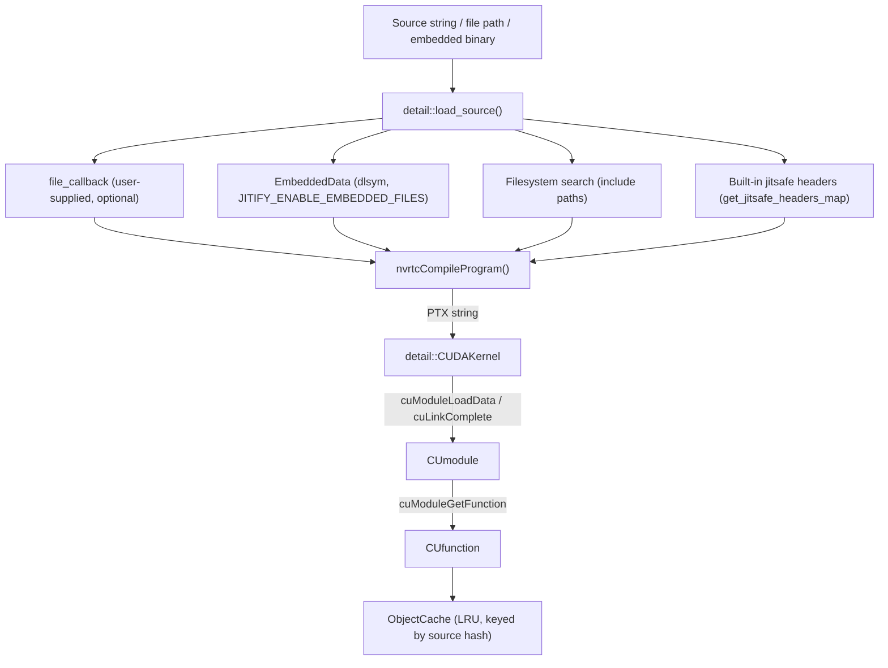

Sources: [jitify.hpp:556-714](), [jitify.hpp:1111-1376](), [jitify.hpp:205-274]()

---

## Key Features

### 1. Kernel Caching

`jitify::JitCache` wraps an `ObjectCache<KeyType, ValueType>` that implements an LRU eviction policy. The cache size (number of compiled programs to retain) is set at construction. When the same source string and options are used again, the compiled `CUDAKernel` is returned directly from the cache without recompilation.

For user-managed persistence (e.g., distributed caches), the `jitify::experimental` namespace exposes `serialize()` and `deserialize()` on `Program` and `KernelInstantiation`. See [Experimental API](#2.6).

Sources: [jitify.hpp:205-274](), [jitify_example.cpp:119-150]()

---

### 2. Template Kernel Instantiation and Reflection

Jitify's `jitify::reflection` namespace converts C++ types and compile-time values into the string representations NVRTC requires for template instantiation.

| Helper | Input | Output string |
|---|---|---|
| `reflect<float>()` | type parameter | `"float"` |
| `reflect(3.14f)` | value | `"(float)3.14"` |
| `reflect<int, 7>()` | non-type parameter | `"(int)7"` |
| `NonType<int, 7>` | wrapper type | used in `reflect<NonType<int,7>>()` |
| `type_of(*ptr)` | dereferenced pointer | `Type<T>` object |
| `instance_of(obj)` | abstract/polymorphic value | runtime-derived type string |

These strings are passed directly to `KernelInstantiation::instantiate()`. See [Reflection Utilities](#2.5) and [Template Kernel Instantiation](#3.2).

Sources: [jitify.hpp:720-1025](), [jitify_example.cpp:177-225]()

---

### 3. Header Management

Jitify resolves `#include` directives in JIT-compiled source through a layered lookup:

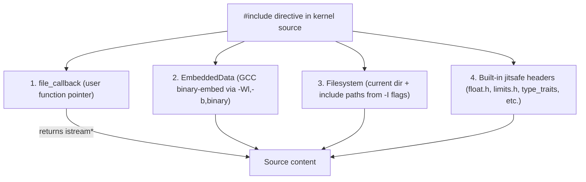

Built-in "jitsafe" headers are simplified versions of standard C/C++ headers (e.g., `float.h`, `limits.h`, `iterator`, `type_traits`) that are safe to compile on the device. These live as string literals in `jitify.hpp` and are returned by `detail::get_jitsafe_headers_map()`.

The `JITIFY_INCLUDE_EMBEDDED_FILE(name)` macro declares symbols placed in the binary by the GCC linker's `-Wl,-b,binary` option. The stringify utility converts header files into C string literals (`.jit` files) for a simpler embedding strategy. See [Header Management](#3.3) and [stringify Utility](#4.1).

Sources: [jitify.hpp:164-183](), [jitify.hpp:309-342](), [jitify.hpp:556-714](), [jitify.hpp:1378-1406]()

---

### 4. Device and Constant Variable Access

`KernelInstantiation` exposes host-side read/write of `__device__` and `__constant__` variables in JIT-compiled modules. Internally, `detail::CUDAKernel` builds a `_global_map` by scanning the PTX for `.const .align` and `.global .align` directives at construction time, then uses `cuModuleGetGlobal` for address resolution.

See [Device and Constant Memory](#3.4) for usage details.

Sources: [jitify.hpp:1222-1244](), [jitify.hpp:1329-1370]()

---

### 5. Linking

`KernelInstantiation` can link compiled PTX against pre-built PTX, CUBIN, FATBIN, object files, or static libraries via `cuLinkCreate` / `cuLinkAddFile` / `cuLinkComplete`. File type is inferred from the file extension. The special value `"."` links against the current executable (used with `JITIFY_ENABLE_EMBEDDED_FILES`). See [KernelInstantiation](#2.3).

Sources: [jitify.hpp:1079-1210]()

---

### 6. Parallel For and Lambda Support

`jitify::parallel_for` and the `JITIFY_LAMBDA` macro allow expressing a device-side loop without naming a kernel function explicitly. The lambda body is JIT-compiled under the hood. See [Parallel For and Lambda Support](#3.5).

Sources: [jitify.hpp:68-81](), [jitify_example.cpp:302-325]()

---

## Namespaces and File Structure

Since Jitify is a single header, all code lives in `jitify.hpp`. The public surface is organized into namespaces:

| Namespace | Role |
|---|---|
| `jitify` | Top-level: `JitCache`, `Program`, `Kernel`, `KernelInstantiation`, `KernelLauncher`, `parallel_for`, `JITIFY_LAMBDA` |
| `jitify::reflection` | Type/value → string conversion: `reflect`, `type_of`, `instance_of`, `Type`, `NonType`, `Instance` |
| `jitify::experimental` | Serializable `Program` and `KernelInstantiation` for user-managed caching |
| `jitify::detail` | Internal helpers: `CUDAKernel`, `ObjectCache`, `load_source`, `EmbeddedData`, path utilities |

Sources: [jitify.hpp:185-198](), [jitify.hpp:720-722]()

---

## Debug and Configuration Macros

The following preprocessor macros control optional behavior:

| Macro | Default | Effect |
|---|---|---|
| `JITIFY_THREAD_SAFE` | `1` | Enables mutex guards in `JitCache` |
| `JITIFY_ENABLE_EMBEDDED_FILES` | `0` | Enables `dlopen`/`dlsym` for binary-embedded files |
| `JITIFY_PRINT_LOG` | `1` | Prints NVRTC compiler log on error |
| `JITIFY_PRINT_INSTANTIATION` | `0` | Logs each kernel instantiation |
| `JITIFY_PRINT_SOURCE` | `0` | Prints processed source before compilation |
| `JITIFY_PRINT_PTX` | `0` | Prints generated PTX |
| `JITIFY_PRINT_LINKER_LOG` | `0` | Prints CUDA linker info/error logs |
| `JITIFY_PRINT_LAUNCH` | `0` | Logs each kernel launch |
| `JITIFY_PRINT_ALL` | `0` | Enables all `JITIFY_PRINT_*` flags |

Sources: [jitify.hpp:84-162]()

---

# Page: Core API Reference

# Core API Reference

<details>
<summary>Relevant source files</summary>

The following files were used as context for generating this wiki page:

- [jitify.hpp](jitify.hpp)

</details>


This page describes the complete C++ object model exposed by `jitify.hpp` and the chain of objects required to compile and launch a JIT-compiled CUDA kernel. It serves as an index over the API and summarizes each class at a glance; detailed coverage of each class is in the linked sub-pages.

This page does not cover build setup, the `stringify` tool, or `nvrtc_cli`. For practical step-by-step patterns see [Usage Guide](#3). For the experimental serialization API see [Experimental API](#2.6).

---

## Object Chain

Every kernel launch follows one fixed chain of object construction. Each step narrows the scope: from a general cache, down to a specific instantiation with concrete template arguments and launch parameters.

**Diagram: Standard API Object Chain**

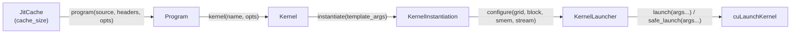

Sources: [jitify.hpp:3492-3570]()

**Diagram: Class-to-Impl Relationship (Pimpl pattern)**

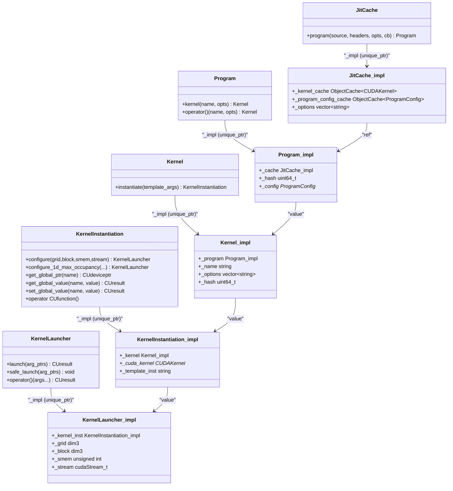

Sources: [jitify.hpp:3041-3171](), [jitify.hpp:3176-3570]()

---

## Classes at a Glance

| Class | Namespace | Header Location | Purpose |
|---|---|---|---|
| `JitCache` | `jitify` | [jitify.hpp:3492-3548]() | Root object; manages LRU caches for compiled programs and kernel instances |
| `Program` | `jitify` | [jitify.hpp:3457-3487]() | Holds parsed source, headers, and compiler options; keyed in the program cache |
| `Kernel` | `jitify` | [jitify.hpp:3392-3452]() | Identifies a named `__global__` function within a `Program` |
| `KernelInstantiation` | `jitify` | [jitify.hpp:3244-3388]() | Compiles a specific template instantiation to PTX and loads a `CUmodule` |
| `KernelLauncher` | `jitify` | [jitify.hpp:3176-3239]() | Binds launch parameters (grid, block, smem, stream) and dispatches the kernel |
| `NonType<T,V>` | `jitify::reflection` | [jitify.hpp:734-737]() | Wrapper for non-type template parameters for use with `reflect()` |
| `Type<T>` | `jitify::reflection` | [jitify.hpp:913-914]() | Wrapper used to pass a type as a value to `instantiate()` |
| `Instance<T>` | `jitify::reflection` | [jitify.hpp:897-909]() | Captures a reference to extract the runtime (derived) type via `reflect()` |
| `ExecutionPolicy` | `jitify` | [jitify.hpp:3739-3772]() | Configuration for `parallel_for` (stream, block size, headers, cache size) |
| `experimental::Program` | `jitify::experimental` | [jitify.hpp:4071-4172]() | Like `Program`, but adds `serialize()` / `deserialize()` without `JitCache` |
| `experimental::KernelInstantiation` | `jitify::experimental` | [jitify.hpp:4229-4417]() | Like `KernelInstantiation`, but adds `serialize()` / `deserialize()` |

---

## Internal / Support Types

These types are used by the public classes but are not part of the user-facing API.

| Type | Location | Role |
|---|---|---|
| `ObjectCache<K,V>` | [jitify.hpp:206-274]() | LRU cache with configurable capacity used by `JitCache_impl` |
| `ProgramConfig` | [jitify.hpp:3046-3052]() | Plain struct holding `options`, `sources`, `include_paths`, and `name` stored in the program cache |
| `detail::CUDAKernel` | [jitify.hpp:1111-1376]() | Wraps a `CUmodule` + `CUfunction`; handles PTX linking and global variable lookup |
| `file_callback_type` | [jitify.hpp:196-197]() | `typedef std::istream* (*)(std::string, std::iostream&)` — user-supplied source loader |

---

## JitCache

[Detailed reference → JitCache](#2.1)

`JitCache` is the root object. It must outlive all `Program` objects derived from it. It owns two `ObjectCache` instances, one keyed on a `uint64_t` hash of (source + headers + options) for `ProgramConfig` objects, and one keyed on a `uint64_t` hash of (program hash + kernel name + template args) for `detail::CUDAKernel` objects.

```
JitCache cache(128);  // holds up to 128 entries per cache tier
```

The default cache size is `JitCache::DEFAULT_CACHE_SIZE` = 128.

Thread safety is controlled by `JITIFY_THREAD_SAFE` (default `1`). When enabled, separate `std::mutex` instances guard each cache tier inside `JitCache_impl`.

---

## Program

[Detailed reference → Program and Kernel](#2.2)

`Program` is created via `JitCache::program()` [jitify.hpp:3542-3547]() and stored in the `_program_config_cache` under a hash of the source string, header strings, and options. On a cache hit the source is not re-parsed.

**Key parameters to `program()`:**

| Parameter | Type | Notes |
|---|---|---|
| `source` | `std::string` | Filename **or** inline source. For inline source, the first line is the program name. |
| `headers` | `vector<string>` | Each entry is a filename or inline header (first line = include name). |
| `options` | `vector<string>` | Passed to NVRTC. `-I` paths are extracted and used for header search. |
| `file_callback` | `file_callback_type` | Optional; called first for every `#include` encountered. |

Source loading priority (per include): `file_callback` → embedded binary (if `JITIFY_ENABLE_EMBEDDED_FILES`) → filesystem → built-in JIT-safe headers. See [jitify.hpp:556-714]().

---

## Kernel

[Detailed reference → Program and Kernel](#2.2)

`Kernel` is created by `Program::kernel(name, options)` [jitify.hpp:3475-3486]() or via `operator()`. It records the unmangled function name and any additional per-kernel NVRTC options. Options are merged with the parent `Program`'s options.

---

## KernelInstantiation

[Detailed reference → KernelInstantiation](#2.3)

`KernelInstantiation` is the step that triggers actual NVRTC compilation. It is created by one of three `Kernel::instantiate()` overloads:

| Overload | Syntax | Notes |
|---|---|---|
| String args | `instantiate({"float", "7"})` | Most flexible; strings are used verbatim |
| Template params | `instantiate<float, NonType<int,7>>()` | C++ template syntax; limited to compile-time values |
| Value args | `instantiate(Type<float>(), val)` | Uses `reflect()` to convert each argument |

The resulting PTX and mangled function name are cached in `_kernel_cache` under a hash that incorporates the program hash, kernel name, and template instantiation string. The compiled `CUfunction` handle is accessible via implicit conversion:

```cpp
CUfunction f = my_instantiation;  // implicit operator CUfunction()
```

Global variable access methods operate on the loaded `CUmodule`:

| Method | Direction |
|---|---|
| `get_global_ptr(name)` → `CUdeviceptr` | Address only |
| `get_global_value(name, &val)` | Device → Host (single element) |
| `get_global_array(name, data, count)` | Device → Host (array) |
| `set_global_value(name, val)` | Host → Device (single element) |
| `set_global_array(name, data, count)` | Host → Device (array) |
| `get_constant_ptr(name)` | Deprecated; delegates to `get_global_ptr` |

---

## KernelLauncher

[Detailed reference → KernelLauncher](#2.4)

`KernelLauncher` is created by `KernelInstantiation::configure()` or `configure_1d_max_occupancy()`. It stores grid/block/smem/stream and provides three ways to dispatch:

| Method | Behaviour on CUDA error |
|---|---|
| `launch(vector<void*>)` → `CUresult` | Returns error code |
| `safe_launch(vector<void*>)` | Throws `std::runtime_error` |
| `operator()(args...)` / `launch(args...)` | Variadic; builds `void*` vector internally; returns `CUresult` |

`configure_1d_max_occupancy()` calls `cuOccupancyMaxPotentialBlockSizeWithFlags` internally [jitify.hpp:3016-3035]() to choose grid and block dimensions.

---

## Reflection Utilities

[Detailed reference → Reflection Utilities](#2.5)

The `jitify::reflection` namespace provides helpers to convert C++ types and values into the strings required by `instantiate()`.

**Diagram: Reflection Function Map**

```mermaid
flowchart TD
  A["reflect&lt;T&gt;()"] -->|"demangle typeid"| S1["\"float\""]
  B["reflect(value)"] -->|"cast + stream"| S2["\"(float)3.14\""]
  C["reflect&lt;N&gt;()"] -->|"NonType&lt;int64_t,N&gt;"| S3["\"(int64_t)7\""]
  D["reflect&lt;T,N&gt;()"] -->|"NonType&lt;T,N&gt;"| S4["\"(int)7\""]
  E["type_of(var)"] -->|"returns Type&lt;T&gt;"| F["Type&lt;T&gt;"]
  F -->|"reflect(Type&lt;T&gt;())"| S1
  G["instance_of(obj)"] -->|"returns Instance&lt;T&gt;"| H["Instance&lt;T&gt;"]
  H -->|"reflect(instance)"| S5["runtime derived type string"]
  I["reflect_template&lt;Ts...&gt;()"] -->|"join with commas"| S6["\"&lt;float,int&gt; \""]
```

Sources: [jitify.hpp:722-1025]()

Key free functions:

| Function | Return | Example output |
|---|---|---|
| `reflect<T>()` | `std::string` | `"float"` |
| `reflect(value)` | `std::string` | `"(float)3.14"` |
| `reflect<N>()` | `std::string` | `"(int64_t)7"` |
| `reflect<T,N>()` | `std::string` | `"(int)7"` |
| `type_of(var)` | `Type<T>` | Used with `reflect()` |
| `instance_of(obj)` | `Instance<T const>` | Used with `reflect()` for runtime types |
| `reflect_template<Ts...>()` | `std::string` | `"<float,int >"` |

---

## Experimental API

[Detailed reference → Experimental API](#2.6)

The `jitify::experimental` namespace [jitify.hpp:3927-4532]() provides `Program`, `Kernel`, `KernelInstantiation`, and `KernelLauncher` classes with the same interface as the standard API, but without `JitCache`. Instead, `experimental::Program` and `experimental::KernelInstantiation` expose `serialize()` and `deserialize()` static methods for user-managed persistence.

**Diagram: Standard vs Experimental API Comparison**

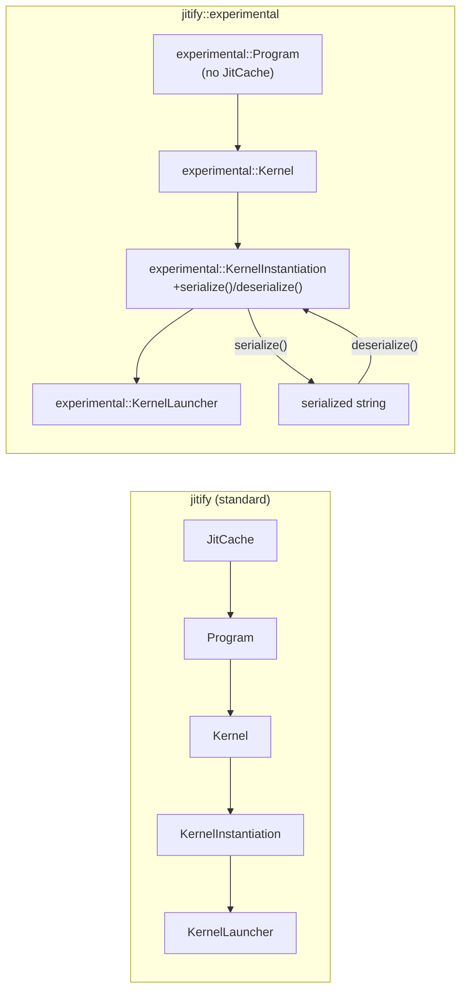

Sources: [jitify.hpp:3927-4532]()

---

## Compile-Time Macros

Several macros modify Jitify's behaviour before `#include <jitify.hpp>`:

| Macro | Default | Effect |
|---|---|---|
| `JITIFY_THREAD_SAFE` | `1` | Guards caches with `std::mutex` |
| `JITIFY_ENABLE_EMBEDDED_FILES` | undefined | Enables `dlopen`-based embedded file lookup |
| `JITIFY_PRINT_LOG` | `1` | Prints NVRTC compile logs |
| `JITIFY_PRINT_ALL` | undefined | Enables all print flags |
| `JITIFY_OPTIONS` | undefined | Additional compiler options added to every program |

Sources: [jitify.hpp:84-162]()

---

## Parallel For and Lambda Support

For use cases that do not require a named kernel, Jitify provides `parallel_for` [jitify.hpp:3868-3925]() and the `JITIFY_LAMBDA` macro, controlled by `ExecutionPolicy`. See [Parallel For and Lambda Support](#3.5) for a usage guide.

---

# Page: JitCache

# JitCache

<details>
<summary>Relevant source files</summary>

The following files were used as context for generating this wiki page:

- [jitify.hpp](jitify.hpp)
- [jitify_example.cpp](jitify_example.cpp)
- [jitify_test.cu](jitify_test.cu)

</details>


This page is a reference for the `jitify::JitCache` class: its constructor, internal cache mechanics, the `program()` method and all its parameters, and thread-safety behavior. For details on the objects that `program()` returns and how to use them to launch kernels, see [Program and Kernel](#2.2). For the experimental (non-cached) API, see [Experimental API](#2.6).

---

## Overview

`JitCache` is the primary entry point for managed JIT compilation in Jitify. It holds an in-process LRU cache of compiled programs, so that repeated calls with identical source and options skip recompilation. The caller constructs one `JitCache` instance (typically as a `static` or `thread_local static`) and calls `program()` each time a JIT-compiled kernel is needed.

**Typical usage pattern:**

```cpp
static jitify::JitCache kernel_cache;
jitify::Program program = kernel_cache.program(source, headers, options, callback);
```

*Sources: [jitify_test.cu:107-131](), [jitify_example.cpp:99-116]()*

---

## Internal Cache Structure

`JitCache` is backed by the `ObjectCache` template class, which implements a fixed-capacity LRU eviction policy.

**Internal LRU Cache: `ObjectCache<KeyType, ValueType>`**

```mermaid
classDiagram
    class "ObjectCache~K,V~" {
        -object_map _objects
        -key_rank _ranked_keys
        -size_t _capacity
        +ObjectCache(size_t capacity)
        +resize(size_t capacity)
        +contains(key) bool
        +touch(key)
        +get(key) V&
        +insert(key, value) V&
        +emplace(key, args...) V&
        -discard_old(n)
    }
    class "JitCache" {
        -ObjectCache _program_cache
        +JitCache(size_t cache_size)
        +program(source, headers, options, callback) Program
    }
    "JitCache" --> "ObjectCache~K,V~" : "contains"
```

*Sources: [jitify.hpp:204-274](), [jitify.hpp:202]()*

Key properties of `ObjectCache`:

| Property | Detail |
|---|---|
| Eviction policy | LRU: least-recently-used entry is discarded when capacity is exceeded |
| Default capacity | `8` entries |
| Key type | Hash derived from source text and compiler options |
| Value type | Compiled `Program` internal state |
| On capacity overflow | Evicts the entry at the back of the `_ranked_keys` deque |
| On cache hit | Promotes the entry to the front via `touch()` |

*Sources: [jitify.hpp:219-273]()*

---

## Constructor

```cpp
jitify::JitCache kernel_cache;              // default capacity
jitify::JitCache kernel_cache(cache_size);  // explicit capacity
```

The single constructor parameter `cache_size` is passed directly to `ObjectCache` as its capacity. It controls how many distinct programs (identified by unique source + option combinations) can reside in the cache simultaneously. When a new program exceeds this count, the least-recently-used existing entry is evicted.

**Declaration site:** [jitify.hpp:202]()

**Typical lifetime patterns observed in practice:**

| Pattern | When to use |
|---|---|
| `static jitify::JitCache kernel_cache;` | Single shared cache across all calls in the process |
| `thread_local static jitify::JitCache kernel_cache;` | Per-thread cache, avoids lock contention |
| Local variable | Throwaway use; cache is not reused across calls |

*Sources: [jitify_test.cu:108](), [jitify_test.cu:226](), [jitify_test.cu:377](), [jitify_example.cpp:99](), [jitify_example.cpp:183]()*

---

## The `program()` Method

`program()` is the sole public method on `JitCache` for obtaining a `Program`. Its full signature is:

```cpp
Program program(
    const std::string& source,
    const std::vector<std::string>& headers = {},
    const std::vector<std::string>& options = {},
    file_callback_type file_callback = nullptr
);
```

On the first call with a given combination of `source`, `headers`, and `options`, Jitify parses and pre-processes the source (resolving includes), stores the result in the `ObjectCache`, and returns a `Program`. Subsequent calls with identical arguments retrieve the `Program` from cache without re-running NVRTC. Full NVRTC compilation is deferred until `KernelInstantiation` is first requested.

**Parameter reference:**

| Parameter | Type | Description |
|---|---|---|
| `source` | `const std::string&` | Kernel source. See format rules below. |
| `headers` | `std::vector<std::string>` | Inline header source strings (e.g. from `stringify`). Pass `0` or `{}` if none. |
| `options` | `std::vector<std::string>` | NVRTC compiler flags, e.g. `"--use_fast_math"`, `"-std=c++14"`, `"-IFOO"`. |
| `file_callback` | `file_callback_type` | Optional function pointer called when an include cannot be resolved by other means. |

*Sources: [jitify_test.cu:227-230](), [jitify_example.cpp:184-187](), [jitify.hpp:196-197]()*

### Source String Format

The `source` parameter accepts two distinct formats:

**Format 1 — Inline source with embedded name:**

```
"<program_name>\n<cuda_source_code>"
```

The program name is the substring before the first `\n`. Everything after it is the CUDA C++ source. This is the most common format.

**Format 2 — Filename reference:**

```
"example_headers/constant_header.cuh"
```

When no `\n` is present, the entire string is treated as a file path. Jitify resolves it using the file-loading chain described in the `file_callback` section below.

*Sources: [jitify.hpp:567-573](), [jitify_test.cu:431](), [jitify_test.cu:386-387]()*

**Source resolution diagram:**

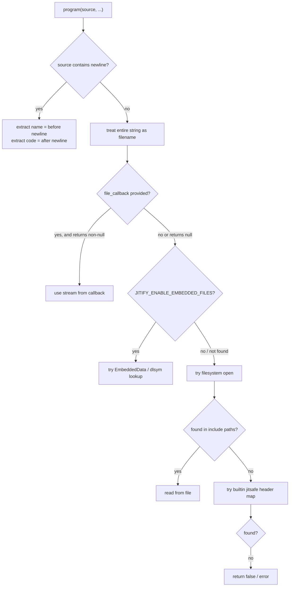

*Sources: [jitify.hpp:556-714]()*

### The `headers` Parameter

Each entry in the `headers` vector is a self-contained header source string. The first line of each string must be the header's filename; subsequent lines are its content. This is the output format produced by the `stringify` tool (see [stringify Utility](#4.1)).

```cpp
// example_headers_my_header1_cuh is a const char* from a .jit file
kernel_cache.program(source, {example_headers_my_header1_cuh}, options);
```

These headers are made available to the NVRTC compiler by name, so the kernel source can `#include` them normally.

*Sources: [jitify_test.cu:228-230](), [jitify_example.cpp:185-187]()*

### The `options` Parameter

`options` is passed directly to NVRTC. Common flags:

| Flag | Effect |
|---|---|
| `--use_fast_math` | Enable fast math intrinsics |
| `-std=c++11` / `-std=c++14` | Set C++ standard |
| `-IFOO` | Add include path `FOO` |
| `-rdc=true` | Enable relocatable device code (for linking) |
| `--remove-unused-globals` | Strip unreferenced `__device__` / `__constant__` variables from PTX |

Options are also read from the `JITIFY_OPTIONS` environment variable, which is prepended to the options list automatically.

*Sources: [jitify_test.cu:230](), [jitify_test.cu:754-756](), [jitify_test.cu:1131-1138]()*

### The `file_callback` Parameter

`file_callback_type` is a function pointer:

```cpp
typedef std::istream* (*file_callback_type)(std::string filename,
                                            std::iostream& tmp_stream);
```

When an `#include` directive cannot be satisfied by inline `headers`, embedded files, or the filesystem, Jitify calls `file_callback` with the requested filename. The callback either:
- Writes source into `tmp_stream` and returns `&tmp_stream`, **or**
- Returns `nullptr` / `0` to let Jitify continue trying other resolution mechanisms.

*Sources: [jitify.hpp:189-197](), [jitify_test.cu:79-93](), [jitify_example.cpp:71-85]()*

---

## Cache Keying and Hit/Miss Behavior

**How the cache key is formed:** The `ObjectCache` key is a hash derived from the combination of the source string and compiler options. The hash function used internally is `hash_larson64` combined with `hash_combine`.

**Call flow:**

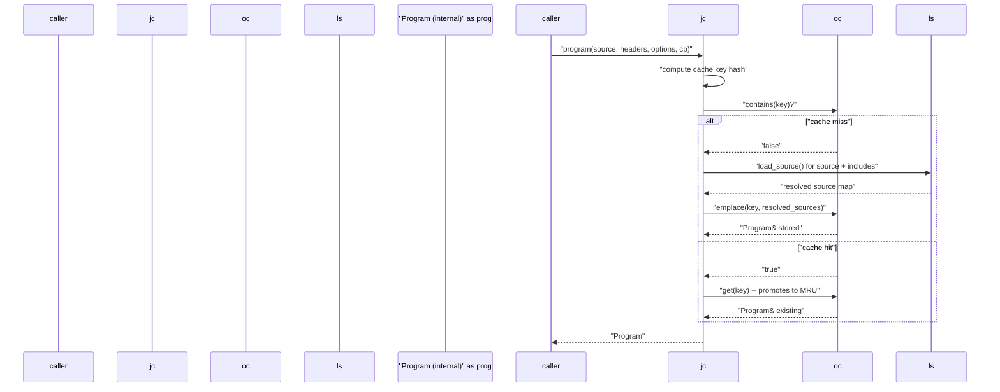

*Sources: [jitify.hpp:428-440](), [jitify.hpp:204-274](), [jitify.hpp:556-714]()*

**Note:** NVRTC compilation (PTX generation) does **not** happen during `program()`. It is deferred until `KernelInstantiation` is first created. What is cached at the `JitCache` level is the pre-processed source and the resolved header map.

---

## Thread Safety

Thread safety is controlled by the compile-time macro `JITIFY_THREAD_SAFE`, which defaults to `1`.

```cpp
#ifndef JITIFY_THREAD_SAFE
#define JITIFY_THREAD_SAFE 1
#endif
```

When `JITIFY_THREAD_SAFE=1`, a `std::mutex` guards all accesses to the internal `ObjectCache`, making concurrent calls to `program()` from multiple threads safe. When set to `0`, no locking is performed and the caller is responsible for external synchronization.

A common pattern to avoid lock contention in multi-threaded code is `thread_local static`:

```cpp
thread_local static jitify::JitCache kernel_cache;
```

Each thread gets its own cache instance and never contends on the mutex.

*Sources: [jitify.hpp:84-86](), [jitify.hpp:108-110](), [jitify_test.cu:226](), [jitify_test.cu:377]()*

---

## Relationship to Other API Classes

The `program()` method returns a `jitify::Program`, which is the starting point for selecting and launching kernels. The full object chain is:


| Class | Obtained from | See |
|---|---|---|
| `Program` | `JitCache::program()` | [Program and Kernel](#2.2) |
| `Kernel` | `Program::kernel()` | [Program and Kernel](#2.2) |
| `KernelInstantiation` | `Kernel::instantiate()` | [KernelInstantiation](#2.3) |
| `KernelLauncher` | `KernelInstantiation::configure()` | [KernelLauncher](#2.4) |

*Sources: [jitify_test.cu:107-131](), [jitify_example.cpp:99-116]()*

---

# Page: Program and Kernel

# Program and Kernel

<details>
<summary>Relevant source files</summary>

The following files were used as context for generating this wiki page:

- [jitify.hpp](jitify.hpp)
- [jitify_example.cpp](jitify_example.cpp)
- [jitify_test.cu](jitify_test.cu)

</details>


This page covers `jitify::Program` and `jitify::Kernel`: what they store, how they are constructed, the overloads available on each, and how they chain together toward compilation and launch. For how `Program` is obtained in the first place, see [JitCache](#2.1). For what happens after `Kernel::instantiate()` is called, see [KernelInstantiation](#2.3) and [KernelLauncher](#2.4).

---

## Position in the API Chain

`Program` and `Kernel` sit in the middle of Jitify's object chain. Neither one triggers NVRTC compilation on its own; compilation is deferred until `instantiate()` is called on `Kernel`.

**Jitify object chain**


Sources: [jitify_test.cu:163-195](), [jitify_example.cpp:99-115]()

---

## Program

### What Program Stores

A `Program` object is a lightweight handle returned by `JitCache::program()`. It holds:

- The **source identifier**: either an inline source string (program name + code) or a file path.
- The **supplementary headers** provided at construction time.
- The **compiler options** (`nvrtc` flags) and any `file_callback`.
- A reference into the `JitCache` that owns the underlying compiled object cache.

`Program` is default-constructable and move-assignable, so it can be declared and assigned separately:

```cpp
// from jitify_test.cu:167-168
jitify::Program program;
program = kernel_cache.program(simple_program_source);
```

Sources: [jitify_test.cu:163-195]()

---

### Source String Format

The source argument passed to `JitCache::program()` (and hence stored in `Program`) can take two forms:

| Form | Example | Behaviour |
|---|---|---|
| Inline source | `"my_program\n__global__ void k() {}"` | First line before `\n` is the program name; remaining text is the CUDA C source. |
| File path | `"example_headers/constant_header.cuh"` | Jitify loads the file via the callback, embedded data, or the filesystem. |

The name (first line) is used as the cache key. If the same name is seen again with the same headers/options, the cached compiled form is reused.

Sources: [jitify_test.cu:95-105](), [jitify_test.cu:431-432](), [jitify.hpp:567-576]()

---

### Program::kernel()

```
Kernel Program::kernel(std::string kernel_name)
```

Selects a named `__global__` function within the program source. This call is cheap — it simply captures the name string alongside a reference to the program state. No compilation occurs here.

```cpp
// from jitify_example.cpp:108
program.kernel("my_kernel")
       .instantiate(3, type_of(*d_data))
       .configure(grid, block)
       .launch(d_data);
```

`Program::operator()` is an equivalent shorthand for `kernel()`.

Sources: [jitify_example.cpp:107-111](), [jitify_test.cu:242-245]()

---

## Kernel

### What Kernel Stores

`Kernel` is a pair of (Program reference, kernel name string). It has no compiled state; it is purely a selector.

`Kernel` is also default-constructable and move-assignable:

```cpp
// from jitify_test.cu:175-176
jitify::Kernel kernel;
kernel = program.kernel("my_kernel");
```

Sources: [jitify_test.cu:175-178]()

---

### Kernel::instantiate() Overloads

`instantiate()` is where template arguments are resolved and NVRTC compilation is triggered (or the cache is consulted). It returns a `KernelInstantiation`.

There are several equivalent calling conventions:

| Style | Syntax | Notes |
|---|---|---|
| No template args | `.instantiate()` | For non-template kernels. |
| Compile-time types | `.instantiate<NonType<int,C>, T>()` | Uses `reflection::NonType` for non-type params. |
| String list | `.instantiate({reflect((int)C), reflect<T>()})` | Explicit string representation of each arg. |
| Mixed value + type | `.instantiate((int)C, Type<T>())` | Recommended; uses `reflection::Type<T>`. |
| Value + type_of | `.instantiate((int)C, type_of(*ptr))` | Deduces type from existing variable. |
| Value + instance_of | `.instantiate((int)C, instance_of(*ptr))` | Resolves runtime-derived types. |

All five non-empty forms in the table above are demonstrated in the same test and are functionally equivalent (and will hit cache after the first call):

Sources: [jitify_test.cu:247-268](), [jitify_example.cpp:203-224]()

---

## Relationship Between Program and Kernel

**Class relationships and methods**

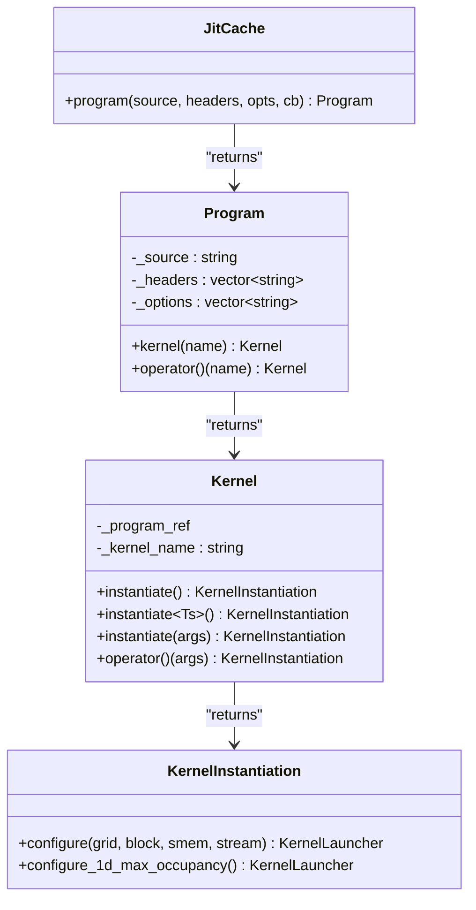

Sources: [jitify_test.cu:163-195](), [jitify.hpp:1111-1376]()

---

## Experimental API Counterparts

`jitify::experimental::Program` and its associated `Kernel` follow the same chaining interface but add `serialize()` and `deserialize()` for persistence. Construction is direct rather than through a `JitCache`:

```cpp
// from jitify_test.cu:135-136
jitify::experimental::Program program_orig(simple_program_source, {}, opts);
auto program = jitify::experimental::Program::deserialize(program_orig.serialize());
```

The `kernel()` method and all `instantiate()` overloads are identical in both the standard and experimental APIs.

For full detail on the experimental API, see [Experimental API](#2.6).

Sources: [jitify_test.cu:133-161](), [jitify_test.cu:278-346]()

---

## Summary Table

| Class | Namespace | Created By | Key Method | Returns |
|---|---|---|---|---|
| `Program` | `jitify` | `JitCache::program()` | `kernel(name)` | `Kernel` |
| `Program` | `jitify::experimental` | Direct constructor | `kernel(name)` | `Kernel` |
| `Kernel` | `jitify` | `Program::kernel()` | `instantiate(...)` | `KernelInstantiation` |
| `Kernel` | `jitify::experimental` | `Program::kernel()` | `instantiate(...)` | `KernelInstantiation` |

Both `Program::operator()` and `Kernel::operator()` are shorthands for `kernel()` and `instantiate()` respectively.

Sources: [jitify_test.cu:107-131](), [jitify_test.cu:219-276](), [jitify_example.cpp:87-116](), [jitify_example.cpp:152-234]()

---

# Page: KernelInstantiation

# KernelInstantiation

<details>
<summary>Relevant source files</summary>

The following files were used as context for generating this wiki page:

- [example_headers/constant_header.cuh](example_headers/constant_header.cuh)
- [jitify.hpp](jitify.hpp)
- [jitify_example.cpp](jitify_example.cpp)
- [jitify_test.cu](jitify_test.cu)

</details>


## Purpose and Scope

`jitify::KernelInstantiation` represents a single compiled, template-instantiated `__global__` kernel function. It is the object produced by calling `Kernel::instantiate()` (see [Program and Kernel](#2.2)) and is the central point for all pre-launch operations: configuring execution geometry, reading and writing device/constant memory variables, and inspecting compiled output.

This page covers:
- The `instantiate()` overloads and how template arguments are resolved
- Implicit `CUfunction` conversion
- `configure()` and `configure_1d_max_occupancy()`
- `__device__` and `__constant__` variable access by name
- PTX and mangled-name introspection
- Function attribute get/set

For the `KernelLauncher` object returned by `configure()`, see [KernelLauncher](#2.4). For the `reflect<T>()`, `type_of()`, and `NonType` helpers used when building template argument strings, see [Reflection Utilities](#2.5). For `serialize()`/`deserialize()` in the experimental namespace, see [Experimental API](#2.6).

---

## Position in the Object Chain

**Object chain diagram**

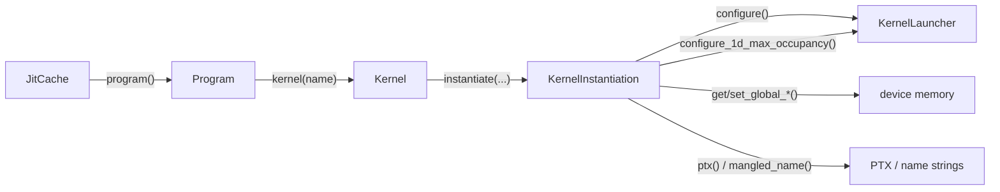

Sources: [jitify_test.cu:107-131](), [jitify_test.cu:219-276]()

---

## `instantiate()` Overloads

`Kernel::instantiate()` accepts template arguments in several forms. All forms ultimately produce a vector of string representations that are combined into the kernel's mangled symbol name.

| Form | Code example | How args are resolved |
|---|---|---|
| No args | `.instantiate()` | Non-template kernel |
| String vector | `.instantiate({"float", "7"})` | Passed as-is |
| Variadic values | `.instantiate((int)C, Type<T>())` | Each arg passed through `reflect()` |
| `type_of` | `.instantiate(N, type_of(*ptr))` | Deduces type from lvalue at compile time |
| `instance_of` | `.instantiate(N, instance_of(base))` | Deduces dynamic type at runtime via `typeid` |
| Template params | `.instantiate<NonType<int,C>, T>()` | `reflect<Ts>()...` expansion |

Each variadic argument is individually dispatched through the `reflect()` overload set (see [Reflection Utilities](#2.5)):
- A plain value `v` of type `T` → `"(T)v"`
- A `Type<T>()` wrapper → `"T"`
- A `NonType<T,V>` wrapper → `"(T)V"`
- An `instance_of(x)` wrapper → the demangled runtime type of `x`

Sources: [jitify_test.cu:116-117](), [jitify_test.cu:248-268](), [jitify_example.cpp:198-224](), [jitify.hpp:919-1023]()

---

## Implicit `CUfunction` Conversion

The backing `detail::CUDAKernel` class provides `operator CUfunction()`, which means a `KernelInstantiation` can be passed directly anywhere a `CUfunction` handle is expected.

Sources: [jitify.hpp:1303]()

---

## `configure()` and `configure_1d_max_occupancy()`

Both methods return a `KernelLauncher` (see [KernelLauncher](#2.4)).

| Method | Parameters | Description |
|---|---|---|
| `configure` | `dim3 grid, dim3 block, unsigned smem = 0, CUstream stream = 0` | Stores explicit launch parameters |
| `configure_1d_max_occupancy` | `int max_block_size = 0, unsigned smem = 0, CUstream stream = 0` | Calls `cuOccupancyMaxPotentialBlockSize` to choose grid and block dimensions automatically |

Sources: [jitify_test.cu:120-128](), [jitify_test.cu:126-128](), [jitify_test.cu:187-192]()

---

## Global Variable Access

`KernelInstantiation` can read and write `__device__` and `__constant__` variables in the compiled module by their demangled C++ names. Namespace-qualified names and anonymous namespace names are both supported.

### How Name Lookup Works

When the underlying `detail::CUDAKernel` is constructed from PTX, it calls `create_global_variable_map()`, which scans the PTX text for `.const .align` and `.global .align` directives and builds a map from the demangled symbol name to the raw PTX mangled name. The demangle step is handled by `detail::demangle_ptx_variable_name()`.

**Global variable name resolution diagram**

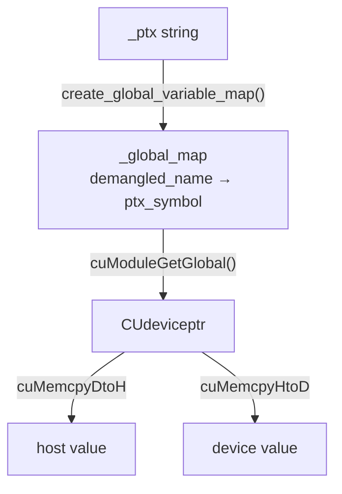

Sources: [jitify.hpp:1224-1244](), [jitify.hpp:1033-1059](), [jitify.hpp:1329-1350]()

### Methods

| Method | Return | Description |
|---|---|---|
| `get_global_ptr(name)` | `CUdeviceptr` | Raw device pointer to a `__device__` or `__constant__` variable |
| `get_constant_ptr(name)` | `CUdeviceptr` | Deprecated alias for `get_global_ptr` |
| `get_global_value(name, T* out)` | `CUresult` | Copies a scalar or struct from device to host |
| `get_global_value(name, T(*)[N] out)` | `CUresult` | Copies a fixed-size array from device to host |
| `get_global_array(name, T* out, count)` | `CUresult` | Copies `count` elements of type `T` from device to host |
| `set_global_value(name, T value)` | `CUresult` | Copies a scalar or struct from host to device |
| `set_global_value(name, T(&)[N] value)` | `CUresult` | Copies a fixed-size C array from host to device |
| `set_global_array(name, T* in, count)` | `CUresult` | Copies `count` elements of type `T` from host to device |

`get_global_value` / `set_global_value` size-check against the variable's actual device size and throw `std::runtime_error` on mismatch. All methods accept an optional `CUstream` argument for async operations.

### Name format examples

| C++ declaration | Name string passed to API |
|---|---|
| `__constant__ int a;` | `"a"` |
| `namespace b { __device__ int a; }` | `"b::a"` |
| `namespace c { namespace b { __constant__ int a; } }` | `"c::b::a"` |
| `namespace { namespace b { __constant__ int a[3]; } }` | `"(anonymous namespace)::b::a"` |

Sources: [jitify_test.cu:388-416](), [jitify_test.cu:436-451](), [jitify_example.cpp:264-295](), [jitify.hpp:1224-1244](), [jitify.hpp:1329-1350]()

---

## PTX and Name Introspection

| Method | Return type | Description |
|---|---|---|
| `ptx()` | `std::string` | The full PTX text produced by NVRTC for this instantiation |
| `mangled_name()` | `std::string` | The CUDA mangled symbol name of the instantiated kernel function |

`ptx()` is used to inspect generated code, verify that `--remove-unused-globals` removed dead symbols, or write PTX to disk for external linking (as in `TEST(JitifyTest, LinkExternalFiles)`).

`mangled_name()` is used to compare instantiations or verify that template reflection resolves to the same symbol regardless of which `instantiate()` overload is used.

Sources: [jitify_test.cu:752-783](), [jitify_test.cu:897-926]()

---

## Function Attribute Get/Set

`KernelInstantiation` wraps `cuFuncGetAttribute` and `cuFuncSetAttribute` via `detail::CUDAKernel`.

| Method | Signature | Underlying CUDA call |
|---|---|---|
| `get_func_attribute` | `(CUfunction_attribute attr) → int` | `cuFuncGetAttribute` |
| `set_func_attribute` | `(CUfunction_attribute attr, int value)` | `cuFuncSetAttribute` |

Common usage patterns:

| Attribute | Use case |
|---|---|
| `CU_FUNC_ATTRIBUTE_SHARED_SIZE_BYTES` | Read static shared memory consumption |
| `CU_FUNC_ATTRIBUTE_MAX_DYNAMIC_SHARED_SIZE_BYTES` | Increase dynamic shared memory limit on Volta+ devices |

Sources: [jitify.hpp:1318-1327](), [jitify_test.cu:1079-1088](), [jitify_test.cu:1099-1129]()

---

## Internal Structure

**Class relationship diagram**

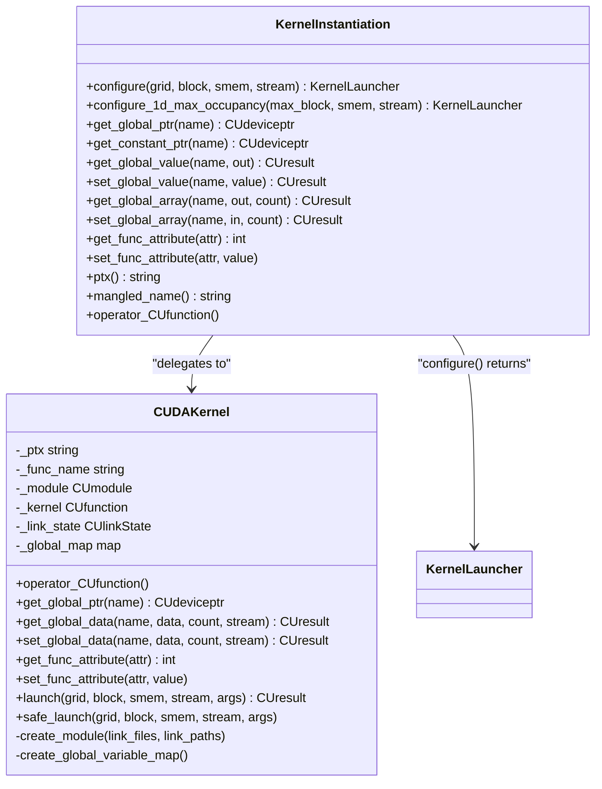

Sources: [jitify.hpp:1111-1350]()

The `detail::CUDAKernel` owns the `CUmodule` and `CUfunction` handles. Its constructor calls both `create_module()` (which runs `cuModuleLoadDataEx` or `cuLinkCreate`/`cuLinkComplete`/`cuModuleLoadData` for multi-file linking) and `create_global_variable_map()` to populate `_global_map`.

Sources: [jitify.hpp:1135-1210](), [jitify.hpp:1224-1244](), [jitify.hpp:1267-1283]()

---

## Lifetime and Caching

`KernelInstantiation` objects are default-constructible and move-assignable, so they can be stored as class members and populated later. Inside `JitCache`, compiled `CUDAKernel` instances are stored in an LRU `ObjectCache` keyed on a hash of the program source and template argument strings. Repeated calls to `Kernel::instantiate()` with identical arguments return the cached result without recompilation.

Sources: [jitify_test.cu:163-195](), [jitify.hpp:204-274]()

---

# Page: KernelLauncher

# KernelLauncher

<details>
<summary>Relevant source files</summary>

The following files were used as context for generating this wiki page:

- [jitify.hpp](jitify.hpp)
- [jitify_example.cpp](jitify_example.cpp)
- [jitify_test.cu](jitify_test.cu)

</details>


## Purpose and Scope

This page documents the `jitify::KernelLauncher` class: the final step in the Jitify launch chain. A `KernelLauncher` holds a resolved `CUfunction` together with its launch geometry parameters (grid, block, shared memory, stream) and provides methods to invoke the kernel with host-side arguments. It does **not** perform compilation or instantiation — those steps belong to `KernelInstantiation` (see [2.3](#2.3)). For details on how `KernelInstantiation` is obtained from a `Program` and `Kernel`, see [2.2](#2.2).

---

## Position in the Object Chain

**Launch chain diagram**


Sources: [jitify.hpp:1111-1376](), [jitify_test.cu:107-131](), [jitify_example.cpp:88-116]()

---

## Obtaining a KernelLauncher

`KernelLauncher` objects are not constructed directly. They are returned by two methods on `KernelInstantiation`.

| Factory Method | Signature | Description |
|---|---|---|
| `configure` | `configure(dim3 grid, dim3 block, unsigned smem = 0, CUstream stream = 0)` | Explicit launch geometry. |
| `configure_1d_max_occupancy` | `configure_1d_max_occupancy(unsigned smem = 0, CUstream stream = 0, int flags = 0)` | Uses `cuOccupancyMaxPotentialBlockSize` to auto-select a 1-D grid/block pair that maximises occupancy. |

Both methods return a `KernelLauncher` by value.

**Example patterns from tests**

```
// Explicit grid and block
kernel_inst.configure(grid, block).launch(d_data);

// With shared memory
instance.configure(grid, block, shared_bytes).launch(out, in);

// Auto-occupancy
kernel_inst.configure_1d_max_occupancy().launch(d_data);
```

Sources: [jitify_test.cu:119-128](), [jitify_test.cu:179-192](), [jitify_test.cu:1124-1125]()

---

## Stored Launch Parameters

When `configure()` is called, the resulting `KernelLauncher` captures:

| Parameter | Type | Source |
|---|---|---|
| `grid` | `dim3` | First argument to `configure` |
| `block` | `dim3` | Second argument to `configure` |
| `smem` | `unsigned int` | Third argument (default `0`) |
| `stream` | `CUstream` | Fourth argument (default `0`, i.e., the default CUDA stream) |

The object also holds a reference (or pointer) to the underlying `CUDAKernel` (the internal `detail::CUDAKernel` class [jitify.hpp:1111-1376]()) so it can delegate the actual `cuLaunchKernel` call.

---

## Launch Methods

**Dispatch diagram**

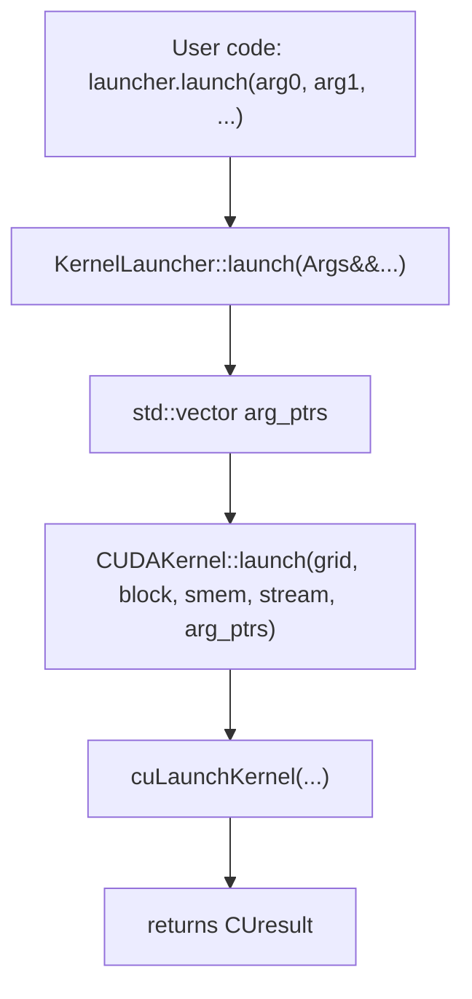

Sources: [jitify.hpp:1305-1316](), [jitify_test.cu:119-128]()

### `launch()`

```
CUresult launch(Args&&... args)
```

- Accepts an arbitrary number of arguments of any types.
- Takes the address of each argument to form a `std::vector<void*>` of argument pointers, which is passed to `cuLaunchKernel` via `CUDAKernel::launch`.
- **Returns `CUresult` directly** — the caller must check for errors (e.g., using the `CHECK_CUDA` macro pattern).
- Zero-argument launches (e.g., `launch()`) are valid.

### `safe_launch()`

```
void safe_launch(Args&&... args)
```

- Identical argument handling to `launch`.
- Wraps the `cuLaunchKernel` result in an internal `cuda_safe_call` that **throws `std::runtime_error`** on any non-`CUDA_SUCCESS` result.
- Has no return value.

### `operator()()`

```
CUresult operator()(Args&&... args)
```

- Variadic template shorthand equivalent to calling `launch(args...)`.
- Returns `CUresult`, matching `launch` semantics.

| Method | Return | On CUDA error |
|---|---|---|
| `launch(args...)` | `CUresult` | Returns error code |
| `safe_launch(args...)` | `void` | Throws `std::runtime_error` |
| `operator()(args...)` | `CUresult` | Returns error code |

Sources: [jitify.hpp:1305-1316](), [jitify_test.cu:120](), [jitify_test.cu:126](), [jitify_test.cu:183]()

---

## Argument Passing Mechanics

The variadic template expands each argument into a `void*` pointer to the argument's storage. This mirrors the CUDA driver API's expected `void** args` parameter for `cuLaunchKernel`.

**Key points:**

- **Scalars, structs, and raw pointers** are all passed by address. A device pointer `float* d_ptr` is passed as `(void*)&d_ptr`, not `(void*)d_ptr`.
- **Temporary/rvalue arguments** work correctly — the `KernelLauncher::operator()` and `launch` methods take forwarding references, and the temporaries' lifetimes extend to the end of the full expression.
- **Class objects** (e.g., a `Arg` struct) can be passed by value or by pointer. See [3.6](#3.6) for patterns.

**Argument pointer assembly diagram**

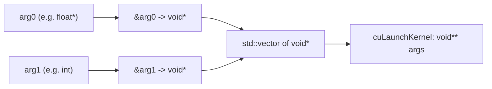

Sources: [jitify.hpp:1305-1309](), [jitify_test.cu:244-245](), [jitify_example.cpp:198-201]()

---

## Default Construction and Move Semantics

`KernelLauncher` is **default-constructible** and **move-assignable**, allowing it to be declared before assignment:

```
jitify::KernelLauncher kernel_launcher;           // default construct
kernel_launcher = kernel_inst.configure(grid, block);  // move-assign
CHECK_CUDA(kernel_launcher.launch(d_data));
```

This is demonstrated in `TEST(JitifyTest, DefaultConstructable)` [jitify_test.cu:163-195]().

---

## Relationship to `CUDAKernel`

`KernelLauncher` does not own any CUDA resources. The actual `CUmodule` and `CUfunction` are owned by the internal `detail::CUDAKernel` object, which is managed by the caching layer. `KernelLauncher` holds a reference to this object and forwards the launch call to `CUDAKernel::launch` [jitify.hpp:1305-1309]() or `CUDAKernel::safe_launch` [jitify.hpp:1311-1316]().

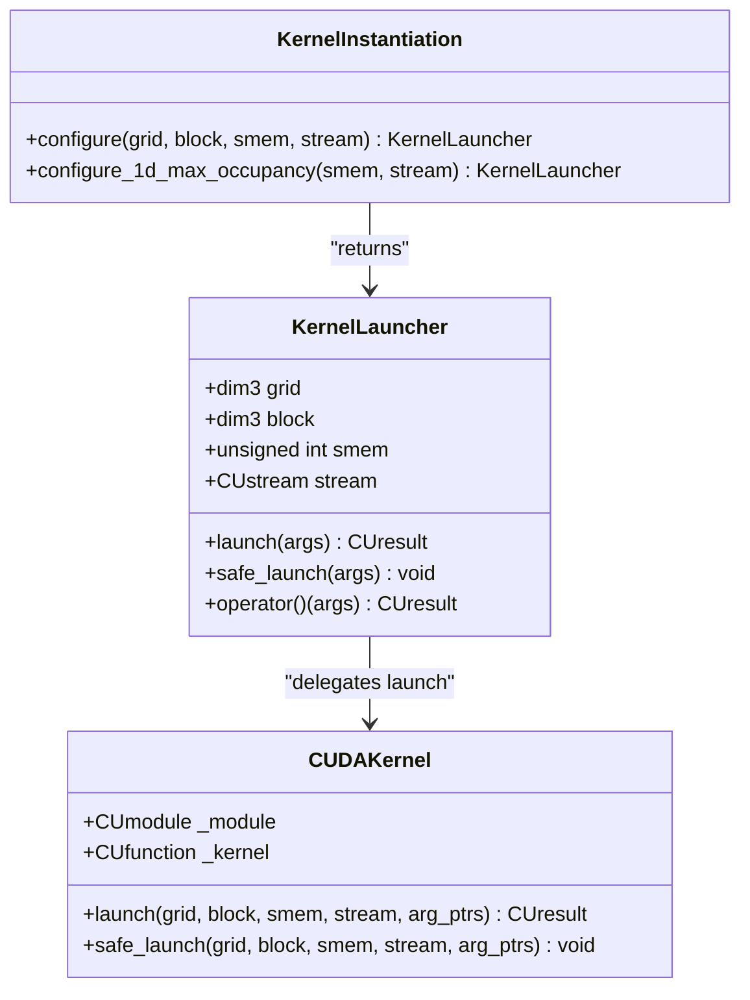

Sources: [jitify.hpp:1111-1376](), [jitify_test.cu:163-195]()

---

## Summary

| Concern | API surface |
|---|---|
| Create a launcher | `KernelInstantiation::configure(grid, block[, smem[, stream]])` |
| Auto-occupancy launcher | `KernelInstantiation::configure_1d_max_occupancy([smem[, stream]])` |
| Launch (caller checks error) | `KernelLauncher::launch(args...)` / `operator()(args...)` |
| Launch (throws on error) | `KernelLauncher::safe_launch(args...)` |
| Underlying CUDA call | `cuLaunchKernel` via `detail::CUDAKernel::launch` |

---

# Page: Reflection Utilities

# Reflection Utilities

<details>
<summary>Relevant source files</summary>

The following files were used as context for generating this wiki page:

- [jitify.hpp](jitify.hpp)
- [jitify_example.cpp](jitify_example.cpp)
- [jitify_test.cu](jitify_test.cu)

</details>


## Purpose and Scope

This page documents the `jitify::reflection` namespace, which provides utilities for converting C++ types and compile-time values into code strings. These strings are used as template arguments when instantiating JIT-compiled CUDA kernels at runtime via `KernelInstantiation::instantiate()`.

For how reflection strings feed into the kernel instantiation workflow, see [KernelInstantiation](#2.3). For a practical guide to using these helpers with templated kernels, see [Template Kernel Instantiation](#3.2).

---

## Overview

NVRTC compiles kernels from source strings. When a kernel is templated, Jitify must build a string like `my_kernel<float, (int)7>` to pass to NVRTC as a name expression. The `jitify::reflection` namespace provides functions that produce exactly these substrings for any C++ type or compile-time value.

**Summary of the namespace contents:**

| Symbol | Kind | Produces |
|---|---|---|
| `NonType<T, V>` | struct | Wraps a non-type template parameter |
| `Type<T>` | struct | Wraps a type as a passable value |
| `Instance<T>` | struct | Wraps a reference for runtime type deduction |
| `reflect<T>()` | function | `"float"` |
| `reflect(value)` | function | `"(float)3.14"` |
| `reflect<N>()` | function | `"(int64_t)7"` |
| `reflect<T,N>()` | function | `"(int)7"` |
| `reflect(Type<T>())` | function | `"float"` |
| `reflect(Instance<T>&)` | function | demangled runtime type name |
| `type_of(x)` | function | `Type<T>()` capturing `T` from `x` |
| `instance_of(x)` | function | `Instance<T const>` capturing `x` |
| `reflect_template<Ts...>()` | function | `"<float,int >"` |
| `reflect_template(args)` | function | `"<float,int >"` |
| `reflect_all(args...)` | function | `vector<string>` of reflected strings |

All symbols are defined in [jitify.hpp:720-1025]().

---

## Wrapper Types

### `NonType<T, VALUE>`

[jitify.hpp:734-737]()

```
template <typename T, T VALUE_>
struct NonType { constexpr static T VALUE = VALUE_; };
```

Used to represent a non-type template parameter as a type argument. When passed to `reflect<>()`, it produces a value string like `"(int)7"`. The specialization of `type_reflection` for `NonType` delegates to `reflect(VALUE)`.

| Usage | Result |
|---|---|
| `reflect<NonType<int,7>>()` | `"(int)7"` |
| `instantiate<NonType<int,C>, T>()` | Passes `C` as non-type and `T` as type arg |

### `Type<T>`

[jitify.hpp:913-914]()

An empty struct used to carry a type as a value. Passing `Type<float>()` to `reflect()` or `instantiate()` produces `"float"`. The overload `reflect(Type<T>)` delegates directly to `reflect<T>()`.

### `Instance<T>`

[jitify.hpp:897-909]()

Holds a `const T&` reference. When passed to `reflect()`, the function calls `typeid(value.value)` to determine the **runtime** (i.e., potentially derived) type. This is the mechanism for reflecting polymorphic objects.

```
struct Instance {
  const T& value;
};
```

---

## Helper Factories

### `type_of(x)`

[jitify.hpp:981-990]()

Two overloads:
- `type_of(T&)` → `Type<T>()`
- `type_of(T const&)` → `Type<T const>()`

Captures the static type of a variable as a `Type` object that can be passed to `instantiate()`. No string conversion happens at call time.

### `instance_of(x)`

[jitify.hpp:907-909]()

Returns `Instance<T const>(value)`. The actual type string is only resolved when `reflect(instance_of(x))` is called, at which point `typeid` is queried for the dynamic type.

---

## The `reflect` Family

### Type reflection: `reflect<T>()`

[jitify.hpp:922-925]()

Invokes `detail::type_reflection<T>::name()`. Internally, this wraps `T` inside `JitifyTypeNameWrapper_<T>`, calls `typeid()` on the wrapped type (to preserve cv-qualifiers that `typeid(T)` would strip), then demangles the result and strips the wrapper prefix.

[jitify.hpp:844-878]()

| Input | Output |
|---|---|
| `reflect<float>()` | `"float"` |
| `reflect<const volatile float>()` | `"const volatile float"` |
| `reflect<int*>()` | `"int *"` |
| `reflect<const float[4]>()` | `"const float [4]"` |

### Value reflection: `reflect(value)`

[jitify.hpp:931-934]()

Combines `reflect<T>()` with `detail::value_string(value)` to produce a cast expression.

```
reflect(3.14f)   →  "(float)3.14"
reflect(true)    →  "(bool)true"
reflect('A')     →  "(char)65"     // char cast to int for readability
```

Specializations of `value_string` exist for `char`, `signed char`, `unsigned char`, `wchar_t`, and `bool` to ensure readable output.

[jitify.hpp:748-782]()

### Non-type template arg reflection

[jitify.hpp:940-952]()

Two overloads:

| Overload | Example | Output |
|---|---|---|
| `reflect<N>()` (int64_t) | `reflect<7>()` | `"(int64_t)7"` |
| `reflect<T,N>()` (explicit type) | `reflect<int,7>()` | `"(int)7"` |

Both delegate to `reflect<NonType<T,N>>()`.

### `reflect(Type<T>)`

[jitify.hpp:958-961]()

Unwraps the `Type<T>` wrapper and calls `reflect<T>()`. Allows `Type<float>()` to be passed directly to any function expecting a reflected string.

### `reflect(Instance<T>&)`

[jitify.hpp:971-973]()

Calls `detail::demangle_native_type(typeid(value.value))` to get the dynamic type at runtime. Used when the actual type is a derived class and only the base class type is known at compile time.

### `reflect_template`

[jitify.hpp:1013-1023]()

Two forms:
- `reflect_template({"float","7","char"})` → `"<float,7,char >"` (note the trailing space before `>` to avoid `>>` parsing issues)
- `reflect_template<float, NonType<int,7>, char>()` → `"<float,(int64_t)7,char >"`

### `reflect_all` and `reflect_list`

[jitify.hpp:993-1009]()

- `reflect_all(args...)` — returns a `vector<string>` by calling `reflect()` on each argument
- `reflect_list(args, opener, closer)` — joins a vector of strings with a separator, adding surrounding brackets

---

## Internal Implementation Details

### Demangling

[jitify.hpp:797-841]()

Platform-specific demangling:
- **Linux/GCC**: `abi::__cxa_demangle` from `<cxxabi.h>`
- **MSVC**: `UnDecorateSymbolName` from `<dbghelp.h>`, followed by `strip_double_underscore_tokens` to remove MSVC-specific keywords like `__cdecl` and `__ptr64`

The function `demangle_cuda_symbol` handles the CUDA mangled name format. `demangle_native_type` wraps it for use with `std::type_info`.

### `JitifyTypeNameWrapper_<T>` trick

[jitify.hpp:844-877]()

`typeid(T)` discards top-level cv-qualifiers on non-reference types. To work around this, `type_reflection<T>::name()` wraps the type:

```
typeid(JitifyTypeNameWrapper_<const volatile float>)
  → "jitify::reflection::detail::JitifyTypeNameWrapper_<const volatile float>"
```

Then strips the `JitifyTypeNameWrapper_<` prefix and the trailing `>` to extract `"const volatile float"`.

---

## Data Flow Diagram

**How reflect helpers produce instantiation strings:**

```mermaid
flowchart TD
    A["C++ type T"] -->|"reflect<T>()"| B["type_reflection<T>::name()"]
    B --> C["typeid(JitifyTypeNameWrapper_<T>)"]
    C --> D["demangle_native_type()"]
    D --> E["strip wrapper prefix"]
    E --> F["type string e.g. float"]

    G["runtime value v"] -->|"reflect(v)"| H["reflect<T>() + value_string(v)"]
    H --> I["value string e.g. (float)3.14"]

    J["NonType<T,N>"] -->|"reflect<NonType<T,N>>()"| K["type_reflection<NonType<T,V>>::name()"]
    K -->|"delegates to"| L["reflect(VALUE)"]
    L --> M["non-type string e.g. (int)7"]

    N["Instance<T>"] -->|"reflect(instance_of(x))"| O["typeid(value.value)"]
    O --> P["demangle_native_type()"]
    P --> Q["runtime type string"]

    F --> R["instantiate() arg list"]
    I --> R
    M --> R
    Q --> R
    R --> S["kernel name expression string"]
```

Sources: [jitify.hpp:844-884](), [jitify.hpp:922-973](), [jitify.hpp:797-841]()

---

## API Reference Diagram

**Code entities in `jitify::reflection` and their relationships:**

```mermaid
classDiagram
    class NonType {
        +T VALUE
    }
    class Type {
    }
    class Instance {
        +const T value
    }
    class type_reflection {
        +static name() string
    }
    class value_string {
        +operator()(x) string
    }
    class reflect_functions {
        +reflect_T() string
        +reflect_value(v) string
        +reflect_N() string
        +reflect_T_N() string
        +reflect_Type(Type_T) string
        +reflect_Instance(Instance_T) string
        +reflect_template(args) string
        +reflect_all(args) vector_string
    }
    class helpers {
        +type_of(T_ref) Type_T
        +type_of(T_const_ref) Type_T_const
        +instance_of(T_const_ref) Instance_T_const
    }

    reflect_functions --> type_reflection : "uses for types"
    reflect_functions --> value_string : "uses for values"
    reflect_functions --> NonType : "specializes on"
    reflect_functions --> Type : "overloads for"
    reflect_functions --> Instance : "overloads for"
    helpers --> Type : "produces"
    helpers --> Instance : "produces"
    type_reflection --> NonType : "specialized for"
```

Sources: [jitify.hpp:734-737](), [jitify.hpp:897-925](), [jitify.hpp:981-1023]()

---

## Practical Equivalences

The following forms for passing template arguments to `instantiate()` are all equivalent. They are taken from actual test code in [jitify_test.cu:247-268]() and [jitify_example.cpp:204-224]():

| Form | Description |
|---|---|
| `instantiate<NonType<int, C>, T>()` | Pure template-arg syntax, no strings |
| `instantiate({reflect((int)C), reflect<T>()})` | Manual string construction |
| `instantiate((int)C, Type<T>())` | Recommended: value + type wrapper |
| `instantiate((int)C, type_of(*indata))` | Recommended: value + `type_of` helper |
| `instantiate((int)C, instance_of(*indata))` | Dynamic type from instance |

The `Type<T>()` and `type_of()` approaches are preferred because they avoid string manipulation in user code while still supporting cv-qualified and pointer types correctly.

---

## Notes on Edge Cases

- **`char` values**: `value_string<char>` casts to `int` before streaming, avoiding non-printable character output. [jitify.hpp:755-758]()
- **`bool` values**: `value_string<bool>` returns `"true"` or `"false"` rather than `1`/`0`. [jitify.hpp:779-782]()
- **Template closing bracket**: `reflect_template` always produces `" >"` (with a space) to prevent `>>` from being misinterpreted as a right-shift operator in generated source. [jitify.hpp:1015-1017]()
- **CUDA version guard**: The `NVRTC_GET_TYPE_NAME` define is set for CUDA >= 8000, but the code comments indicate that `nvrtcGetTypeName` was not used because its behavior differed from the demangle-based approach. The host-side demangling path is always used. [jitify.hpp:114-116](), [jitify.hpp:851-876]()

---

# Page: Experimental API

# Experimental API

<details>
<summary>Relevant source files</summary>

The following files were used as context for generating this wiki page:

- [jitify.hpp](jitify.hpp)
- [jitify_example.cpp](jitify_example.cpp)
- [jitify_test.cu](jitify_test.cu)

</details>


This page covers the `jitify::experimental` namespace: its two primary classes, `Program` and `KernelInstantiation`, the `serialize()`/`deserialize()` round-trip that enables user-managed kernel caching, and how this approach differs from the `JitCache`-based API. For the standard caching API (`JitCache`, `Program`, `KernelInstantiation` in the root `jitify::` namespace), see [Core API Reference](#2). For launch configuration and kernel arguments, see [KernelLauncher](#2.4).

---

## Purpose

The `jitify::experimental` namespace provides an alternative front-end to NVRTC compilation that gives the caller direct control over how compiled programs are stored and reused. Rather than an opaque LRU in-process cache (`JitCache`), the experimental API exposes `serialize()` and `deserialize()` methods on both `Program` and `KernelInstantiation`. The caller decides where, how long, and in what form a compiled artifact is persisted.

Typical use cases include:

- Saving compiled PTX or module state to disk between process restarts.
- Distributing pre-compiled kernel instances across worker processes in a cluster.
- Integrating JIT compilation with an application-specific cache keyed on arbitrary metadata.

---

## Class Overview

| Class | Namespace | Role |
|---|---|---|
| `Program` | `jitify::experimental` | Compiles and holds source + preprocessed state for a CUDA program |
| `KernelInstantiation` | `jitify::experimental` | Holds a fully compiled, linked, and loaded kernel for a specific template instantiation |
| `Kernel` | `jitify::experimental` | Intermediate handle returned by `Program::kernel(name)` |
| `KernelLauncher` | `jitify::experimental` | Holds launch parameters; returned by `KernelInstantiation::configure()` |

The `Kernel` and `KernelLauncher` types in the experimental namespace mirror those in the root `jitify::` namespace (see [Program and Kernel](#2.2) and [KernelLauncher](#2.4)); `KernelLauncher` is shared between both namespaces.

---

## Object Lifecycle

**Experimental lifecycle diagram**

```mermaid
flowchart TD
    src["source string / filename"]
    hdrs["headers vector"]
    opts["compiler options vector"]
    cb["file_callback (optional)"]

    src --> ctor
    hdrs --> ctor
    opts --> ctor
    cb --> ctor

    ctor["experimental::Program(source, headers, opts, cb)"]
    ctor -->|"compile via NVRTC"| prog["experimental::Program"]

    prog -->|"serialize()"| serial_prog["std::string (serialized program)"]
    serial_prog -->|"Program::deserialize(str)"| prog2["experimental::Program"]

    prog2 -->|"kernel(name)"| kern["experimental::Kernel"]
    kern -->|"instantiate(args...)"| ki["experimental::KernelInstantiation"]

    ki -->|"serialize()"| serial_ki["std::string (serialized instantiation)"]
    serial_ki -->|"KernelInstantiation::deserialize(str)"| ki2["experimental::KernelInstantiation"]

    ki2 -->|"configure(grid, block)"| launcher["KernelLauncher"]
    launcher -->|"launch(args...)"| exec["kernel execution"]
```

Sources: [jitify_test.cu:133-161](), [jitify_test.cu:278-346](), [jitify_example.cpp:119-150]()

---

## `experimental::Program`

### Construction

```
jitify::experimental::Program(
    const std::string& source,
    const std::vector<std::string>& headers = {},
    const std::vector<std::string>& options = {},
    file_callback_type file_callback = nullptr
)
```

- `source` — either a program name followed by a newline and the full source body, or a filename that Jitify will load. The same format as accepted by `JitCache::program()`.
- `headers` — inline header strings, each formatted as `"filename\nsource"`. These are passed to NVRTC as virtual files.
- `options` — NVRTC compiler flags (e.g., `"-I/path"`, `"--use_fast_math"`, `"-rdc=true"`, `"--remove-unused-globals"`).
- `file_callback` — optional callback invoked when Jitify cannot locate a `#include`d file through the normal mechanisms. See [Header Management](#3.3).

Compilation occurs eagerly in the constructor. If compilation fails, a `std::runtime_error` is thrown.

Example from tests [jitify_test.cu:285-290]():
```
jitify::experimental::Program program_orig(
    multiple_kernels_program_source,
    {example_headers_my_header1_cuh},
    {"--use_fast_math", "-I" CUDA_INC_DIR},
    file_callback);
auto program =
    jitify::experimental::Program::deserialize(program_orig.serialize());
```

### `serialize()` and `deserialize()`

| Method | Signature | Description |
|---|---|---|
| `serialize` | `std::string serialize() const` | Returns a self-contained string encoding the compiled program state |
| `deserialize` | `static Program deserialize(const std::string&)` | Reconstructs a `Program` from a previously serialized string |

The serialized string encodes everything needed to later call `kernel()` and `instantiate()` without re-invoking NVRTC. This allows the output to be written to a file, stored in a database, or transmitted over a network.

### `kernel(name)`

```
Kernel kernel(const std::string& name)
```

Returns an `experimental::Kernel` handle referencing the named `__global__` function. Passing an empty string (`""`) is valid and is used to obtain PTX output without requiring a specific kernel symbol [jitify_test.cu:827-831]().

---

## `experimental::KernelInstantiation`

### Creation

`KernelInstantiation` is obtained by calling `instantiate()` on a `Kernel`. Template arguments follow the same conventions as the standard namespace — variadic values, `Type<T>()`, `NonType<T,N>`, `type_of()`, `instance_of()`, or a vector of strings. For full details see [Template Kernel Instantiation](#3.2).

```
// Type-safe variadic form
auto ki = program.kernel("my_kernel").instantiate(3, type_of(*d_data));

// String form
auto ki = program.kernel("my_kernel2")
              .instantiate({reflect((int)C), reflect<T>()});
```
[jitify_test.cu:144-147](), [jitify_test.cu:307-319]()

### `serialize()` and `deserialize()`

| Method | Signature | Description |
|---|---|---|
| `serialize` | `std::string serialize() const` | Encodes the instantiation (PTX, linked module state, function name) as a string |
| `deserialize` | `static KernelInstantiation deserialize(const std::string&)` | Reloads a `CUmodule` and `CUfunction` from the serialized string |

After `deserialize()`, the returned `KernelInstantiation` is fully operational — it holds a loaded `CUmodule` and can be launched immediately.

Example [jitify_test.cu:308-313]():
```
auto ki = jitify::experimental::KernelInstantiation::deserialize(
    program.kernel("my_kernel2")
        .instantiate<NonType<int, C>, T>()
        .serialize());
CHECK_CUDA(ki.configure(grid, block).launch(indata, outdata));
```

### Launch Methods

| Method | Returns | Description |
|---|---|---|
| `configure(grid, block, smem=0, stream=0)` | `KernelLauncher` | Sets launch dimensions; see [KernelLauncher](#2.4) |
| `configure_1d_max_occupancy(...)` | `KernelLauncher` | Auto-selects block size for maximum occupancy |

### Introspection Methods

| Method | Return Type | Description |
|---|---|---|
| `ptx()` | `std::string` | Returns the PTX string produced by NVRTC |
| `mangled_name()` | `std::string` | Returns the lowered (mangled) name of the instantiated kernel |
| `get_func_attribute(attr)` | `int` | Reads a `CUfunction_attribute` |
| `set_func_attribute(attr, val)` | `void` | Writes a `CUfunction_attribute` |

`ptx()` is used in the link-test pattern to write compiled PTX to disk for subsequent linking [jitify_test.cu:827-831]():
```
std::ofstream ptx_file("linktest.ptx");
ptx_file << jitify::experimental::Program(src, {}, {"-rdc=true"})
                .kernel("").instantiate().ptx();
```

### Device and Constant Variable Access

These methods are identical to the standard `KernelInstantiation` API described in [Device and Constant Memory](#3.4):

| Method | Description |
|---|---|
| `get_global_ptr(name, size=nullptr)` | Returns `CUdeviceptr` for a `__device__` or `__constant__` variable |
| `get_constant_ptr(name)` | Alias for `get_global_ptr` (deprecated, kept for compatibility) |
| `get_global_value(name, ptr)` | Async device→host copy of a scalar global |
| `set_global_value(name, val)` | Async host→device copy of a scalar global |
| `get_global_array(name, ptr, count)` | Async device→host copy of an array global |
| `set_global_array(name, ptr, count)` | Async host→device copy of an array global |

---

## Comparison with the `JitCache` API

**Side-by-side comparison of caching models**

```mermaid
flowchart LR
    subgraph "Standard API (jitify::)"
        jc["JitCache\n(LRU cache)"]
        jp["Program"]
        jk["Kernel"]
        jki["KernelInstantiation"]
        jc -->|"program(source,...)"| jp
        jp -->|"kernel(name)"| jk
        jk -->|"instantiate(...)"| jki
    end

    subgraph "Experimental API (jitify::experimental)"
        ep["experimental::Program\n(no internal cache)"]
        ek["experimental::Kernel"]
        eki["experimental::KernelInstantiation"]
        ep -->|"kernel(name)"| ek
        ek -->|"instantiate(...)"| eki
        ep <-->|"serialize() / deserialize()"| store1["user-managed store"]
        eki <-->|"serialize() / deserialize()"| store2["user-managed store"]
    end
```

| Attribute | `JitCache` / `jitify::` | `jitify::experimental` |
|---|---|---|
| Cache management | Automatic LRU, in-process | Caller-managed via `serialize()`/`deserialize()` |
| Persistence across processes | No | Yes (caller writes serialized string to disk) |
| Thread safety | Mutex-protected (when `JITIFY_THREAD_SAFE=1`) | Caller-managed |
| Construction cost | `JitCache` constructor only; compilations are lazily cached | Compilation occurs in `Program` constructor |
| Caching granularity | Keyed by source hash inside `JitCache` | Arbitrary (caller decides key and storage) |
| Implicit re-use | Yes, within same process | No; caller must explicitly deserialize |

Sources: [jitify.hpp:204-274](), [jitify_test.cu:107-131](), [jitify_test.cu:133-161]()

---

## Special Compiler Options in the Experimental API

The experimental API is the primary path for several compile-time options that influence the PTX output:

| Option | Effect |
|---|---|
| `"-rdc=true"` | Enables relocatable device code (required for device-side linking) |
| `"--remove-unused-globals"` or `"-remove-unused-globals"` | Strips unused `__device__` and `__constant__` symbols from PTX output |
| `"-l<file>"` | Links an external PTX, CUBIN, object, or library at load time |
| `"-L<path>"` | Adds a path to search when resolving `-l` link targets |
| `"-l."` | Links against the current executable (for calling host-compiled device functions) |

The `--remove-unused-globals` option is demonstrated with CuRAND to strip large precomputed tables from the PTX [jitify_test.cu:793-799](), and with general device-global management [jitify_test.cu:752-784]().

Linking against an external PTX file requires `"-rdc=true"` in both the producing and consuming programs [jitify_test.cu:819-847](). Linking against the current executable uses the special `"-l."` flag [jitify_test.cu:863-878]().

---

## `JITIFY_OPTIONS` Environment Variable

Both `JitCache`-based and experimental programs respect the `JITIFY_OPTIONS` environment variable. If set, its value is appended to the compiler option list before each compilation. Invalid options in `JITIFY_OPTIONS` cause a `std::runtime_error` at compile time [jitify_test.cu:1131-1139]().

---

## Error Handling

Both `Program` construction and `KernelInstantiation` creation throw `std::runtime_error` on failure (compilation error, missing file, invalid PTX, etc.). The standard pattern is to let exceptions propagate or catch them explicitly:

- `Program("missing_filename")` → throws because the file cannot be loaded [jitify_test.cu:573-577]()
- `Program("bad_program\nNOT CUDA C!")` → throws because NVRTC rejects the source [jitify_test.cu:575-577]()

Sources: [jitify_test.cu:564-578]()

---

# Page: Usage Guide

# Usage Guide

<details>
<summary>Relevant source files</summary>

The following files were used as context for generating this wiki page:

- [README.md](README.md)
- [jitify_example.cpp](jitify_example.cpp)

</details>


This page is the index for practical integration guides covering the most common patterns for embedding Jitify in a CUDA application. It summarizes the complete workflow at a high level and directs readers to detailed sub-pages for each topic. For API class reference material, see [Core API Reference](#2). For build system setup and the `stringify` utility, see [Build System and Tooling](#4).

---

## What Jitify Does

Jitify wraps NVRTC (CUDA Runtime Compilation) behind a chainable C++ API. The caller writes kernel source as a string, selects a kernel by name, instantiates it with template arguments (which may include C++ types resolved at runtime), configures launch dimensions, and launches — all without manually managing `nvrtcProgram` handles, PTX compilation, driver API linkage, or name mangling.

---

## The Core Workflow

Every Jitify usage follows the same five-step chain:

**Workflow: JitCache → Program → Kernel → KernelInstantiation → KernelLauncher**

```mermaid
flowchart LR
  JC["JitCache\n(kernel_cache)"] -->|"program(source, headers, opts, callback)"| P["Program"]
  P -->|"kernel(name)"| K["Kernel"]
  K -->|"instantiate(args...)"| KI["KernelInstantiation"]
  KI -->|"configure(grid, block, smem, stream)"| KL["KernelLauncher"]
  KL -->|"launch(args...)"| GPU["Device Execution"]
```

Sources: [jitify_example.cpp:88-116](), [README.md:14-34]()

Each step maps to a concrete type in `jitify.hpp`:

| Step | Class / Function | Responsibility |
|---|---|---|
| 1 | `jitify::JitCache` | Holds a compiled-program cache; size configurable |
| 2 | `jitify::Program` | Encapsulates source, headers, and compiler options |
| 3 | `jitify::Kernel` | Selects one `__global__` function by name |
| 4 | `jitify::KernelInstantiation` | Resolves template arguments; holds `CUfunction` |
| 5 | `jitify::KernelLauncher` | Holds grid/block/smem/stream; calls `launch()` |

Sources: [jitify_example.cpp:99-111](), [README.md:24-33]()

---

## Minimal Working Pattern

The following condensed pattern appears in `test_simple` in [jitify_example.cpp:88-116]():

1. Define kernel source as a `const char*`, with the **program name on the first line** followed by CUDA C++ source.
2. Declare a `static jitify::JitCache kernel_cache` (static ensures the cache persists across calls).
3. Call `kernel_cache.program(source)` → `Program`.
4. Call `.kernel("name")` → `Kernel`.
5. Call `.instantiate(template_args...)` → `KernelInstantiation`.
6. Call `.configure(grid, block)` → `KernelLauncher`.
7. Call `.launch(device_ptrs...)`.

Wrap each step in the `CHECK_CUDA` macro defined in [jitify_example.cpp:54-64]() to surface driver-level errors with file and line information.

---

## Key Input Types to `program()`

`JitCache::program()` accepts four parameters. Understanding each is important for header management:

| Parameter | Type | Purpose |
|---|---|---|
| `source` | `const char*` | Program name + kernel source, or a filename |
| `headers` | initializer list of `const char*` | Inline header strings (name on first line) |
| `options` | `std::vector<std::string>` | NVRTC compiler flags, e.g. `--use_fast_math` |
| `file_callback` | function pointer | Dynamic header resolution by filename |

Sources: [jitify_example.cpp:183-187]()

---

## Template Argument Resolution

When a kernel is templated, `instantiate()` accepts a mix of argument types resolved at compile-or-runtime. The `jitify::reflection` namespace provides helpers that convert C++ types and values to strings:

```mermaid
flowchart TD
  IA["instantiate(args...)"] --> NT["NonType&lt;T,N&gt;\ne.g. NonType&lt;int,3&gt;"]
  IA --> TY["Type&lt;T&gt;\ne.g. Type&lt;float&gt;"]
  IA --> TOF["type_of(expr)\ndeduces type from a value"]
  IA --> IOF["instance_of(expr)\nsame as type_of"]
  IA --> RV["reflect(value)\nfor integral non-type params"]
  IA --> RS["reflect&lt;T&gt;()\nreturns type name string"]
  NT --> STR["std::string\n(e.g. &quot;3&quot;)"]
  TY --> STR
  TOF --> STR
  IOF --> STR
  RV --> STR
  RS --> STR
  STR --> NVRTC["NVRTC instantiation string"]
```

Sources: [jitify_example.cpp:177-224]()

All five invocation forms in [jitify_example.cpp:203-224]() are equivalent at runtime; the results are cached after the first compilation.

---

## Header Supply Mechanisms

Three mechanisms exist for supplying headers to a JIT-compiled program:

```mermaid
flowchart LR
  H1["Inline string headers\n(passed to program())"] --> JC["JitCache::program()"]
  H2["file_callback\n(dynamic lookup)"] --> JC
  H3["Embedded via stringify\n(.jit files + JITIFY_INCLUDE_EMBEDDED_FILE)"] --> JC
```

- **Inline strings**: The `headers` argument to `program()` is a list of `const char*` where the first line of each string is the header filename. See [jitify_example.cpp:186]().
- **`file_callback`**: A user-supplied function `std::istream*(std::string filename, std::iostream& tmp_stream)` that returns a stream for a given filename or `nullptr` to fall through to other resolution. See [jitify_example.cpp:71-85]().
- **Embedded via `stringify`**: The `stringify` tool converts `.cuh` files to `.jit` C string literal files. Include the `.jit` file, then register it with `JITIFY_INCLUDE_EMBEDDED_FILE`. See [jitify_example.cpp:45-48]().

Sources: [jitify_example.cpp:34-48](), [jitify_example.cpp:71-85](), [jitify_example.cpp:183-187]()

---

## `__constant__` and `__device__` Variable Access

After calling `instantiate()`, the resulting `KernelInstantiation` object exposes methods to read and write device-side named variables by their mangled names:

| Method | Direction | Namespace support |
|---|---|---|
| `get_constant_ptr("name")` | returns `CUdeviceptr` | Yes, including `(anonymous namespace)::` |
| `get_global_value()` | host read of `__device__` var | — |
| `set_global_value()` | host write of `__device__` var | — |

Example usage with `cuMemcpyHtoD` after `get_constant_ptr` is shown in [jitify_example.cpp:266-268]() and [jitify_example.cpp:285-286]().

Sources: [jitify_example.cpp:236-299]()

---

## Parallel For and Lambda Kernels

Jitify provides `jitify::parallel_for` and the `JITIFY_LAMBDA` macro as an alternative to writing named kernels. The pattern is:

1. Create a `jitify::ExecutionPolicy` with `jitify::DEVICE`.
2. Define a lambda using `JITIFY_LAMBDA((captured_vars...), body_using_index_i)`.
3. Call `jitify::parallel_for(policy, begin, end, lambda)`.

The index variable inside the lambda body is `i`. See [jitify_example.cpp:302-325]() for a complete example.

Sources: [jitify_example.cpp:302-325]()

---

## Experimental Serialization API

The `jitify::experimental` namespace provides `Program` and `KernelInstantiation` with `serialize()` and `deserialize()` methods for user-managed persistent caches. The standard `JitCache` approach is simpler for in-process caching; use `experimental` when caching must survive process restarts or cross-machine distribution.

See [jitify_example.cpp:119-150]() for a side-by-side example. Detailed reference is in [Experimental API](#2.6).

---

## Sub-Pages in This Section

| Sub-page | Topic |
|---|---|
| [Basic Compilation and Launch](#3.1) | Minimal `JitCache` → `launch()` walkthrough |
| [Template Kernel Instantiation](#3.2) | `reflect`, `Type`, `NonType`, `type_of`, `instance_of` |
| [Header Management](#3.3) | Inline strings, `file_callback`, `stringify`, embedded files |
| [Device and Constant Memory](#3.4) | `get_constant_ptr`, `get_global_value`, `set_global_value` |
| [Parallel For and Lambda Support](#3.5) | `jitify::parallel_for`, `JITIFY_LAMBDA`, `ExecutionPolicy` |
| [Passing Class Objects as Kernel Arguments](#3.6) | By value/reference/pointer, `Managed` base class |

---

# Page: Basic Compilation and Launch

# Basic Compilation and Launch

<details>
<summary>Relevant source files</summary>

The following files were used as context for generating this wiki page:

- [README.md](README.md)
- [jitify.hpp](jitify.hpp)
- [jitify_example.cpp](jitify_example.cpp)

</details>


## Purpose and Scope

This page covers the minimal end-to-end workflow for compiling a CUDA kernel at runtime with Jitify and launching it: from writing the kernel source string, through `JitCache`, `Program`, `Kernel`, `KernelInstantiation`, and `KernelLauncher`, to the actual kernel dispatch. It also covers the `CHECK_CUDA` error-checking pattern used throughout examples.

For template argument reflection utilities (`reflect<T>()`, `NonType`, `type_of()`) used inside `instantiate()` calls, see [Reflection Utilities](#2.5). For reading and writing `__device__`/`__constant__` variables after instantiation, see [Device and Constant Memory](#3.4). For the experimental serializable API, see [Experimental API](#2.6).

---

## The Compilation and Launch Chain

Every Jitify kernel execution passes through five objects in sequence. Each object is produced by calling a method on the previous one.

**Object chain diagram**

```mermaid
flowchart LR
  A["JitCache\n(kernel_cache)"] -->|".program(source,...)"| B["Program"]
  B -->|".kernel(name)"| C["Kernel"]
  C -->|".instantiate(...)"| D["KernelInstantiation"]
  D -->|".configure(grid, block)"| E["KernelLauncher"]
  E -->|".launch(args...)"| F["cuLaunchKernel"]
```

Sources: [jitify_example.cpp:99-111](), [jitify_example.cpp:183-220]()

---

## Step 1 — Writing the Kernel Source String

The kernel source is passed as a C string. The **first line must be the program name**, followed by a newline, followed by the actual CUDA source code.

```
"my_program\n"
"template<int N, typename T>\n"
"__global__ void my_kernel(T* data) { ... }\n"
```

This format is required because Jitify's `load_source()` function splits on the first newline to extract the program name from the source content. See [jitify.hpp:567-573]() for the parsing logic.

| Segment | Content | Example |
|---|---|---|
| First line (before `\n`) | Program name (used as cache key) | `my_program` |
| Remainder | Valid CUDA source | `__global__ void my_kernel(...)` |

Sources: [jitify_example.cpp:89-98](), [jitify.hpp:567-573]()

---

## Step 2 — Constructing a JitCache

`jitify::JitCache` is the top-level manager. Construct it once and reuse it. It holds an LRU `ObjectCache` of compiled programs, keyed by source hash and options.

Typical usage makes the cache `static` or `thread_local static` so it persists across repeated calls:

```cpp
static jitify::JitCache kernel_cache;
// or
thread_local static jitify::JitCache kernel_cache;
```

The default constructor uses a cache capacity of 8 entries. A repeated call with the same source and options will return the cached `Program` without recompiling.

Sources: [jitify_example.cpp:99](), [jitify_example.cpp:183](), [jitify_example.cpp:238]()

---

## Step 3 — Calling program()

`JitCache::program()` accepts the source string, optional inline headers, optional compiler options, and an optional file callback.

```
JitCache::program(source, headers, options, file_callback)
```

| Parameter | Type | Purpose |
|---|---|---|
| `source` | `const char*` | Kernel source with name on line 1 |
| `headers` | initializer list / `std::vector` | Inline header `name → content` pairs |
| `options` | `std::vector<std::string>` | NVRTC compiler flags (e.g. `--use_fast_math`) |
| `file_callback` | `file_callback_type` | Called when an `#include` cannot be resolved |

The simplest call passes only source and `0` for the rest:

[jitify_example.cpp:100]()

A more complete call with headers, options, and a callback:

[jitify_example.cpp:183-187]()

For header supply strategies see [Header Management](#3.3). The `file_callback_type` signature is defined at [jitify.hpp:196-197]().

Sources: [jitify_example.cpp:99-100](), [jitify_example.cpp:183-187]()

---

## Step 4 — Selecting a Kernel

`Program::kernel(name)` identifies which `__global__` function in the compiled source to use. It returns a `jitify::Kernel` object. The name is the unmangled function name as it appears in the source.

```cpp
jitify::Kernel k = program.kernel("my_kernel");
// or inline:
program.kernel("my_kernel1").instantiate()...
```

Sources: [jitify_example.cpp:108](), [jitify_example.cpp:198](), [jitify_example.cpp:204]()

---

## Step 5 — Instantiating the Kernel

`Kernel::instantiate(...)` resolves template arguments and produces a `jitify::KernelInstantiation`. For a non-templated kernel, call it with no arguments:

```cpp
.instantiate()
```

For a templated kernel, pass arguments that Jitify converts to strings. The arguments can be:
- Integer values for non-type parameters (e.g. `3` for `N`)
- `type_of(*ptr)` to deduce a type from an existing device pointer
- `jitify::reflection::Type<T>()` to name a type explicitly
- Strings via `reflect<T>()`

See [jitify_example.cpp:109]() for `instantiate(3, type_of(*d_data))` and [Template Kernel Instantiation](#3.2) for the full reference.

**Instantiation resolves the mangled CUDA function name** and triggers NVRTC compilation (or cache lookup) to produce the underlying `CUfunction`. The resulting `KernelInstantiation` implicitly converts to `CUfunction` for use with raw CUDA Driver API calls.

Sources: [jitify_example.cpp:108-110](), [jitify_example.cpp:199](), [jitify_example.cpp:204-206]()

---

## Step 6 — Configuring Launch Parameters

`KernelInstantiation::configure(grid, block, smem, stream)` returns a `jitify::KernelLauncher` that holds the launch dimensions. The `smem` (shared memory bytes) and `stream` parameters are optional and default to `0`.

```cpp
dim3 grid(1);
dim3 block(1);
.configure(grid, block)
// or with shared memory and stream:
.configure(grid, block, smem_bytes, cuda_stream)
```

Sources: [jitify_example.cpp:105-111]()

---

## Step 7 — Launching the Kernel

`KernelLauncher::launch(args...)` or `KernelLauncher::operator()(args...)` dispatches the kernel. Arguments are passed directly as typed values; Jitify takes their addresses internally to build the `void*[]` array required by `cuLaunchKernel`.

`launch()` returns a `CUresult`. `safe_launch()` throws `std::runtime_error` on failure instead.

The actual dispatch calls `cuLaunchKernel` via `CUDAKernel::launch()` at [jitify.hpp:1305-1309]().

Sources: [jitify_example.cpp:111](), [jitify.hpp:1305-1316]()

---

## Complete Minimal Example

The following annotated trace maps directly to the `test_simple<float>()` function in `jitify_example.cpp`:

**Workflow with code locations**

```mermaid
flowchart TD
  S1["1. Define source string\n[jitify_example.cpp:89-98]"] --> S2
  S2["2. static JitCache kernel_cache\n[jitify_example.cpp:99]"] --> S3
  S3["3. kernel_cache.program(source, 0)\n→ jitify::Program\n[jitify_example.cpp:100]"] --> S4
  S4["4. program.kernel(\"my_kernel\")\n→ jitify::Kernel\n[jitify_example.cpp:108]"] --> S5
  S5["5. .instantiate(3, type_of(*d_data))\n→ jitify::KernelInstantiation\n[jitify_example.cpp:109]"] --> S6
  S6["6. .configure(grid, block)\n→ jitify::KernelLauncher\n[jitify_example.cpp:110]"] --> S7
  S7["7. .launch(d_data)\n→ CUresult\n[jitify_example.cpp:111]"] --> S8
  S8["cuLaunchKernel\n[jitify.hpp:1307-1308]"]
```

Sources: [jitify_example.cpp:88-116](), [jitify.hpp:1305-1309]()

---

## Error Checking with CHECK_CUDA

`jitify_example.cpp` defines a `CHECK_CUDA` macro that wraps any `CUresult`-returning call, prints the CUDA error name with file/line/function context, and returns `false` from the enclosing function on failure.

[jitify_example.cpp:54-64]()

Usage with the launch chain:

```cpp
CHECK_CUDA(program.kernel("my_kernel1")
               .instantiate()
               .configure(grid, block)
               .launch(indata, outdata));
```

[jitify_example.cpp:198-201]()

The macro wraps the entire chain expression because `launch()` returns `CUresult` directly. `safe_launch()` is an alternative that throws instead of returning.

Sources: [jitify_example.cpp:54-64](), [jitify.hpp:1311-1316]()

---

## Object Lifetimes and Caching

The table below summarizes which objects should be created once versus per-launch:

| Object | Typical lifetime | Notes |
|---|---|---|
| `JitCache` | Program lifetime | `static` or `thread_local static`; owns the LRU cache |
| `Program` | Reuse per-set-of-options | Returned from cache after first compilation |
| `Kernel` | Cheap; create inline | Just a name selector; no compilation involved |
| `KernelInstantiation` | Reuse if template args are fixed | Holds the compiled `CUfunction`; cache hit avoids recompile |
| `KernelLauncher` | Per-launch | Holds `grid`, `block`, `smem`, `stream` |

The `ObjectCache` inside `JitCache` uses LRU eviction with a default capacity of 8. Exceeding capacity discards the least-recently-used entry, triggering recompilation on the next access. See [JitCache](#2.1) for constructor options.

Sources: [jitify_example.cpp:99](), [jitify_example.cpp:183](), [jitify.hpp:206-274]()

---

# Page: Template Kernel Instantiation

# Template Kernel Instantiation

<details>
<summary>Relevant source files</summary>

The following files were used as context for generating this wiki page:

- [jitify.hpp](jitify.hpp)
- [jitify_example.cpp](jitify_example.cpp)
- [jitify_test.cu](jitify_test.cu)

</details>


This page explains how to instantiate templated CUDA kernels at runtime using Jitify's reflection utilities. It covers converting C++ types and compile-time values into the string representations that NVRTC requires, and shows the different calling conventions for `instantiate()`.

For the full API reference for `KernelInstantiation` (the object returned by `instantiate()`), see [2.3](#2.3). For the base workflow of writing a kernel string and calling `instantiate()`, see [3.1](#3.1).

---

## Overview

NVRTC compiles kernels as strings. When a kernel is templated, Jitify must construct the template argument list as a string (e.g., `"<int, float>"`) before passing it to the compiler. The `jitify::reflection` namespace provides the functions that perform this conversion.

The calling site looks like:

```
program.kernel("my_kernel").instantiate(<template args>)
```

The template arguments can be supplied in four ways, all of which are semantically equivalent for the same kernel template signature.

**Reflection utilities used in instantiation:**

| Helper | Input | Output String Example |
|---|---|---|
| `reflect<T>()` | type parameter | `"float"` |
| `reflect(value)` | runtime value | `"(int)123"` |
| `reflect<T, N>()` | typed non-type param | `"(int)7"` |
| `NonType<T, N>` | compile-time non-type | used as template arg |
| `Type<T>()` | type wrapped as value | `"float"` |
| `type_of(var)` | lvalue of known type | `"float"` |
| `instance_of(var)` | polymorphic base ref | derived type name |

Sources: [jitify.hpp:720-1025]()

---

## The `reflection` Namespace

All helpers live in `jitify::reflection`. The typical usage in a translation unit is:

```cpp
using jitify::reflection::NonType;
using jitify::reflection::Type;
using jitify::reflection::type_of;
using jitify::reflection::instance_of;
using jitify::reflection::reflect;
```

Sources: [jitify_test.cu:220-224](), [jitify_example.cpp:177-181]()

---

## Type Parameters — `reflect<T>()` and `Type<T>`

### `reflect<T>()`

Converts a C++ type to its string name. The underlying implementation wraps the type in a dummy template class and uses `typeid` demangling to recover the name.

```cpp
reflect<float>()         // -> "float"
reflect<const float*>()  // -> "const float *"
```

Sources: [jitify.hpp:922-925](), [jitify.hpp:847-878]()

### `Type<T>` wrapper

`Type<T>` is an empty struct that carries a type as a value. It is the idiomatic way to pass a type as an argument to the variadic `instantiate()` overload.

```cpp
Type<float>()   // passed as a value, resolved to "float"
```

`reflect(Type<float>())` and `reflect<float>()` produce identical output.

Sources: [jitify.hpp:913-914](), [jitify.hpp:958-961]()

---

## Non-Type Parameters — `NonType<T, N>` and `reflect(value)`

### `reflect(value)`

Converts a runtime value to a cast-style string. This is the standard way to pass a non-type template argument.

```cpp
reflect(123)       // -> "(int)123"
reflect(3.14f)     // -> "(float)3.14"
```

Sources: [jitify.hpp:931-934]()

### `reflect<T, N>()` and `reflect<N>()`

Compile-time versions for integer non-type template arguments.

```cpp
reflect<int, 7>()   // -> "(int)7"
reflect<7>()        // -> "(int64_t)7"
```

Sources: [jitify.hpp:940-952]()

### `NonType<T, VALUE>` wrapper

`NonType<T, VALUE>` is a compile-time wrapper for a non-type template parameter. It is used when calling the template-parameter form of `instantiate<...>()`.

```cpp
NonType<int, 123>   // represents the value 123 of type int
```

When used in `reflect<NonType<T, VALUE>>()`, it emits the value string for `VALUE`.

Sources: [jitify.hpp:734-737](), [jitify.hpp:879-884]()

---

## Deducing Types from Existing Variables — `type_of()` and `instance_of()`

### `type_of(var)`

Creates a `Type<T>` from an lvalue or const lvalue. The type is resolved at compile time. This avoids writing the type explicitly when you already have a variable.

```cpp
float* d_data;
type_of(*d_data)   // equivalent to Type<float>()
```

Sources: [jitify.hpp:980-990]()

### `instance_of(var)`

Creates an `Instance<T>` that deduces the *runtime* (dynamic) type from a polymorphic reference. This is for cases where the static type is a base class but you want to template on the derived type.

```cpp
Derived<float> obj;
Base& base = obj;
instance_of(base)   // -> reflect yields "Derived<float>"
```

`reflect(Instance<T>)` calls `typeid(value).name()` on the wrapped value and demangles the result, rather than using the static type.

Sources: [jitify.hpp:896-909](), [jitify.hpp:970-973]()

---

## Calling Conventions for `instantiate()`

All five forms below produce the same compiled kernel for the kernel `template<int C, typename T> __global__ void my_kernel2(...)`:

**1. Template parameter pack form** (compile-time types and NonType values)

```cpp
program.kernel("my_kernel2")
    .instantiate<NonType<int, C>, T>()
```

**2. String vector form** (explicit string arguments)

```cpp
program.kernel("my_kernel2")
    .instantiate({reflect((int)C), reflect<T>()})
```

**3. Mixed value + `Type<T>` form** (recommended, most readable)

```cpp
program.kernel("my_kernel2")
    .instantiate((int)C, Type<T>())
```

**4. Mixed value + `type_of()` form** (deduces type from existing variable)

```cpp
program.kernel("my_kernel2")
    .instantiate((int)C, type_of(*indata))
```

**5. Mixed value + `instance_of()` form** (runtime polymorphic type)

```cpp
program.kernel("my_kernel2")
    .instantiate((int)C, instance_of(*indata))
```

Sources: [jitify_test.cu:248-268](), [jitify_example.cpp:204-224]()

---

## How Arguments Are Resolved

The variadic `instantiate()` overload accepts arguments of heterogeneous types. Each argument is passed through `reflect()`. The overload set in `jitify::reflection` covers:

- Plain integer or float values → cast string via `reflect(value)`
- `Type<T>` instances → type name via `reflect(Type<T>)`
- `Instance<T>` instances → dynamic type name via `reflect(Instance<T>)`
- Plain types (template form) → type name via `reflect<T>()`
- `NonType<T, N>` (template form) → value string via `reflect<NonType<T,N>>()`

**Argument-to-string resolution flow:**

```mermaid
flowchart TD
    A["instantiate(args...)"] --> B{"arg kind?"}
    B --> C["plain value\ne.g. (int)C"]
    B --> D["Type<T>()"]
    B --> E["type_of(var)"]
    B --> F["instance_of(var)"]
    B --> G["template param\nNonType<T,N> or T"]
    C --> H["reflect(value)\n-> (int)123"]
    D --> I["reflect(Type<T>)\n-> float"]
    E --> J["-> Type<T>()\n-> reflect<T>()"]
    F --> K["reflect(Instance<T>)\n-> typeid demangle"]
    G --> L["reflect<T>() or\nreflect<NonType<T,N>>()"]
    H --> M["string list\npassed to NVRTC"]
    I --> M
    J --> M
    K --> M
    L --> M
```

Sources: [jitify.hpp:922-996](), [jitify.hpp:731-737]()

---

## Data Flow: From Host Type to PTX Instantiation

```mermaid
flowchart LR
    A["Host C++ Type\nor Value"] --> B["jitify::reflection\nreflect / type_of / instance_of"]
    B --> C["std::string\ntype name or value"]
    C --> D["Kernel::instantiate()\nbuilds template arg list"]
    D --> E["KernelInstantiation\nstores mangled func name"]
    E --> F["NVRTC\ncuCompileProgram"]
    F --> G["PTX\ninstantiated kernel"]
    G --> H["CUfunction\nvia cuModuleGetFunction"]
```

Sources: [jitify.hpp:720-1025](), [jitify.hpp:1111-1376]()

---

## Example: Mixed Non-Type and Type Parameters

The kernel in the test suite has the signature `template<int N, typename T> __global__ void my_kernel(T* data)`. The first parameter is a non-type `int`, the second is a type parameter.

From [jitify_test.cu:95-105]():
- `N` is the non-type integer loop count.
- `T` is the element type.

Instantiation using `type_of`:

```cpp
// d_data is float*
auto kernel_inst =
    program.kernel("my_kernel").instantiate(3, type_of(*d_data));
```

`type_of(*d_data)` dereferences the pointer (yielding a `float`) and returns `Type<float>`. The integer `3` is passed as a value and resolved by `reflect(3)` → `"(int)3"`. The final template string built is `<(int)3, float>`.

Sources: [jitify_test.cu:116-117](), [jitify_test.cu:95-105]()

---

## Special Cases

### No template arguments

For a non-templated kernel, call `instantiate()` with no arguments or an empty initializer list:

```cpp
program.kernel("my_kernel1").instantiate()
program.kernel("my_kernel1").instantiate({})
```

Sources: [jitify_test.cu:242-245]()

### `char` and `bool` values

`reflect<char>(const char& x)` casts to `int` to avoid printing a non-printable character. `reflect<bool>` produces `"true"` or `"false"` as literals.

Sources: [jitify.hpp:754-782]()

### `const`/`volatile` qualifiers

`type_of(T const&)` returns `Type<T const>`, preserving the `const` qualifier in the reflected string. The `type_reflection` machinery wraps `T` in `JitifyTypeNameWrapper_<T>` to prevent `typeid` from stripping cv-qualifiers before demangling.

Sources: [jitify.hpp:987-990](), [jitify.hpp:847-878]()

---

## Summary Table: Which Helper to Use

| Scenario | Recommended Helper |
|---|---|
| Type known at compile time | `Type<float>()` or template form `<float>` |
| Type deduced from an existing variable | `type_of(*ptr)` or `type_of(var)` |
| Runtime polymorphic type (base/derived) | `instance_of(base_ref)` |
| Non-type integer value (compile time) | `NonType<int, N>` in template form |
| Non-type integer value (runtime variable) | pass as `(int)val` directly |
| Explicit string override | `reflect<T>()` or `reflect(val)` in vector form |

Sources: [jitify.hpp:720-1025](), [jitify_test.cu:219-276](), [jitify_example.cpp:177-233]()

---

# Page: Header Management

# Header Management

<details>
<summary>Relevant source files</summary>

The following files were used as context for generating this wiki page:

- [Makefile](Makefile)
- [example_headers/my_header1.cuh](example_headers/my_header1.cuh)
- [example_headers/my_header2.cuh](example_headers/my_header2.cuh)
- [example_headers/my_header3.cuh](example_headers/my_header3.cuh)
- [jitify.hpp](jitify.hpp)
- [jitify_example.cpp](jitify_example.cpp)
- [stringify.cpp](stringify.cpp)

</details>


## Purpose and Scope

This page explains the mechanisms Jitify provides for supplying header files to JIT-compiled CUDA programs. When NVRTC compiles a source string at runtime, it has no access to the host filesystem by default. Jitify intercepts `#include` directives and resolves them through a priority-ordered chain of sources. This page covers each source in that chain: inline string headers, the `file_callback` mechanism, the `stringify` tool for C string literals, and binary embedding via the GCC linker.

For the `program()` call signature itself, see [2.1](#2.1). For the `stringify` utility in detail, see [4.1](#4.1).

---

## Header Resolution Order

When a `#include` directive fails during compilation, Jitify re-attempts compilation by loading the missing file through the following ordered strategy, implemented in `detail::load_source` in [jitify.hpp:556-714]():

**Resolution priority diagram:**

```mermaid
flowchart TD
    A["#include directive fails"] --> B["load_source() called"]
    B --> C{"filename contains newline?"}
    C -- "yes" --> D["\"Direct source string\"\nuse embedded source"]
    C -- "no" --> E{"file_callback != NULL?"}
    E -- "returns non-NULL" --> F["\"file_callback result\"\nuse stream from callback"]
    E -- "returns NULL" --> G{"JITIFY_ENABLE_EMBEDDED_FILES?"}
    G -- "yes" --> H["EmbeddedData::begin/end\nvia dlsym"]
    H -- "found" --> I["use embedded binary data"]
    H -- "not found" --> J["filesystem search"]
    G -- "no" --> J
    J --> K{"search_current_dir?"}
    K -- "yes" --> L["open current_dir/filename"]
    K -- "no" --> M["search include_paths[]"]
    L -- "not found" --> M
    M -- "not found" --> N["get_jitsafe_headers_map()"]
    N -- "found" --> O["use built-in jitsafe header"]
    N -- "not found" --> P["return false\ncompilation error"]
```

Sources: [jitify.hpp:556-714]()

---

## Method 1: Inline String Headers

The second parameter of `JitCache::program()` accepts a list of `const char*` strings. Each string must follow the same format as a kernel source string: the **first line must be the filename**, followed by a newline, followed by the header source.

```
"example_headers/my_header1.cuh\n"
"#pragma once\n"
"template<typename T> T square(T x) { return x*x; }\n"
```

Jitify's `load_source` detects the embedded filename by searching for the first `\n` in the string [jitify.hpp:567-573](). When found, it extracts the filename prefix and uses the rest as source.

This format is exactly what the `stringify` tool produces (see Method 3 below).

**Example from the codebase:**

[jitify_example.cpp:183-187]() shows passing an inline string header alongside a `file_callback`:

```cpp
jitify::Program program = kernel_cache.program(
    program1,
    {example_headers_my_header1_cuh},   // const char* from .jit file
    {"--use_fast_math", "-I" CUDA_INC_DIR},
    file_callback);
```

Sources: [jitify.hpp:556-573](), [jitify_example.cpp:183-187]()

---

## Method 2: The `file_callback` Mechanism

### Type Definition

[jitify.hpp:196-197]() defines the callback signature:

```cpp
typedef std::istream* (*file_callback_type)(std::string filename,
                                            std::iostream& tmp_stream);
```

| Parameter | Description |
|-----------|-------------|
| `filename` | The full path as requested by the `#include` directive, joined with the current directory |
| `tmp_stream` | A `std::iostream` provided for convenience to hold dynamically constructed content |
| **Return value** | Pointer to an `std::istream` with the source content, or `NULL` to defer to other mechanisms |

Returning `NULL` tells Jitify to continue down the resolution chain (embedded files, filesystem, built-ins). Returning a pointer stops the search and uses that stream's content.

### Callback registration

The callback is passed as the fourth argument to `JitCache::program()`. It is invoked once per missing include, with the full path formed by joining the current directory with the include filename [jitify.hpp:583-586]().

### Example

[jitify_example.cpp:71-85]() shows a complete callback that handles one specific header and defers everything else:

```cpp
std::istream* file_callback(std::string filename, std::iostream& tmp_stream) {
  if (filename == "example_headers/my_header4.cuh") {
    tmp_stream << "#pragma once\n"
                  "template<typename T>\n"
                  "T pointless_func(T x) { return x; }\n";
    return &tmp_stream;
  } else {
    return 0;  // defer to Jitify's other mechanisms
  }
}
```

The callback is appropriate when header content is generated at runtime, fetched from a database, or comes from a non-standard location.

Sources: [jitify.hpp:196-197](), [jitify.hpp:581-586](), [jitify_example.cpp:71-85]()

---

## Method 3: stringify — Embedding Headers as C String Literals

### What stringify does

`stringify` ([stringify.cpp]()) is a command-line tool that converts a `.cuh` or `.h` file into a C string literal declaration, producing a `.jit` file. The output is a single `const char* const` variable whose value starts with the filename on the first line.

**Output format:**

```
const char* const example_headers_my_header1_cuh =
"example_headers/my_header1.cuh\n"
"#pragma once\n"
"template <typename T>\n"
"__device__ inline T square(T x) {\n"
"  return x * x;\n"
"}\n"
;
```

The variable name is produced by `sanitize_varname`, which replaces all non-alphanumeric characters with underscores [stringify.cpp:40-51](). The filename appears as the first line of the string literal so that `load_source` can extract it [stringify.cpp:79-80]().

### Build integration

The `Makefile` rule [Makefile:50-51]() generates `.jit` files automatically:

```makefile
%.jit: % stringify
    ./stringify $< > $@
```

`example_headers/my_header1.cuh.jit` is listed as a build dependency and is generated from `example_headers/my_header1.cuh`.

### Usage in host code

Include the `.jit` file to declare the variable, then pass it in the headers list:

```cpp
#include "example_headers/my_header1.cuh.jit"
// ...
jitify::Program program = kernel_cache.program(
    source,
    {example_headers_my_header1_cuh},
    options);
```

Sources: [stringify.cpp](), [Makefile:39-51](), [jitify_example.cpp:45-46](), [jitify_example.cpp:184-187]()

---

## Method 4: Binary Embedding via the GCC Linker

On Linux with GCC, raw files can be embedded directly into the executable binary. This requires no source transformation.

### Build flags

The linker flag sequence [jitify.hpp:45-48](), [Makefile:16-29]():

| Compiler | Flags |
|----------|-------|
| `g++` | `-rdynamic -DJITIFY_ENABLE_EMBEDDED_FILES=1 -Wl,-b,binary,<file1>,<file2>,...,-b,default` |
| `nvcc` | `-rdynamic -Xcompiler "-Wl\,-b\,binary\,<file1>,...\,-b\,default"` |

The Makefile sets this up in `EMBED` and `NVCC_EMBED` variables [Makefile:16-29](), embedding `example_headers/my_header2.cuh` on Linux.

### Declaring embedded files in host code

After linking, each file must be declared using `JITIFY_INCLUDE_EMBEDDED_FILE`. The macro argument is the sanitized filename (all non-alphanumeric characters replaced with `_`) [jitify.hpp:166-183]():

```cpp
JITIFY_INCLUDE_EMBEDDED_FILE(example_headers_my_header2_cuh);
```

This expands to `extern "C"` declarations for the linker-generated `_binary_<name>_start` and `_binary_<name>_end` symbols [jitify.hpp:176-182]().

The `JITIFY_FORCE_UNDEFINED_SYMBOL` helper [jitify.hpp:165]() prevents the linker from discarding the symbols as unreferenced.

### Runtime resolution

When `JITIFY_ENABLE_EMBEDDED_FILES=1`, `load_source` instantiates `detail::EmbeddedData` and calls `dlopen(NULL, RTLD_LAZY)` to access the current process's symbol table. The file content is retrieved by resolving `_binary_<sanitized_name>_start` and `_binary_<sanitized_name>_end` via `dlsym` [jitify.hpp:310-342]().

The `EmbeddedData::operator[]` sanitizes the key using `sanitize_filename` before the `dlsym` lookup [jitify.hpp:328-335]().

**Binary embedding flow diagram:**

```mermaid
sequenceDiagram
    participant "Makefile" as makefile
    participant "GCC linker" as linker
    participant "load_source()" as ls
    participant "EmbeddedData" as ed
    participant "dlsym()" as dl

    makefile ->> linker: "-Wl,-b,binary,my_header.cuh,-b,default"
    linker ->> linker: "creates _binary_my_header_cuh_start/_end symbols"
    ls ->> ed: "EmbeddedData embedded"
    ed ->> dl: "dlopen(NULL, RTLD_LAZY)"
    ls ->> ed: "embedded.begin(fullpath)"
    ed ->> dl: "dlsym(_binary_..._start)"
    dl -->> ed: "uint8_t* pointer"
    ed -->> ls: "source string"
```

Sources: [jitify.hpp:88-90](), [jitify.hpp:164-183](), [jitify.hpp:309-342](), [jitify.hpp:586-595](), [Makefile:16-29](), [jitify_example.cpp:34-36](), [jitify_example.cpp:46-48]()

---

## `#pragma once` Handling

NVRTC does not support `#pragma once`. Jitify handles this by detecting the directive during `load_source` [jitify.hpp:664-671]() and replacing it with an `#ifndef / #define / #endif` include guard. The guard name is derived from a Larson-64 hash of the file content [jitify.hpp:697-710](), making it unique per file even when the same header is included from multiple paths.

---

## Summary of Methods

| Method | Mechanism | Platform | Use case |
|--------|-----------|----------|----------|
| Inline string | `const char*` in `headers` list | All | Small or generated headers |
| `file_callback` | `file_callback_type` function pointer | All | Dynamic or conditional resolution |
| stringify `.jit` | C string literal via `stringify` tool | All | Static headers compiled into the binary |
| Binary embedding | `-Wl,-b,binary` + `JITIFY_INCLUDE_EMBEDDED_FILE` | Linux/GCC only | Raw file embedding without transformation |
| Filesystem | `-I` include path options | All | Headers available on disk at runtime |
| Built-in jitsafe | `get_jitsafe_headers_map()` | All | Standard C/CUDA headers shimmed by Jitify |

Sources: [jitify.hpp:556-714](), [jitify_example.cpp:71-85](), [jitify_example.cpp:183-187](), [stringify.cpp](), [Makefile:16-51]()

---

# Page: Device and Constant Memory

# Device and Constant Memory

<details>
<summary>Relevant source files</summary>

The following files were used as context for generating this wiki page:

- [example_headers/constant_header.cuh](example_headers/constant_header.cuh)
- [jitify.hpp](jitify.hpp)
- [jitify_example.cpp](jitify_example.cpp)
- [jitify_test.cu](jitify_test.cu)

</details>


## Purpose and Scope

This page covers how to read and write `__device__` and `__constant__` variables in JIT-compiled CUDA programs from host code, using the methods provided on `jitify::KernelInstantiation`. It explains how Jitify discovers these variables in compiled PTX, how to look them up by name including namespaced names, and how to use each access method.

This page does not cover kernel launch configuration or argument passing — for those, see [KernelInstantiation](#2.3) and [KernelLauncher](#2.4).

---

## Background

CUDA provides two special memory spaces accessible from device code:

| Qualifier | CUDA Memory Space | Typical Use |
|---|---|---|
| `__device__` | Global device memory | Read/write from device; read/write from host via driver API |
| `__constant__` | Constant memory (cached, read-only on device) | Read-only on device; written from host before launch |

In normal (non-JIT) CUDA code, the driver API functions `cuModuleGetGlobal` and `cuMemcpyHtoD`/`cuMemcpyDtoH` are used to access these. Jitify wraps this functionality and adds automatic name resolution from demangled C++ variable names.

---

## How Jitify Discovers Global Variables

When a `KernelInstantiation` is created, it internally holds a `detail::CUDAKernel` instance. During module loading, `create_global_variable_map()` scans the compiled PTX for all global variable declarations.

**Variable discovery in PTX (create_global_variable_map)**

```mermaid
flowchart TD
    A["PTX string (_ptx)"] --> B["Scan for '.const .align'"]
    A --> C["Scan for '.global .align'"]
    B --> D["Extract PTX mangled symbol name"]
    C --> D
    D --> E["demangle_ptx_variable_name()"]
    E --> F["_global_map\n(demangled → mangled)"]
    F --> G["cuModuleGetGlobal(mangled)"]
    G --> H["CUdeviceptr"]
```

Sources: [jitify.hpp:1222-1244](), [jitify.hpp:1033-1059]()

The `_global_map` is a `std::map<std::string, std::string>` where the key is the demangled C++ name (e.g., `"b::a"`) and the value is the PTX mangled symbol (e.g., `"_ZN1b1aE"`). Static variables defined inside functions are excluded from the map because they are not externally addressable.

Sources: [jitify.hpp:1119](), [jitify.hpp:1222-1244]()

---

## API Overview

All global variable access methods are exposed on `jitify::KernelInstantiation`. Internally they delegate to the `detail::CUDAKernel` member.

**KernelInstantiation method call chain**

```mermaid
flowchart LR
    KI["KernelInstantiation"] --> GP["get_global_ptr(name)\n→ CUdeviceptr"]
    KI --> GV["get_global_value(name, T*)"]
    KI --> SV["set_global_value(name, val)"]
    KI --> GA["get_global_array(name, T*, count)"]
    KI --> SA["set_global_array(name, T*, count)"]
    KI --> CP["get_constant_ptr(name)\n[deprecated]"]

    GP --> MG["cuModuleGetGlobal"]
    GV --> GGD["get_global_data()\n→ cuMemcpyDtoH"]
    SV --> SGD["set_global_data()\n→ cuMemcpyHtoD"]
    GA --> GGD
    SA --> SGD
    CP --> MG
```

Sources: [jitify.hpp:1329-1357](), [jitify_test.cu:388-426]()

### Method Reference

| Method | Return | Description |
|---|---|---|
| `get_global_ptr(name)` | `CUdeviceptr` | Returns device pointer to named variable; optionally returns size via `size_t*` |
| `get_global_value(name, T* val)` | `CUresult` | Copies one element from device to host |
| `set_global_value(name, val)` | `CUresult` | Copies one element from host to device; also accepts array types via template deduction |
| `get_global_array(name, T* arr, count)` | `CUresult` | Copies `count` elements from device to host |
| `set_global_array(name, T* arr, count)` | `CUresult` | Copies `count` elements from host to device |
| `get_constant_ptr(name)` | `CUdeviceptr` | **Deprecated.** Equivalent to `get_global_ptr`. |

Sources: [jitify.hpp:1329-1357](), [jitify_test.cu:388-426](), [jitify_example.cpp:236-299]()

---

## Name Resolution and Namespace Support

Variable names are passed as strings using C++ `::` namespace notation. Jitify resolves these to PTX mangled names via the `_global_map` built during compilation.

**Supported name formats**

| Variable declaration | String to pass |
|---|---|
| `__constant__ int a;` | `"a"` |
| `namespace b { __constant__ int a; }` | `"b::a"` |
| `namespace c { namespace b { __constant__ int a; } }` | `"c::b::a"` |
| `namespace { namespace b { __constant__ int a[3]; } }` | `"(anonymous namespace)::b::a"` |

This naming convention follows the Itanium C++ ABI demangling scheme used by `demangle_ptx_variable_name()`.

Sources: [jitify.hpp:1033-1059](), [jitify_test.cu:348-373](), [example_headers/constant_header.cuh:31-38]()

---

## Worked Example: Scalars and Named Namespaces

The following source from `jitify_test.cu` illustrates the full round-trip for reading and writing `__constant__` and `__device__` variables declared at various namespace depths:

**Kernel source (constmem_program_source)**

```
__constant__ int a;
__device__ int d;
namespace b { __constant__ int a; __device__ int d; }
namespace c { namespace b { __constant__ int a; __device__ int d; } }
namespace x { __constant__ int a = 3; __device__ int d = 7; }
namespace y { __constant__ int a[] = {4, 5}; __device__ int d[] = {8, 9}; }
```

Sources: [jitify_test.cu:348-373]()

**Host-side access sequence**

```mermaid
sequenceDiagram
    participant Host
    participant KernelInstantiation
    participant CUDAKernel
    participant Driver as "CUDA Driver"

    Host->>KernelInstantiation: "get_global_value(\"x::a\", &dval)"
    KernelInstantiation->>CUDAKernel: "get_global_data(\"x::a\", &dval, 1)"
    CUDAKernel->>CUDAKernel: "_global_map.find(\"x::a\")"
    CUDAKernel->>Driver: "cuModuleGetGlobal(mangled_name)"
    Driver-->>CUDAKernel: "CUdeviceptr ptr, size_bytes"
    CUDAKernel->>Driver: "cuMemcpyDtoH(&dval, ptr, sizeof(int))"
    Driver-->>Host: "dval == 3"

    Host->>KernelInstantiation: "set_global_value(\"a\", inval[0])"
    KernelInstantiation->>CUDAKernel: "set_global_data(\"a\", &inval[0], 1)"
    CUDAKernel->>Driver: "cuModuleGetGlobal + cuMemcpyHtoD"
```

Sources: [jitify_test.cu:388-426]()

Reading the pre-initialized value of `x::a` (which is `3`) and then overwriting `a` with a new value before launching `constant_test` is the typical usage pattern. All writes must happen before the kernel launch to ensure the device sees the updated values.

---

## Worked Example: Arrays

Both `set_global_value` and `set_global_array` / `get_global_array` handle array types. The difference is how the element count is specified:

- `set_global_value("y::d", inarr)` — the array size is deduced from the type `T[N]`
- `set_global_array("y::a", &inval[8], 2)` — the count is passed explicitly as the third argument
- `get_global_array("y::a", &darr[0], 2)` — reads exactly 2 elements

`get_global_data` performs a size check: if the byte count computed from `count * sizeof(T)` does not match the actual variable size in the module, a `std::runtime_error` is thrown.

Sources: [jitify_test.cu:396-416](), [jitify.hpp:1342-1357]()

---

## Anonymous Namespace Variables

Anonymous namespace variables are supported. The string `"(anonymous namespace)"` is used as the namespace component in the lookup key, matching the output of the PTX demangler.

This is demonstrated in `example_headers/constant_header.cuh`, which declares:

```
namespace {
namespace b {
__constant__ int a[3];
__device__ int d[3];
}
}
```

Sources: [example_headers/constant_header.cuh:31-38]()

These are accessed using:
- `get_constant_ptr("(anonymous namespace)::b::a")` — deprecated but still present in example code
- `get_global_ptr("(anonymous namespace)::b::d")`

Sources: [jitify_test.cu:437-441](), [jitify_example.cpp:283-293]()

---

## Deprecated: `get_constant_ptr`

`get_constant_ptr(name)` is a legacy method that returns a `CUdeviceptr` to a `__constant__` variable. It is functionally equivalent to `get_global_ptr(name)`.

The preferred replacement is `get_global_ptr`, `get_global_value`, or `set_global_value` depending on the operation. The reason both `__constant__` and `__device__` variables share the same API is that Jitify's `_global_map` is built from both `.const .align` and `.global .align` PTX directives without distinction.

Sources: [jitify.hpp:1222-1244](), [jitify_test.cu:437-441]()

---

## Runtime Size Validation

`get_global_data` (called internally by `get_global_value` and `get_global_array`) validates that the requested byte transfer matches the declared size of the variable in the module:

- If `count * sizeof(T) != size_bytes`, a `std::runtime_error` is thrown with a descriptive message.
- This protects against type mismatches and out-of-bounds reads.

Sources: [jitify.hpp:1342-1357]()

---

## Relationship to the `experimental` API

The `jitify::experimental::KernelInstantiation` class exposes the same `get_global_*` / `set_global_*` / `get_global_ptr` / `get_constant_ptr` interface as the standard `jitify::KernelInstantiation`. The test suite exercises both paths identically. See [Experimental API](#2.6) for how `experimental::KernelInstantiation` differs from the standard one in terms of serialization and caching.

Sources: [jitify_test.cu:456-540]()

---

# Page: Parallel For and Lambda Support

# Parallel For and Lambda Support

<details>
<summary>Relevant source files</summary>

The following files were used as context for generating this wiki page:

- [jitify.hpp](jitify.hpp)
- [jitify_example.cpp](jitify_example.cpp)
- [jitify_test.cu](jitify_test.cu)

</details>


## Purpose and Scope

This page covers `jitify::parallel_for` and the `JITIFY_LAMBDA` macro, which together provide a way to express simple device-side parallel loops without writing a named `__global__` kernel. This is a higher-level convenience interface built on top of the same JIT compilation pipeline described in pages [2.1](#2.1) through [2.4](#2.4).

For manually writing, instantiating, and launching named kernels, see [3.1 Basic Compilation and Launch](#3.1). For template instantiation of named kernels, see [3.2 Template Kernel Instantiation](#3.2).

---

## Overview

The `parallel_for` pattern in Jitify allows a host-side C++ lambda body to be stringified, JIT-compiled into a CUDA kernel, and launched over an integer range — all with a single call. The three pieces are:

| Component | Type | Role |
|---|---|---|
| `jitify::ExecutionPolicy` | class | Specifies where and how to run (device, stream, etc.) |
| `JITIFY_LAMBDA(captures, body)` | macro | Bundles captured variables and a stringified body expression |
| `jitify::parallel_for(policy, begin, end, lambda)` | function | Compiles and launches the lambda as a kernel over `[begin, end)` |

Sources: [jitify.hpp:68-80](), [jitify_test.cu:542-562](), [jitify_example.cpp:301-325]()

---

## Core Concepts

### The Loop Variable `i`

The body expression given to `JITIFY_LAMBDA` is executed once per integer index. The implicit loop variable is always named `i`, which ranges over the half-open interval `[begin, end)` provided to `parallel_for`.

### Captures

The capture list is passed as a parenthesized, comma-separated list of variable names as the first argument to `JITIFY_LAMBDA`. These variables are captured by value and passed as kernel arguments. Device pointers are valid captures.

### Execution Policy

`jitify::ExecutionPolicy` is constructed with an execution target. Currently the relevant constant is `jitify::DEVICE`, which routes the parallel loop to a GPU kernel launch.

---

## Usage Pattern

The canonical usage pattern, drawn from the test suite and examples:

**Test example** ([jitify_test.cu:542-562]()):
```
ExecutionPolicy policy(DEVICE);
lambda = JITIFY_LAMBDA((d_out, val), d_out[i] = (float)i * val);
parallel_for(policy, 0, n, lambda);
```

**Example with explicit cast** ([jitify_example.cpp:308-311]()):
```
ExecutionPolicy policy(DEVICE);
lambda = JITIFY_LAMBDA((d_out, val),
                       d_out[i] = static_cast<decltype(val)>(i) * val);
parallel_for(policy, 0, n, lambda);
```

The body is an arbitrary device-executable expression. `decltype` and other C++ constructs that NVRTC understands are valid in the body.

---

## How the Components Interact

**Call flow diagram: `parallel_for` execution**

```mermaid
sequenceDiagram
    participant "Host Code" as host
    participant "JITIFY_LAMBDA macro" as macro
    participant "parallel_for()" as pfor
    participant "JitCache (internal)" as cache
    participant "NVRTC" as nvrtc
    participant "GPU" as gpu

    host->>macro: "JITIFY_LAMBDA((d_out, val), body)"
    macro-->>host: "lambda object (captures + stringified body)"
    host->>pfor: "parallel_for(policy, 0, n, lambda)"
    pfor->>cache: "program(generated_kernel_source)"
    cache->>nvrtc: "nvrtcCompileProgram()"
    nvrtc-->>cache: "PTX"
    cache-->>pfor: "KernelInstantiation"
    pfor->>gpu: "cuLaunchKernel(grid, block, ...)"
    gpu-->>host: "CUresult"
```

Sources: [jitify_test.cu:542-562](), [jitify_example.cpp:301-325](), [jitify.hpp:68-80]()

---

## Data Flow: From Macro to Kernel

**Structure of the JITIFY_LAMBDA object**

```mermaid
flowchart TD
    A["JITIFY_LAMBDA((d_out, val), body_expr)"]
    B["Stringified body\n(via preprocessor # operator)"]
    C["Captured variable values\n(d_out, val by value)"]
    D["Lambda object\n(captures + source string)"]
    E["parallel_for()"]
    F["Generated __global__ kernel source\n(body string embedded)"]
    G["JIT compilation via JitCache"]
    H["CUfunction (launched with captured values as args)"]

    A --> B
    A --> C
    B --> D
    C --> D
    D --> E
    E --> F
    F --> G
    G --> H
```

Sources: [jitify_test.cu:542-562](), [jitify_example.cpp:301-325]()

---

## `JITIFY_LAMBDA` Macro

**Syntax:**
```
JITIFY_LAMBDA((var1, var2, ...), expression)
```

- **First argument**: parenthesized list of variable names to capture. These become kernel parameters.
- **Second argument**: an expression forming the kernel body. This expression is stringified by the preprocessor using the `#` operator. The string is later embedded in a generated `__global__` kernel.
- The variable `i` is the implicit index variable within the expression.
- All captured variables must be trivially copyable (they are passed as kernel arguments).

**Key constraints:**

| Constraint | Reason |
|---|---|
| Loop variable must be referenced as `i` | The generated kernel uses `i` as the thread index name |
| Captures are by value | Variables are passed as kernel arguments |
| Body must be a valid NVRTC-compilable expression | The stringified body is compiled by NVRTC at runtime |
| No commas at the top level of the body | The macro uses comma as a delimiter |

Sources: [jitify_test.cu:542-562](), [jitify_example.cpp:301-325](), [jitify.hpp:68-80]()

---

## `jitify::ExecutionPolicy`

`ExecutionPolicy` is constructed by passing an execution location constant. The constant `jitify::DEVICE` directs execution to a GPU kernel.

The policy object may also carry grid/block configuration parameters, which `parallel_for` uses to calculate the launch dimensions over the specified integer range.

---

## `jitify::parallel_for`

**Signature (inferred from usage):**
```
CUresult parallel_for(ExecutionPolicy policy, int begin, int end, Lambda lambda);
```

- `policy`: controls execution target and parameters.
- `begin`, `end`: integer range, half-open `[begin, end)`.
- `lambda`: a lambda object produced by `JITIFY_LAMBDA`.
- Returns `CUresult`.

Internally, `parallel_for`:
1. Constructs a `__global__` kernel source string by embedding the stringified body from the lambda.
2. Uses the Jitify JIT pipeline (equivalent to `JitCache::program()`) to compile the source.
3. Passes the captured variable values as kernel arguments.
4. Launches the kernel over the integer range, mapping thread indices to `i`.

---

## Complete Working Example

From [jitify_test.cu:542-562]() — allocates a device array, uses `parallel_for` to write `i * val` to each element, then validates on the host:

```
int n = 10000;
float* d_out;
cudaMalloc((void**)&d_out, n * sizeof(float));
float val = 3.14159f;

jitify::ExecutionPolicy policy(jitify::DEVICE);
auto lambda = JITIFY_LAMBDA((d_out, val), d_out[i] = (float)i * val);
CHECK_CUDA(jitify::parallel_for(policy, 0, n, lambda));

// After device sync, h_out[i] == (float)i * 3.14159f
```

From [jitify_example.cpp:301-325]() — the same pattern with `decltype` to handle type inference:

```
JITIFY_LAMBDA((d_out, val), d_out[i] = static_cast<decltype(val)>(i) * val)
```

---

## Relationship to the Standard Jitify Pipeline

`parallel_for` is not a standalone system — it reuses the same JIT compilation infrastructure as the `JitCache`/`Program`/`KernelInstantiation` chain described in [2](#2). The difference is that the kernel source is **generated** from the lambda body string rather than supplied by the user. Caching behavior follows the same LRU object cache described in [2.1](#2.1).

```mermaid
flowchart LR
    subgraph "High-Level API"
        A["JITIFY_LAMBDA + parallel_for()"]
    end
    subgraph "Standard API"
        B["JitCache::program()"]
        C["Program::kernel()"]
        D["KernelInstantiation"]
        E["KernelLauncher"]
    end
    subgraph "Runtime"
        F["NVRTC"]
        G["CUDAKernel (detail::CUDAKernel)"]
        H["cuLaunchKernel"]
    end

    A --> B
    B --> C
    C --> D
    D --> E
    E --> G
    B --> F
    F --> G
    G --> H
```

Sources: [jitify.hpp:68-80](), [jitify_test.cu:542-562](), [jitify_example.cpp:301-325]()

---

# Page: Passing Class Objects as Kernel Arguments

# Passing Class Objects as Kernel Arguments

<details>
<summary>Relevant source files</summary>

The following files were used as context for generating this wiki page:

- [example_headers/class_arg_kernel.cuh](example_headers/class_arg_kernel.cuh)
- [jitify.hpp](jitify.hpp)
- [jitify_test.cu](jitify_test.cu)

</details>


This page covers how to pass C++ class and struct instances as arguments to JIT-compiled CUDA kernels using Jitify, including the by-value, by-reference, and by-pointer calling patterns and the role of the `Managed` helper class for unified memory allocation.

For the general kernel launch workflow, see the [Basic Compilation and Launch](#3.1) guide. For the `KernelLauncher` API that accepts these arguments, see the [KernelLauncher reference](#2.4). For a reference listing all example headers including `class_arg_kernel.cuh`, see the [Example Headers Reference](#5).

---

## Motivation

CUDA kernels can accept user-defined structs and class instances as parameters — by value, by reference, or by pointer. Jitify's `KernelLauncher::operator()` and `launch()` collect raw pointers to each argument and forward them to `cuLaunchKernel`. Because CUDA performs a **bitwise copy** of argument data into kernel parameter space at launch time, C++ copy constructors and move semantics are bypassed entirely. This has specific consequences for class design, particularly around deleted copy constructors and memory residency.

---

## The `Managed` Base Class

[example_headers/class_arg_kernel.cuh:31-46]()

The `Managed` class overrides `operator new` and `operator delete` to route heap allocation through `cudaMallocManaged`. Any class inheriting from `Managed` will be allocated in CUDA Unified Memory, making it accessible from both host code and device kernels.

| Member | Behavior |
|---|---|
| `operator new(size_t len)` | Calls `cudaMallocManaged`, then `cudaDeviceSynchronize` before returning |
| `operator delete(void* ptr)` | Calls `cudaDeviceSynchronize`, then `cudaFree` |

> **Note:** The `#ifndef __CUDACC_RTC__` guard around `cudaMallocManaged` means the `Managed` class body is shared between host compilation and device-side JIT compilation — the allocation call is stripped at JIT-compile time.

**`Managed` allocation flow:**

```mermaid
sequenceDiagram
    participant "Host C++" as Host
    participant "cudaMallocManaged" as CMA
    participant "Unified Memory" as UM
    Host->>CMA: "new Arg(x)"
    CMA->>UM: "allocate in unified address space"
    UM-->>Host: "ptr (accessible on host and device)"
```

Sources: [example_headers/class_arg_kernel.cuh:31-46]()

---

## The `Arg` Example Struct

[example_headers/class_arg_kernel.cuh:48-54]()

```
struct Arg : public Managed {
  const int x;
  Arg(int x_) : x(x_) {}
  Arg(const Arg& arg) = delete;   // no copy constructor
};
```

Key design decisions in `Arg`:

- Inherits `Managed` so heap-allocated instances (`new Arg(...)`) reside in unified memory.
- The copy constructor is explicitly deleted. This is safe because CUDA's `cuLaunchKernel` performs a raw memory copy of argument data — it does not invoke C++ constructors.
- `x` is `const int`, keeping the struct small enough that by-value kernel passing works without unified memory.

Sources: [example_headers/class_arg_kernel.cuh:48-54]()

---

## Kernel Variants

Three kernel templates in `class_arg_kernel.cuh` demonstrate each passing pattern:

[example_headers/class_arg_kernel.cuh:56-69]()

| Kernel | Signature | Pattern |
|---|---|---|
| `class_arg_kernel` | `(int* x, T arg)` | By value |
| `class_arg_ref_kernel` | `(int* x, T& arg)` | By reference |
| `class_arg_ptr_kernel` | `(int* x, T* arg)` | By pointer |

**Kernel variants and their argument types:**

```mermaid
classDiagram
    class "class_arg_kernel" {
        +int* x
        +T arg (by value)
        reads arg.x
    }
    class "class_arg_ref_kernel" {
        +int* x
        +T& arg (by reference)
        reads arg.x
    }
    class "class_arg_ptr_kernel" {
        +int* x
        +T* arg (by pointer)
        reads arg->x
    }
    class "Arg" {
        +const int x
        +Managed base
        copy ctor deleted
    }
    "class_arg_kernel" --> "Arg" : "T = Arg"
    "class_arg_ref_kernel" --> "Arg" : "T = Arg"
    "class_arg_ptr_kernel" --> "Arg" : "T = Arg"
```

Sources: [example_headers/class_arg_kernel.cuh:56-69]()

---

## Passing Patterns in Practice

The test `TEST(JitifyTest, ClassKernelArg)` in [jitify_test.cu:995-1061]() exercises all three patterns.

### 1 — By Value (stack-allocated object)

[jitify_test.cu:1010-1020]()

```
Arg arg(-1);
program.kernel("class_arg_kernel")
    .instantiate(Type<Arg>())
    .configure(grid, block)
    .launch(d_data, arg);
```

- `Arg arg(-1)` is stack-allocated; `Managed::operator new` is **not** called here.
- The `Arg` struct is small (one `int`), so CUDA can copy it bitwise into the kernel argument buffer.
- The deleted copy constructor is not a problem: the C++ copy constructor path is never taken.

### 2 — By Value (rvalue / temporary)

[jitify_test.cu:1022-1032]()

```
int value = -2;
program.kernel("class_arg_kernel")
    .instantiate(Type<Arg>())
    .configure(grid, block)
    .launch(d_data, Arg(value));
```

- A temporary `Arg(value)` is constructed in place. The `KernelLauncher::operator()` template captures a pointer to the temporary before the CUDA driver copies it.

### 3 — By Reference

[jitify_test.cu:1034-1046]()

```
Arg* arg = new Arg(-3);
program.kernel("class_arg_ref_kernel")
    .instantiate(Type<Arg>())
    .configure(grid, block)
    .launch(d_data, arg);
// ...
delete(arg);
```

- `new Arg(-3)` routes through `Managed::operator new` → `cudaMallocManaged`. The object is in unified memory.
- A reference parameter (`T& arg`) in a CUDA kernel is, at the ABI level, identical to a pointer. The test comment reads: *"references are passed as pointers since references are just pointers from an ABI point of view"*.
- The host-side `arg` is a raw pointer; it is passed directly to `launch()`, which gives `cuLaunchKernel` the pointer value. The device then dereferences it.
- The object must be in unified (or device-mapped) memory so the device pointer is valid.

### 4 — By Pointer

[jitify_test.cu:1048-1058]()

```
Arg* arg = new Arg(-4);
program.kernel("class_arg_ptr_kernel")
    .instantiate(Type<Arg>())
    .configure(grid, block)
    .launch(d_data, arg);
// ...
delete(arg);
```

- Same allocation pattern as the reference case.
- The kernel receives `T* arg` and accesses `arg->x`.
- The `Managed`-allocated pointer is valid on device.

---

## How Arguments Reach the Device

All passing patterns go through the same launch mechanism. `KernelLauncher::operator()` collects the address of each argument into a `std::vector<void*>` and passes that array to `cuLaunchKernel` via the `launch()` method.

[jitify.hpp:1305-1309]()

```mermaid
flowchart TD
    A["launch(d_data, arg)"] --> B["operator() collects &arg for each argument"]
    B --> C["std::vector<void*> arg_ptrs"]
    C --> D["cuLaunchKernel(..., arg_ptrs.data(), NULL)"]
    D --> E["CUDA driver: bitwise copy into kernel param space"]
    E --> F["Kernel sees value / ptr / ref"]
```

Sources: [jitify.hpp:1305-1309](), [jitify_test.cu:995-1061]()

---

## Memory Residency Requirements

| Passing mode | Must be in unified memory? | Why |
|---|---|---|
| By value (small struct) | No | CUDA driver bitwise copies the struct into parameter space; host-resident data is fine |
| By value (rvalue) | No | Same — temporary lives on the host stack for the duration of the call |
| By reference | **Yes** | The device dereferences the pointer at execution time; must be valid on device |
| By pointer | **Yes** | Same as reference |

Using `new` with a `Managed`-derived class (or `cudaMallocManaged` directly) is the standard mechanism to satisfy the unified memory requirement for reference and pointer modes.

---

## Deleted Copy Constructor and CUDA ABI

`Arg` deletes its copy constructor ([example_headers/class_arg_kernel.cuh:53]()). This does not prevent by-value kernel passing because:

1. `KernelLauncher::operator()` takes each argument as a forwarded reference and stores `(void*)&arg`.
2. The CUDA driver reads `sizeof(Arg)` bytes from that address and places them in the kernel's parameter space.
3. No C++ copy or move constructor is invoked anywhere in this chain.

This means a class can safely delete its copy constructor and still be passed by value to a kernel, provided its data is trivially copyable at the byte level.

Sources: [example_headers/class_arg_kernel.cuh:48-54](), [jitify_test.cu:995-1061](), [jitify.hpp:1305-1316]()

---

# Page: Build System and Tooling

# Build System and Tooling

<details>
<summary>Relevant source files</summary>

The following files were used as context for generating this wiki page:

- [.clang-format](.clang-format)
- [.gitignore](.gitignore)
- [Doxyfile](Doxyfile)
- [Makefile](Makefile)

</details>


## Purpose and Scope

This page documents the `Makefile`-based build system used for building, testing, and documenting Jitify. It covers all build targets, compiler flag conventions, platform-specific behavior, external dependency acquisition, and code formatting configuration.

For documentation of the `stringify` utility itself (which converts `.cuh` headers into embeddable C string files), see [stringify Utility](#4.1). For documentation of the `nvrtc_cli` command-line compiler tool, see [nvrtc_cli](#4.2).

---

## Build Targets at a Glance

| Target | Type | Description |
|---|---|---|
| `all` | Default | Builds `jitify_example`, `jitify_test`, and `nvrtc_cli` |
| `jitify_example` | Binary | Example application demonstrating the Jitify API |
| `jitify_test` | Binary | Full test suite using GoogleTest and NVCC |
| `stringify` | Binary | Utility for embedding headers as C strings |
| `nvrtc_cli` | Binary | Standalone NVRTC command-line compiler |
| `test` | Phony | Runs `./jitify_test` |
| `doc` | Phony | Generates Doxygen HTML and LaTeX documentation |
| `get-deps` | Phony | Installs system-level prerequisites via `apt-get` |
| `clean` | Phony | Removes all build artifacts and fetched dependencies |

[Makefile:43-43]()

---

## Build Graph

**Build Dependency Graph**

```mermaid
graph TD
  all["all (default)"]
  all --> jitify_example
  all --> jitify_test
  all --> nvrtc_cli

  jitify_example --> jitify_example_cpp["jitify_example.cpp"]
  jitify_example --> jitify_hpp["jitify.hpp"]
  jitify_example --> my_header1_jit["example_headers/my_header1.cuh.jit"]
  jitify_example --> my_header2_cuh["example_headers/my_header2.cuh"]

  my_header1_jit --> my_header1_cuh["example_headers/my_header1.cuh"]
  my_header1_jit --> stringify_bin["stringify (binary)"]
  stringify_bin --> stringify_cpp["stringify.cpp"]

  jitify_test --> jitify_test_cu["jitify_test.cu"]
  jitify_test --> jitify_hpp
  jitify_test --> my_header1_jit
  jitify_test --> my_header2_cuh
  jitify_test --> gtest_static["googletest/build/lib/libgtest.a"]
  jitify_test --> cub_header["cub/cub.cuh"]
  jitify_test --> Makefile_dep["Makefile"]

  gtest_static --> gtest_clone["git clone googletest (release-1.12.1)"]
  cub_header --> cub_clone["git clone cub (v1.8.0)"]

  nvrtc_cli --> nvrtc_cli_cpp["nvrtc_cli.cpp"]
  nvrtc_cli --> nvrtc_cli_test["nvrtc_cli_test.sh"]

  doc["doc (phony)"] --> doxygen["doxygen Doxyfile"]
  doc --> jitify_hpp
```

Sources: [Makefile:39-100]()

---

## Compiler Variables and Flags

The Makefile exposes several overridable variables:

| Variable | Default | Purpose |
|---|---|---|
| `CXX` | System default | C++ compiler used for host-only builds |
| `NVCC` | `$(CUDA_DIR)/bin/nvcc` | CUDA compiler for `jitify_test` |
| `CUDA_DIR` | `/usr/local/cuda` | Root CUDA installation path |
| `CUDA_INC_DIR` | `$(CUDA_DIR)/include` | CUDA header directory |
| `CXX11` | `1` | When set to `1`, adds `-std=c++11` |
| `DOXYGEN` | `doxygen` | Doxygen executable |
| `CUB_DIR` | `/tmp/cub` | Path where CUB headers are fetched |

[Makefile:2-22]()

### `CXXFLAGS`

The base flags used for all host C++ compilations:

```
-O3 -Wall -Wconversion -Wextra -Wshadow -g -fmessage-length=80 -pthread
```

When `CXX11=1` (the default), `-std=c++11` is also appended.

[Makefile:3-13]()

### Library and Include Flags

```
INC  = -I$(CUDA_INC_DIR)
LIB  = -ldl -L$(CUDA_LIB_DIR) -lcuda -lcudart -lnvrtc
```

[Makefile:36-37]()

---

## Platform Detection

The Makefile uses `uname -s` to detect the operating system and branches on it:

**Platform-Specific Behavior**

```mermaid
flowchart TD
  uname["uname -s"]
  uname --> Linux
  uname --> Darwin

  Linux --> embed["-D LINUX\nEMBED = -rdynamic -Wl,-b,binary,...,-b,default\nCUDA_LIB_DIR = CUDA_DIR/lib64"]
  Darwin --> no_embed["No header embedding\nCUDA_LIB_DIR = CUDA_DIR/lib"]
```

Sources: [Makefile:25-34]()

The `-rdynamic -Wl,-b,binary,...,-b,default` linker trick is a GCC/Linux feature that embeds arbitrary binary files directly into the executable. Jitify uses this to embed `example_headers/my_header2.cuh` into `jitify_example` and `jitify_test` so the kernel source file can be accessed at runtime without a filesystem lookup. This technique is not available on macOS.

[Makefile:16-29]()

---

## `.jit` File Generation

The `.jit` pattern rule converts any `.cuh` header into a C string literal file suitable for `#include` at compile time:

```makefile
%.jit: % stringify
    ./stringify $< > $@
```

[Makefile:50-51]()

For example, `example_headers/my_header1.cuh.jit` is generated from `example_headers/my_header1.cuh` by running `./stringify`. The `stringify` tool itself is built from `stringify.cpp` with plain `$(CXX) -o $@ $< -O3 -Wall`. See [stringify Utility](#4.1) for a full description of what the tool produces.

---

## External Dependency Acquisition

### GoogleTest

GoogleTest is not bundled; the Makefile downloads and builds it on demand.

[Makefile:66-74]()

| Variable | Value |
|---|---|
| `GTEST_DIR` | `googletest` |
| `GTEST_STATIC_LIB` | `googletest/build/lib/libgtest.a` |
| Pinned version | `release-1.12.1` |
| Build method | `cmake .. && make -j8` |

The `$(GTEST_STATIC_LIB)` rule clones the repo, checks out the pinned tag, and runs CMake + make. It is an automatic prerequisite of the `jitify_test` target.

### CUB

CUB headers are similarly fetched on demand:

[Makefile:76-83]()

| Variable | Value |
|---|---|
| `CUB_DIR` | `/tmp/cub` (overridable) |
| `CUB_HEADER` | `$(CUB_DIR)/cub/cub.cuh` |
| Pinned version | `v1.8.0` |

`JITIFY_TEST_DEFINES` passes both `CUDA_INC_DIR` and `CUB_DIR` as preprocessor macros into `jitify_test.cu`:

```makefile
JITIFY_TEST_DEFINES = -DCUDA_INC_DIR="\"$(CUDA_INC_DIR)\"" -DCUB_DIR="\"$(CUB_DIR)\""
```

[Makefile:84-84]()

### System Prerequisites

The `get-deps` phony target installs `cmake` via `apt-get`, which is required to build GoogleTest:

[Makefile:60-64]()

---

## `jitify_test` Build

The test binary uses NVCC as the top-level driver, not `$(CXX)`. This is necessary because `jitify_test.cu` contains CUDA device code.

**Key build aspects:**

1. **Two compilation units**: Before invoking NVCC, the Makefile generates `jitify_2nd_compilation_unit.cpp` on the fly. This file `#include`s `jitify.hpp` and `example_headers/my_header1.cuh.jit`, verifying that Jitify's single-header design does not produce multiple-definition errors when included in more than one translation unit.

2. **Relocatable device code**: The `-rdc=true` flag enables CUDA relocatable device code, required for linking multiple `.cu` compilation units.

3. **Passing host flags through NVCC**: The `-Xcompiler` argument forwards `$(CXXFLAGS)`, `$(NVCC_EMBED)`, and `-pthread` to the host C++ compiler. Because NVCC requires escaping commas in linker flags, `NVCC_EMBED` uses backslash-escaped commas (`\,-b\,binary\,`).

[Makefile:86-92]()

---

## `nvrtc_cli` Build and Test

`nvrtc_cli` is built with a simpler invocation, requiring only the NVRTC library:

```makefile
$(CXX) -o $@ $< -O3 -Wall -Wextra -std=c++11 -I$(CUDA_INC_DIR) -L$(CUDA_LIB_DIR) -lnvrtc
```

After compilation, `nvrtc_cli_test.sh` is executed automatically as part of the build rule to validate the binary.

[Makefile:56-58]()

---

## Phony Targets

| Target | Action |
|---|---|
| `test` | Executes `./jitify_test` |
| `doc` | Runs `$(DOXYGEN) Doxyfile`, writes output to `doc/` |
| `clean` | Removes `stringify`, `*.jit`, `jitify_example`, `jitify_test`, `googletest/`, `$(CUB_DIR)`, `*.o` |
| `get-deps` | `sudo apt-get install -y cmake` |

[Makefile:94-110]()

---

## Documentation Generation

Documentation is generated from `jitify.hpp` using Doxygen. The configuration is in `Doxyfile`.

Key Doxyfile settings:

| Setting | Value |
|---|---|
| `PROJECT_NAME` | `Jitify` |
| `INPUT` | `jitify.hpp` |
| `OUTPUT_DIRECTORY` | `doc` |
| `GENERATE_HTML` | `YES` (output in `doc/html`) |
| `GENERATE_LATEX` | `YES` (output in `doc/latex`) |
| `PREDEFINED` | `__cplusplus=201103L` |
| `HAVE_DOT` | `NO` |

[Doxyfile:35-61](), [Doxyfile:774-774](), [Doxyfile:1607-1607](), [Doxyfile:2038-2040](), [Doxyfile:2155-2155]()

---

## Code Formatting

The repository includes a `.clang-format` configuration based on the Google C++ style with the following notable overrides:

| Setting | Value |
|---|---|
| `BasedOnStyle` | Google |
| `ColumnLimit` | 80 |
| `IndentWidth` | 2 |
| `AlwaysBreakTemplateDeclarations` | Yes |
| `Standard` | Auto |
| `UseTab` | Never |
| `SortIncludes` | true |
| `PointerAlignment` | Left |

[.clang-format:1-148]()

---

## `.gitignore` Coverage

The following build artifacts are excluded from version control:

| Pattern | Source |
|---|---|
| `jitify_example` | Built binary |
| `stringify` | Built binary |
| `*.jit` | Generated string-embed files |
| `*.o` | Object files |
| `jitify_2nd_compilation_unit.cpp` | Auto-generated source |
| `jitify_test` | Built binary |
| `googletest/` | Fetched dependency |

[.gitignore:1-10]()

---

# Page: stringify Utility

# stringify Utility

<details>
<summary>Relevant source files</summary>

The following files were used as context for generating this wiki page:

- [Makefile](Makefile)
- [stringify.cpp](stringify.cpp)

</details>


## Purpose and Scope

This page covers the `stringify` command-line program ([stringify.cpp]()) — a small build-time tool that converts plain text files (typically CUDA header files) into C string literals suitable for embedding directly in a compiled binary. This enables headers to be included in a program without requiring them to be present on the filesystem at runtime.

For information on how embedded headers are referenced and loaded at runtime via Jitify, see the Header Management guide [3.3](#3.3). For information on the alternative binary-embedding approach using `-Wl,-b,binary`, also see [3.3](#3.3).

---

## What stringify Does

The program reads a text file and writes a C `const char*` variable declaration to `stdout`. Each line of the input file is escaped and wrapped in a string literal, and the variable name is derived from the filename (or supplied explicitly).

**Output structure:**

```
const char* const <varname> = "<filename>\n"
"<line1>\n"
"<line2>\n"
...
;
```

The first element in the concatenated string is always the filename followed by a newline. This is not cosmetic — Jitify expects the filename as the first line of the string when it parses embedded headers.

> **Note (from source):** *"This puts `"filename\n"` at the beginning of the string, which is what jitify expects."* — [stringify.cpp:77-80]()

---

## Transformation Pipeline

The following diagram shows the data flow from input file to output C declaration.

**Diagram: stringify data flow**

```mermaid
flowchart TD
    inputFile["Input file\n(e.g. my_header1.cuh)"] --> readLines["Read lines via\nstd::getline"]
    inputFile --> filenameArg["filename arg\n(argv[1])"]
    filenameArg --> sanitize_varname["sanitize_varname(filename)"]
    sanitize_varname --> varDecl["const char* const VARNAME ="]
    filenameArg --> firstLine["\"filename\\n\""]
    readLines --> sanitize_string_literal["sanitize_string_literal(line)"]
    sanitize_string_literal --> quotedLines["\"escaped_line\\n\""]
    varDecl --> output["stdout (.jit file)"]
    firstLine --> output
    quotedLines --> output
```

Sources: [stringify.cpp:64-86]()

---

## String Transformation Functions

### `sanitize_varname`

[stringify.cpp:40-51]()

Converts a filename string into a valid C identifier:

| Input character | Output character |
|---|---|
| Alphanumeric (`[a-zA-Z0-9]`) | Unchanged |
| Any other character (`.`, `/`, `-`, etc.) | `_` |
| Digit at position 0 | Prepend `_`, then keep digit |

**Examples:**

| Input | Output |
|---|---|
| `example_headers/my_header1.cuh` | `example_headers_my_header1_cuh` |
| `my_header2.cuh` | `my_header2_cuh` |

### `sanitize_string_literal`

[stringify.cpp:53-62]()

Escapes characters that would break a C string literal:

| Input character | Escaped output |
|---|---|
| `"` | `\"` |
| `\` | `\\` |
| All other characters | Unchanged |

---

## Command-Line Interface

```
stringify <infile> [varname] > outfile
```

| Argument | Required | Description |
|---|---|---|
| `infile` | Yes | Path to the input text file |
| `varname` | No | Override for the C variable name; defaults to `sanitize_varname(infile)` |

If no arguments are given, or the first argument starts with `-`, a usage message is printed and the program exits with code `-1`.

[stringify.cpp:65-71]()

---

## Build Integration

The Makefile defines a pattern rule that invokes `stringify` to produce `.jit` files from CUDA headers. The `.jit` files are then compiled into the host binary as part of the normal C++ compilation step.

**Diagram: Makefile build flow for .jit files**

```mermaid
flowchart LR
    srcCpp["stringify.cpp"] -->|"$(CXX) -o stringify"| stringifyBin["stringify\n(executable)"]
    headerFile["example_headers/my_header1.cuh"] --> stringifyBin
    stringifyBin -->|"./stringify $< > $@"| jitFile["example_headers/my_header1.cuh.jit"]
    jitFile -->|"#include"| hostBinary["jitify_example\n/ jitify_test"]
```

Sources: [Makefile:50-54]()

**Relevant Makefile rules:**

| Rule | Command |
|---|---|
| Build `stringify` | `$(CXX) -o stringify stringify.cpp -O3 -Wall` |
| Generate `.jit` from any file | `./stringify $< > $@` |
| `clean` removes `.jit` files | `rm -f example_headers/*.jit` |

[Makefile:50-54](), [Makefile:103-104]()

The `HEADERS` variable in the Makefile lists `example_headers/my_header1.cuh.jit` as a build dependency, ensuring the `.jit` file is regenerated before any dependent target is compiled.

[Makefile:39-41]()

---

## Why the Filename Must Be the First Line

Jitify's header-loading logic identifies embedded headers by scanning the beginning of each string literal for a filename. When a `#include` directive is encountered during JIT compilation, Jitify searches all registered string headers for one whose first line matches the requested filename. If the filename is absent or in a different position, the header will not be matched.

This contract between `stringify` and `jitify.hpp` is why the output format unconditionally prepends `"<filename>\n"` before any file content, regardless of what the content is.

[stringify.cpp:77-80]()

For the runtime side of this mechanism, see [3.3](#3.3).

---

# Page: nvrtc_cli

# nvrtc_cli

<details>
<summary>Relevant source files</summary>

The following files were used as context for generating this wiki page:

- [Makefile](Makefile)
- [nvrtc_cli.cpp](nvrtc_cli.cpp)
- [nvrtc_cli_test.sh](nvrtc_cli_test.sh)

</details>


## Purpose and Scope

`nvrtc_cli` is a standalone command-line tool that exposes NVRTC (the CUDA C++ Runtime Compilation library) as a compiler driver. Its interface is designed to mirror NVCC as closely as possible for device-code compilation, allowing PTX, CUBIN, and NVVM IR to be produced from CUDA source files without invoking NVCC.

This page covers the tool's flags, internal architecture, output formats, name-expression handling, timing output, and CUDA version feature guards. For documentation on how Jitify uses NVRTC at the API level, see the Core API Reference ([2](#2)).

---

## Source Files

| File | Role |
|---|---|
| `nvrtc_cli.cpp` | Full implementation of the tool |
| `nvrtc_cli_test.sh` | Shell-based smoke test suite, run automatically by the build |
| `Makefile` | Build target `nvrtc_cli` [Makefile:56-58]() |

---

## Build

The tool is compiled by the Makefile's `nvrtc_cli` target:

[Makefile:56-58]()

```
nvrtc_cli: nvrtc_cli.cpp
    $(CXX) -o $@ $< -O3 -Wall -Wextra -std=c++11 -I$(CUDA_INC_DIR) -L$(CUDA_LIB_DIR) -lnvrtc
    bash nvrtc_cli_test.sh
```

Note that the test script runs automatically as part of the build step. Dependencies are only `nvrtc` (no `libcuda`, no `libcudart` at link time—`cuda_runtime_api.h` is included only for the `CUDART_VERSION` preprocessor macro).

---

## Command-Line Flags

### Flags Reference Table

| Long form | Short form | Argument | Description |
|---|---|---|---|
| `--help` | `-h` | — | Print usage and exit |
| `--version` | `-V` | — | Print NVRTC version info and exit |
| `--output-file` | `-o` | `<file>` | Path for the output file |
| `--ptx` | `-ptx` | — | Emit PTX output (default if no format given) |
| `--cubin` | `-cubin` | — | Emit CUBIN output (requires CUDART ≥ 11.1) |
| `--dlink-time-opt` | `-dlto` | — | Emit NVVM IR (LTO); mutually exclusive with `--ptx`/`--cubin` |
| `--name-expression` | `-ne` | `"<name>"` | Register a name expression; repeatable |
| `--list-gpu-arch` | `-arch-ls` | — | List `compute_XX` virtual architectures and exit |
| `--list-gpu-code` | `-code-ls` | — | List `sm_XX` real architectures and exit |
| `--time` | `-time` | `<file>` or `-` | Write compilation timing as CSV; `-` means stdout |
| All other `-` flags | — | — | Passed directly through to NVRTC |

Sources: [nvrtc_cli.cpp:58-112](), [nvrtc_cli.cpp:384-463]()

### Input File

The positional argument is the input CUDA C++ source file. Passing `-` (a single dash) reads from standard input; in that case no default output filename is derived and PTX goes to stdout if `--output-file` is not given.

[nvrtc_cli.cpp:438-445](), [nvrtc_cli.cpp:500-518]()

### Default Output File Naming

When `--output-file` is not provided and the input is not stdin, the output filename is derived from the input filename's basename with the extension replaced:

| Output format | Extension |
|---|---|
| PTX | `.ptx` |
| CUBIN | `.cubin` |
| NVVM IR | `.nvvm` |

[nvrtc_cli.cpp:493-498]()

---

## Internal Architecture

### Control Flow Overview

**Diagram: main() execution flow**

```mermaid
flowchart TD
    A["main()"] --> B["Parse argv"]
    B --> C{"Special flag?"}
    C -- "--help" --> D["print_usage()"]
    C -- "--version" --> E["print_version()"]
    C -- "--list-gpu-arch" --> F["print_supported_archs(compute)"]
    C -- "--list-gpu-code" --> G["print_supported_archs(sm)"]
    C -- "other" --> H["Accumulate options / name_expressions"]
    H --> I{"Input file set?"}
    I -- No --> J["fatal_error(): no input"]
    I -- Yes --> K["Read source into string"]
    K --> L["compile_program()"]
    L --> M["Write log to stderr"]
    M --> N{"--time set?"}
    N -- Yes --> O["write_time_info() CSV"]
    N -- No --> P["Write output file or stdout"]
    O --> P
    P --> Q["Print lowered names if -ne used"]
    Q --> R["EXIT_SUCCESS / EXIT_FAILURE"]
```

Sources: [nvrtc_cli.cpp:371-593]()

---

### Key Functions and Structs

**Diagram: code entities and their relationships**

```mermaid
classDiagram
    class CompiledProgram {
        +string ptx
        +vector~char~ cubin
        +vector~char~ nvvm
    }
    class compile_program {
        +const char* name
        +const char* source
        +vector~const char*~ options
        +string* log
        +CompiledProgram* compiled
        +vector~const char*~ name_expressions
        +vector~string~* lowered_names
        +milliseconds_double* compilation_time_ms
        +returns nvrtcResult
    }
    class main {
        +parses argv
        +calls compile_program
        +calls write_time_info
        +writes output files
    }
    class write_time_info {
        +ostream stream
        +string input_filename
        +string phase_name
        +string output_filename
        +string arch
        +duration time_ms
        +bool include_header
    }
    class get_default_arch {
        +int* default_arch
        +returns nvrtcResult
    }
    class get_supported_archs {
        +vector~int~* supported_archs
        +returns nvrtcResult
    }
    main --> compile_program : "calls"
    main --> write_time_info : "calls (if --time)"
    compile_program --> CompiledProgram : "populates"
    get_default_arch --> compile_program : "uses"
    get_supported_archs --> get_default_arch : "paired with"
```

Sources: [nvrtc_cli.cpp:116-201](), [nvrtc_cli.cpp:230-268](), [nvrtc_cli.cpp:314-328]()

---

## `compile_program` Function

`compile_program` is the central compilation routine [nvrtc_cli.cpp:122-201]().

It performs the following steps in order:

1. **Create NVRTC program** — `nvrtcCreateProgram` with no inline headers (headers must be accessible through include paths passed as options)
2. **Register name expressions** — `nvrtcAddNameExpression` for each entry in `name_expressions`
3. **Compile** — `nvrtcCompileProgram`; wall-clock time is captured if `compilation_time_ms` is non-null
4. **Retrieve log** — `nvrtcGetProgramLog`; always retrieved even on failure
5. **Extract PTX** — `nvrtcGetPTX` (always attempted)
6. **Extract CUBIN** — `nvrtcGetCUBIN` (guarded by `CUDART_VERSION >= 11010`)
7. **Extract NVVM IR** — `nvrtcGetLTOIR` (CUDART ≥ 13000) or `nvrtcGetNVVM` (CUDART ≥ 11040)
8. **Resolve lowered names** — `nvrtcGetLoweredName` for each registered name expression

> **Note**: There is a known workaround at [nvrtc_cli.cpp:159]() — if `ptx_size == 1`, it is reset to 0. This addresses an NVRTC 11.4 bug with `-dlto`.

---

## Name Expressions and Lowered Names

NVRTC supports registering C++ name expressions (including templated names) before compilation. After compilation, the mangled (lowered) symbol name can be retrieved. `nvrtc_cli` exposes this via `--name-expression` / `-ne`.

**Example** (from the test script):

```
./nvrtc_cli input.cu -ne "my_kernel<float>" -ptx -o out.ptx
```

Output to stdout:
```
Lowered name expressions:
"my_kernel<float>" -> _Z9my_kernelIfEvPKT_PS1_
```

If name expressions are provided, the resolved mappings are always printed to stdout after compilation, regardless of the output format.

[nvrtc_cli.cpp:580-586](), [nvrtc_cli_test.sh:39-41]()

---

## Output Formats and Mutual Exclusivity

**Diagram: output format selection logic**

```mermaid
flowchart LR
    A["--ptx / -ptx"] --> PTX["output_ptx = true"]
    B["--cubin / -cubin"] --> C{"CUDART_VERSION >= 11010?"}
    C -- Yes --> CUBIN["output_cubin = true"]
    C -- No --> ERR["fatal_error: not supported"]
    D["--dlink-time-opt / -dlto"] --> NVVM["output_nvvm = true"]
    NVVM --> E{"output_ptx or output_cubin?"}
    E -- Yes --> ERR2["fatal_error: incompatible"]
    E -- No --> OK["proceed"]
    PTX --> F{"Any format set?"}
    CUBIN --> F
    NVVM --> F
    F -- No --> PTX
```

Sources: [nvrtc_cli.cpp:407-491]()

If no format flag is given, `output_ptx` is set to `true` as the default [nvrtc_cli.cpp:489-491]().

---

## CUDART_VERSION Feature Guards

The tool uses `CUDART_VERSION` (from `<cuda_runtime_api.h>`) to conditionally enable features. This macro encodes `major*1000 + minor*10`.

| `CUDART_VERSION` threshold | Feature enabled |
|---|---|
| `>= 9000` | Minimum supported version for arch list |
| `>= 10010` | Arch list: adds sm_75 |
| `>= 11000` | Arch list: adds sm_80 range |
| `>= 11010` | `--cubin` / CUBIN output (`nvrtcGetCUBINSize`, `nvrtcGetCUBIN`) |
| `>= 11020` | `nvrtcGetNumSupportedArchs`, `nvrtcGetSupportedArchs` |
| `>= 11040` | NVVM IR output (`nvrtcGetNVVMSize`, `nvrtcGetNVVM`) |
| `>= 13000` | LTO IR via `nvrtcGetLTOIRSize`, `nvrtcGetLTOIR` (supersedes NVVM path) |

Sources: [nvrtc_cli.cpp:165-188](), [nvrtc_cli.cpp:239-256](), [nvrtc_cli.cpp:410-417]()

---

## Timing Output

When `--time <file>` or `--time -` is passed, the tool appends a CSV row to the specified file (or stdout) after compilation. Two rows are emitted:

1. **`nvrtcCompileProgram`** — time spent inside the NVRTC compile call only
2. **`nvrtc_cli (driver)`** — total wall-clock time minus compile time (driver overhead)

**CSV column headers** (written only when the file is empty or output is stdout):

```
source file name , phase name , phase input files , phase output file , arch , tool, metric , unit
```

The `arch` column is derived by parsing the `.target` directive from the output PTX via `get_arch_string()`.

[nvrtc_cli.cpp:314-328](), [nvrtc_cli.cpp:529-578]()

---

## Architecture Query Helpers

| Function | Behavior |
|---|---|
| `get_default_arch(int*)` | Compiles an empty program and parses the `.target` line from its PTX to determine the default architecture [nvrtc_cli.cpp:230-237]() |
| `get_supported_archs(vector<int>*)` | Calls `nvrtcGetSupportedArchs` on CUDART ≥ 11020; falls back to hardcoded lists on older versions [nvrtc_cli.cpp:239-256]() |
| `print_supported_archs(const char*)` | Calls both helpers; marks the default arch with `(default)` in output [nvrtc_cli.cpp:258-268]() |
| `get_arch_string(CompiledProgram&, int*)` | Scans PTX for `.target` line; returns `compute_XX` or `sm_XX` based on whether CUBIN was produced [nvrtc_cli.cpp:213-228]() |

---

## NVRTC Option Pass-Through

Any unrecognized flag beginning with `-` is passed directly to `nvrtcCompileProgram` in the `options` vector. NVRTC options that take values **must** use the `--opt=val` form, not `--opt val`, because `nvrtc_cli` only separates the argument with a space for its own recognized options.

Library path flags (`-L`, `--library-path`) are silently ignored since NVRTC does not use dynamic linking [nvrtc_cli.cpp:432-437]().

---

## Test Coverage

`nvrtc_cli_test.sh` exercises the following cases automatically after each build:

- PTX output with `-lineinfo`
- CUBIN output
- Architecture targeting with `-arch=sm_70`
- Name expression lowering with `-ne`
- `--help`, `--version`, `--list-gpu-arch`, `--list-gpu-code`
- Timing output (`-time -`)
- Library path flag silencing (`-L`, `--library-path`)
- Reading source from stdin via `-`

Sources: [nvrtc_cli_test.sh:1-58]()

---

# Page: Example Headers Reference

# Example Headers Reference

<details>
<summary>Relevant source files</summary>

The following files were used as context for generating this wiki page:

- [example_headers/class_arg_kernel.cuh](example_headers/class_arg_kernel.cuh)
- [example_headers/constant_header.cuh](example_headers/constant_header.cuh)
- [example_headers/my_header1.cuh](example_headers/my_header1.cuh)
- [example_headers/my_header2.cuh](example_headers/my_header2.cuh)
- [example_headers/my_header3.cuh](example_headers/my_header3.cuh)

</details>


## Purpose and Scope

This page documents all headers under `example_headers/`. These files are not part of the Jitify library itself; they are self-contained CUDA header fixtures used by the example programs and test suite to exercise specific Jitify features. Each header is designed to illustrate one pattern: simple device math, constant/device memory access, or passing class objects as kernel arguments.

For guidance on how to supply headers like these to a JIT-compiled program at runtime, see the Header Management guide ([3.3](#3.3)). For usage of device/constant memory patterns demonstrated here, see Device and Constant Memory ([3.4](#3.4)). For the class-argument patterns, see Passing Class Objects as Kernel Arguments ([3.6](#3.6)).

---

## Header Overview

| File | Key Symbols | Primary Feature Demonstrated |
|---|---|---|
| `example_headers/my_header1.cuh` | `square<T>` | `__device__` template function |
| `example_headers/my_header2.cuh` | `negate<T>` | Host/device template helper |
| `example_headers/my_header3.cuh` | `identity<T>` | Host/device template helper |
| `example_headers/constant_header.cuh` | `b::a`, `b::d`, `constant_test2` | `__constant__` and `__device__` arrays in a nested namespace |
| `example_headers/class_arg_kernel.cuh` | `Managed`, `Arg`, `class_arg_kernel`, `class_arg_ref_kernel`, `class_arg_ptr_kernel` | Passing class objects by value, reference, and pointer |

---

## Dependency Map

The diagram below shows which headers define which symbols and the inheritance/usage relationships among them.

**Figure: example_headers symbol map**

```mermaid
graph TD
    H1["my_header1.cuh"]
    H2["my_header2.cuh"]
    H3["my_header3.cuh"]
    HC["constant_header.cuh"]
    HK["class_arg_kernel.cuh"]

    H1 -->|"defines"| SQ["square<T>()  (__device__)"]
    H2 -->|"defines"| NEG["negate<T>()"]
    H3 -->|"defines"| ID["identity<T>()"]

    HC -->|"defines"| BA["namespace b :: __constant__ a[3]"]
    HC -->|"defines"| BD["namespace b :: __device__ d[3]"]
    HC -->|"defines"| CT2["__global__ constant_test2(int*)"]

    HK -->|"defines"| MAN["class Managed"]
    HK -->|"defines"| ARG["struct Arg : Managed"]
    HK -->|"defines"| K1["__global__ class_arg_kernel<T>(int*, T)"]
    HK -->|"defines"| K2["__global__ class_arg_ref_kernel<T>(int*, T&)"]
    HK -->|"defines"| K3["__global__ class_arg_ptr_kernel<T>(int*, T*)"]

    ARG -->|"inherits"| MAN
    K1 -->|"uses"| ARG
    K2 -->|"uses"| ARG
    K3 -->|"uses"| ARG
```

Sources: [example_headers/my_header1.cuh:31-34](), [example_headers/my_header2.cuh:31-34](), [example_headers/my_header3.cuh:31-34](), [example_headers/constant_header.cuh:31-43](), [example_headers/class_arg_kernel.cuh:31-69]()

---

## `my_header1.cuh` — `square<T>`

[example_headers/my_header1.cuh:31-34]()

Defines a single `__device__ inline` function template:

```
square<T>(T x) → T
```

- Marked `__device__`, so it is callable only from device (GPU) code.
- Marked `inline` to avoid multiple-definition issues when included in multiple translation units.
- Used in examples to verify that a JIT-compiled kernel can call a device helper defined in an included header.

---

## `my_header2.cuh` — `negate<T>`

[example_headers/my_header2.cuh:31-34]()

Defines a plain (no `__device__` qualifier) function template:

```
negate<T>(T x) → T
```

- Not annotated with `__device__`; usable on host or device depending on the calling context.
- Demonstrates that Jitify can handle headers with ordinary C++ templates, not just CUDA-specific ones.

---

## `my_header3.cuh` — `identity<T>`

[example_headers/my_header3.cuh:31-34]()

Defines a plain function template:

```
identity<T>(T x) → T
```

- Returns its argument unchanged. Used as a trivial baseline operation in tests that verify header inclusion and template instantiation mechanics without any arithmetic complexity.

---

## `constant_header.cuh` — Constant and Device Memory

[example_headers/constant_header.cuh:31-43]()

### Globals

Both arrays are declared inside an anonymous namespace wrapping a named namespace `b`:

| Symbol | Storage Class | Type | Scope |
|---|---|---|---|
| `b::a` | `__constant__` | `int[3]` | anonymous + `b` namespace |
| `b::d` | `__device__` | `int[3]` | anonymous + `b` namespace |

The anonymous outer namespace (`namespace { namespace b { ... } }`) restricts these globals to internal linkage within the translation unit, which is the expected pattern for avoiding symbol collisions when headers are included in multiple compilation units.

### Kernel: `constant_test2`

[example_headers/constant_header.cuh:40-43]()

```
__global__ constant_test2(int* x)
```

- Reads all three elements of `b::a` into `x[0..2]`.
- Reads all three elements of `b::d` into `x[3..5]`.
- Used in tests that exercise `set_global_value` / `get_global_value` on `__constant__` and `__device__` arrays via `KernelInstantiation`.

---

## `class_arg_kernel.cuh` — Class Arguments

[example_headers/class_arg_kernel.cuh:31-69]()

This header defines a base class for CUDA Unified Memory allocation and three kernel variants that accept a struct instance through different argument-passing conventions.

### `Managed`

[example_headers/class_arg_kernel.cuh:31-46]()

A base class that overrides `operator new` and `operator delete` to use `cudaMallocManaged` and `cudaFree`.

| Method | Behavior |
|---|---|
| `operator new(size_t)` | Calls `cudaMallocManaged` (guarded by `#ifndef __CUDACC_RTC__`), then `cudaDeviceSynchronize`. |
| `operator delete(void*)` | Calls `cudaDeviceSynchronize`, then `cudaFree`. |

The `__CUDACC_RTC__` guard prevents the `cudaMallocManaged` call from being compiled during JIT (NVRTC) compilation of device code, where it is not available.

### `Arg`

[example_headers/class_arg_kernel.cuh:48-54]()

A concrete struct that inherits `Managed`:

- Holds a single `const int x` member.
- Constructor: `Arg(int x_)`.
- Copy constructor is explicitly deleted (`= delete`). This is intentional: passing by value requires the compiler to bitwise-copy the struct without invoking a user-defined copy constructor, which CUDA requires for kernel arguments.

### Kernel Variants

[example_headers/class_arg_kernel.cuh:56-69]()

All three kernels are templated on `T`, write `arg.x` (or `arg->x`) into `*x`.

| Kernel | Signature | Argument Convention |
|---|---|---|
| `class_arg_kernel<T>` | `(int* x, T arg)` | By value — struct copied to device |
| `class_arg_ref_kernel<T>` | `(int* x, T& arg)` | By reference — pointer to managed memory |
| `class_arg_ptr_kernel<T>` | `(int* x, T* arg)` | By pointer — explicit device pointer |

**Figure: Argument-passing conventions for class_arg_kernel.cuh**

```mermaid
graph LR
    HOST["Host code"]
    ARG_OBJ["Arg object\n(cudaMallocManaged)"]

    HOST -->|"new Arg(x)"| ARG_OBJ

    ARG_OBJ -->|"T arg  (by value)"| K_VAL["class_arg_kernel<T>"]
    ARG_OBJ -->|"T& arg  (by reference)"| K_REF["class_arg_ref_kernel<T>"]
    ARG_OBJ -->|"T* arg  (by pointer)"| K_PTR["class_arg_ptr_kernel<T>"]

    K_VAL -->|"*x = arg.x"| OUT["int* x (device output)"]
    K_REF -->|"*x = arg.x"| OUT
    K_PTR -->|"*x = arg->x"| OUT
```

Sources: [example_headers/class_arg_kernel.cuh:31-69]()

---

## Relationship to Tests and Examples

The headers are consumed by the main Jitify test suite and example programs. The table below summarises which feature each header primarily exercises in that context.

| Header | Jitify Feature Exercised |
|---|---|
| `my_header1.cuh` | Inline header string supply; `__device__` helper reuse across kernels |
| `my_header2.cuh` | Inline header string supply; plain C++ template in JIT context |
| `my_header3.cuh` | Inline header string supply; identity baseline for template tests |
| `constant_header.cuh` | `KernelInstantiation` constant/device variable get and set |
| `class_arg_kernel.cuh` | `Managed` unified memory; by-value, by-reference, by-pointer kernel arg patterns |

For the mechanics of how these headers are supplied to `JitCache::program()` at runtime, see [3.3](#3.3). For how `KernelInstantiation` reads and writes `b::a` and `b::d` from host code, see [3.4](#3.4). For the full class-argument workflow using `Managed` and `Arg`, see [3.6](#3.6).