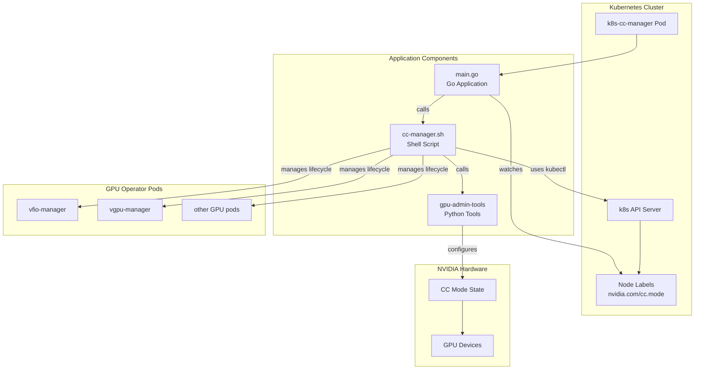
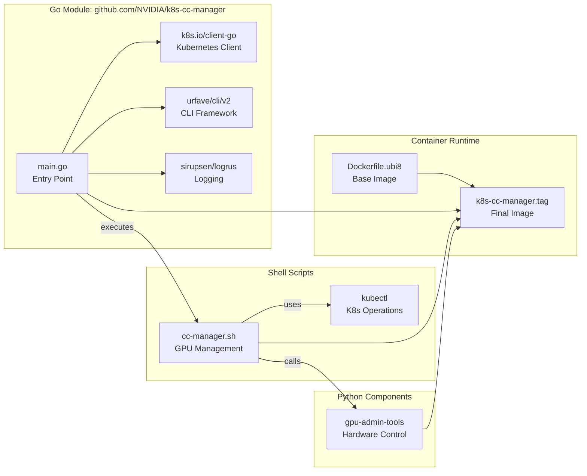
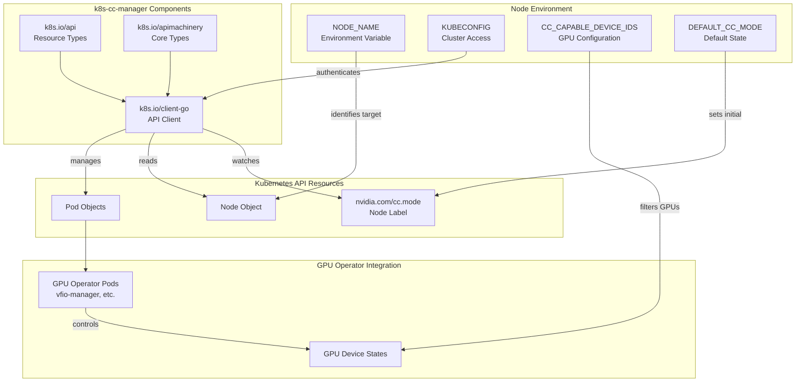

<!-- source: DeepWiki mcp.deepwiki.com · repo NVIDIA/k8s-cc-manager · page 1 Overview · fetched 2026-10-26 -->

# Overview

Relevant source files

The following files were used as context for generating this wiki page:

- [LICENSE](LICENSE)
- [README.md](README.md)
- [go.mod](go.mod)

## Purpose and Scope

The NVIDIA k8s-cc-manager is a Kubernetes component that manages NVIDIA GPU Confidential Computing (CC) mode within Kubernetes clusters. This system automatically enables and disables CC mode on supported NVIDIA GPUs based on Kubernetes node labels and orchestrates the necessary pod lifecycle operations to safely transition GPU states.

This document provides a high-level overview of the k8s-cc-manager system architecture, core components, and operational workflow. For detailed information about the core application implementation, see [Core Application](#3). For CI/CD pipeline details, see [CI/CD Pipelines](#5). For container system specifics, see [Container System](#4).

Sources: [README.md:1-3](), [go.mod:1-13]()

## System Architecture

The k8s-cc-manager operates as a containerized Kubernetes workload that bridges GPU hardware management with Kubernetes orchestration. The system consists of a Go application that watches Kubernetes API events and coordinates with shell scripts and Python tools to manage GPU states.

**System Architecture Overview**

This architecture shows how the `main.go` application integrates with Kubernetes APIs to watch node label changes and coordinate CC mode transitions through the `cc-manager.sh` script.

Sources: [README.md:1-3](), [go.mod:7-13]()

## Core Components and Code Mapping

The k8s-cc-manager system maps to specific code entities that handle different aspects of GPU CC mode management:

**Code Entity Mapping**

This diagram maps system components to their corresponding code entities, showing how the Go module dependencies integrate with scripts and container components.

Sources: [go.mod:1-13](), [go.mod:7-12]()

## Kubernetes Integration Architecture

The k8s-cc-manager integrates deeply with Kubernetes APIs and relies on specific node labeling conventions and pod management patterns:

**Kubernetes Integration Architecture**

This diagram shows how the k8s-cc-manager uses Kubernetes client libraries to interact with cluster resources and coordinate with GPU Operator components.

Sources: [go.mod:10-12]()

## Runtime Workflow

The k8s-cc-manager follows a specific operational workflow that coordinates Kubernetes API operations with GPU hardware management:

| Phase | Component | Action | Code Entity |
|-------|-----------|--------|-------------|
| **Initialization** | `main.go` | Parse CLI arguments and setup logging | `urfave/cli/v2`, `sirupsen/logrus` |
| **Cluster Connection** | `main.go` | Establish Kubernetes client connection | `k8s.io/client-go` |
| **Label Watching** | `main.go` | Watch for node label changes | `k8s.io/api`, `nvidia.com/cc.mode` |
| **CC Mode Transition** | `cc-manager.sh` | Execute GPU state changes | `gpu-admin-tools` |
| **Pod Management** | `cc-manager.sh` | Coordinate GPU operator pod lifecycle | `kubectl` binary |
| **State Verification** | `main.go` | Verify successful CC mode transition | `k8s.io/client-go` |

**Runtime Workflow Table**

This table shows the sequential phases of operation and which code entities are responsible for each phase.

Sources: [go.mod:7-13](), [README.md:1-3]()

## System Context and Integration Points

The k8s-cc-manager operates within the broader NVIDIA GPU Operator ecosystem and relies on several integration points:

- **Kubernetes Node Labels**: Uses `nvidia.com/cc.mode` labels to trigger CC mode transitions
- **GPU Operator Pods**: Coordinates with existing GPU operator pods like `vfio-manager` and `vgpu-manager`
- **Environment Configuration**: Relies on environment variables like `NODE_NAME`, `CC_CAPABLE_DEVICE_IDS`, and `DEFAULT_CC_MODE`
- **Container Registry**: Distributed as container image `k8s-cc-manager:tag` through multiple registries
- **Hardware Integration**: Directly interfaces with NVIDIA GPU hardware through Python tools

The system is licensed under Apache License 2.0 and follows Kubernetes community standards for cluster component development.

Sources: [LICENSE:1-203](), [go.mod:1-56]()

---

