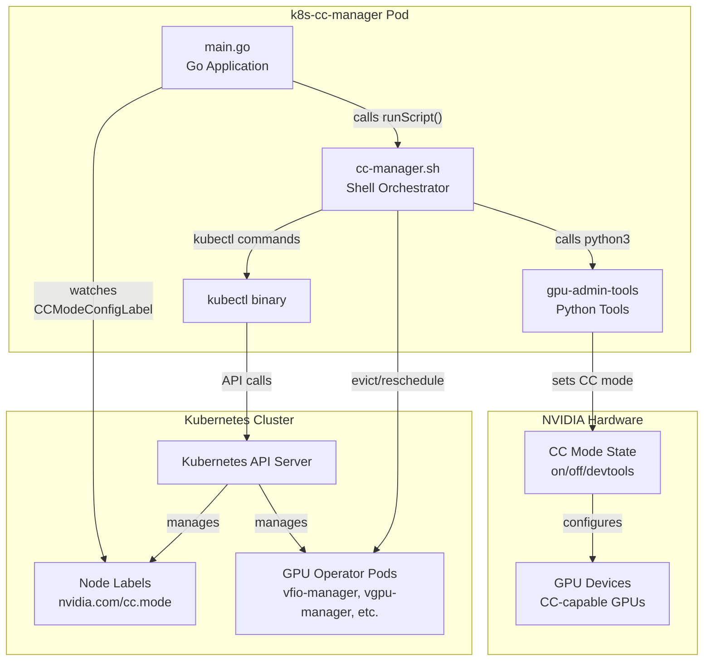
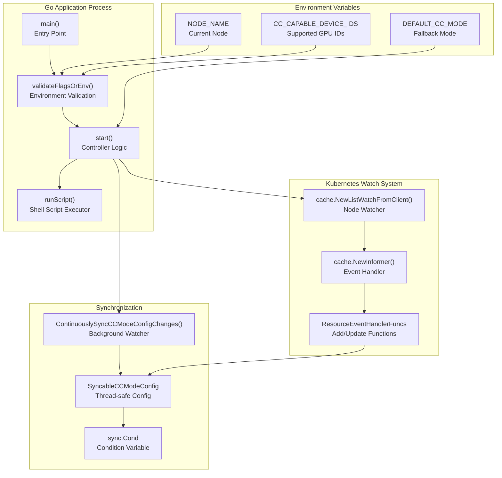
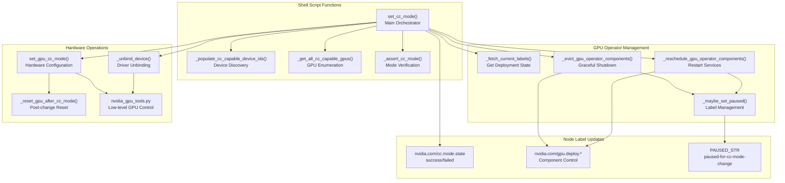
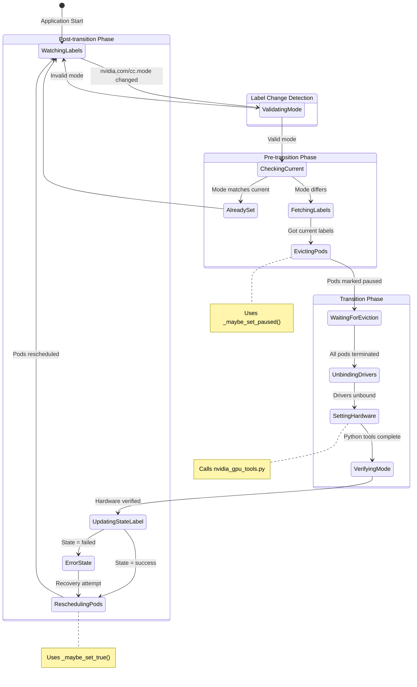
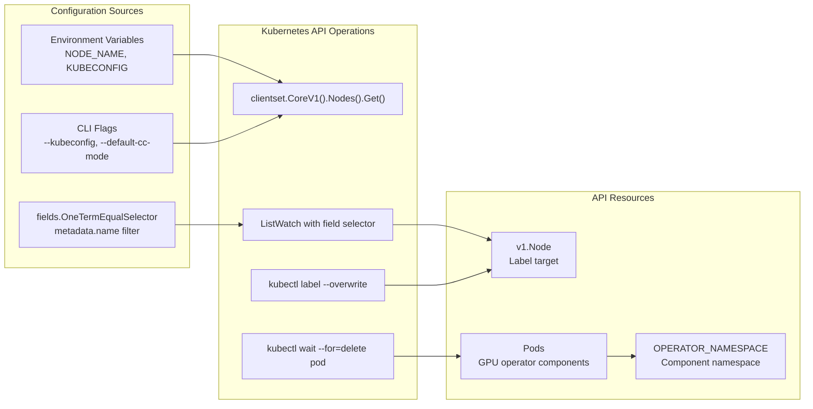

<!-- source: DeepWiki mcp.deepwiki.com · repo NVIDIA/k8s-cc-manager · page 2 Architecture · fetched 2026-10-26 -->

# Architecture

Relevant source files

The following files were used as context for generating this wiki page:

- [cmd/main.go](cmd/main.go)
- [scripts/cc-manager.sh](scripts/cc-manager.sh)

This document describes the high-level system architecture of the k8s-cc-manager, covering how the Go application, shell scripts, Kubernetes integration, and GPU management components work together to enable dynamic NVIDIA GPU Confidential Computing mode management in Kubernetes clusters.

For information about the specific implementation details of the core application components, see [Core Application](#3). For container build and deployment details, see [Container System](#4).

## System Overview

The k8s-cc-manager implements a Kubernetes controller pattern that watches for node label changes and orchestrates GPU Confidential Computing mode transitions. The system consists of three primary layers: a Go-based Kubernetes controller, a shell script orchestrator, and Python-based GPU management tools.

**System Architecture Overview**

Sources: [cmd/main.go:1-212](), [scripts/cc-manager.sh:1-537]()

## Core Controller Pattern

The Go application implements a standard Kubernetes controller pattern using the client-go library to watch for changes to specific node labels and react accordingly.

**Controller Pattern Implementation**

The system uses several key constants and data structures:
- `CCModeConfigLabel` constant (`"nvidia.com/cc.mode"`) for the watched node label
- `SyncableCCModeConfig` struct for thread-safe configuration synchronization
- `ResourceNodes` constant for the Kubernetes resource type being watched

Sources: [cmd/main.go:37-41](), [cmd/main.go:48-76](), [cmd/main.go:184-211]()

## GPU Management Workflow

The shell script orchestrates complex GPU mode transitions by coordinating with multiple GPU operator components and managing hardware state changes.

**GPU Management Orchestration**

The script manages five specific GPU operator components through node labels:
- `nvidia.com/gpu.deploy.vfio-manager`
- `nvidia.com/gpu.deploy.vgpu-manager` 
- `nvidia.com/gpu.deploy.sandbox-validator`
- `nvidia.com/gpu.deploy.sandbox-device-plugin`
- `nvidia.com/gpu.deploy.vgpu-device-manager`

Sources: [scripts/cc-manager.sh:336-382](), [scripts/cc-manager.sh:259-318](), [scripts/cc-manager.sh:320-334]()

## Component State Management

The system implements sophisticated state management to ensure safe GPU mode transitions without disrupting running workloads.

**State Transition Management**

The system uses specific state indicators:
- `nvidia.com/cc.mode.state` label with values `"success"` or `"failed"`
- `PAUSED_STR` constant (`"paused-for-cc-mode-change"`) for component coordination
- Timeout values (5 minutes) for pod eviction operations

Sources: [scripts/cc-manager.sh:170-208](), [scripts/cc-manager.sh:259-318](), [scripts/cc-manager.sh:336-382]()

## Kubernetes Integration Architecture

The application integrates deeply with Kubernetes APIs using the client-go library for both watching resources and managing node labels.

| Component | Purpose | Key APIs Used |
|-----------|---------|---------------|
| **Node Watcher** | Monitor label changes | `cache.NewListWatchFromClient()`, `fields.OneTermEqualSelector()` |
| **Event Handler** | Process label updates | `cache.ResourceEventHandlerFuncs{}` |
| **Label Manager** | Update node labels | `kubectl` CLI commands via shell execution |
| **Pod Coordinator** | Manage operator pods | `kubectl wait --for=delete pod` commands |

The system requires specific environment variables for proper Kubernetes integration:
- `NODE_NAME`: Identifies the current node for label operations
- `KUBECONFIG`: Optional kubeconfig file path for API access
- `CC_CAPABLE_DEVICE_IDS`: Comma-separated list of supported GPU device IDs

**Kubernetes API Integration**

Sources: [cmd/main.go:119-170](), [cmd/main.go:184-211](), [scripts/cc-manager.sh:217-257]()

---

