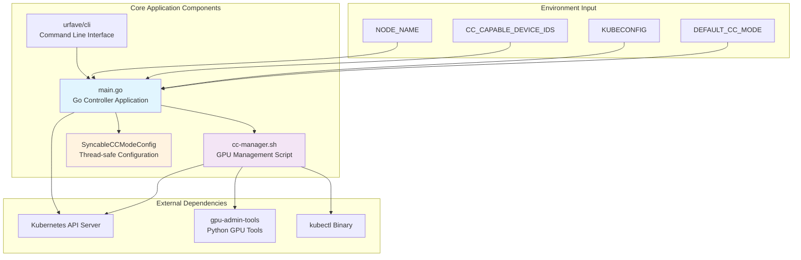
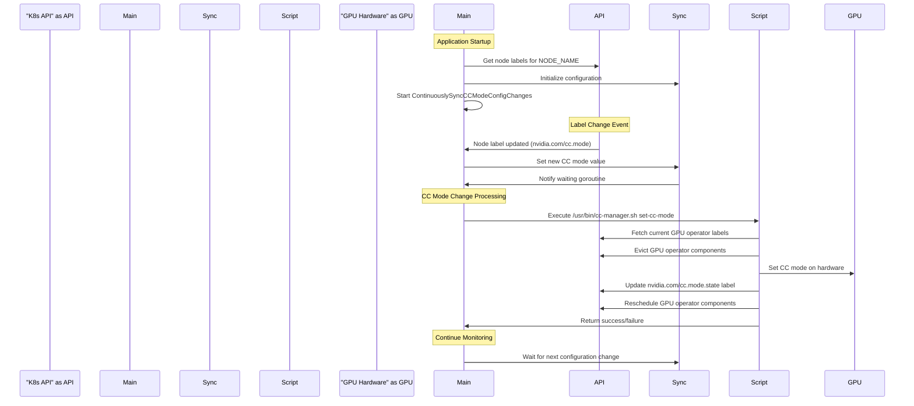
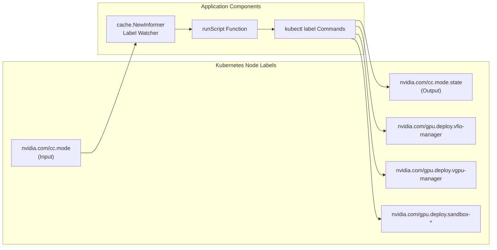
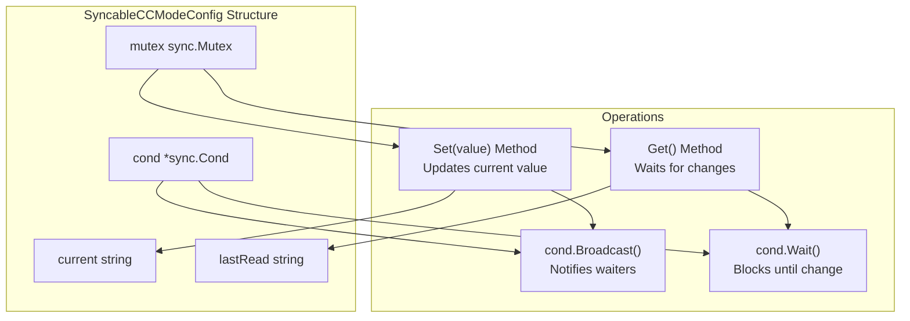
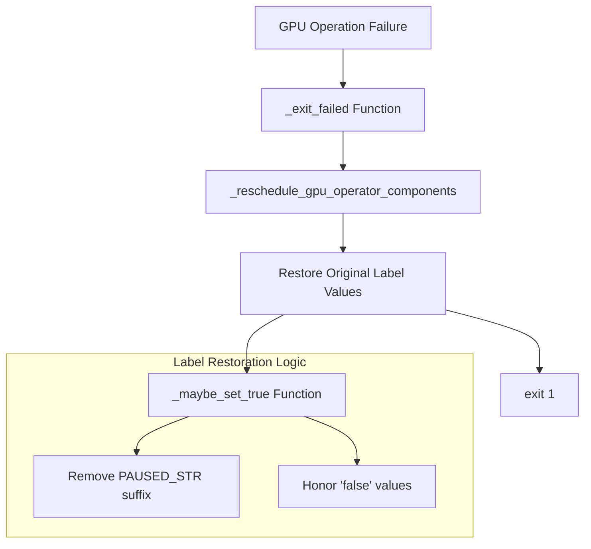

<!-- source: DeepWiki mcp.deepwiki.com · repo NVIDIA/k8s-cc-manager · page 3 Core Application · fetched 2026-10-26 -->

# Core Application

Relevant source files

The following files were used as context for generating this wiki page:

- [cmd/main.go](cmd/main.go)
- [scripts/cc-manager.sh](scripts/cc-manager.sh)

The core application consists of the main Go binary and shell script that together implement the NVIDIA GPU Confidential Computing mode management for Kubernetes nodes. This page documents the primary application components and their interactions.

For detailed information about the Go application implementation, see [Main Application (Go)](#3.1). For shell script functionality, see [GPU Management Script](#3.2). For dependency management, see [Dependencies](#3.3).

## Application Architecture

The core application follows a two-tier architecture where a Go application serves as the Kubernetes-native controller and a shell script handles the low-level GPU management operations.

**Sources**: [cmd/main.go:1-212](), [scripts/cc-manager.sh:1-537]()

## Component Interaction Flow

The application operates through a well-defined interaction flow that ensures safe GPU CC mode transitions while maintaining Kubernetes integration.

**Sources**: [cmd/main.go:119-170](), [cmd/main.go:184-211](), [scripts/cc-manager.sh:336-382]()

## Kubernetes Integration Points

The application integrates with Kubernetes through multiple API interaction patterns and label management strategies.

| Integration Point | Component | Purpose | Code Location |
|-------------------|-----------|---------|---------------|
| Node Label Watching | main.go | Monitor `nvidia.com/cc.mode` changes | [cmd/main.go:184-211]() |
| GPU Operator Labels | cc-manager.sh | Control component deployment | [scripts/cc-manager.sh:217-257]() |
| Pod Lifecycle Management | cc-manager.sh | Evict and reschedule pods | [scripts/cc-manager.sh:259-334]() |
| Status Reporting | cc-manager.sh | Update `nvidia.com/cc.mode.state` | [scripts/cc-manager.sh:359-376]() |

**Sources**: [cmd/main.go:37-41](), [cmd/main.go:194-206](), [scripts/cc-manager.sh:218-256]()

## Configuration Management

The application uses a thread-safe configuration management system to coordinate between the Kubernetes watcher and the CC mode execution logic.

**Sources**: [cmd/main.go:48-76]()

## Error Handling and Recovery

The application implements comprehensive error handling with automatic recovery mechanisms for failed CC mode transitions.

| Error Scenario | Handler | Recovery Action | Code Location |
|----------------|---------|-----------------|---------------|
| Environment validation failure | `validateFlagsOrEnv` | Exit with error | [cmd/main.go:109-117]() |
| Kubernetes API errors | `start` function | Return formatted error | [cmd/main.go:120-134]() |
| Script execution failure | `runScript` | Log error and continue | [cmd/main.go:164-167]() |
| GPU operation failure | `_exit_failed` | Reschedule components and exit | [scripts/cc-manager.sh:210-215]() |
| Label update failure | Individual functions | Return error status | [scripts/cc-manager.sh:269-271]() |

The shell script includes a comprehensive cleanup mechanism that ensures GPU operator components are properly rescheduled even during failure scenarios:

**Sources**: [scripts/cc-manager.sh:210-215](), [scripts/cc-manager.sh:320-334](), [scripts/cc-manager.sh:196-208]()

## Command Line Interface

The main application uses the `urfave/cli` framework to provide a structured command-line interface with environment variable support:

| Flag | Environment Variable | Purpose | Default |
|------|---------------------|---------|---------|
| `--kubeconfig` | `KUBECONFIG` | Path to kubeconfig file | "" |
| `--default-cc-mode` | `DEFAULT_CC_MODE` | Default CC mode when label absent | "" |

**Required Environment Variables:**
- `NODE_NAME`: Kubernetes node name for the current instance
- `CC_CAPABLE_DEVICE_IDS`: Comma-separated list of CC-capable GPU device IDs

**Sources**: [cmd/main.go:83-99](), [cmd/main.go:109-117]()

The shell script provides its own command interface supporting GPU management operations with device-specific or node-wide scope through the commands `set-cc-mode` and `get-cc-mode` with options for targeting all devices (`-a`) or specific device IDs (`-d`).

**Sources**: [scripts/cc-manager.sh:472-482](), [scripts/cc-manager.sh:489-513]()

---

