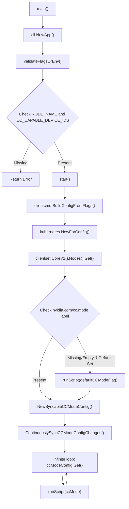
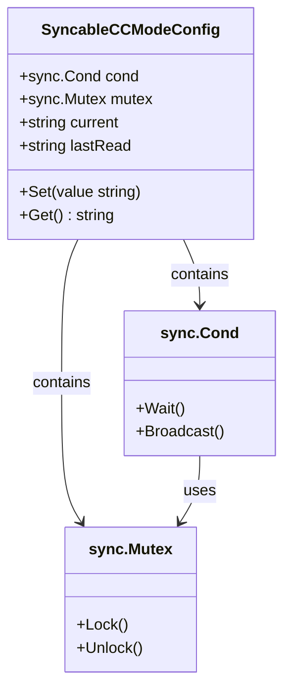
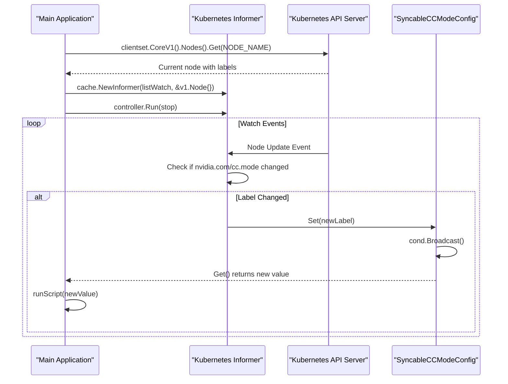
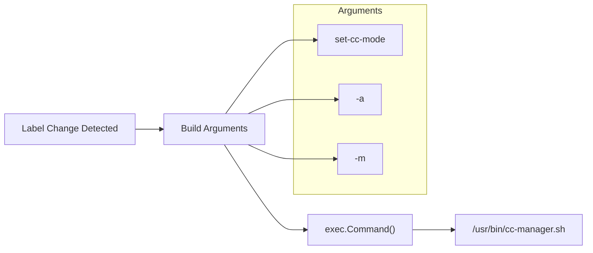
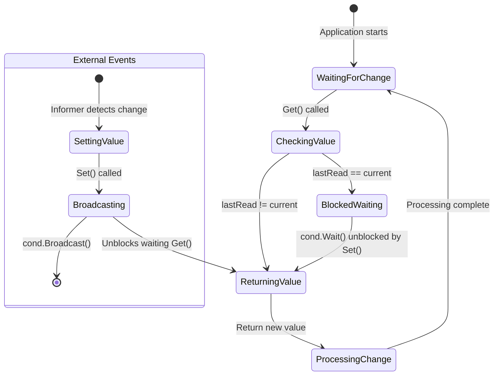

<!-- source: DeepWiki mcp.deepwiki.com · repo NVIDIA/k8s-cc-manager · page 3.1 Main Application (Go) · fetched 2026-10-26 -->

# Main Application (Go)

<details>
<summary>Relevant source files</summary>

The following files were used as context for generating this wiki page:

- [cmd/main.go](cmd/main.go)

</details>


This document covers the main Go application that serves as the core orchestrator for NVIDIA GPU Confidential Computing mode management in Kubernetes. The application watches for node label changes and coordinates with shell scripts to perform actual GPU configuration changes.

For information about the shell script that performs the actual GPU management operations, see [GPU Management Script](#3.2). For details about Go module dependencies, see [Dependencies](#3.3).

## Application Structure

The main Go application is implemented as a single binary that runs as a long-lived process within a Kubernetes pod. It uses the `urfave/cli` framework to provide a command-line interface and integrates deeply with the Kubernetes API server to monitor node configuration changes.

### CLI Application Framework

The application initializes using the `cli.NewApp()` constructor and defines two primary configuration flags:

| Flag | Environment Variable | Purpose |
|------|---------------------|---------|
| `--kubeconfig` | `KUBECONFIG` | Path to Kubernetes configuration file |
| `--default-cc-mode` | `DEFAULT_CC_MODE` | Default CC mode when node label is absent |

The application validates required environment variables `NODE_NAME` and `CC_CAPABLE_DEVICE_IDS` during startup through the `validateFlagsOrEnv` function.

**Application Flow Diagram**



Sources: [cmd/main.go:78-107](), [cmd/main.go:109-117](), [cmd/main.go:119-170]()

## Configuration Management

The application manages CC mode configuration through a thread-safe structure called `SyncableCCModeConfig`. This structure implements a condition variable pattern to coordinate between the Kubernetes event watcher and the main application loop.

### SyncableCCModeConfig Structure



The `Set` method updates the current configuration value and broadcasts to waiting goroutines, while the `Get` method blocks until a new value is available that differs from the last read value.

**Configuration Constants**

| Constant | Value | Purpose |
|----------|-------|---------|
| `CCModeConfigLabel` | `"nvidia.com/cc.mode"` | Kubernetes node label for CC mode |
| `ResourceNodes` | `"nodes"` | Kubernetes resource type being watched |
| `DefaultHostNvidiaDir` | `"/usr/local/nvidia"` | Default NVIDIA driver directory |

Sources: [cmd/main.go:37-41](), [cmd/main.go:48-76]()

## Kubernetes Integration

The application integrates with Kubernetes through the `client-go` library, specifically using informers to watch for node label changes. It creates a specialized `ListWatch` that monitors only the current node.

### Node Watching Mechanism



The `ContinuouslySyncCCModeConfigChanges` function creates an informer that specifically watches for the current node using a field selector:

```
fields.OneTermEqualSelector("metadata.name", os.Getenv("NODE_NAME"))
```

Sources: [cmd/main.go:184-211](), [cmd/main.go:130-148]()

## Script Execution

When a CC mode change is detected, the application executes the external shell script `/usr/bin/cc-manager.sh` through the `runScript` function. This function constructs command arguments and executes the script with proper stdio redirection.

### Script Invocation Pattern



The script is invoked with these arguments:
- `set-cc-mode`: The operation mode
- `-a`: Apply changes flag
- `-m <ccMode>`: The target CC mode value

Error handling ensures that script failures are logged but do not terminate the main application loop, allowing for retry on subsequent label changes.

Sources: [cmd/main.go:172-182](), [cmd/main.go:163-168]()

## Synchronization Mechanism

The application uses a producer-consumer pattern where the Kubernetes informer acts as the producer of configuration changes, and the main application loop acts as the consumer. The `SyncableCCModeConfig` structure provides thread-safe coordination between these components.

### Thread Synchronization Flow



This design ensures that:
1. The main loop blocks until a genuine configuration change occurs
2. Multiple rapid changes are coalesced - only the latest value is processed
3. No configuration changes are lost during script execution
4. The application remains responsive to Kubernetes API events

Sources: [cmd/main.go:55-76](), [cmd/main.go:150-169](), [cmd/main.go:194-205]()

---

