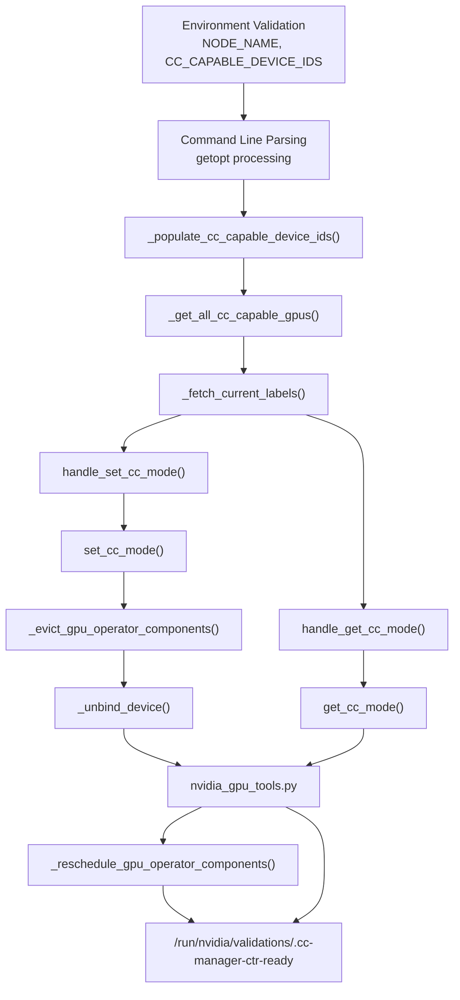
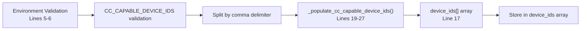
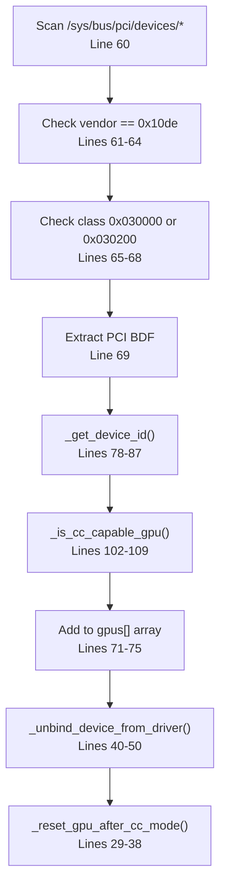
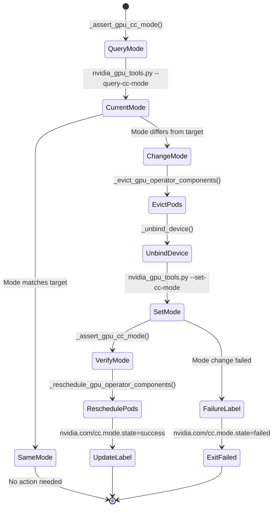
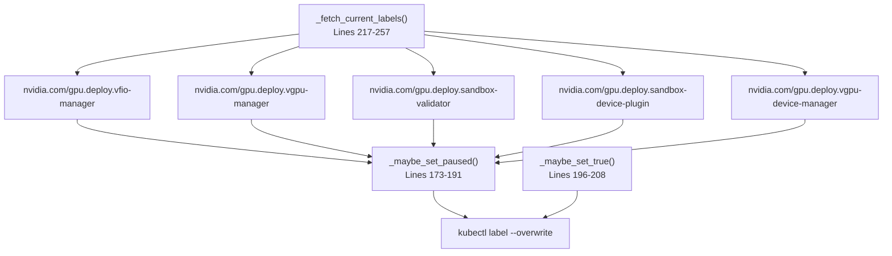
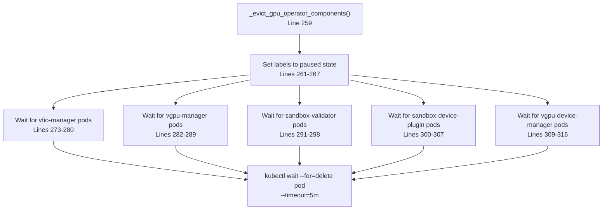
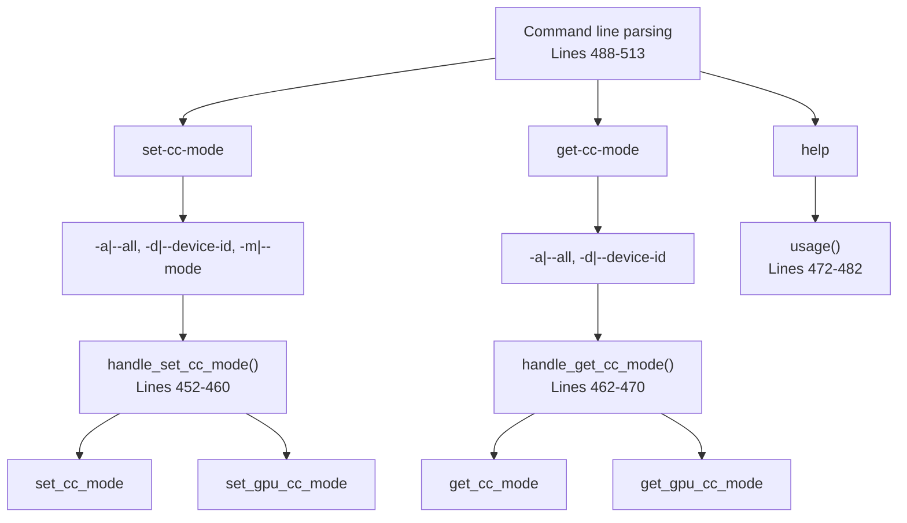
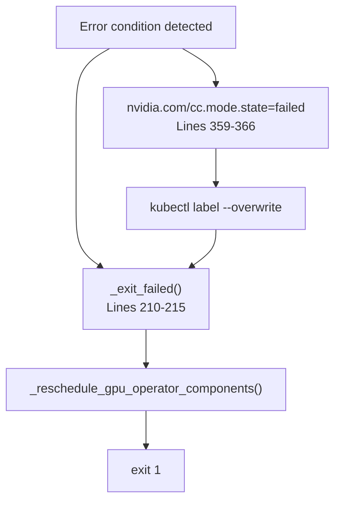

<!-- source: DeepWiki mcp.deepwiki.com · repo NVIDIA/k8s-cc-manager · page 3.2 GPU Management Script · fetched 2026-10-26 -->

# GPU Management Script

Relevant source files

The following files were used as context for generating this wiki page:

- [scripts/cc-manager.sh](scripts/cc-manager.sh)

This document covers the `cc-manager.sh` script, which serves as the core orchestration component for managing NVIDIA GPU Confidential Computing (CC) mode on Kubernetes nodes. The script handles GPU discovery, CC mode transitions, and coordination with the GPU Operator's pod lifecycle to ensure safe mode changes.

For information about the main Go application that invokes this script, see [Main Application (Go)](#3.1). For details about the container system that packages this script, see [Container Images](#4.1).

## Purpose and Scope

The `cc-manager.sh` script provides the primary interface for:
- Setting and querying GPU Confidential Computing mode on CC-capable devices
- Managing GPU Operator component lifecycle during mode transitions
- Coordinating with Kubernetes node labels for state tracking
- Interfacing with NVIDIA GPU admin tools for low-level device operations

## Script Architecture

The script follows a modular design with distinct phases for GPU discovery, mode validation, pod eviction, and mode setting operations.

**Script Architecture Flow**

Sources: [scripts/cc-manager.sh:1-537]()

## Environment Variables and Configuration

The script requires specific environment variables and validates their presence during initialization.

| Variable | Purpose | Required | Default |
|----------|---------|----------|---------|
| `NODE_NAME` | Kubernetes node name for label operations | Yes | N/A |
| `CC_CAPABLE_DEVICE_IDS` | Comma-separated GPU device IDs supporting CC | Yes | N/A |
| `OPERATOR_NAMESPACE` | Namespace containing GPU Operator pods | No | Inferred |

**Environment Variable Processing**

Sources: [scripts/cc-manager.sh:5-6](), [scripts/cc-manager.sh:19-27]()

## GPU Discovery and Management

The script implements a comprehensive GPU discovery mechanism that identifies CC-capable devices on the node.

**GPU Discovery Process**

Sources: [scripts/cc-manager.sh:58-76](), [scripts/cc-manager.sh:78-87](), [scripts/cc-manager.sh:102-109]()

### GPU Array Management

The script maintains arrays for tracking discovered GPUs and their capabilities:

- `gpus[]`: Array of PCI Bus:Device.Function identifiers for CC-capable GPUs
- `device_ids[]`: Array of GPU device IDs that support Confidential Computing
- Array operations use `_array_contains()` helper function for membership testing

Sources: [scripts/cc-manager.sh:14-17](), [scripts/cc-manager.sh:89-100]()

## CC Mode Operations

The script supports three CC modes: `on`, `off`, and `devtools`. Mode operations involve coordination between multiple system components.

**CC Mode State Machine**

Sources: [scripts/cc-manager.sh:336-382](), [scripts/cc-manager.sh:384-405]()

### Mode Validation and Parsing

The script implements strict mode validation and parsing logic:

- `_is_valid_mode()`: Validates mode against allowed values (`on`, `off`, `devtools`)
- `_parse_mode()`: Extracts CC mode from Python tool output using regex patterns
- Mode assertions ensure consistency across all CC-capable GPUs on the node

Sources: [scripts/cc-manager.sh:111-123](), [scripts/cc-manager.sh:125-134](), [scripts/cc-manager.sh:136-168]()

## Kubernetes Integration

The script heavily integrates with Kubernetes APIs to manage GPU Operator component lifecycle and node labels.

**Kubernetes Label Management**

Sources: [scripts/cc-manager.sh:217-257](), [scripts/cc-manager.sh:173-191](), [scripts/cc-manager.sh:196-208]()

### Pod Lifecycle Management

The script orchestrates GPU Operator pod eviction and scheduling through label manipulation:

**Pod Eviction Flow**

Sources: [scripts/cc-manager.sh:259-318](), [scripts/cc-manager.sh:320-334]()

### Label State Management

The script implements sophisticated label state management to preserve user-configured values:

| Original Value | Paused State | Restored State |
|----------------|--------------|----------------|
| `""` (empty) | `""` | `""` |
| `"false"` | `"false"` | `"false"` |
| `"true"` | `"paused-for-cc-mode-change"` | `"true"` |
| `"custom_value"` | `"custom_value_paused-for-cc-mode-change"` | `"custom_value"` |

Sources: [scripts/cc-manager.sh:173-191](), [scripts/cc-manager.sh:196-208]()

## Command-Line Interface

The script provides a command-line interface for manual CC mode management operations.

**CLI Command Structure**

Sources: [scripts/cc-manager.sh:488-513](), [scripts/cc-manager.sh:452-470](), [scripts/cc-manager.sh:472-482]()

### Command Examples

The script supports both individual GPU and all-device operations:

- Set CC mode for all devices: `set-cc-mode --all --mode on`
- Set CC mode for specific device: `set-cc-mode --device-id 0000:01:00.0 --mode off`
- Get CC mode for all devices: `get-cc-mode --all`
- Get CC mode for specific device: `get-cc-mode --device-id 0000:01:00.0`

Sources: [scripts/cc-manager.sh:474-481]()

## Error Handling and Validation

The script implements comprehensive error handling with automatic cleanup and state restoration.

**Error Handling Flow**

Sources: [scripts/cc-manager.sh:210-215](), [scripts/cc-manager.sh:359-366]()

### Readiness Indication

Upon successful completion, the script creates a readiness file to signal container readiness:

- Readiness file: `/run/nvidia/validations/.cc-manager-ctr-ready`
- Created only after successful operation completion
- Used by container orchestration systems for health checking

Sources: [scripts/cc-manager.sh:536]()

## Integration with Python Tools

The script interfaces with the `nvidia_gpu_tools.py` Python module for low-level GPU operations:

| Operation | Python Command | Purpose |
|-----------|----------------|---------|
| Query CC Mode | `--query-cc-mode --gpu-bdf=$gpu` | Read current CC mode |
| Set CC Mode | `--set-cc-mode=$mode --reset-after-cc-mode-switch --gpu-bdf=$gpu` | Change CC mode |
| Reset GPU | `--reset-after-cc-mode-switch --gpu-bdf=$gpu` | Post-transition reset |

Sources: [scripts/cc-manager.sh:152](), [scripts/cc-manager.sh:389](), [scripts/cc-manager.sh:31](), [scripts/cc-manager.sh:437]()

---

