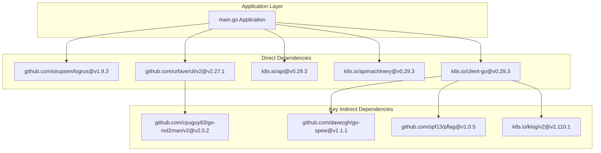
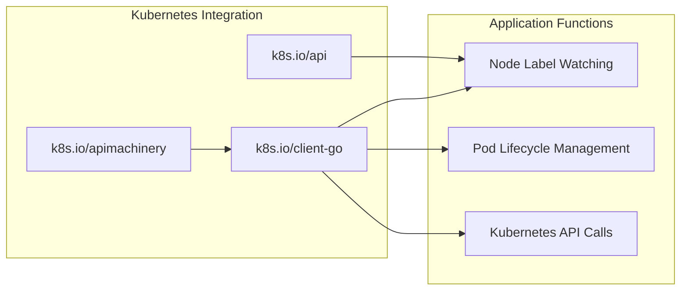
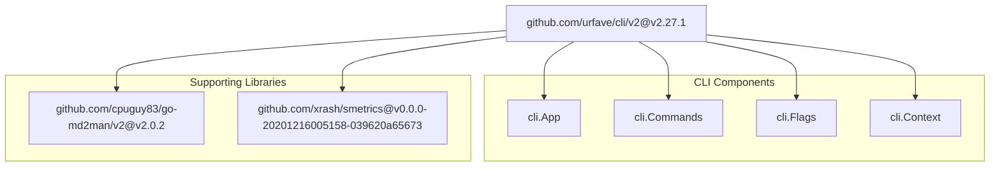
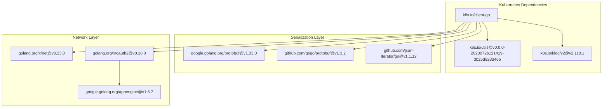
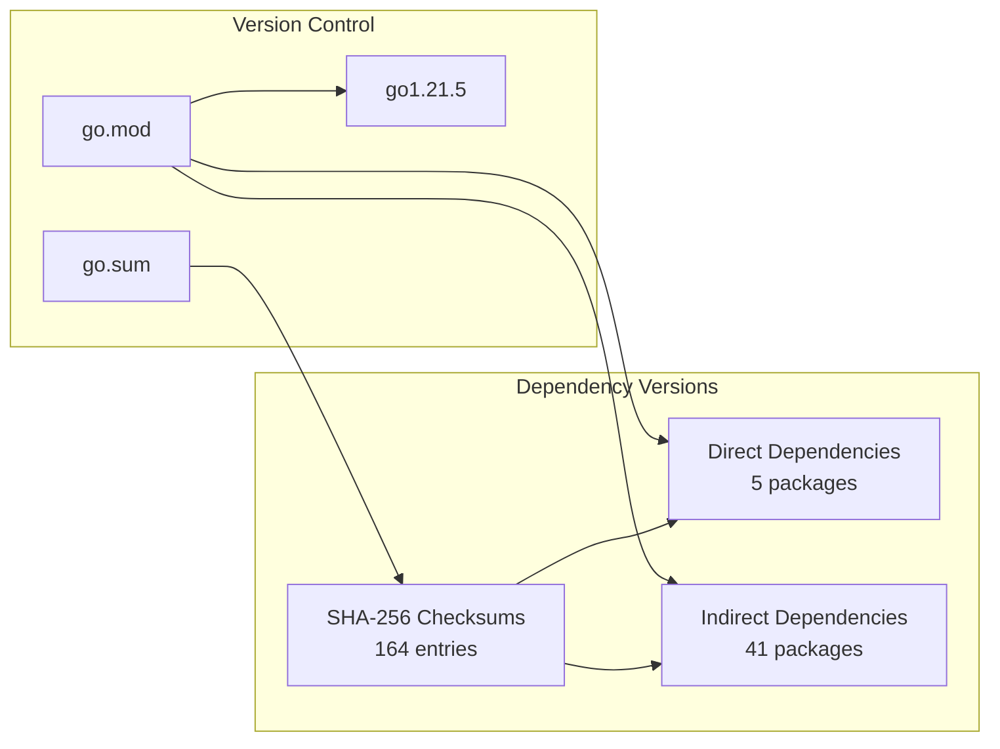

<!-- source: DeepWiki mcp.deepwiki.com · repo NVIDIA/k8s-cc-manager · page 3.3 Dependencies · fetched 2026-10-26 -->

# Dependencies

Relevant source files

The following files were used as context for generating this wiki page:

- [go.mod](go.mod)
- [go.sum](go.sum)

This document covers the external Go module dependencies used by the k8s-cc-manager application. It details the direct and indirect dependencies declared in the Go module files, their purposes, and how they integrate with the overall system architecture.

For information about the main Go application that uses these dependencies, see [Main Application (Go)](#3.1). For details about container build dependencies, see [Build System](#4.2).

## Dependency Architecture Overview

The k8s-cc-manager application relies on a carefully curated set of Go modules to provide Kubernetes integration, command-line interface capabilities, and logging functionality. The dependency graph shows clear separation between core Kubernetes libraries, application frameworks, and supporting utilities.

**Sources:** [go.mod:1-57]()

## Core Kubernetes Dependencies

The application's primary integration with Kubernetes is achieved through three essential libraries that provide API types, core utilities, and client functionality.

### Kubernetes Client Libraries

| Dependency | Version | Purpose |
|------------|---------|---------|
| `k8s.io/client-go` | v0.29.3 | Primary Kubernetes client library for API server communication |
| `k8s.io/api` | v0.29.3 | Kubernetes API object definitions and types |
| `k8s.io/apimachinery` | v0.29.3 | Core Kubernetes API machinery and utilities |

The `k8s.io/client-go` library is the foundation for all Kubernetes operations, providing clientsets, informers, and watch capabilities that the main application uses to monitor node labels and manage GPU operator pods.

**Sources:** [go.mod:10-12]()

## Application Framework Dependencies

The command-line interface and logging functionality are provided by established Go libraries that offer robust, production-ready capabilities.

### CLI Framework

The `github.com/urfave/cli/v2` library at version v2.27.1 provides the command-line interface framework. This library handles argument parsing, subcommand routing, and help text generation for the main application.

### Logging Infrastructure

The `github.com/sirupsen/logrus` library at version v1.9.3 provides structured logging capabilities with support for different log levels, formatting options, and output destinations.

**Sources:** [go.mod:8-9]()

## Indirect Dependencies

The application inherits numerous indirect dependencies through its direct dependencies, particularly from the Kubernetes client libraries which have extensive dependency trees.

### Key Indirect Dependencies

| Category | Dependencies | Purpose |
|----------|--------------|---------|
| **Serialization** | `github.com/gogo/protobuf`, `google.golang.org/protobuf` | Protocol buffer support for Kubernetes APIs |
| **HTTP/Network** | `golang.org/x/net`, `golang.org/x/oauth2` | Network communication and OAuth2 authentication |
| **Utilities** | `github.com/google/uuid`, `github.com/imdario/mergo` | UUID generation and object merging |
| **Testing** | `github.com/davecgh/go-spew`, `github.com/google/go-cmp` | Pretty printing and comparison utilities |

**Sources:** [go.mod:15-56]()

## Version Management

All dependency versions are precisely specified using semantic versioning and are locked through the `go.sum` file which contains cryptographic checksums for reproducible builds.

### Go Toolchain Requirements

The module requires Go version 1.21 with toolchain go1.21.5, ensuring compatibility with modern Go features while maintaining stability.

The dependency management follows Go module best practices with all versions pinned to specific releases, ensuring reproducible builds across different environments and CI/CD systems.

**Sources:** [go.mod:3-5](), [go.sum:1-165]()

---

