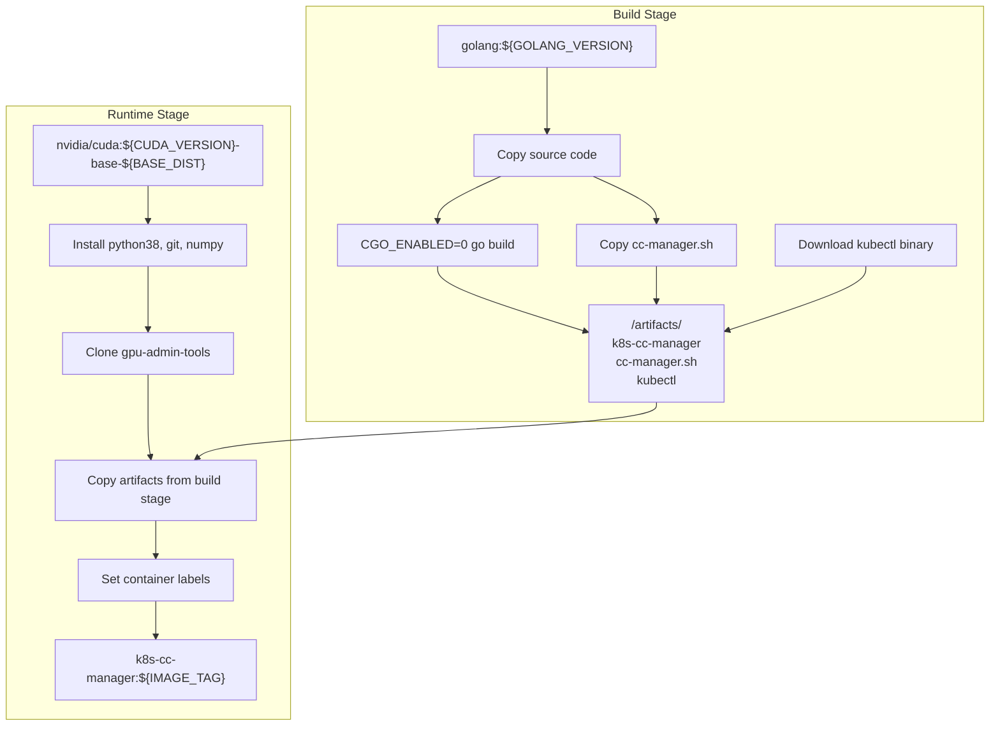
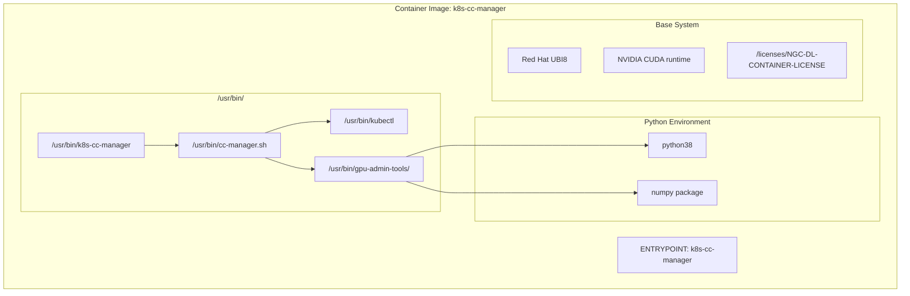
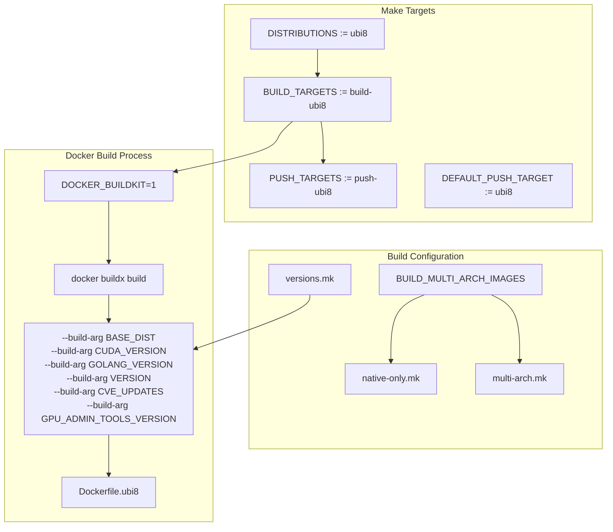
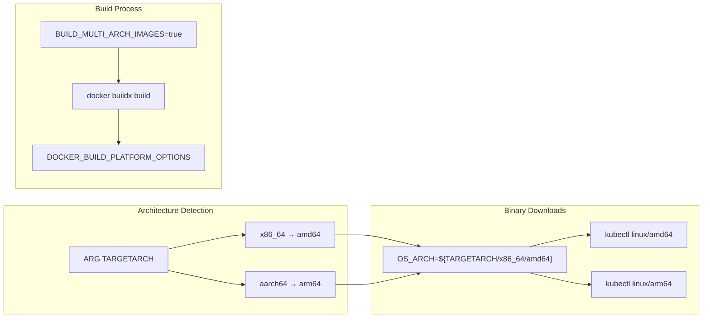
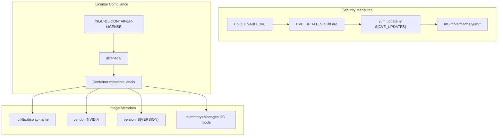

<!-- source: DeepWiki mcp.deepwiki.com · repo NVIDIA/k8s-cc-manager · page 4 Container System · fetched 2026-10-26 -->

# Container System

Relevant source files

The following files were used as context for generating this wiki page:

- [deployments/container/Dockerfile.ubi8](deployments/container/Dockerfile.ubi8)
- [deployments/container/Makefile](deployments/container/Makefile)

The Container System encompasses the containerization infrastructure for the k8s-cc-manager application, including Docker image definitions, multi-architecture build processes, and registry distribution mechanisms. This system packages the Go application, shell scripts, and supporting tools into deployable container images that can run across different architectures and Kubernetes environments.

For detailed information about the specific container images and their contents, see [Container Images](#4.1). For build system mechanics and multi-architecture support, see [Build System](#4.2).

## Container Build Architecture

The container system uses a multi-stage build process to create optimized images that include all necessary components for GPU confidential computing management.

### Multi-Stage Build Process

Sources: [deployments/container/Dockerfile.ubi8:19-66]()

### Final Container Image Structure

The resulting container includes multiple components organized in the filesystem:

Sources: [deployments/container/Dockerfile.ubi8:51-66]()

## Build System Architecture

The build system supports multiple architectures and distributions through a flexible Makefile-based approach.

### Build Target Structure

Sources: [deployments/container/Makefile:22-90]()

### Image Tagging and Registry Strategy

The build system implements a comprehensive tagging strategy for different environments and architectures:

| Variable | Purpose | Example Value |
|----------|---------|---------------|
| `IMAGE_NAME` | Base image name | `nvidia/k8s-cc-manager` |
| `IMAGE_VERSION` | Version from versions.mk | `v0.1.0` |
| `DIST` | Distribution suffix | `ubi8` |
| `IMAGE_TAG` | Full image tag | `v0.1.0-ubi8` |
| `OUT_IMAGE_NAME` | Output registry name | `nvidia/k8s-cc-manager` |

Sources: [deployments/container/Makefile:25-38]()

## Multi-Architecture Support

The container system supports building for multiple architectures using Docker Buildx:

Sources: [deployments/container/Dockerfile.ubi8:23-34](), [deployments/container/Makefile:15-54]()

## Build Arguments and Customization

The Dockerfile accepts multiple build arguments for customization:

| Build Argument | Purpose | Used For |
|----------------|---------|----------|
| `CUDA_VERSION` | CUDA base image version | Runtime environment |
| `BASE_DIST` | Base distribution (ubi8) | OS selection |
| `GOLANG_VERSION` | Go compiler version | Build stage |
| `VERSION` | Application version | Image labeling |
| `GIT_COMMIT` | Git commit hash | Build metadata |
| `GPU_ADMIN_TOOLS_VERSION` | gpu-admin-tools branch/tag | Python tools |
| `CVE_UPDATES` | Security updates | Vulnerability patching |

Sources: [deployments/container/Dockerfile.ubi8:15-88]()

## Security and Compliance Features

The container includes security scanning integration and license compliance:

Sources: [deployments/container/Dockerfile.ubi8:30-64]()

The container system provides a complete packaging solution for the k8s-cc-manager application, supporting multiple architectures while maintaining security best practices and license compliance requirements for enterprise Kubernetes deployments.

---

