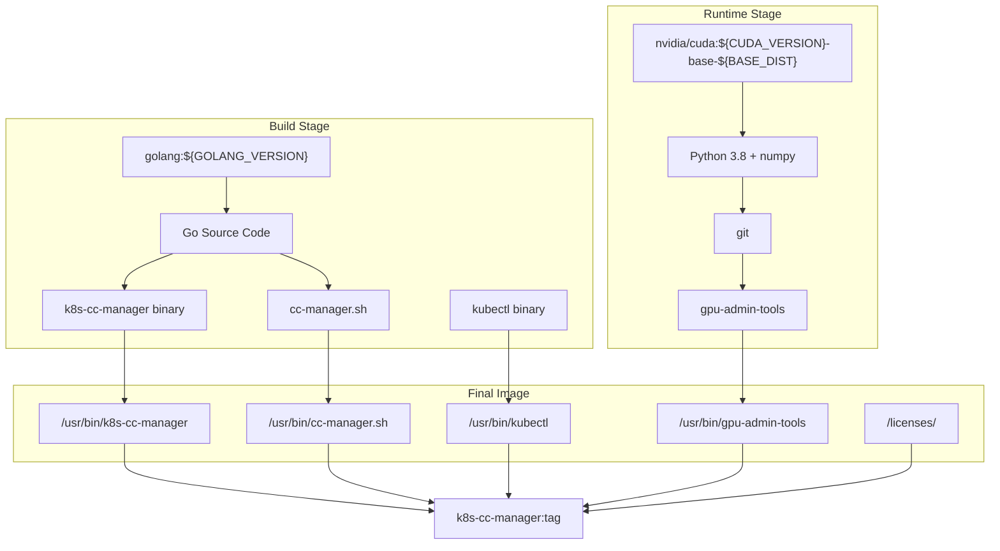
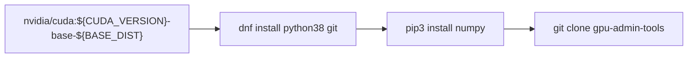
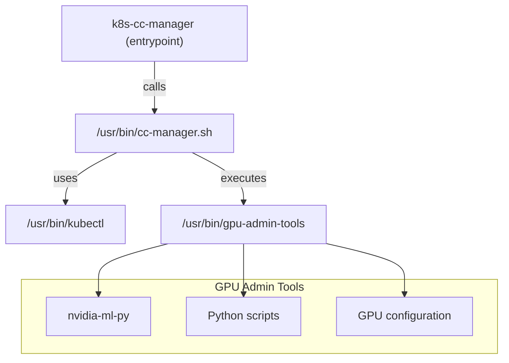
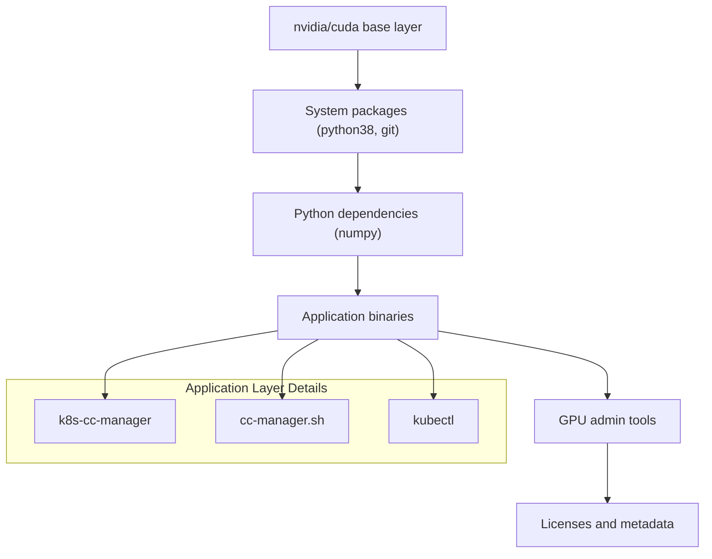

<!-- source: DeepWiki mcp.deepwiki.com · repo NVIDIA/k8s-cc-manager · page 4.1 Container Images · fetched 2026-10-26 -->

# Container Images

Relevant source files

The following files were used as context for generating this wiki page:

- [deployments/container/Dockerfile.ubi8](deployments/container/Dockerfile.ubi8)

This document covers the container image structure and build process for the k8s-cc-manager. It details the Dockerfile configuration, multi-stage build process, runtime dependencies, and the resulting container image that gets deployed to Kubernetes clusters.

For information about the container build system and multi-architecture builds, see [Build System](#4.2). For details about the CI/CD pipelines that build these images, see [CI/CD Pipelines](#5).

## Container Architecture Overview

The k8s-cc-manager container is built using a multi-stage approach that produces a minimal runtime image containing the Go application, shell scripts, and necessary dependencies for GPU Confidential Computing management.

Sources: [deployments/container/Dockerfile.ubi8:1-67]()

## Multi-Stage Build Process

The container uses a multi-stage build to minimize the final image size while maintaining all necessary runtime dependencies.

### Build Stage

The build stage uses the official Go image to compile the application and prepare artifacts:

| Component | Source | Destination | Purpose |
|-----------|--------|-------------|---------|
| `k8s-cc-manager` binary | Go build from `./cmd` | `/artifacts/k8s-cc-manager` | Main application executable |
| `cc-manager.sh` script | `./scripts/cc-manager.sh` | `/artifacts/cc-manager.sh` | GPU management script |
| `kubectl` binary | Kubernetes releases | `/artifacts/kubectl` | Kubernetes CLI tool |

The build process includes:
- Cross-compilation support via `TARGETARCH` argument
- Architecture normalization for kubectl download (x86_64→amd64, aarch64→arm64)
- CGO disabled for static binary compilation

Sources: [deployments/container/Dockerfile.ubi8:19-34]()

### Runtime Stage

The runtime stage is based on the NVIDIA CUDA base image and includes:

**Key Dependencies:**
- **Python 3.8**: Required for `gpu-admin-tools` execution
- **numpy**: Python scientific computing library
- **git**: For cloning `gpu-admin-tools` repository
- **gpu-admin-tools**: NVIDIA GPU administration utilities

Sources: [deployments/container/Dockerfile.ubi8:36-58]()

## Base Image and CUDA Integration

The container inherits from the official NVIDIA CUDA base image, providing:

- CUDA runtime libraries
- NVIDIA Container Toolkit compatibility
- GPU device access capabilities
- Enterprise support through Red Hat UBI (Universal Base Image)

The base image is parameterized through build arguments:
- `CUDA_VERSION`: Specifies CUDA runtime version
- `BASE_DIST`: Defines the base distribution (typically `ubi8`)

Sources: [deployments/container/Dockerfile.ubi8:15-16,36]()

## Runtime Components

The final container image contains several key components that work together:

**Runtime Executable Locations:**
- `/usr/bin/k8s-cc-manager`: Main Go application (entrypoint)
- `/usr/bin/cc-manager.sh`: Shell script for GPU management
- `/usr/bin/kubectl`: Kubernetes command-line interface
- `/usr/bin/gpu-admin-tools/`: Python-based GPU administration tools

Sources: [deployments/container/Dockerfile.ubi8:51-57,66]()

## Image Metadata and Labels

The container includes comprehensive metadata for Kubernetes and container registry integration:

| Label | Value | Purpose |
|-------|-------|---------|
| `io.k8s.display-name` | "NVIDIA Confidential Containers Manager for Kubernetes" | Kubernetes UI display |
| `name` | "NVIDIA Confidential Containers Manager for Kubernetes" | Container identification |
| `vendor` | "NVIDIA" | Vendor identification |
| `version` | `${VERSION}` | Build version tracking |
| `summary` | "Manages the CC mode on NVIDIA GPUs with Kubernetes" | Brief description |

**Licensing:**
The container includes NVIDIA NGC license files located at `/licenses/NGC-DL-CONTAINER-LICENSE` for compliance and legal requirements.

Sources: [deployments/container/Dockerfile.ubi8:41-49]()

## Security and CVE Management

The Dockerfile includes provisions for security updates through the `CVE_UPDATES` build argument:

- Conditional package updates during build time
- Cache cleanup to minimize image size
- Base image security patches via `yum update`

This allows for security patching without rebuilding the entire application stack.

Sources: [deployments/container/Dockerfile.ubi8:60-64]()

## Container Layers Structure

The final image consists of the following logical layers:

This layered approach optimizes for:
- Container registry caching efficiency
- Minimal rebuild requirements during development
- Security scanning granularity
- Runtime performance

Sources: [deployments/container/Dockerfile.ubi8:1-67]()

---

