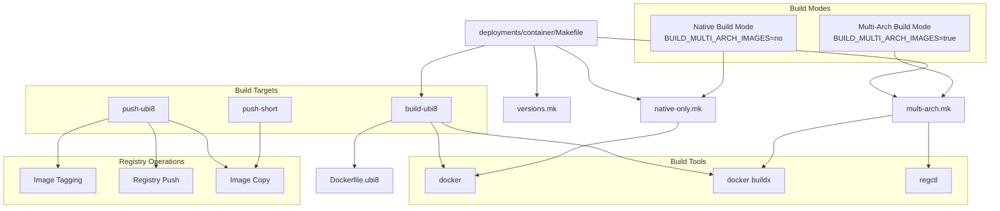
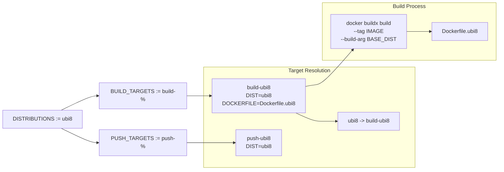
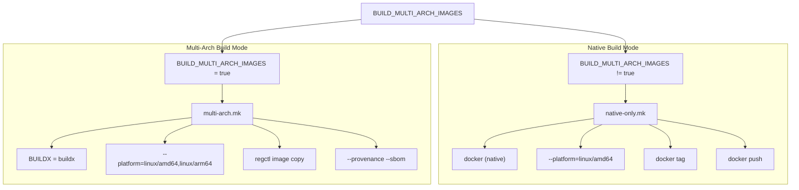
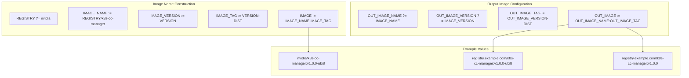
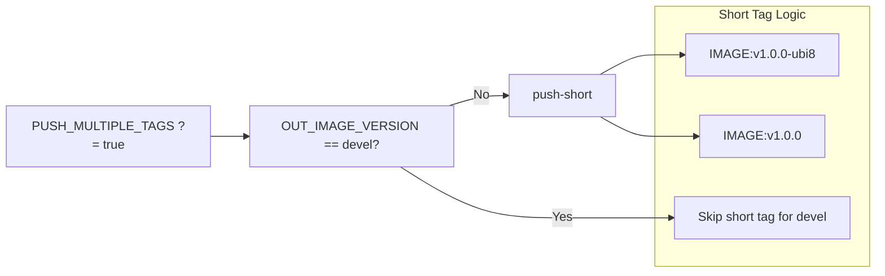
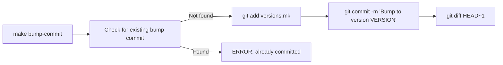
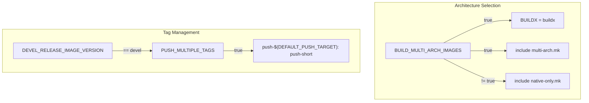

<!-- source: DeepWiki mcp.deepwiki.com · repo NVIDIA/k8s-cc-manager · page 4.2 Build System · fetched 2026-10-26 -->

# Build System

<details>
<summary>Relevant source files</summary>

The following files were used as context for generating this wiki page:

- [deployments/container/Makefile](deployments/container/Makefile)
- [deployments/container/multi-arch.mk](deployments/container/multi-arch.mk)
- [deployments/container/native-only.mk](deployments/container/native-only.mk)

</details>


This document covers the container build system for the k8s-cc-manager project, including the Makefile-based build infrastructure, multi-architecture support, and registry operations. The build system orchestrates Docker/buildx builds, manages image tagging and versioning, and handles distribution to multiple container registries.

For information about the actual container images and Dockerfile contents, see [Container Images](#4.1). For details about the CI/CD pipelines that invoke this build system, see [CI/CD Pipelines](#5).

## Build System Overview

The build system is centered around a main Makefile in the `deployments/container/` directory that coordinates Docker builds, multi-architecture support, and registry operations.

### Build System Architecture



Sources: [deployments/container/Makefile:1-103](), [deployments/container/multi-arch.mk:1-29](), [deployments/container/native-only.mk:1-24]()

## Build Targets and Distributions

The build system defines standardized targets for building and pushing container images across different distributions.

### Available Distributions and Targets

| Distribution | Build Target | Push Target | Default |
|-------------|-------------|-------------|---------|
| `ubi8` | `build-ubi8` | `push-ubi8` | ✓ |

The system supports the following target patterns:

- **Build Targets**: `$(BUILD_TARGETS)` = `build-ubi8`
- **Push Targets**: `$(PUSH_TARGETS)` = `push-ubi8`  
- **Distribution Aliases**: `ubi8` (equivalent to `build-ubi8`)

### Build Target Implementation



Sources: [deployments/container/Makefile:41-46](), [deployments/container/Makefile:71-90]()

## Multi-Architecture Support

The build system supports both native-only and multi-architecture builds through conditional inclusion of architecture-specific Makefiles.

### Architecture Build Modes



### Multi-Architecture Configuration

The multi-architecture mode enables several advanced features:

**Platform Support**: `--platform=linux/amd64,linux/arm64` [deployments/container/multi-arch.mk:18]()

**Build Options**: 
- `--output=type=image,push=$(PUSH_ON_BUILD)`
- `--provenance=$(ATTACH_ATTESTATIONS)` 
- `--sbom=$(ATTACH_ATTESTATIONS)`

**Registry Operations**: Uses `regctl image copy` instead of direct Docker push operations [deployments/container/multi-arch.mk:21-29]()

Sources: [deployments/container/Makefile:15-20](), [deployments/container/Makefile:50-54](), [deployments/container/multi-arch.mk:15-29](), [deployments/container/native-only.mk:15-24]()

## Registry Operations

The build system handles image tagging, pushing, and copying to support different registry configurations and multi-platform scenarios.

### Image Naming and Tagging



### Push Target Behavior

The push behavior differs between native and multi-architecture modes:

**Native Mode** (`native-only.mk`):
- Uses `docker tag` and `docker push` commands
- Direct registry operations

**Multi-Architecture Mode** (`multi-arch.mk`):
- Uses `regctl image copy` for registry operations  
- Supports copying images between registries
- Handles multi-platform manifests

### Short Tag Support

For the default push target (`ubi8`), the system optionally pushes a short tag without the distribution suffix:



Sources: [deployments/container/Makefile:25-38](), [deployments/container/Makefile:56-68](), [deployments/container/native-only.mk:17-24](), [deployments/container/multi-arch.mk:21-29]()

## Version Management

The build system integrates with version management through the `versions.mk` file and provides utilities for version bumping.

### Version Integration

The main Makefile includes version definitions: `include $(CURDIR)/versions.mk` [deployments/container/Makefile:23]()

### Build Arguments

The Docker build receives multiple version-related build arguments:

| Build Argument | Source | Purpose |
|---------------|---------|---------|
| `BASE_DIST` | `$(DIST)` | Distribution identifier |
| `CUDA_VERSION` | `versions.mk` | CUDA runtime version |
| `GOLANG_VERSION` | `versions.mk` | Go compiler version |
| `VERSION` | `versions.mk` | Application version |
| `CVE_UPDATES` | `versions.mk` | Security update flag |
| `GPU_ADMIN_TOOLS_VERSION` | `versions.mk` | GPU tools version |

### Version Bump Automation



The `bump-commit` target automates version bumping by:
1. Checking if the bump commit already exists
2. Adding the `versions.mk` file to git
3. Creating a standardized commit message
4. Displaying the applied changes

Sources: [deployments/container/Makefile:78-90](), [deployments/container/Makefile:92-103]()

## Build Configuration

The build system provides extensive configuration through environment variables and conditional logic.

### Key Configuration Variables

| Variable | Default | Purpose |
|----------|---------|---------|
| `BUILD_MULTI_ARCH_IMAGES` | `no` | Enable multi-architecture builds |
| `DOCKER` | `docker` | Docker command to use |
| `REGISTRY` | `nvidia` | Default registry prefix |
| `PUSH_ON_BUILD` | `false` | Push during build (multi-arch) |
| `ATTACH_ATTESTATIONS` | `false` | Include provenance/SBOM |
| `PUSH_MULTIPLE_TAGS` | `true` | Enable short tag pushing |
| `REGCTL` | `regctl` | Registry control tool |

### Conditional Build Logic



### Docker Build Configuration

The main build command combines multiple configuration sources:

```bash
DOCKER_BUILDKIT=1 \
$(DOCKER) $(BUILDX) build --pull \
    $(DOCKER_BUILD_OPTIONS) \
    $(DOCKER_BUILD_PLATFORM_OPTIONS) \
    --tag $(IMAGE) \
    --build-arg BASE_DIST="$(DIST)" \
    --build-arg CUDA_VERSION="$(CUDA_VERSION)" \
    --build-arg GOLANG_VERSION="$(GOLANG_VERSION)" \
    --build-arg VERSION="$(VERSION)" \
    --build-arg CVE_UPDATES="$(CVE_UPDATES)" \
    --build-arg GPU_ADMIN_TOOLS_VERSION="$(GPU_ADMIN_TOOLS_VERSION)" \
    --file $(DOCKERFILE) \
    $(CURDIR)
```

Sources: [deployments/container/Makefile:15-20](), [deployments/container/Makefile:58-65](), [deployments/container/multi-arch.mk:15-18](), [deployments/container/native-only.mk:15]()

---

