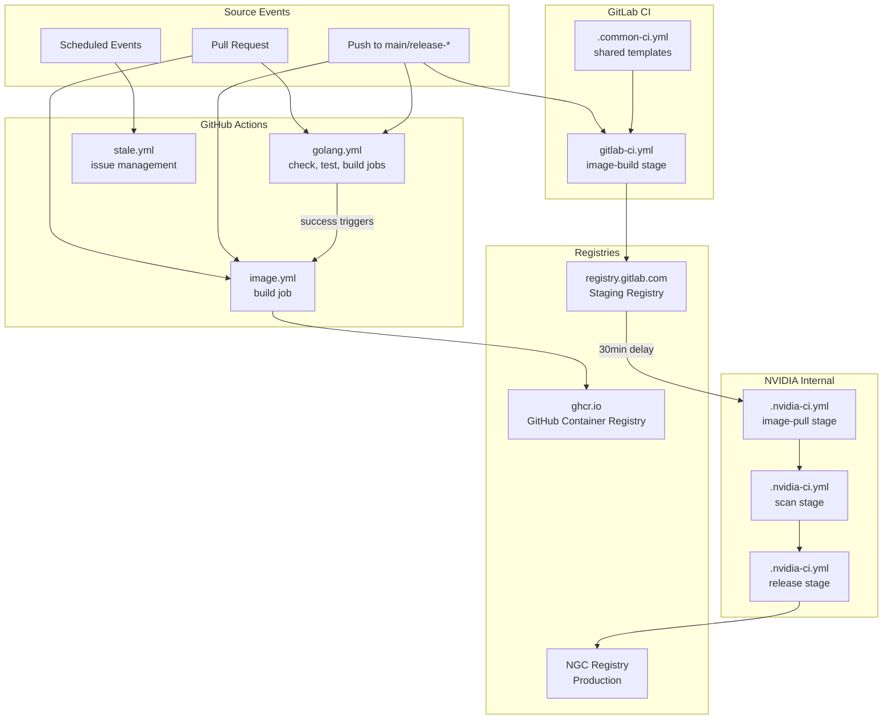
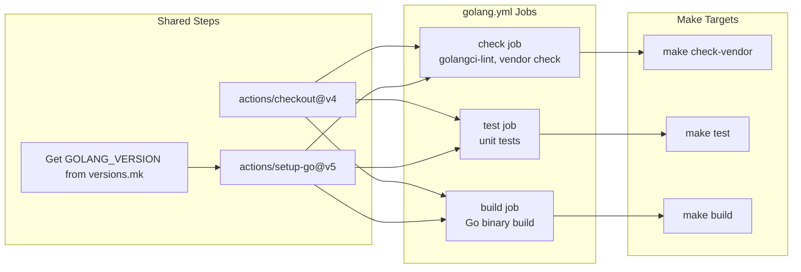
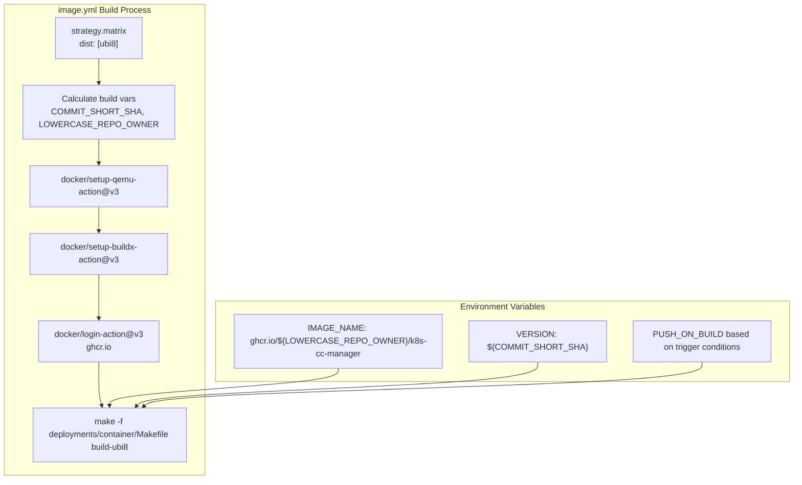
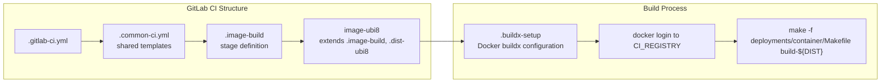
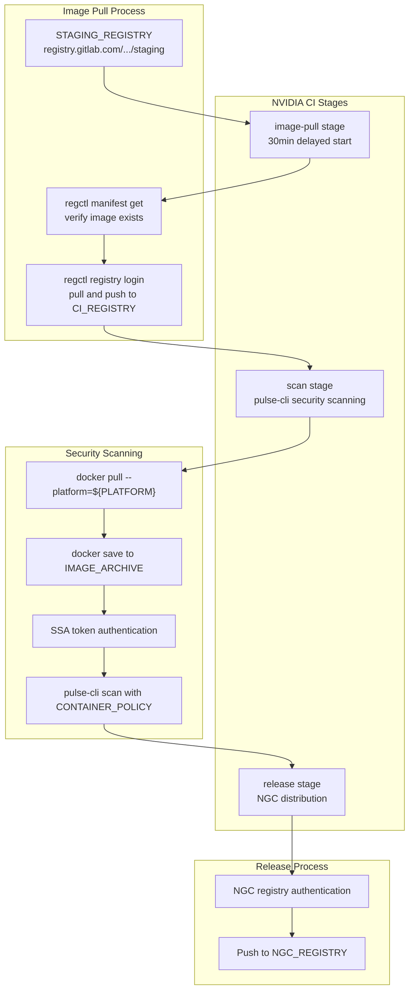
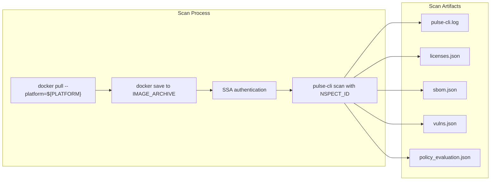
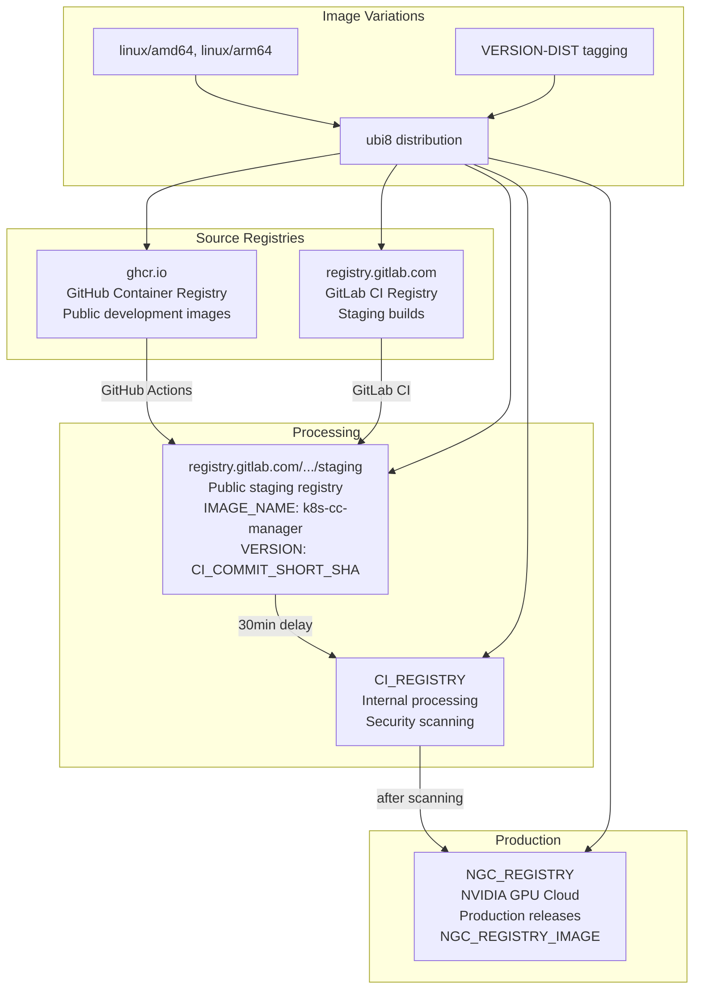

<!-- source: DeepWiki mcp.deepwiki.com · repo NVIDIA/k8s-cc-manager · page 5 CI/CD Pipelines · fetched 2026-10-26 -->

# CI/CD Pipelines

Relevant source files

The following files were used as context for generating this wiki page:

- [.github/workflows/golang.yml](.github/workflows/golang.yml)
- [.github/workflows/image.yml](.github/workflows/image.yml)
- [.gitlab-ci.yml](.gitlab-ci.yml)
- [.nvidia-ci.yml](.nvidia-ci.yml)

This document covers the comprehensive CI/CD infrastructure for the k8s-cc-manager project, which includes three distinct pipeline systems: GitHub Actions for development and testing, GitLab CI for container image builds, and NVIDIA internal CI for security scanning and production releases. These pipelines work together to build, test, scan, and distribute the k8s-cc-manager container images across multiple registries and architectures.

For information about the container build system and Makefiles, see [Container System](#4). For details about the core application being built by these pipelines, see [Core Application](#3).

## Pipeline Architecture Overview

The CI/CD system consists of three interconnected pipeline systems that handle different aspects of the software delivery lifecycle:

Sources: [.github/workflows/golang.yml](), [.github/workflows/image.yml](), [.gitlab-ci.yml](), [.nvidia-ci.yml]()

## GitHub Actions Workflows

GitHub Actions handles development workflows including Go code validation, testing, and initial container image builds for pull requests and main branch pushes.

### Golang Workflow

The `golang.yml` workflow provides comprehensive Go code validation through three parallel jobs:

The workflow is triggered on pull requests and pushes to `main` and `release-*` branches [.github/workflows/golang.yml:17-28](). Each job extracts the Go version from `versions.mk` [.github/workflows/golang.yml:39-40]() and uses `actions/setup-go@v5` for consistent Go environment setup.

Key validation steps:
- **Linting**: Uses `golangci/golangci-lint-action@v6` with 5-minute timeout [.github/workflows/golang.yml:46-50]()
- **Vendor Check**: Executes `make check-vendor` to validate dependency consistency [.github/workflows/golang.yml:52]()
- **Unit Testing**: Runs `make test` for comprehensive test coverage [.github/workflows/golang.yml:68]()
- **Build Verification**: Executes `make build` to ensure binary compilation [.github/workflows/golang.yml:84]()

### Image Workflow

The `image.yml` workflow builds multi-architecture container images and pushes them to GitHub Container Registry:

The workflow implements intelligent artifact generation logic [.github/workflows/image.yml:49-58]():
- Skips builds for Dependabot PRs
- Generates artifacts for internal PRs and main branch pushes
- Controls multi-architecture builds through `BUILD_MULTI_ARCH_IMAGES` variable

Sources: [.github/workflows/golang.yml](), [.github/workflows/image.yml]()

## GitLab CI Pipeline

GitLab CI provides the primary container image build pipeline using shared templates and standardized build processes.

### Build Configuration

The GitLab pipeline uses a modular configuration approach:

The `.image-build` template defines the standard build process [.gitlab-ci.yml:19-31]():
- Uses `CI_REGISTRY_IMAGE` as the target image name
- Sets `VERSION` to `CI_COMMIT_SHORT_SHA`
- Enables push with `PUSH_ON_BUILD: "true"`
- Installs `bash` and `make` dependencies
- Authenticates with the CI registry using built-in variables

The `image-ubi8` job extends both `.image-build` and `.dist-ubi8` templates [.gitlab-ci.yml:33-36](), inheriting the complete build configuration while specifying the UBI8 distribution target.

Sources: [.gitlab-ci.yml](), [.common-ci.yml]()

## NVIDIA Internal CI Pipeline

The NVIDIA internal CI system handles image processing, security scanning, and production releases through a sophisticated multi-stage pipeline.

### Pipeline Stages and Flow

### Image Pull Stage

The image pull stage implements a delayed execution pattern [.nvidia-ci.yml:51-52]() with a 30-minute delay to allow the public GitLab pipeline to generate required images. The stage includes sophisticated error handling with timeout and retry logic [.nvidia-ci.yml:53-58]().

Key variables for image pull operations [.nvidia-ci.yml:41-49]():
- `IN_REGISTRY`: Sources from `STAGING_REGISTRY`
- `IN_IMAGE_NAME`: `k8s-cc-manager`
- `IN_VERSION`: `STAGING_VERSION` (commit SHA)
- `OUT_REGISTRY`: Target `CI_REGISTRY`

The pull process uses `regctl` for registry operations [.nvidia-ci.yml:63]() and verifies image existence before proceeding with the pull operation.

### Security Scanning

The `.scan` template provides comprehensive security analysis [.nvidia-ci.yml:83-111]():

The scanning process supports skip conditions [.nvidia-ci.yml:89-92]() for commits with `[skip scans]` messages or when `SKIP_SCANS=yes`.

Multi-architecture scanning is implemented through separate jobs for `amd64` and `arm64` platforms [.nvidia-ci.yml:122-134](), with sequential execution to avoid registry conflicts.

### Release Process

The release process extends `.release:external` functionality for NGC distribution [.nvidia-ci.yml:137-152]():
- Uses `NGC_REGISTRY_USER` and `NGC_REGISTRY_TOKEN` for authentication
- Targets `NGC_REGISTRY` and `NGC_REGISTRY_IMAGE` 
- Includes debug mode with `DOCKER: "echo docker"` and `REGCTL: "echo regctl"`

Sources: [.nvidia-ci.yml]()

## Registry Distribution Flow

The complete image distribution system moves container images through multiple registries with different access levels and purposes:

Registry access patterns:
- **GitHub Container Registry**: Public access for development builds from PR and main branch pushes
- **GitLab Staging Registry**: Public staging for builds that will be processed by NVIDIA CI
- **Internal CI Registry**: Private registry for security scanning and processing
- **NGC Registry**: Production registry for external distribution

Image naming conventions:
- GitHub: `ghcr.io/${LOWERCASE_REPO_OWNER}/k8s-cc-manager:${COMMIT_SHORT_SHA}-${DIST}`
- GitLab: `${CI_REGISTRY_IMAGE}:${CI_COMMIT_SHORT_SHA}-${DIST}`
- NGC: `${NGC_REGISTRY_IMAGE}:${VERSION}-${DIST}`

Sources: [.github/workflows/image.yml:71-72](), [.gitlab-ci.yml:22-23](), [.nvidia-ci.yml:36-37](), [.nvidia-ci.yml:142-143]()

## Build Triggers and Automation

The CI/CD system responds to multiple trigger types with different behaviors:

| Trigger Type | GitHub Actions | GitLab CI | NVIDIA CI |
|--------------|----------------|-----------|-----------|
| **Pull Request** | `golang.yml`, `image.yml` | No trigger | No trigger |
| **Push to main** | `golang.yml`, `image.yml` | `image-build` | `image-pull` (delayed) |
| **Push to release-*** | `golang.yml`, `image.yml` | `image-build` | `image-pull` (delayed) |
| **Scheduled** | `stale.yml` only | No trigger | No trigger |
| **Dependabot** | Limited execution | No trigger | No trigger |

Conditional execution logic:
- **Dependabot PRs**: Skip artifact generation in GitHub Actions [.github/workflows/image.yml:50-51]()
- **Fork PRs**: Generate artifacts only for internal repository PRs [.github/workflows/image.yml:52-53]()
- **Scan skipping**: Support `[skip scans]` commit message pattern [.nvidia-ci.yml:91]()
- **Multi-arch builds**: Controlled by `BUILD_MULTI_ARCH_IMAGES` variable [.github/workflows/image.yml:58]()

Dependencies and version management:
- Go version sourced from `versions.mk` across all pipelines
- Container Makefile targets provide consistent build interface
- Shared templates in `.common-ci.yml` ensure build consistency

Sources: [.github/workflows/golang.yml:17-28](), [.github/workflows/image.yml:17-29](), [.nvidia-ci.yml:91-92]()

---

