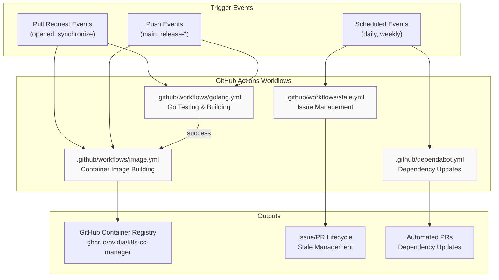
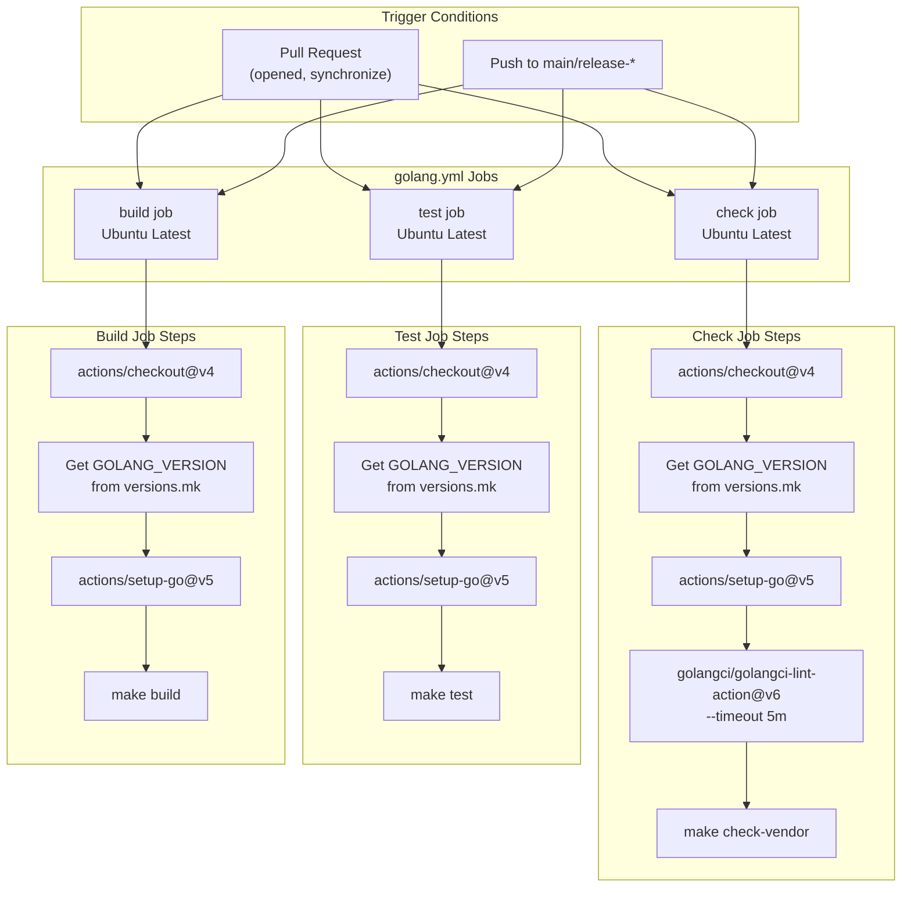
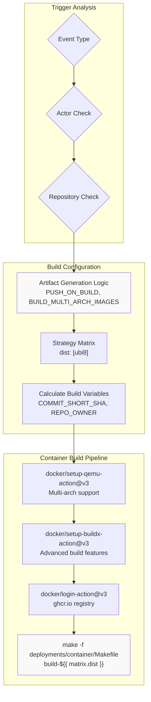
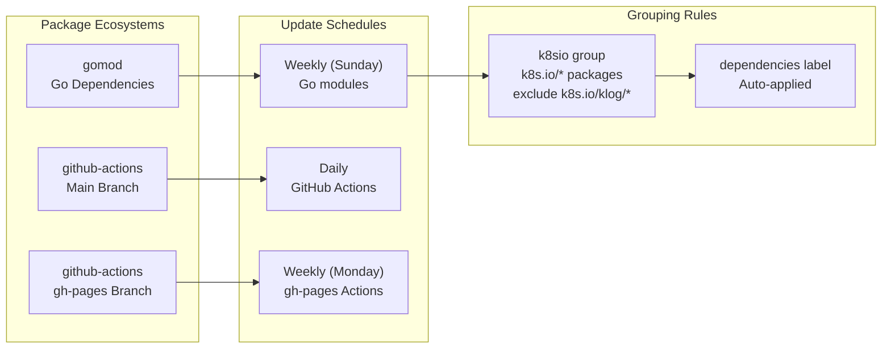
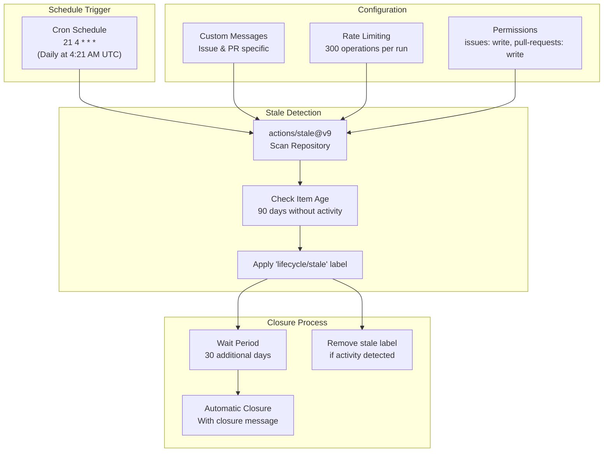

<!-- source: DeepWiki mcp.deepwiki.com · repo NVIDIA/k8s-cc-manager · page 5.1 GitHub Actions · fetched 2026-10-26 -->

# GitHub Actions

Relevant source files

The following files were used as context for generating this wiki page:

- [.github/dependabot.yml](.github/dependabot.yml)
- [.github/workflows/golang.yml](.github/workflows/golang.yml)
- [.github/workflows/image.yml](.github/workflows/image.yml)
- [.github/workflows/stale.yml](.github/workflows/stale.yml)

This page documents the GitHub Actions workflows that handle continuous integration, dependency management, and issue lifecycle management for the k8s-cc-manager repository. These workflows complement the GitLab CI pipeline (see [5.2](#5.2)) and NVIDIA internal CI (see [5.3](#5.3)) to provide a comprehensive CI/CD system.

The GitHub Actions workflows handle Go application testing and building, container image creation, automated dependency updates, and repository maintenance tasks. All workflows are configured to work with the main development branches and pull request lifecycle.

## Workflow Overview

The repository contains four primary GitHub Actions workflows that handle different aspects of the development lifecycle:

**Sources:** [.github/workflows/golang.yml:17-29](), [.github/workflows/image.yml:18-30](), [.github/workflows/stale.yml:3-6](), [.github/dependabot.yml:6-32]()

## Go Application Workflow (`golang.yml`)

The `golang.yml` workflow handles all Go-related testing, linting, and building operations. It consists of three parallel jobs that validate the Go codebase:

**Sources:** [.github/workflows/golang.yml:30-85]()

### Key Implementation Details

| Component | Configuration |
|-----------|---------------|
| **Go Version** | Extracted from `versions.mk` using `GOLANG_VERSION ?=` pattern |
| **Linting** | `golangci-lint-action@v6` with 5-minute timeout and verbose output |
| **Vendor Check** | Validates Go module consistency with `make check-vendor` |
| **Testing** | Executes unit tests via `make test` |
| **Building** | Builds application binary via `make build` |

The workflow extracts the Go version dynamically from [versions.mk:39-41]() to ensure consistency across all jobs. Each job runs independently on `ubuntu-latest` runners.

**Sources:** [.github/workflows/golang.yml:36-44](), [.github/workflows/golang.yml:45-52](), [.github/workflows/golang.yml:68-84]()

## Container Image Workflow (`image.yml`)

The `image.yml` workflow builds multi-architecture container images and pushes them to GitHub Container Registry. It includes sophisticated logic to determine when to generate artifacts:

**Sources:** [.github/workflows/image.yml:32-76]()

### Artifact Generation Logic

The workflow uses complex conditional logic to determine when to generate and push container artifacts:

| Condition | Generate Artifacts |
|-----------|-------------------|
| **Dependabot PRs** | `false` - Skip artifact generation for dependency updates |
| **Internal PRs** | `true` - Generate artifacts for PRs from the same repository |
| **External PRs** | `false` - Skip artifacts for external contributor PRs |
| **Push Events** | `true` - Always generate artifacts for direct pushes |

This logic is implemented in [.github/workflows/image.yml:49-58]() and controls both `PUSH_ON_BUILD` and `BUILD_MULTI_ARCH_IMAGES` environment variables.

### Container Registry Integration

The workflow authenticates to GitHub Container Registry using the built-in `GITHUB_TOKEN` and pushes images with the naming convention:

- **Registry**: `ghcr.io`
- **Image Name**: `ghcr.io/${LOWERCASE_REPO_OWNER}/k8s-cc-manager`
- **Version Tag**: `${COMMIT_SHORT_SHA}` (first 8 characters of commit hash)

**Sources:** [.github/workflows/image.yml:63-76]()

## Dependency Management (`dependabot.yml`)

The Dependabot configuration automates dependency updates across multiple package ecosystems:

**Sources:** [.github/dependabot.yml:1-32]()

### Dependency Grouping Strategy

Dependabot groups related Kubernetes dependencies to reduce PR volume:

| Group | Pattern | Exclusions |
|-------|---------|------------|
| **k8sio** | `k8s.io/*` | `k8s.io/klog/*` |

This grouping is defined in [.github/dependabot.yml:14-20]() and ensures that related Kubernetes client library updates are combined into single PRs rather than individual updates.

**Sources:** [.github/dependabot.yml:14-20]()

## Issue Lifecycle Management (`stale.yml`)

The stale workflow automatically manages the lifecycle of inactive issues and pull requests:

**Sources:** [.github/workflows/stale.yml:1-28]()

### Stale Management Configuration

| Parameter | Issues | Pull Requests |
|-----------|--------|---------------|
| **Days before stale** | 90 | 90 |
| **Days before close** | 30 | 30 |
| **Stale label** | `lifecycle/stale` | `lifecycle/stale` |
| **Operations per run** | 300 | 300 |
| **Remove when updated** | `true` | `true` |

The workflow includes specific messages for both issues and PRs defined in [.github/workflows/stale.yml:17-26](), informing users about the automatic lifecycle management process.

**Sources:** [.github/workflows/stale.yml:15-28]()

## Integration with Broader CI/CD System

The GitHub Actions workflows form the first stage of the multi-pipeline CI/CD system:

| Workflow | Purpose | Next Stage |
|----------|---------|------------|
| **golang.yml** | Code validation | Enables image.yml execution |
| **image.yml** | Development artifacts | Feeds into GitLab CI (see [5.2](#5.2)) |
| **stale.yml** | Repository maintenance | Independent operation |
| **dependabot.yml** | Dependency updates | Triggers golang.yml and image.yml |

The successful completion of `golang.yml` is a prerequisite for `image.yml` execution, ensuring that only validated code proceeds to container image building. The resulting images in GitHub Container Registry serve as input for the GitLab CI pipeline, which handles staging and production release processes.

**Sources:** [.github/workflows/golang.yml:30-85](), [.github/workflows/image.yml:18-76]()

---

