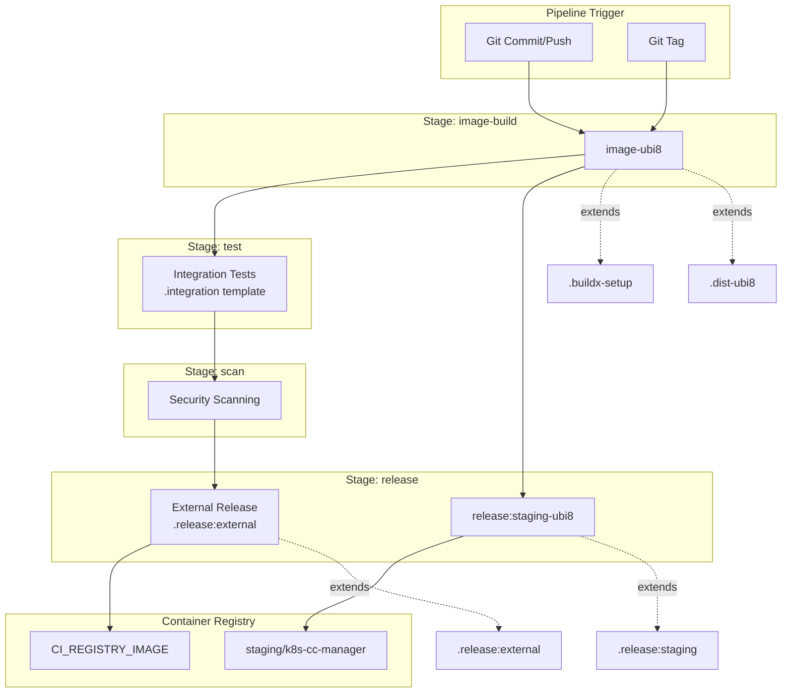
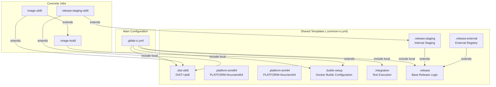
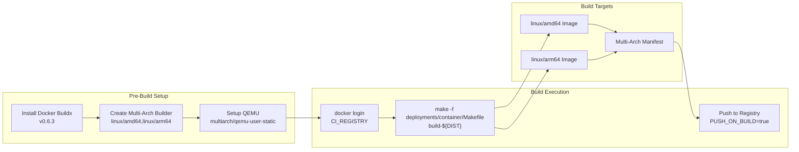
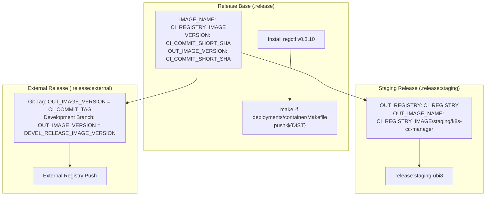

<!-- source: DeepWiki mcp.deepwiki.com · repo NVIDIA/k8s-cc-manager · page 5.2 GitLab CI · fetched 2026-10-26 -->

# GitLab CI

Relevant source files

The following files were used as context for generating this wiki page:

- [.common-ci.yml](.common-ci.yml)
- [.gitlab-ci.yml](.gitlab-ci.yml)

This document covers the GitLab CI pipeline configuration for the k8s-cc-manager project, focusing on container image builds with shared templates and multi-architecture support. For information about GitHub Actions workflows, see [GitHub Actions](#5.1). For information about NVIDIA's internal CI pipeline, see [NVIDIA Internal CI](#5.3).

## Pipeline Architecture

The GitLab CI system is structured around a multi-stage pipeline that builds, tests, and releases container images. The pipeline leverages shared configuration templates to maintain consistency across different build targets.

### Pipeline Stages and Job Flow

Sources: [.gitlab-ci.yml:24-31](), [.common-ci.yml:24-28](), [.common-ci.yml:140-146]()

## Shared Configuration Templates

The GitLab CI configuration uses a modular approach with shared templates defined in `.common-ci.yml`. The main pipeline configuration in `.gitlab-ci.yml` includes these shared templates and defines specific jobs.

### Template Structure

Sources: [.gitlab-ci.yml:15-16](), [.common-ci.yml:31-34](), [.common-ci.yml:37-43](), [.common-ci.yml:117-125]()

## Container Image Build Process

The image build process uses Docker Buildx for multi-architecture support and follows a standardized pattern defined in the shared templates.

### Build Job Configuration

The `image-ubi8` job demonstrates the typical build configuration:

| Configuration | Value | Source |
|---------------|-------|---------|
| Stage | `image-build` | [.common-ci.yml:25]() |
| Base Image | `docker:stable` | [.common-ci.yml:16]() |
| Service | `docker:stable-dind` | [.common-ci.yml:18-19]() |
| Distribution | `ubi8` | [.common-ci.yml:32-34]() |
| Multi-Arch | `BUILD_MULTI_ARCH_IMAGES: "true"` | [.common-ci.yml:22]() |

### Build Process Flow

Sources: [.common-ci.yml:46-56](), [.gitlab-ci.yml:25-31](), [.gitlab-ci.yml:33-36]()

## Multi-Architecture Support

The pipeline supports building images for multiple CPU architectures using Docker Buildx and QEMU emulation.

### Platform Configuration

The shared templates define platform-specific variables:

- `.platform-amd64`: Sets `PLATFORM: linux/amd64` [.common-ci.yml:37-39]()
- `.platform-arm64`: Sets `PLATFORM: linux/arm64` [.common-ci.yml:41-43]()

### Buildx Setup Process

The `.buildx-setup` template configures the multi-architecture build environment:

1. **Install Buildx**: Downloads Docker Buildx v0.6.3 [.common-ci.yml:48-52]()
2. **Create Builder**: Initializes buildx with both amd64 and arm64 platforms [.common-ci.yml:54]()
3. **QEMU Setup**: Configures QEMU for cross-platform emulation [.common-ci.yml:56]()

Sources: [.common-ci.yml:46-56]()

## Testing Integration

The pipeline includes automated testing through the `.integration` template, which runs container-based tests against built images.

### Test Configuration

| Setting | Value | Purpose |
|---------|--------|---------|
| Stage | `test` | [.common-ci.yml:60]() |
| Skip Conditions | Commit message contains `[skip tests]` | [.common-ci.yml:65-67]() |
| Test Command | `make -f deployments/container/Makefile test-${DIST}` | [.common-ci.yml:73]() |

### Test Execution Flow

The integration tests follow this pattern:
1. **Setup**: Install required tools (`make`, `bash`, `jq`) [.common-ci.yml:69]()
2. **Authentication**: Login to CI registry [.common-ci.yml:70]()
3. **Image Pull**: Download the built image [.common-ci.yml:71]()
4. **Test Execution**: Run distribution-specific tests [.common-ci.yml:73]()

Sources: [.common-ci.yml:59-73]()

## Release Pipeline

The release process supports both staging and external releases using the `regctl` tool for registry operations.

### Release Configurations

Sources: [.common-ci.yml:88-112](), [.common-ci.yml:117-138](), [.common-ci.yml:140-146]()

### Registry Operations

The release process uses `regctl` for advanced registry operations:
- **Multi-registry Support**: Handles different source and destination registries [.common-ci.yml:106-108]()
- **Authentication**: Supports separate credentials for different registries [.common-ci.yml:121-123]()
- **Image Copying**: Efficiently copies images between registries without re-uploading layers [.common-ci.yml:112]()

Sources: [.common-ci.yml:76-83](), [.common-ci.yml:105-112]()

## Configuration Variables

The pipeline uses several environment variables for configuration:

| Variable | Purpose | Default/Example |
|----------|---------|-----------------|
| `BUILD_MULTI_ARCH_IMAGES` | Enable multi-architecture builds | `"true"` |
| `CI_REGISTRY_IMAGE` | Base image name for builds | Set by GitLab |
| `CI_COMMIT_SHORT_SHA` | Version tag for images | Set by GitLab |
| `DIST` | Distribution target | `"ubi8"` |
| `CVE_UPDATES` | Security updates to apply | `"cyrus-sasl-lib"` |
| `PUSH_ON_BUILD` | Push images after build | `"true"` |

Sources: [.common-ci.yml:22](), [.common-ci.yml:32-34](), [.gitlab-ci.yml:22-24]()

---

