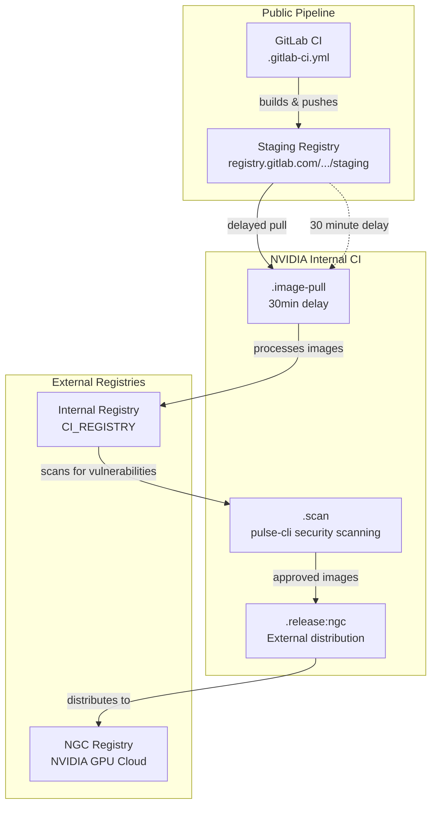
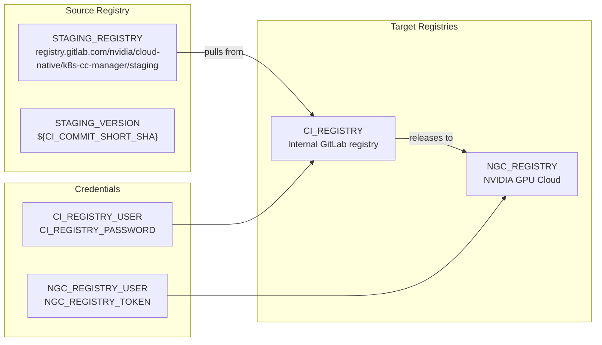
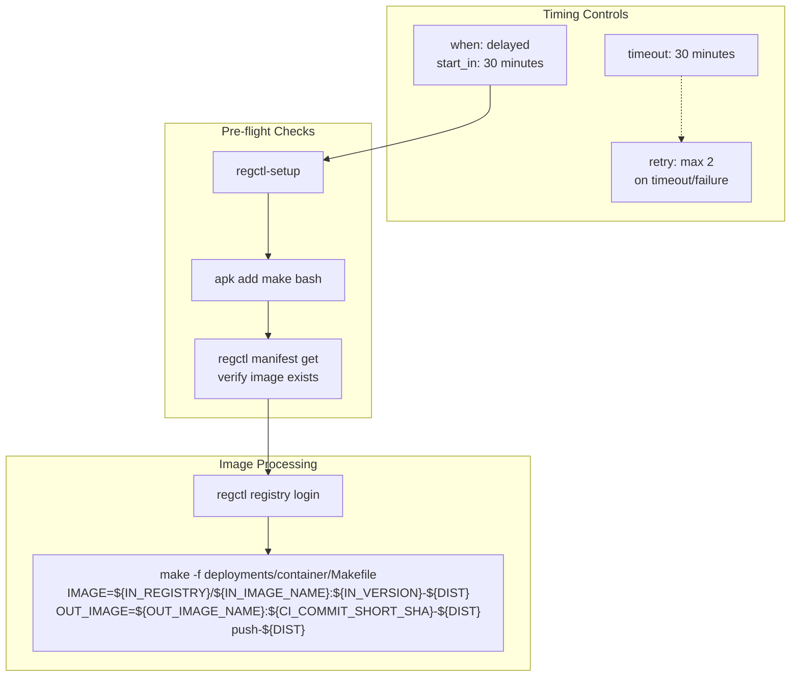
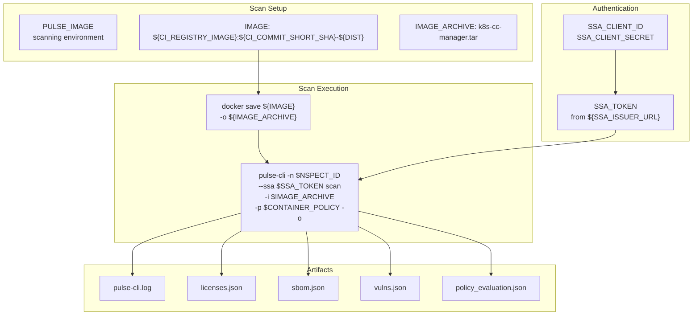
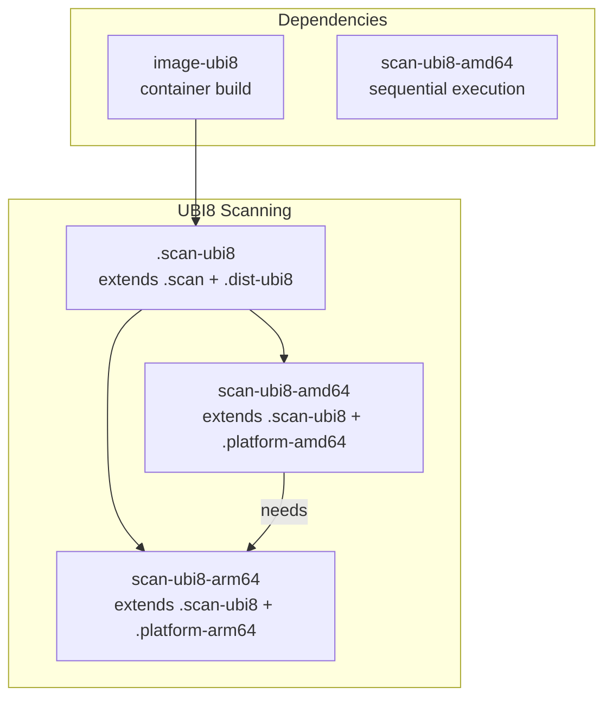
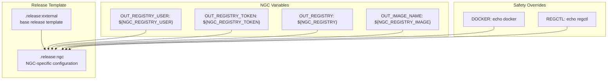
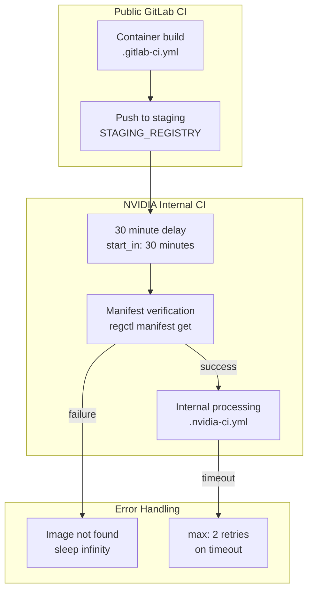

<!-- source: DeepWiki mcp.deepwiki.com · repo NVIDIA/k8s-cc-manager · page 5.3 NVIDIA Internal CI · fetched 2026-10-26 -->

# NVIDIA Internal CI

<details>
<summary>Relevant source files</summary>

The following files were used as context for generating this wiki page:

- [.nvidia-ci.yml](.nvidia-ci.yml)

</details>


This document covers the NVIDIA internal CI pipeline for the k8s-cc-manager project, which handles image processing, security scanning, and external release distribution. This system operates as the final stage in the multi-pipeline CI/CD architecture, processing container images built by the public GitLab CI pipeline.

For information about the public GitHub Actions workflows, see [GitHub Actions](#5.1). For details about the public GitLab CI pipeline that feeds into this system, see [GitLab CI](#5.2).

## Overview

The NVIDIA internal CI pipeline serves as a bridge between the public container image builds and NVIDIA's internal release processes. It pulls images from the public staging registry, performs comprehensive security scanning, and releases approved images to external registries like NVIDIA GPU Cloud (NGC).



**Pipeline Architecture**
Sources: [.nvidia-ci.yml:1-153]()

## Configuration and Setup

The pipeline configuration extends shared templates and defines NVIDIA-specific variables and credentials for internal operations.

### Base Configuration

The pipeline includes shared CI templates and sets up container-specific execution environments:

| Configuration | Value | Purpose |
|---------------|-------|---------|
| `include` | `.common-ci.yml` | Shared pipeline templates |
| `tags` | `cnt`, `container-dev`, `docker/multi-arch` | Execution environment requirements |
| `DOCKER_DRIVER` | `overlay2` | Docker storage driver |
| `SKIP_QEMU_SETUP` | `"1"` | Multi-arch builder optimization |

### Registry Configuration



**Registry Flow Configuration**
Sources: [.nvidia-ci.yml:35-37](), [.nvidia-ci.yml:140-143]()

## Image Pull Process

The `.image-pull` job template defines the core image processing workflow with built-in delays and retry logic.

### Pull Job Configuration

The image pull process includes several safety mechanisms:



**Image Pull Workflow**
Sources: [.nvidia-ci.yml:39-66]()

### Distribution Targets

The pipeline supports multiple distribution architectures through inheritance:

| Job | Extends | Platform | Purpose |
|-----|---------|----------|---------|
| `image-ubi8` | `.image-pull`, `.dist-ubi8` | Multi-arch | UBI8-based images |

Sources: [.nvidia-ci.yml:68-71]()

## Security Scanning

The `.scan` job template provides comprehensive security analysis using NVIDIA's internal scanning infrastructure.

### Scanning Infrastructure



**Security Scanning Process**
Sources: [.nvidia-ci.yml:83-111]()

### Scan Configuration

The scanning process includes skip conditions and platform-specific execution:

| Configuration | Value | Purpose |
|---------------|-------|---------|
| Skip conditions | `[skip scans]` in commit message | Allow bypassing scans |
| `SKIP_SCANS` | `"yes"` | Environment variable override |
| Artifact retention | `1 week` | Scan result storage |

### Multi-Architecture Scanning



**Multi-Architecture Scan Dependencies**
Sources: [.nvidia-ci.yml:114-134]()

## External Release Process

The `.release:ngc` template handles distribution to NVIDIA GPU Cloud and other external registries.

### Release Configuration



**NGC Release Configuration**
Sources: [.nvidia-ci.yml:137-145]()

### Release Targets

The pipeline defines specific release jobs for each supported distribution:

| Release Job | Extends | Target Registry | Purpose |
|-------------|---------|-----------------|---------|
| `release:ngc-ubi8` | `.release:ngc`, `.dist-ubi8` | NGC Registry | UBI8 image distribution |

Sources: [.nvidia-ci.yml:149-152]()

## Integration with Public Pipelines

The NVIDIA internal CI operates with specific timing and dependency relationships to the public CI systems.

### Pipeline Synchronization



**Public Pipeline Integration**
Sources: [.nvidia-ci.yml:50-52](), [.nvidia-ci.yml:54-58](), [.nvidia-ci.yml:63]()

## Testing Overrides

The internal CI pipeline includes specific overrides for integration testing to avoid conflicts with internal infrastructure.

### Integration Test Skip

The pipeline explicitly skips integration tests that are handled by the public CI systems:

```yaml
.integration:
  stage: test
  before_script:
    - echo "Skipped in internal CI"
  script:
    - echo "Skipped in internal CI"
```

This ensures that integration tests run only in the appropriate public environments while allowing the internal pipeline to focus on security scanning and release processes.

Sources: [.nvidia-ci.yml:73-79]()

---

