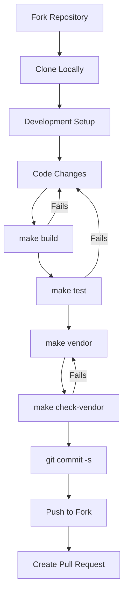
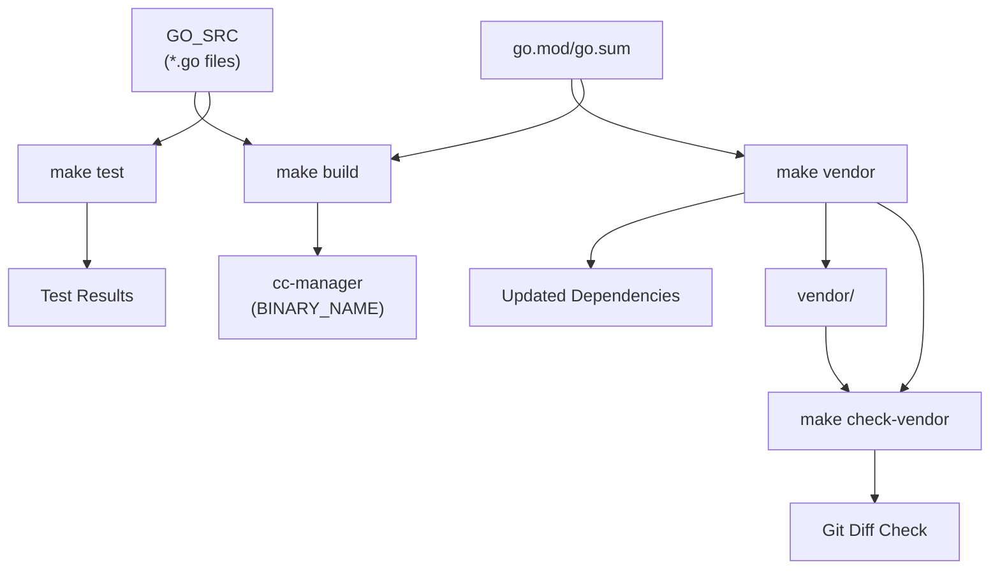
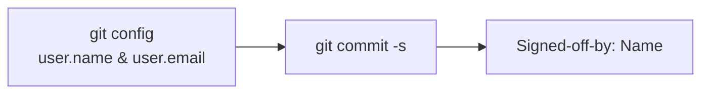

<!-- source: DeepWiki mcp.deepwiki.com · repo NVIDIA/k8s-cc-manager · page 6 Development · fetched 2026-10-26 -->

# Development

Relevant source files

The following files were used as context for generating this wiki page:

- [.gitignore](.gitignore)
- [CONTRIBUTING.md](CONTRIBUTING.md)
- [Makefile](Makefile)

This document provides developer-focused guidance for building, testing, and contributing to the NVIDIA k8s-cc-manager project. It covers the essential development workflow, build system, and project configuration needed to work with the codebase effectively.

For detailed information about the core application architecture, see [Core Application](#3). For container build processes, see [Container System](#4). For CI/CD pipeline details, see [CI/CD Pipelines](#5).

## Development Workflow Overview

The k8s-cc-manager project follows a standard open-source development workflow with specific requirements for contribution signing and code quality. The development process integrates Go-based build tools with Kubernetes-focused testing and validation.

### Development Process Flow

Sources: [CONTRIBUTING.md:1-61](), [Makefile:21-35]()

## Build System

The project uses a Go-based build system managed through a primary `Makefile` that provides standardized targets for compilation, testing, and dependency management. The build system generates the `cc-manager` binary which serves as the main application executable.

### Build Targets and Dependencies

Sources: [Makefile:15-35]()

### Core Build Variables

The build system uses several key variables that control the compilation process:

| Variable | Default Value | Purpose |
|----------|---------------|---------|
| `GO_CMD` | `go` | Go compiler command |
| `GO_FMT` | `gofmt` | Go formatter command |
| `GO_SRC` | `$(shell find . -type f -name '*.go' -not -path "./vendor/*")` | Source file discovery |
| `BINARY_NAME` | `cc-manager` | Output binary name |

Sources: [Makefile:15-19]()

## Build Targets

The `Makefile` provides four primary targets for development workflow:

### `make build`
Compiles the Go source code into the `cc-manager` binary using the `GO_CMD` variable. The build target processes all Go files discovered by the `GO_SRC` variable pattern.

### `make test`
Executes the Go test suite across all packages in the project using `go test ./...`.

### `make vendor`
Manages Go module dependencies through a three-step process:
1. `go mod tidy` - Clean up module dependencies
2. `go mod vendor` - Vendor dependencies to local directory
3. `go mod verify` - Verify dependency integrity

### `make check-vendor`
Validates that vendored dependencies are current by running `make vendor` and checking for git differences in `go.mod`, `go.sum`, and `vendor/` directory.

Sources: [Makefile:21-33]()

## Testing Strategy

The project implements Go's standard testing framework with tests distributed across packages. The testing approach focuses on unit tests for individual components and integration tests for Kubernetes interaction.

Testing is executed through the `make test` target which runs all tests in the project using the `go test ./...` command pattern.

Sources: [Makefile:24-25]()

## Contributing Requirements

### Developer Certificate of Origin (DCO)

All contributions must include a Developer Certificate of Origin sign-off. This requirement ensures proper licensing and contribution tracking for the open-source project.

The DCO process requires:
1. Each commit must include a `Signed-off-by` line
2. Use real name (no pseudonyms or anonymous contributions)
3. Sign-off certifies the contributor's right to submit the code

### Commit Signing Process

Contributors can automatically sign commits using `git commit -s` when `user.name` and `user.email` are properly configured in git.

Sources: [CONTRIBUTING.md:52-59]()

## Project Configuration

### Git Configuration

The project includes a `.gitignore` file that excludes the compiled `cc-manager` binary from version control, ensuring that build artifacts don't interfere with source code management.

Sources: [.gitignore:1-2]()

### Development Environment Setup

To set up a development environment:

1. **Prerequisites**: Go compiler (version specified in `go.mod`)
2. **Clone Repository**: Standard git clone operation
3. **Dependency Management**: Run `make vendor` to populate vendor directory
4. **Build Verification**: Run `make build` to compile the binary
5. **Test Execution**: Run `make test` to validate functionality

The development workflow supports the complete cycle from initial setup through testing and contribution submission, with each step validated through the Makefile targets.

Sources: [Makefile:21-35](), [CONTRIBUTING.md:1-61]()

---

