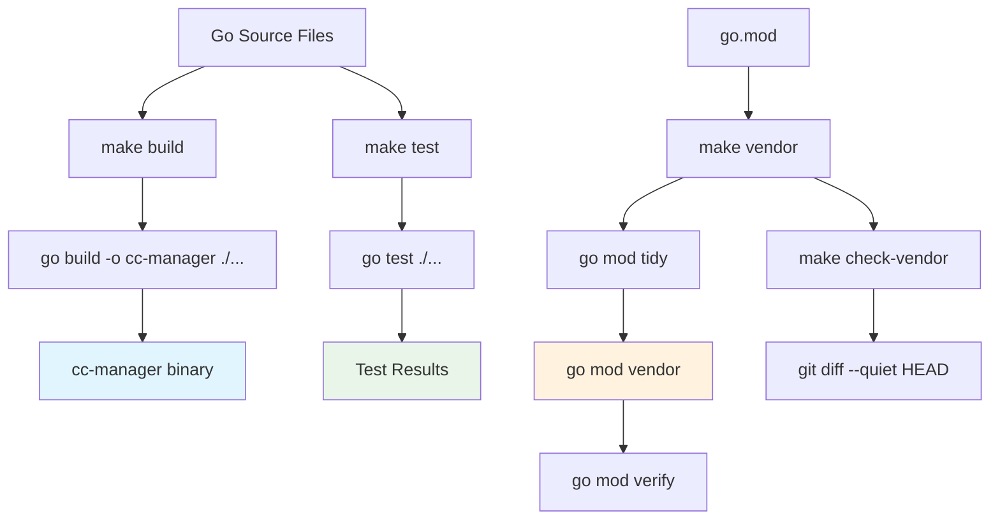
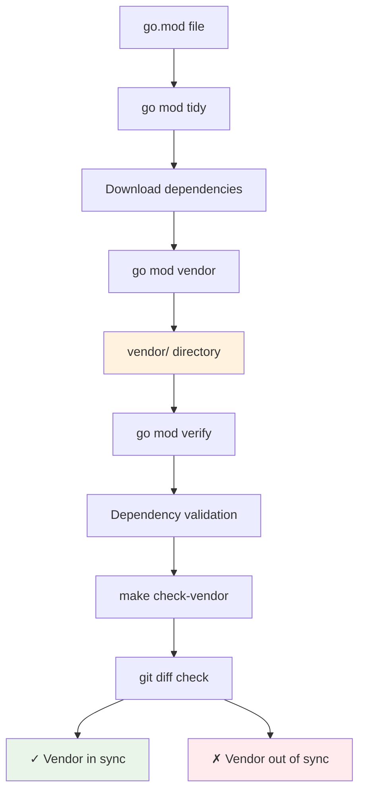
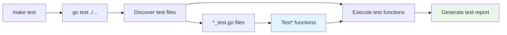

<!-- source: DeepWiki mcp.deepwiki.com · repo NVIDIA/k8s-cc-manager · page 6.1 Building and Testing · fetched 2026-10-26 -->

# Building and Testing

<details>
<summary>Relevant source files</summary>

The following files were used as context for generating this wiki page:

- [Makefile](Makefile)

</details>


This document covers the local development build system and testing procedures for the k8s-cc-manager project. It focuses on the main Makefile targets and Go-based build process that developers use for building and testing the application locally.

For container image building and CI/CD pipelines, see [Container System](#4) and [CI/CD Pipelines](#5). For contribution guidelines and development workflow, see [Contributing](#6.2).

## Build System Overview

The k8s-cc-manager project uses a straightforward Go-based build system orchestrated through a main Makefile. The build system produces a single binary called `cc-manager` that serves as the primary application executable.

### Build Process Flow



**Build Process Flow Diagram**

Sources: [Makefile:1-36]()

## Available Make Targets

The build system provides several key targets for different development tasks:

| Target | Purpose | Command Executed |
|--------|---------|------------------|
| `build` | Compile the Go application | `go build -o cc-manager ./...` |
| `test` | Run all Go tests | `go test ./...` |
| `vendor` | Update vendor dependencies | `go mod tidy && go mod vendor && go mod verify` |
| `check-vendor` | Verify vendor sync with git | `git diff --quiet HEAD -- go.mod go.sum vendor` |

### Build Target

The primary build target compiles the Go source code into the `cc-manager` binary:

```bash
make build
```

This target uses the `GO_CMD` variable (defaulting to `go`) and the `BINARY_NAME` variable (defaulting to `cc-manager`) as defined in [Makefile:15-19](). The build command processes all Go packages in the current directory tree using the `./...` pattern.

### Test Target  

The test target runs the complete test suite:

```bash
make test
```

This executes `go test ./...` to run all tests in the project and its subdirectories, as shown in [Makefile:24-25]().

Sources: [Makefile:21-25]()

## Dependency Management

The project uses Go modules with a vendored dependency approach for reproducible builds.

### Vendor Management Workflow



**Dependency Management Workflow**

### Vendor Target

The `vendor` target performs a complete dependency update cycle:

```bash
make vendor
```

This target executes three sequential commands as defined in [Makefile:27-30]():
1. `go mod tidy` - Clean up unused dependencies
2. `go mod vendor` - Populate vendor directory  
3. `go mod verify` - Validate dependency integrity

### Check-Vendor Target

The `check-vendor` target ensures the vendor directory remains synchronized with version control:

```bash
make check-vendor
```

This target first runs the `vendor` target, then verifies that no changes were made to `go.mod`, `go.sum`, or the `vendor` directory using `git diff --quiet HEAD` as shown in [Makefile:32-33]().

Sources: [Makefile:27-33]()

## Build Configuration

The Makefile provides several configuration variables that can be overridden:

| Variable | Default Value | Purpose |
|----------|---------------|---------|
| `GO_CMD` | `go` | Go command executable |
| `GO_FMT` | `gofmt` | Go formatter executable |
| `BINARY_NAME` | `cc-manager` | Output binary name |

### Source File Discovery

The build system automatically discovers Go source files using:

```makefile
GO_SRC := $(shell find . -type f -name '*.go' -not -path "./vendor/*")
```

This variable defined in [Makefile:17]() excludes vendored dependencies from source processing while including all other `.go` files in the project tree.

Sources: [Makefile:15-19]()

## Testing Framework

The project uses Go's built-in testing framework with the standard `go test` command. The test target runs all tests recursively across the entire project structure.

### Test Execution Flow



**Test Execution Flow**

The `./...` pattern in the test command ensures that all packages in the project tree are tested, including any subdirectories that contain Go test files.

Sources: [Makefile:24-25]()

## Development Workflow

A typical development workflow using the build system follows this pattern:

1. **Initial Setup**: Run `make vendor` to ensure dependencies are current
2. **Development Cycle**: 
   - Make code changes
   - Run `make test` to verify changes
   - Run `make build` to compile the binary
3. **Dependency Updates**: Run `make check-vendor` before committing to ensure vendor synchronization
4. **Final Validation**: Run all targets before submitting changes

The build system is designed to be simple and consistent, focusing on the core Go toolchain without additional complexity. All targets are marked as `.PHONY` in [Makefile:35]() to ensure they execute regardless of file timestamps.

Sources: [Makefile:1-36]()

---

