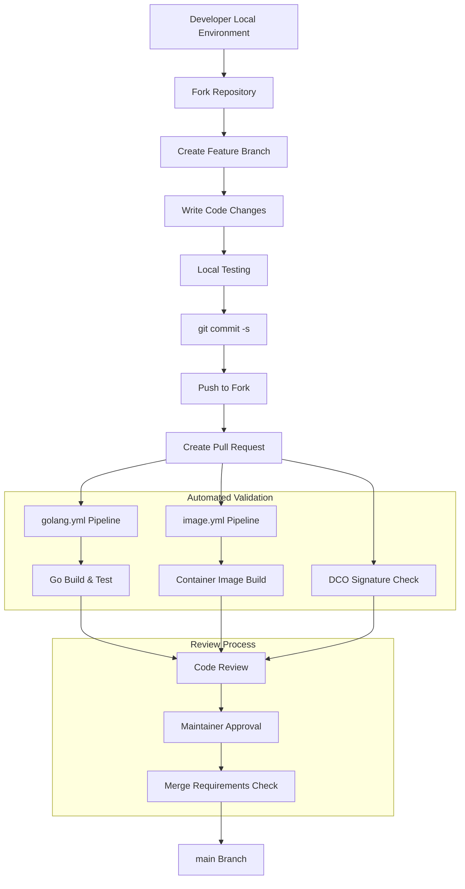
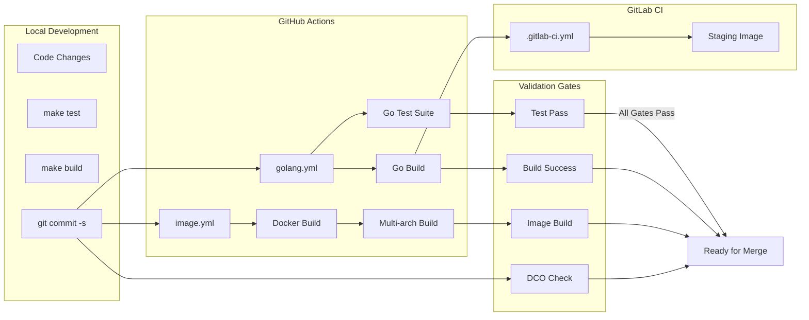

<!-- source: DeepWiki mcp.deepwiki.com · repo NVIDIA/k8s-cc-manager · page 6.2 Contributing · fetched 2026-10-26 -->

# Contributing

<details>
<summary>Relevant source files</summary>

The following files were used as context for generating this wiki page:

- [CONTRIBUTING.md](CONTRIBUTING.md)

</details>


This document covers the contribution guidelines and development workflow for the NVIDIA k8s-cc-manager project. It includes the Developer Certificate of Origin (DCO) requirements, code contribution process, and integration with the project's CI/CD systems.

For information about building and testing the project locally, see [Building and Testing](#6.1). For details about the CI/CD pipeline architecture, see [CI/CD Pipelines](#5).

## Developer Certificate of Origin (DCO)

The NVIDIA k8s-cc-manager project requires all contributors to sign their work using the Developer Certificate of Origin (DCO). This is a legal requirement that certifies you have the right to contribute your code to the project.

### DCO Requirements

All contributions must include a sign-off line in the git commit message that certifies your agreement to the Developer Certificate of Origin version 1.1. The DCO text is maintained in [CONTRIBUTING.md:13-50]() and covers four key certifications:

| Certification | Description |
|---------------|-------------|
| (a) Original Work | The contribution was created by you and you have the right to submit it |
| (b) Derivative Work | The contribution is based on previous open source work that you have the right to modify |
| (c) Third-party Work | The contribution was provided by someone else who certified (a), (b), or (c) |
| (d) Public Record | You understand the contribution and your information will be maintained indefinitely |

### Signing Your Commits

Add the following line to every git commit message as specified in [CONTRIBUTING.md:52-54]():

```
Signed-off-by: Your Name <your.email@example.com>
```

**Important Requirements:**
- Use your real name (no pseudonyms or anonymous contributions) as stated in [CONTRIBUTING.md:56]()
- Configure your git settings: `user.name` and `user.email`
- Use `git commit -s` to automatically add the sign-off line as described in [CONTRIBUTING.md:58-59]()

Sources: [CONTRIBUTING.md:1-61]()

## Contribution Workflow

The following diagram shows the complete contribution workflow from local development through CI/CD validation to final merge:

**Contribution Process Flow**



Sources: [CONTRIBUTING.md:1-61](), [.github/workflows/golang.yml](), [.github/workflows/image.yml]()

## Development Environment Setup

### Prerequisites

Before contributing, ensure your development environment includes:

- Go development tools (see [Building and Testing](#6.1))
- Docker for container builds
- `kubectl` for Kubernetes integration testing
- Git with proper user configuration

### Repository Setup

1. **Fork the Repository**: Create a fork of `NVIDIA/k8s-cc-manager`
2. **Clone Your Fork**: `git clone https://github.com/yourname/k8s-cc-manager.git`
3. **Configure Git**: Set up your name and email for DCO compliance
4. **Add Upstream Remote**: `git remote add upstream https://github.com/NVIDIA/k8s-cc-manager.git`

### Branch Management

Create feature branches from the latest `main` branch:

```bash
git checkout main
git pull upstream main
git checkout -b feature/your-feature-name
```

Sources: [CONTRIBUTING.md:1-61]()

## Code Standards and Validation

### CI/CD Integration

All contributions are automatically validated through multiple CI/CD pipelines. The following diagram shows how local contributions integrate with the automated validation systems:

**CI/CD Validation Pipeline**



### Required Validations

All pull requests must pass the following automated checks:

| Check Type | Pipeline | Description |
|------------|----------|-------------|
| DCO Signature | GitHub | Every commit must be signed off |
| Go Build | `golang.yml` | Code must compile successfully |
| Go Tests | `golang.yml` | All tests must pass |
| Container Build | `image.yml` | Docker images must build for all architectures |
| Staging Image | GitLab CI | Images must build in staging environment |

Sources: [.github/workflows/golang.yml](), [.github/workflows/image.yml](), [.gitlab-ci.yml]()

## Testing Requirements

### Local Testing

Before submitting a pull request, run the full test suite locally:

```bash
# Run Go tests
make test

# Build the application
make build

# Build container images
make docker-build
```

### Integration Testing

For changes that affect Kubernetes integration or GPU management:

1. **Test with Local Cluster**: Verify functionality with a local Kubernetes cluster
2. **Test GPU Operations**: If available, test with actual NVIDIA GPUs
3. **Validate CC Mode Changes**: Ensure confidential computing mode transitions work correctly

### Test Coverage

Maintain or improve test coverage for:
- Core Go application logic in `main.go`
- Shell script functionality in `cc-manager.sh`
- Kubernetes API interactions
- Error handling and edge cases

Sources: [Makefile](), [main.go](), [cc-manager.sh]()

## Pull Request Process

### Creating Pull Requests

1. **Descriptive Title**: Use clear, concise titles that describe the change
2. **Detailed Description**: Explain the problem being solved and the approach taken
3. **Link Issues**: Reference any related issues using GitHub linking syntax
4. **Test Information**: Describe testing performed and any special test requirements

### Review Process

The maintainer review process includes:

- **Code Quality Review**: Code style, structure, and best practices
- **Functionality Review**: Correctness and completeness of the implementation
- **Security Review**: Security implications, especially for GPU and container operations
- **Documentation Review**: Updates to documentation and comments

### Merge Requirements

Pull requests require:

- All CI/CD checks passing
- At least one maintainer approval
- DCO sign-off on all commits
- Conflicts resolved with main branch
- Documentation updates (if applicable)

Sources: [CONTRIBUTING.md:1-61]()

## Dependency Management

### Updating Dependencies

When adding or updating Go dependencies:

1. **Use Go Modules**: Add dependencies via `go get`
2. **Check for Vulnerabilities**: Ensure new dependencies don't introduce security issues
3. **Update Documentation**: Document new dependencies if they affect deployment or usage
4. **Test Thoroughly**: Verify that dependency changes don't break existing functionality

### Dependabot Integration

The project uses Dependabot for automatic dependency updates as configured in [.github/dependabot.yml](). Contributors should:

- Review Dependabot PRs promptly
- Test dependency updates thoroughly
- Resolve any conflicts or breaking changes

Sources: [go.mod](), [.github/dependabot.yml]()

---

