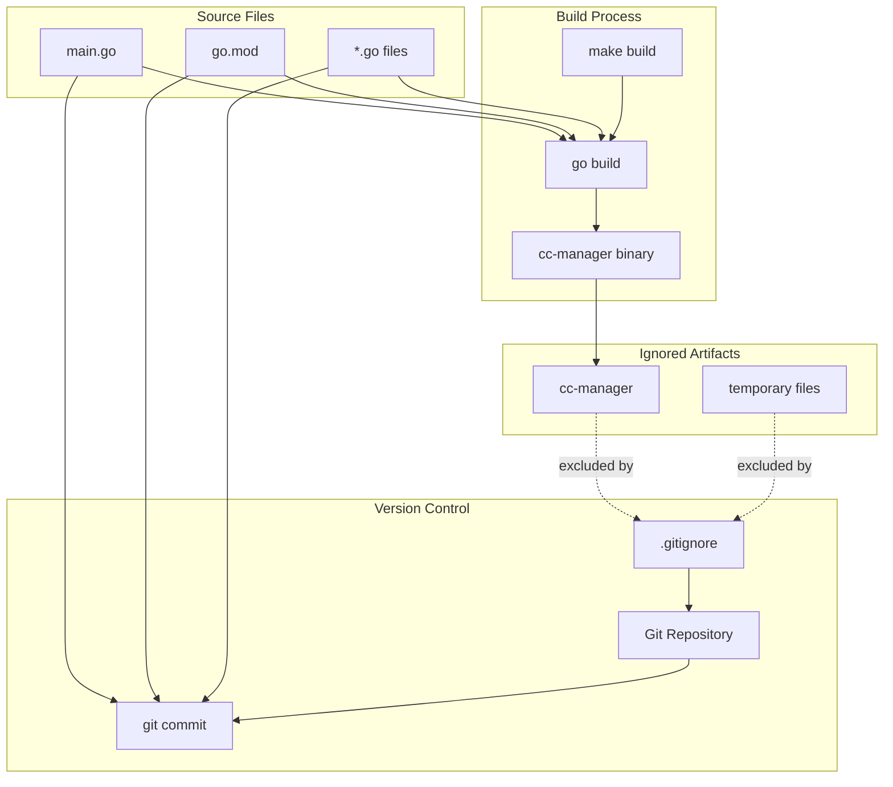
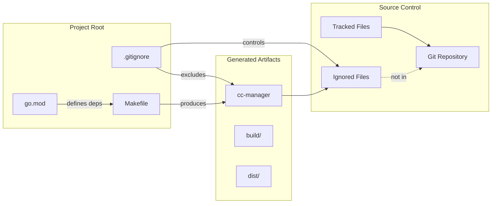

<!-- source: DeepWiki mcp.deepwiki.com · repo NVIDIA/k8s-cc-manager · page 6.3 Project Configuration · fetched 2026-10-26 -->

# Project Configuration

<details>
<summary>Relevant source files</summary>

The following files were used as context for generating this wiki page:

- [.gitignore](.gitignore)

</details>


This document covers the project configuration files that control development environment behavior, version control, and local development settings. These configuration files help maintain consistency across development environments and ensure proper handling of generated artifacts.

For information about CI/CD pipeline configuration, see [CI/CD Pipelines](#5). For build system configuration including Makefiles, see [Building and Testing](#6.1).

## Overview

The k8s-cc-manager project uses several configuration files to manage the development environment and control which files are tracked in version control. These configurations ensure that generated binaries, temporary files, and environment-specific artifacts are properly handled during development.

## Git Configuration

### .gitignore File

The project uses a minimal `.gitignore` file to exclude generated artifacts from version control. The current configuration excludes the compiled Go binary from being tracked.

| File Pattern | Purpose |
|-------------|---------|
| `cc-manager` | Compiled Go binary executable |

The `.gitignore` configuration prevents the locally compiled `cc-manager` binary from being accidentally committed to the repository. This is the primary executable that gets built from the Go source code in `main.go`.

**Configuration Details:**

```
cc-manager

```

This simple configuration ensures that when developers build the project locally using the Makefile targets, the resulting binary file is not tracked in Git. The binary is built during the container image creation process and should not be part of the source code repository.

Sources: [.gitignore:1-2]()

## Development Configuration Flow

The following diagram shows how project configuration files interact with the development workflow:



Sources: [.gitignore:1-2]()

## Configuration File Relationships

The project configuration files work together to maintain a clean development environment:



Sources: [.gitignore:1-2]()

## File Management Strategy

The project uses a focused approach to file management:

1. **Source Code Tracking**: All Go source files, module definitions, and build configurations are tracked in Git
2. **Binary Exclusion**: Compiled executables are excluded from version control to prevent binary bloat
3. **Clean Builds**: The build process can regenerate binaries from source, making version control of binaries unnecessary

The `cc-manager` binary exclusion is particularly important because:
- The binary is architecture-specific and may not run on all development machines
- Container builds create their own binaries during the image build process
- Local development binaries are only needed for testing and debugging

Sources: [.gitignore:1-2]()

---

