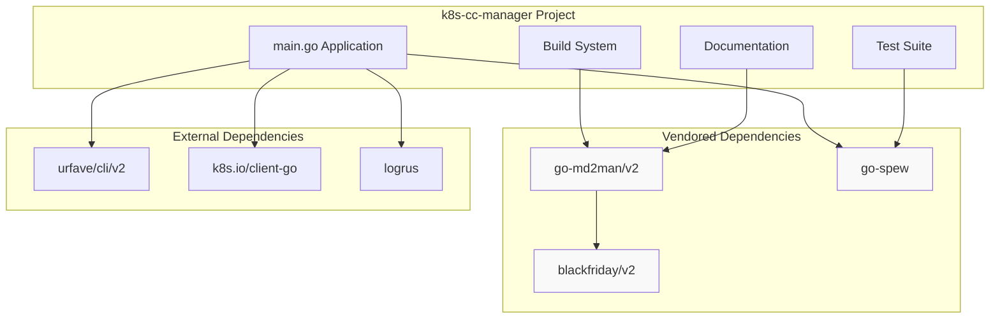
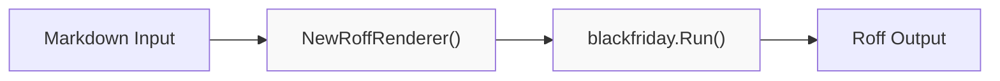
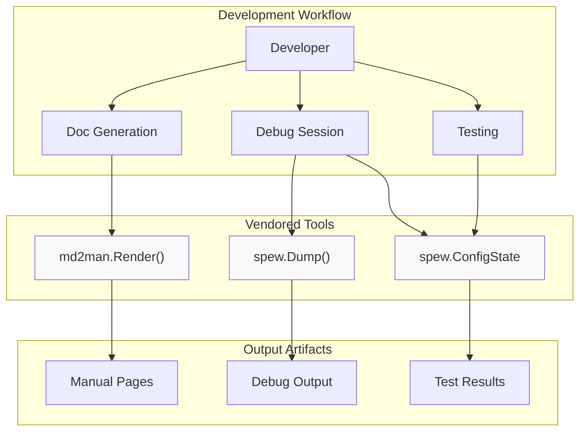

<!-- source: DeepWiki mcp.deepwiki.com · repo NVIDIA/k8s-cc-manager · page 7 Reference · fetched 2026-10-26 -->

# Reference

<details>
<summary>Relevant source files</summary>

The following files were used as context for generating this wiki page:

- [vendor/github.com/cpuguy83/go-md2man/v2/LICENSE.md](vendor/github.com/cpuguy83/go-md2man/v2/LICENSE.md)
- [vendor/github.com/cpuguy83/go-md2man/v2/md2man/md2man.go](vendor/github.com/cpuguy83/go-md2man/v2/md2man/md2man.go)
- [vendor/github.com/davecgh/go-spew/spew/config.go](vendor/github.com/davecgh/go-spew/spew/config.go)

</details>


This page provides reference documentation for vendored dependencies and supporting libraries used by the NVIDIA k8s-cc-manager project. These components provide essential functionality for documentation generation, debugging, and development workflows. For information about the core application dependencies, see [Dependencies](#3.3). For build system documentation, see [Build System](#4.2).

## Overview

The k8s-cc-manager project includes several vendored dependencies that support development and documentation workflows. These libraries are embedded directly in the repository under the `vendor/` directory to ensure reproducible builds and version consistency.

The primary vendored dependencies serve the following purposes:

| Library | Purpose | Usage Context |
|---------|---------|---------------|
| `go-md2man` | Markdown to manual page conversion | Documentation generation |
| `go-spew` | Advanced data structure formatting | Debug output and testing |

## Vendored Dependencies Architecture



**Sources:** [vendor/github.com/cpuguy83/go-md2man/v2/md2man/md2man.go:1-15](), [vendor/github.com/davecgh/go-spew/spew/config.go:1-307]()

## go-md2man Documentation Generator

The `go-md2man` library provides functionality to convert Markdown documents into Unix manual pages (roff format). This is essential for generating proper manual pages from Markdown documentation.

### Core Functionality

The main entry point is the `Render` function which orchestrates the conversion process:



The `Render` function in [vendor/github.com/cpuguy83/go-md2man/v2/md2man/md2man.go:8-14]() creates a roff renderer and processes markdown content using the blackfriday parser with specific extensions enabled.

**Sources:** [vendor/github.com/cpuguy83/go-md2man/v2/md2man/md2man.go:8-14](), [vendor/github.com/cpuguy83/go-md2man/v2/LICENSE.md:1-22]()

## go-spew Debug Formatter

The `go-spew` library provides advanced formatting capabilities for Go data structures, particularly useful for debugging and testing scenarios. It offers more detailed output than the standard `fmt` package.

### ConfigState System

The core of go-spew is the `ConfigState` struct which controls formatting behavior:

```mermaid
graph TD
    CONFIG["ConfigState"]
    
    subgraph "Configuration Options"
        INDENT["Indent string"]
        MAXDEPTH["MaxDepth int"]
        DISMETHODS["DisableMethods bool"]
        DISPOINTER["DisablePointerMethods bool"]
        DISADDR["DisablePointerAddresses bool"]
        DISCAP["DisableCapacities bool"]
        CONTINUE["ContinueOnMethod bool"]
        SORT["SortKeys bool"]
        SPEWKEYS["SpewKeys bool"]
    end
    
    subgraph "Output Methods"
        DUMP["Dump()"]
        FDUMP["Fdump()"]
        SDUMP["Sdump()"]
        FORMATTER["NewFormatter()"]
    end
    
    CONFIG --> INDENT
    CONFIG --> MAXDEPTH
    CONFIG --> DISMETHODS
    CONFIG --> DISPOINTER
    CONFIG --> DISADDR
    CONFIG --> DISCAP
    CONFIG --> CONTINUE
    CONFIG --> SORT
    CONFIG --> SPEWKEYS
    
    CONFIG --> DUMP
    CONFIG --> FDUMP
    CONFIG --> SDUMP
    CONFIG --> FORMATTER
```



### Key Configuration Parameters

The `ConfigState` struct in [vendor/github.com/davecgh/go-spew/spew/config.go:37-101]() defines several important configuration options:

- `Indent`: Specifies indentation string for nested structures
- `MaxDepth`: Controls maximum recursion depth (0 = unlimited)
- `DisableMethods`: Controls whether to invoke `error` and `Stringer` interfaces
- `DisablePointerAddresses`: Useful for deterministic testing output
- `SortKeys`: Enables deterministic map key ordering for consistent output

### Global Configuration

A global configuration instance is available at [vendor/github.com/davecgh/go-spew/spew/config.go:105]():

```go
var Config = ConfigState{Indent: " "}
```

**Sources:** [vendor/github.com/davecgh/go-spew/spew/config.go:37-101](), [vendor/github.com/davecgh/go-spew/spew/config.go:105](), [vendor/github.com/davecgh/go-spew/spew/config.go:273-283]()

## Integration with Build System

These vendored dependencies integrate with the broader k8s-cc-manager build and development workflow:



The vendored dependencies are integrated into the project's development lifecycle through:

1. **Documentation Generation**: `go-md2man` converts Markdown files to manual pages during the build process
2. **Debug Output**: `go-spew` provides detailed data structure dumps for troubleshooting
3. **Testing**: `go-spew` ensures consistent, deterministic output formatting for test comparisons

**Sources:** [vendor/github.com/cpuguy83/go-md2man/v2/md2man/md2man.go:8-14](), [vendor/github.com/davecgh/go-spew/spew/config.go:273-283](), [vendor/github.com/davecgh/go-spew/spew/config.go:105]()

## License Information

Both vendored dependencies use permissive open-source licenses:

- **go-md2man**: MIT License (Copyright 2014 Brian Goff)
- **go-spew**: ISC License (Copyright 2013-2016 Dave Collins)

The complete license texts are available in their respective vendor directories.

**Sources:** [vendor/github.com/cpuguy83/go-md2man/v2/LICENSE.md:1-22](), [vendor/github.com/davecgh/go-spew/spew/config.go:1-15]()

---

